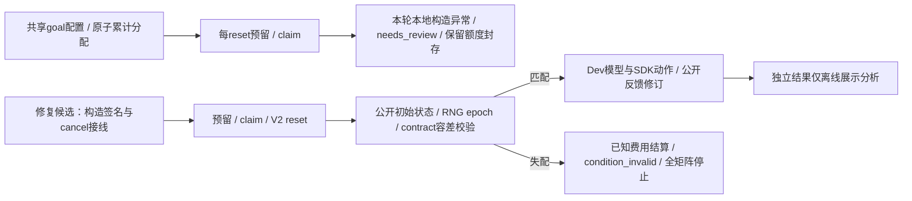
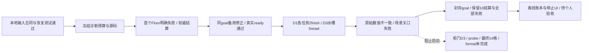

<!-- collab-repro-20261101 -->
## 11-01：协作者可复现，L2 达成（干净 GPU 容器里装环境并完成一次真实 agent 运行；工程验收，非正式实验）

**口径**：L2 是过程检查，不是方案的完成标准（完成标准是 L3：一位协作者在自己的机器和 GPU 上重复 L2）。所有结果都是开发档（`formal_eligible=false`）。协作者机器的规划器只走本机 dev 档信任，正式档仍只认仓库里的 `trusted_deployments.json`。

- **已合入的阶段**：
  - P2 路径可配置：`paths.json` + `workspace_paths`，加机器路径守卫测试（`7be8e2a`）。
  - P3 缺失文件入库：OpenArm 网格、相对模型路径、seed/launch 配置、`init_store`（`329af16`）。
  - P4 安装器：`attentionbench.lock.json`，以及 bootstrap/doctor/start/stop（`228c7d5`）。
  - P5 本机 dev 档规划器信任（`406739a`）。
  - 规划器链构建器（`382481e`、`1dfe304`）。
  - L2 中发现问题的修复（`39d750b`…`615edc9`）。
- **L2 过程中又补的三处**：
  - W6：Memory 注册根、契约根移出仓库、`--dev-v2-per-run-budget`，文档要求登录后先做一次 Codex 调用，否则额度读不到。
  - P4d（`4046623`）：可移植链补上作者 d02–d04 适配层（底盘碰撞体与 `native_chassis`、`ik_native_limits.yml`、GPU 活动探针；探针在本机编译）。
  - P4e/P4f（`9670474`、`38e359a`、`3dec516`）：本机登记的 dev-local 快照带上路径解析模块和 10 个官方清单。服务子进程因此能找到本机登记；缺 `ATTENTIONBENCH_WORKSPACE` 时明确报错，不再静默退回作者路径。
  - 以上都没有改 `identity.py` 和 `trusted_deployments.json`。作者 98 份 dev-local 锁用新旧代码加载，结果逐条一致。
- **L2 证据**：
  - 干净镜像 bootstrap、doctor 39 项通过、服务启动、seed 101 场景指纹与登记一致。
  - 真实 agent 运行 `devexp-7e6b133d1bb0e7b784f47a29`（OpenArm365，`pick_place_counter_to_sink` seed 101，Dev/Eval/Advisor 都是 `gpt-6.1-sol`）：探针正常，3 次移动执行，产出 v1。Eval 判失败：第二次下探在确认双指夹持前碰到杯子，被规则拒绝（`PlanningRejected`）。到时外部取消。
  - 报告在作者工作区 `diagnostics/collab-repro/l2/REPORT-L2.md`。
- **后续问题**：`stop.sh` 不停已脱离的 Dev v2 worker；`control.py` 没有测试。
- **未做**：L3（协作者在自己机器上重复）；P6 状态快照（B 档，要用户选带哪些运行）；L2 测试目录清理（等用户确认）。
<!-- /collab-repro-20261101 -->

<!-- summary-20261022-31 -->
## 10-22 至 10-31 汇总：agent 模式、Memory M-6～M-11、dev-local 规划器（工程通过，非正式验收）

**口径**：本段是 10-22 以后各条线的索引，按合并提交列出；细节在各提交信息和作者工作区的方案/报告里。所有结果均为开发档（dev tier，`formal_eligible=false`）。10-21 以后本文件和 `docs/attentionbench_progress.md` 未逐日更新，本段补齐。

- **运行控制（10-22）**：Dev 输入上限 150000 字节（`474b90c`）；cuRobo 单次规划上限 8 s→180 s（`4710650`）；完成但未解决的 attempt 不再算成功（`215221c`）；明暗主题、封面页（`6446321`、`f8605fc`）。
- **Memory**：所有策略读 Memory、临时提案与离线自动导入（`07d71c5`）；所有模式接入 Memory（`0eaeabb`）；run notes M-6（`2aabacc`）；run⊂scene⊂task⊂family 分层 M-7（`9b5a811`）；自动验证 M-8（`de709e6`）；跨 seed 验证 worker M-10（`3344c6f`，10-27 收尾 `d64f8e4`）；第二个抓放任务与家族信任 M-11（`1de875c`、`98f4d94`）。M-10 正向对照为 would_fail，没有跨 seed 生效的证据。
- **场景与规划器**：放宽抓取设置（`0232c43`）；r3/r4 执行设置作为冻结的 dev 配置块（`7de13c8`、`1b74aae`、`e62021f`）；dev-local 规划器：在 deployment-06 之上做内容寻址快照，只用于开发档（`b553472`）。
- **其他运行能力**：从任一 attempt 继续/fork（`11866b7`）；统一外壳与状态词汇（`d29647f`、`a3e1791`）。
- **agent 模式（10-28～10-31）**：Dev agent 在 bwrap 沙箱中工作（`b0b3b4e`、`31fd2a5`、`bfd1e3c`、`bc523bb`）；Codex CLI 固定 0.165.0、Dev/Eval 默认 `gpt-6.1-sol`（`83c0d85`）；帧去重与低磁盘暂停（`dc11d35`、`6b5f4cb`）；agent-policy v2 与 agent Memory 阶段 1–4（`89d9875`、`0cd33a4`、`09300cf`、`e1bf9fd`）；周额度读数修正（`7cac54b`）。10-30 一次真实 agent 运行原生成功（0 次求助）。10-31 阶段 5 端到端运行 `devexp-dc15f5ae…` 被操作者取消。
- **未做**：七方法比较、held-out、正式实验；agent 模式下"强制求助"只有离线证明；在作者以外的机器上运行（见下条）。
- **协作者可复现（10-31 开始，11-01 进展见上一段）**：分支已推到 GitHub；方案 `PLAN-collaborator-reproducible-20261031` 与验收包 `ACCEPT-collaborator-reproducible-20261031`（作者工作区 `docs/`）。P1：修 README/项目指南死链（指向已删分支 `feature/attention-native-robosuite`）并更新内容。
<!-- /summary-20261022-31 -->

<!-- memory-monitor-20261021 -->
## 10-20/21：Dev 流式调用、Codex 订阅来源、Memory 监看页（工程通过 + 真实页面核对，非正式验收）

**状态口径**：以下"真实页面核对"指在 8769 上用 Chromium（Playwright，WebGL 走 SwiftShader）打开页面并看截图；Memory 监看页只读，不改变任何 Dev/Eval/Advisor 的正式通道、预算、审批或场景合约。

- **流式 Dev 模型调用**（`1697849`）：真实 seed-102 运行在第 3 版被网关在约 301 秒处返回空响应截断（非流式 `urlopen`），360 秒的 Dev 截止时间因此不可达。`dev_provider_worker` 改为流式（SSE，`ParccClient(stream=True)`，默认关闭，其他调用方不变）；首字节等待与总截止都用整个剩余时间；用量缺失仍按错误处理、不编造。真实验证：同一场景 5 个 Dev 版本全部跑完（最长一次 3388 token、104 秒）。注意 GLM 速度随负载剧烈波动（约 6–34 token/s）。
- **Codex 订阅来源**（`72b2913`）：运行配置新增"Model source"（默认 PARCC；Codex 时 Dev、Eval、AdvisorProxy 固定 `gpt-6-astra`、`high`）；只允许开发档，正式档与 legacy 拒绝；`codex exec --json --ephemeral -s read-only` 在空临时目录运行，环境不含任何 LiteLLM/PARCC/Memory 密钥；用量按 Codex 返回记录（输入 token 含 Codex 自带系统提示，不与 PARCC 可比）；额度读取器读 `~/.codex/sessions` 的 `rate_limits`（每周窗口）。**未做**：真实 Codex 来源的 seed-102 冒烟运行、界面里的额度提示。
- **Memory 服务**（`26dbe2b`）：笔记新增可选 `summary`（≤80 字符）与 `group`（≤24 字符）；与 `title` 同一严格度，缺省读作 null，旧指纹不变；服务测试 166 项通过。
- **Memory 监看页**（`/ui/memory.html#exp=<id>`，只读路由 `GET /api/dev-v2/memory-monitor`）：3D 地球 + 2D 流向图两种视图，版本筛选，点球出卡片，管理操作（关闭/恢复/过期/撤回，确认与不可逆提示不变）从主页面搬到这里；浅色（默认，与主页面一致）和深色两套主题，选择记在 localStorage；`#demo=40|150|400` 演示模式用示例数据。主页面不再显示任何 Memory 记录，标题栏只有一个"Memory"按钮和徽标。
- **数据来源与诚实口径**：读取次数/最近使用来自实验账本，不调用 importer 专用接口（8769 只持有在线密钥）；效果标签只在服务端已有完成的验证结论时才是 Helps/Does not help，测试笔记和未验证笔记一律 Not tested（成对验证仍属 B 阶段，未做）。每个 Dev 版本的状态（passed/failed/finished）取自主页面同一证据，不把"执行完成"当通过。
- **真实核对中发现并修复**：路由 502（importer-only 调用）、3D 里 `color` 变量遮蔽造成整页崩溃（现有假 THREE 测试覆盖）、演示模式不推进、2D 与设计稿不符、版本状态误显 Passed。
- **未做/未验证**：真实运行中"新读取时闪烁"的实时行为只用演示模式和单元测试验证，未在运行中的真实实验上观察；移动端布局未逐项核对；`group`/`summary` 在真实数据里目前只有测试笔记。
<!-- /memory-monitor-20261021 -->

<!-- ui-run-evidence-20261019 -->
## 10-18/19：8769 界面真实运行打通；场景合约重登记；Eval/Advisor 重构（工程通过 + 真实运行，非正式验收）

**状态口径**：以下"真实运行"指在 8769 上由界面点击启动、用免费模型（parcc/GLM、parcc/Qwen）跑完的 seed 102、`pick_place_counter_to_sink` 开发运行；它证明"链路能跑"，没有任何原生成功（5 版本全部失败，原因是规划器超时/被拒/关节超限），不是能力结论，也不是正式实验（`formal_eligible=false`）。

- **Start run 可用**：此前 daily 后端的 worker 在调度预检 `KeyError: 'model_reserve_seconds'` 即崩溃（`40fe690`，`dev_experiment.slot_wall_seconds`）。
- **daily 对比模式之前不复现场景（已修）**：legacy 配置路径不带 `scene_reset_seed`/`scene_contract`，同一 seed 的物体在水槽两侧随机落位，合约也不校验（`b54d3af`）。新建的 experiment 模式 manifest 现在每个 config 带两者；interactive/diagnostic 与旧 manifest 字节不变。
- **场景合约过期并已重登记**：合约建于控制增益 300，默认增益 10-17 改为 1500 后真实运行第一次对不上（归一化哈希不同，物体位姿 ~1e-5 差）。在 1500 下对 101–103 × 两个任务各 20 个新进程重采集（每组指纹唯一），新文件 `openarm365_dev_v2/scene_contracts/dev-seeds-101-103-v2-20261019-kp1500.json`，sha256 `bb28cd3e…c716`，`scene_contract.REGISTERED_SHA256` 已更新；旧合约文件保留（旧 manifest 仍可加载）。**以后改控制默认值/机器人模型须重验合约。**
- **Run configuration 对话框重做**（`8253377`）：4 个分区 + Advanced；默认 seed 102、help 5（1–10）、等待 300 s、5 版本、整次 6 h、AI 思考 30 min；SDK 调用由 `task_limits()` 推出；服务端 help 上限 2→10；experiment 模式仅允许已登记合约的种子（`registered_scene_seeds` 由合约读取）。
- **Eval v3 / AdvisorProxy / 请求视图**（`09de370`、`fadaf8f`）：Eval 输出 `passed`、`reason`（事实）、可选 `reference_suggestion`（含建议的句子被移走）；Dev 只拿 `reason`（所有策略一致）；`dev_request_view.py` 构建"人在界面上看到的内容"，AdvisorProxy（parcc/Qwen 视觉）的输入由它生成（五视角帧+哈希、步骤与停止原因、diff、Eval 评审）；Eval 与 Advisor 允许同模型，条件为提示词/哈希/缓存命名空间/会话命名空间均不同（**唯一被放宽的校验，已知限制：二者共用基础模型**）；账本按每条路径固定一个 advisor 模型；逻辑人工时间按"词"计（读 4、写 0.7 词/秒，答案预留 768 词，分量单独存档；此前误按字符数，已修）；Eval 解析接受围栏/前后文字但键集合仍严格，失败时留原文片段；句子切分不再拆小数。界面：03 区 Eval 评审卡、04 区请求视图面板、回答者标签 `Advisor (simulated human)`。
- **证据**：最近一次界面启动运行 `devexp-564f691a7a159fbb60511467`：5 版本全部执行并被 Eval 评审（视觉，五视角），4 次 Reactive 求助均由 Qwen 视觉 Advisor 回答，5 次重置均 `verified`、物体位置一致；全量回归 60 failed / 57 errors / 2289 passed，对照 117 个基线失败名称无新增（`fadaf8f`）；截图 `outputs/ui-screenshots-20261019/`。
- **发现（Ground truth 暴露）**：公开观测的 `perception.source` 为 `official_public_sim_gt`，`perception_mode=sim_gt`：Dev 通过 `sensors.find_objects()` 拿到物体/水槽的模拟器真实坐标；Eval 证据包含执行前后的公开观测（含这些坐标）+ 录像帧，故 Eval 判"没成功"可只靠坐标。两者**拿不到**原生评测结果/安全字段（证据构建有正则拦截）。timeline 写的"Eval 看不到模拟器 oracle"与此不一致，待决定（保持并如实说明，或加"Eval 有/无坐标"消融）。
- **未做/未验证**：七个策略逐个在 8769 上的可执行性未试（今天只跑了 Autonomous 与 Reactive）；Dev 的"假设/求助理由"字段未做（求助问题仍是固定模板）；Live 模式回退、Memory 真实链路、注意力公式 `A = c0·N + Σ(T_view+T_read+T_write)` 的汇总（c0、T_view 倍速/上限未定，暂定）；diff 全文计入"读的字数"为建模选择；逻辑人工时间仍偏高（~200–380 s/次）；Eval 对成功版本的行为未测；正式档预算倍数未定；104–125 种子筛查与整机底座预筛分支（`screen-20261018`）搁置——测试版只用 seed 102。后续计划见 `~/下载/plan.md`。
<!-- /ui-run-evidence-20261019 -->

<!-- sidebar-badges-20261017 -->
## 侧边栏：strategy / attempt badge 与任务标题整理（2026-10-17，仅前端，未提交）

每条记录在状态下方加两个只读椭圆 badge：strategy（7 种策略各一个浅色底，中途切换显示 `Auto → Reactive`，以最后一个策略着色）和 attempt（`2/3 attempts`，进行中 `Attempt 2/3`，灰色细边框）；robot 那行保留。任务分组标题去掉与任务无关的图标和 “Viewing” 字样，次数改为右侧灰色胶囊，最近 10 次结果改为小圆点；Planned / Cancelled / Finished 等状态在侧边栏统一为胶囊。数据来自 `/api/runs` 已有字段（dev_v2 的 `policy_id`/`policy_segments`/`used.executions`/`budget.executions`），后端未改、8769 未重启。dev_loop 记录没有 strategy 记录，只显示 attempt；formal run 只有 strategy，`list_runs()` 里没有已用次数（未做）。

状态文字：dev 记录的 `completed` 后端含义是跑满 attempt（`fixed_iteration_boundary`），不是任务成功；现有 8 条 completed 的每次执行都是 `failed`。前端新增 `all_attempts_failed`（completed 且至少一次执行、全部 `receipt.execution_status==='failed'`），此时侧边栏显示红色 Failed（悬停说明 “Ran all N attempts; none succeeded”），并计入顶部 Failed 筛选（16→24）。没有执行记录的 completed 仍显示灰色 Finished，不下结论。

证据：`test_live_ui.cjs` 新增 SIDEBAR-BADGES（1280/390px）2 项通过，含 Failed/Finished 判断；全量与 HEAD 基线对比，失败名单完全相同（84 项预先存在，无新增，pass 194→196）。中间有一遍全量出现 CLARITY-05 失败（主面板未切到 “Run ended”，疑似时序偶发），单独跑 2 次通过、再跑一遍全量也通过，未复现原因。8769 真实页面 1400/390px 截图无溢出。

未核实/未做：“成功”在数据里的表示方式（现有记录无成功样本，故没有写 Succeeded 判断）；2 条旧 formal run（`status=completed`）仍显示 Finished，其结果未核实；`list_runs()` 不含 formal run 的已用次数（未做）。
<!-- /sidebar-badges-20261017 -->

<!-- week1-scene-gate-20261016 -->
## 第 1 周场景门收尾：补测、Dev v2 强制开启、held-out 登记（2026-10-16）

柜门补测完成：seed 101–103 每个 20 个新进程、60 次重置，各只有 1 个指纹，与阶段 3 逐位一致（水槽此前已是每 seed 20 进程）。`dev_experiment.create` 在实验模式下经 `require_scene_gate` 强制 `reproducible_reset: true` 和覆盖所选（任务，seed）的 `scene_contract`，缺任何一项在分发前拒绝；主桥（`dev_main_bridge`，UI 创建实验的路径）自动带上已登记的契约，因此 UI 里实验模式现在只能选 seed 101–103；新增按 seed 登记指纹的 v2 契约并登记了两个任务 × seed 101–103（`openarm365_dev_v2/scene_contracts/`）。held-out 固定为 1001–1010（`HELD_OUT_SEEDS`），开发路径拒绝；这些编号没有跑过任何东西。

没做/没验证：旧的 daily 桥（独立 `configuration` 写法，`daily_dev_v2`）不受该门约束，因为它无法表达这两项；其余 22 个开发 seed 的指纹和契约条目；固定动作 rollout 指纹；柜门在真实 worker 里与契约的首次比对；HumanProxy、review 请求、协议文档。测试：根目录 conftest 对其余测试关闭该门（它们用模拟 runner），只有 `scene_gate` 标记的测试用真实检查。全部改动未提交。详见 `docs/attentionbench_seed_reproducibility.md` 第 4–5 节。
<!-- /week1-scene-gate-20261016 -->

<!-- p3-ui-20261016 -->
## P3：补回 Attention efficiency，修请求/回复面板的 19 个前端失败

补回昨晚才加进旧 8769 目录的 “Attention efficiency” 区块（切换到主工作区时丢失；后端 9 行已在，补回 live.js 函数与挂接点和 index.html 样式，与旧版逐字相同，8769 无需重启即生效）。19 个失败有两个根因：`requestAllowed()` 在 `permitted_actions` 缺失时一律返回 false，页面删光回复按钮（17 个）；机制详情/Memory 面板撑高了空闲的请求区域，超出 IA-14 的 170px 预算（2 个）。现在字段缺失时原有的五种操作沿用旧行为、新增的“忽略”必须由服务端列出、字段存在时以服务端为准；面板改为请求区域后的折叠卡片（有请求等待时展开）；D 自己测试里“字段缺失即禁止”的断言已按新契约改写（有意的契约变更）。验证：19 个全过；`test_live_ui.cjs` 279 项失败名称 86（旧基线 90、修前 106），无稳定复现的新增失败（`ERROR-01` 偶发 1 次，单独 4/4 通过）；其余 3 个前端文件全过；Python 回归 1394 通过，失败 = 基线 56 + 已知 openarm365_dev 冻结配置 1 项。证据 `outputs/p3-ui-20261016/`。
<!-- /p3-ui-20261016 -->

<!-- legacy-paths-p1-p2-20261016 -->
## 路径回退、成果提交、8769 恢复（0b + P1 + P2）

工作区整理后桌面只保留 3 个软链接，其余旧绝对路径失效。新增 `legacy_paths.py`：旧 Desktop 路径缺失时到 Workspace 按 `path-map.tsv` 的 `move` 行或目录名查找，用于 catalog 加载和 `dev_integration`，不改任何已记录路径或冻结文件；回归 1394 通过 / 57 失败 = 基线 56 + `openarm365_dev` 冻结配置按旧绝对路径固定源文件哈希的键（需下次冻结时重新固定，未动）。B/C/D 的成果拆成 5 个本地提交（`55f2872`..`adf1b85`，未 push）；用户改写的 7 个 OpenArm 模型文件（会改变被锁定的哈希）未提交。8769 由 systemd 用户服务 `attentionbench-8769` 重启，原 argv，数据库 23 库/154 表/1333 行逐表哈希前后一致，接口冒烟全通过；原进程环境未保存，只复原了 PYTHONPATH 等并经 `with-litellm.sh` 注入模型 key。**已知回归**：旧 8769 上的 “Attention efficiency” 区块（昨晚 23:11 才加）不在主工作区 live.js 中。证据 `outputs/p2-8769-restore-20261016/`。
<!-- /legacy-paths-p1-p2-20261016 -->

<!-- d-ui-acceptance-20261016-0310 -->
## D 真实 UI 持久化链：部分完成且被明确阻塞（2026-10-16）

固定包 `outputs/handoff-execution-20261016/D/ACCEPTANCE.md` 下，真实浏览器验证了合成 Ignore、Defer 和 Memory lifecycle；ignored→fallback、deferred 时间线、Memory disable/rollback 刷新后状态均持久。所有 fixture 均显式 synthetic，不是 live-human、Memory 有效性或正式实验材料。详 `outputs/handoff-execution-20261016/D/RESULT.md`。

已补 1280×900 与 390×844 CSS viewport 截图，文件为1265×889和375×812像素，哈希与元数据一致；只显示 synthetic rolled_back Memory。`test_live_ui.cjs` 两边均279项、测试 SHA 相同：current 173 pass/105 fail/1 cancelled，baseline 189/89/1；失败集合19 current-only、3 baseline-only，`DECISION-06` 两边均取消。差集完整保留，不称回归通过；部分请求按钮断言的旧 fixture 未提供当前 renderer 要求的服务端 `permitted_actions`。无真实内部用户回复证据。详见 `outputs/handoff-execution-20261016/D/RESULT.md` 和 comparison REPORT。D 仍部分完成且明确阻塞。
<!-- /d-ui-acceptance-20261016-0310 -->

<!-- e-m1-current-recheck-20261016 -->
## E/M1 当前双 Service 复核：部分完成且被明确阻塞（2026-10-16）

既有 `test_m1_entry.py` 32 passed / exit 0。新鲜 seed101 handoff 中，Robosuite 在指定干净 commit clone 上完成一次真实 Service identity 交接，entry lock 匹配、进程组清理、native_success=false、formal_eligible=false。RoboCasa entry lock 也匹配，但当前 V2-only 守卫在 simulator/agent Service spawn 前拒绝旧链，未绕过、未重试；双 Service 包未通过，按 AGENTS.md 不进入 M2。原服务 dirty checkout、主仓、冻结配置、其他 Service 源和进程均保持不变。M1 preflight 的现时监听检查发现8769/8082/8775均未监听、8772 PID3315894仍在；本任务未启动、停止或连接这些服务。

F 未生成新包/350锁/审批，execution_authorized 与 formal_eligible 仍 false。G 仍未开始 step 1；模型认证/账户余额未核实，没有 G provider call、simulator attempt 或 spend（E/M1 的1次 Robosuite attempt单独记账）。核验 `outputs/handoff-execution-20261016/{E/M1-current-recheck.json,F-readiness.json,G-budget-readiness.json}`。
<!-- /e-m1-current-recheck-20261016 -->

<!-- c-host-acceptance-20261016-0304 -->
## C host 验收完成：8769 已条件式切至主工作树（2026-10-16 03:04 +08:00）

本次仅 C host 启动兼容、临时端口与条件式切换；仓库仍 `attentionbench/baseline-20261015@aef9ca86af7663ffcf2bb23e4d3057f37944daa1`，原有 dirty 源保留。以下此前“host待验/未重启”条目是历史，本段为本次 C host 最新证据；不改变其他板块、M1–M6或正式资格。

- **源与临时服务通过**：643个代码/测试/UI文件与 `C/bridge-compat/checks-metadata.json` 完全匹配；旧12+331 Python（1 deselected）、36+14+6 Node成绩只按原源绑定引用，未把旧28 socket结果转签。新临时主代码 `127.0.0.1:18769` / PID215134于03:00:22–03:00:23实际运行，25项GET通过、exit0且端口释放。按HANDOFF exact argv仅改port/cwd/PYTHONPATH，复用真实路径；先只读Online Backup23库，临时前后155表schema/行完全一致。
- **新空闲守卫与8769切换通过**：03:01:42重新核验原PID905496/candidate-eval-agent的真实argv/cwd与94项完整环境（仅内存，不落盘凭据）；10条run全终态，62条launch PID/PGID均不存在，26 sessions含1 planned、117 jobs仅113 settled/4 needs_review、无活动owner/worker。03:01:42.715向原UI发SIGINT，消失后原argv重启为主工作树 **PID220418**；仅cwd/PYTHONPATH变化，其他应用参数/环境逐项相同。旧UI非本执行器子进程，exit code不可wait，已如实记录；新UI持续服务中。
- **API与账本通过**：新服务25项GET：15×200、5×206（原回放及4路视角Range）、5×404（预期terminal_saved/no_frame）；覆盖 `/ui/`、`/api/run-options`、Dev options/experiments、runs、既有snapshot/cell view/live/多视角/录像、planned只读view。dev_v2保持enabled、2 profiles、7 policies、per_run_budget；额外 `/ui/live.js` 200且SHA与主树一致。紧邻pre/post **23库/155表/1335行** 的schema、行数、逐行SHA列表/逐表row hash完全一致；planned实验/cell原始payload、API session和该SQLite文件字节SHA相同，goal/预算/用量原样保留。
- **保全与边界**：旧candidate目录4265个manifest范围文件、1600个既有C证据文件、643源码文件及原脚本/catalog未改。切换成功，**回滚未触发**，旧目录保留可回滚。两个验收helper的字段/pycache范围错误及原失败证据均保留并在RESULT解释，不是部署失败；未改业务源或历史manifest。未POST、审批、启动planned/新实验/模型/模拟器，未操作8082/8772/8775、Git refs/commit/push。

证据入口：`outputs/handoff-execution-20261016/C/host-acceptance-20261015T185736Z/RESULT.md`；实际进程/退出与切换 `attempt2/{temporary-lifecycle.json,switch-result.json}`，新守卫 `immediate-pre-switch/`、`post-switch/`，统一算法及155表对照 `attempt2/{switch_common.py,database-comparison.json}`，原API/临时/正式响应与保全记录同目录。**C本次host验收完成，整个handoff goal仍未完成**；下一步交回主聊天按既定验收包处理后续板块，本执行不进入D–H，不宣称真实任务/正式实验验收。
<!-- /c-host-acceptance-20261016-0304 -->

<!-- handoff-A-independent-20261016-final -->
## A 第 3 步独立全量复验：验收完成（工程回归，2026-10-16）

本轮两仓库仍为 `attentionbench/baseline-20261015`：主 `aef9ca86af7663ffcf2bb23e4d3057f37944daa1`、Memory `15968a37fb55b0f7ad323dcd265729dfa13621ab`。实际接手时已有后续 B/C 等未提交代码与新增测试，全部保留；不把当前 dirty 源称为原提交。用户指定的两条原命令已在原工作目录完整结束：harness **1387 passed / 56 failed / 10 skipped，364.47s，exit 1**；失败 node ID 与固定 56 项基线精确相同，**新增 `[]` / 基线不再失败 `[]`**。Memory collect-only **77 项 / exit 0**，全量 **77 passed / 56.73s / exit 0**，与历史 77 项口径无差异。当前 harness 1453 项比历史 1375 多 78 项，均是已有后续新增测试，无原测试移除。

另以原提交的干净临时 worktree 独立复验：普通 `/tmp` 路径首轮 **82 failed / 1283 passed / 10 skipped**，额外 26 项是本地产物/绝对路径依赖与一次 0.5s 墙钟测试波动；原日志保留。随后只在测试子进程挂载命名空间中保留原路径，原 `openarm_phase*`、launch_configs、outputs **只读挂入**，源码仍取临时 worktree；26 项全部通过，再完整复跑得到 **1309 passed / 原 56 failed / 10 skipped，330.33s，exit 1**，两向 node ID 差集均 `[]`。6183 个 tracked 文件测试前匹配原提交、测试后无漂移；引用该 worktree 的 Memory 全量亦 **77 passed / 52.89s / exit 0**。未改源码、断言、历史锁或失败基线。

证据：`outputs/handoff-A-independent-20261015T183243Z/RESULT.md`、`comparison.json`、两套完整失败 node ID 清单、完整日志/命令/退出码、`preservation.json`；固定基线 SHA256 仍 `f48c51fad1ccb35678b1cbfc780936841a967042669548e462fcfbe15cb195f9`。本轮 tracked 修改仅此三份状态文档的新增说明；旧文档字节与历史证据保留，暂存区/两个 HEAD 不变，未 commit/amend/push。临时 worktree `/tmp/attentionbench-A-step3-20261015T183243Z` 保留供复查。

本结论只关闭 A 的独立工程回归，不代表真实运行服务、机器人/模拟器或正式实验验收；未操作 8769、凭据、远端、付费模型、审批、M1–M6 或 formal_eligible，也未执行 B–H。原沙箱 EPERM/中断说明保留为历史；其他板块原有阻塞不因本轮解除。下一步将 A 的完整证据交回主聊天，后续范围沿用其原验收包。
<!-- /handoff-A-independent-20261016-final -->

<!-- c-bridge-compat-20261016 -->
## C 启动兼容代码补缺已验证；总验收部分完成且被明确阻塞（2026-10-16）

主仓库仍 `attentionbench/baseline-20261015@aef9ca86af7663ffcf2bb23e4d3057f37944daa1`，Memory 仍 `15968a37fb55b0f7ad323dcd265729dfa13621ab`。本轮仅 C，不启动 E/F/G/H、模型/模拟器或浏览器任务，不提交/推送，不写 Git refs，保留原工作树与候选目录。

- **代码和无 socket 回归通过**：`ui_server.py` 接受并初始化原服务的 `--dev-v2-root` / `--dev-v2-per-run-budget` 及可选 authorization，保留显式共享 goal bridge/独立 human 审批；两路配置互斥。Daily POST 兼容通用 bridge 参数。实测又发现首个实验的 materialization CLI 无 experiment 可推断独立 goal，已按 selection 的原有限额显式绑定，避免误读/创建默认 GOAL。preview、Qwen→GLM review 和多视角保留，预算/用量/时钟/截止不重置。
- **实际证据**：`outputs/handoff-execution-20261016/C/bridge-compat/`：新增测试 **12 passed / exit0**，Dev/审批/恢复/旧goal/evaluator/多视角组合 **331 passed / 1 deselected / exit0**（仅原有 Service-manifest CLI epoch 外部依赖未跑）。Node workspace **36**、evaluator **14**、Attention **6**，语法检查均 exit0。`checks-metadata.json` 给出精确 argv/env/exit 与源码前后 SHA，`source_unchanged=true`。是临时 SQLite + 内存 HTTP 合同及离线 create 子进程，无真实监听/API/模型/模拟器验收；不将 task-03 的529或调用者旧28 socket成绩转签给本轮新源。
- **host 已可见，尚待新源临时端口验证及切换**：调用者 `C/host-pre-switch.json` 已核实 PID905496/candidate-eval-agent、原 argv/cwd/selected env、10终态run与62条launch的pid/pgid均无活动worker；保留1条planned/owner null/jobs空/used=0，不启动或修改。8082模拟服务及8772/8775独立UI勿动。host原socket回归28passed/exit0；主树原argv probe exit2是本轮修复输入，原失败日志保留。
- **C 尚未全项通过**：本轮business未操作真实8769。调用者须先在host临时端口以除port外同一参数组合（cwd/PYTHONPATH指主树、其余原环境保留）成功启动并读原API，验证新源实际transport；再按已有授权重新核对紧邻切换空闲/worker、逐表行哈希和回滚守卫，才能有条件切换。旧22表哈希和4265文件清单原字节保留，不刷新/补签。步骤和调用者原事实见 `C/bridge-compat/HOST_HANDOFF.md`。

`C/bridge-compat/preservation.json` 核对旧候选4265文件、host证据和历史基线无变化；可审增量 `bridge.delta.patch`，累计 `task.patch` / `task-source-manifest.json` 延续task-03原基准（三份dirty文档用before-*.md、tracked源码用HEAD、新文件用空基线）。C整体仍为**部分完成且被明确阻塞**，整个goal未完成；D真实浏览器交互、M1–M6和正式准入状态不因本轮代码通过而改变。
<!-- /c-bridge-compat-20261016 -->

<!-- handoff-execution-20261016 -->
## 交接执行：部分完成且被明确阻塞（A完成、B定向工程通过，2026-10-16）

已独立核验 `outputs/step3-direct-verification-20261016/run-metadata.json`、完整日志与失败清单：主 `aef9ca86` / Memory `15968a3`；harness **1309 passed / 56 failed / 10 skipped，exit 1**，56 个失败 node ID 与固定基线精确相同（新增 0、修复 0）；Memory **77 passed，exit 0**。12 个第 3 步代码/测试文件的 commit blob、测试前后及本轮工作树 SHA256 全部一致；整体 `tracked_source_unchanged=false` 源于原有三份文档差异，不是测试中业务代码改变。新核验清单：`outputs/handoff-execution-20261016/A-audit.json`。

**A 已完成，B1–B5 已实现并通过定向工程验收；后续状态见下方最终索引。** 以下受限沙箱 72/527、EPERM 和缺少绑定的旧归档结论仅为历史；旧 RESULT、基线与原证据保持原字节。完整 unrestricted 证据闭合了 A 的版本绑定和回归门槛，无需在本受限环境重跑原全量。此结论仅为工程回归，不代表真实服务或正式实验验收；M1–M6 与正式准入不变。

### B1：Run 崩溃回收工程测试通过
新增 `run_recovery.py`，UI 启动和列表触发原子清理；新 launch 记录 PID namespace/boot 身份，仅本命名空间中确认死亡才回收，旧/跨 namespace/权限未知不猜测。pending/fallback 取消、未消费 credit 退还、资源释放、等待结束、run/launch scheduler_lost 终态在同一事务中提交。`B1-final.log`：14 passed / exit 0（含既有 store 8 项）；重启幂等、存活/未知不动、已消费 credit 保留和失败回滚通过。历史 launch 缺少 namespace 时保持原状态，真实宿主崩溃恢复未核实。固定范围见 `outputs/handoff-execution-20261016/B-acceptance.md`。下一项 B2 缓存只读重放。

### B2：Advisor 只读缓存重放工程测试通过
`SimGTAdvisorProxy(replay_only=True)` 对共享缓存用 SQLite mode=ro，未命中直接 `advisor_cache_miss`，不调用 provider、不创建缓存/目录；本地缓存同样只读。两 CLI `--advisor-replay-only`，formal scheduler_config 和 run scheduler_options/summary 均留账，重放不初始化默认认证 client。`outputs/handoff-execution-20261016/B2.log`：13 passed / exit 0（含既有 Advisor 回归）。下一项 B3 消融开关。

### B3：Memory / trace-evidence 消融工程测试通过
`memory_enabled` / `trace_evidence` 默认 true，两个 CLI 提供 `--no-memory-enabled` / `--no-trace-evidence`，进入 scheduler_config、scheduler_options 和 summary。Memory off 覆盖两个 native binding、planner 选择与 formal executor；trace off 不执行 assess_trace，规划器仅基于失败摘要/次数，Advisor 用字段白名单移除事件/证据/assessment/图像（包括历史包），独立安全监控与审批保持。`outputs/handoff-execution-20261016/B3.log`：19 passed / exit 0，实际包无对应内容及 formal executor 门槛通过。

### B4：随机次数匹配工具工程测试通过
`random_matching.py` 函数与 CLI 从同 suite/task/seed 完整规划器的终态 run 派生，交叉核对原 summary 和只读数据库请求集合，排除 interrupt；输出 policy_config.json、精确字节 SHA 与 match.json 来源账本，拒绝错误 cell、非终态、遗漏请求及覆盖已有产物目录。`outputs/handoff-execution-20261016/B4.log`：6 passed / exit 0。匹配请求目标，不保证提前成功/资源终止后的实际请求数；没有执行实验。

### B5：请求生命周期时间线工程测试通过；B 定向组合通过
新增 `request_lifecycle.py`，只读 CLI 和快照 `request_timeline` 共用持久事件，记录七类时刻、回复延迟、采用回复、execution/candidate 链；新状态转换持久化时刻，历史缺钟明确 null，不回填旧事件。`B5.log` 18 passed / exit 0。五项组合 `B-combined-final.log` **116 passed / 1 deselected / exit 0**（仅排除需 socket 的 endpoint）；首轮 2 failed / 114 passed 保留，已修复默认 scheduler_options 的兼容形状，以及新增重放测试误用了两份不同源码导致的合法 miss；未改任何既有测试断言或基线。新开关全量写 formal scheduler_config / run summary，非默认值才扩展原 scheduler_options。B1–B5 实现与定向工程包通过；HTTP endpoint、完整 unrestricted B 全量和真实服务未验收，不沿用 A 的全量成绩冒充 B。

开始 C 静态分叉合并，冻结包 `outputs/handoff-execution-20261016/C/ACCEPTANCE.md`。当前 socket EPERM、仅可见隔离 PID，宿主空闲/worker/启动任务未核实，禁止重启 8769；继续静态三方分析和代码合并。`candidate-fontfix` 为未版本化快照，不能把目录存在视作 Git 公共祖先；差异表与原 operator 前像 merge 结果已存档。

### 本轮最终验收索引：部分完成且被明确阻塞

- **A 验收完成（工程回归）**：unrestricted 1309 passed / 固定 56 failed / 10 skipped，exit 1；node ID 差集新增0/修复0；Memory 77 passed / exit 0；12 源/测试字节绑定已核验，旧 EPERM 报告与基线不改。
- **B1–B5 已实现，定向工程验收通过**：崩溃回收（本 namespace 身份守卫、原子清理及自定义 UI 启动/列表接线）、缓存只读重放、Memory/trace 开关、同 cell 随机次数预注册、持久请求时间线都有新增测试。最终组合 **529 passed / 3 deselected / exit 0，296.84s**，源码运行前后完全一致，详 `outputs/handoff-execution-20261016/C/final/regression-metadata.json`。该组包含 Dev v2、旧审批/恢复、评审、B 全部新增和相关既有回归；不是完整 harness unrestricted 复跑，不把 A 的完整成绩转签给新源。
- **C 代码桥补缺及无socket回归通过；总验收部分完成且被明确阻塞**：原三方合并/祖先证据保持；新12项+331项Python（1项外部依赖deselected）及36+14+6 Node合同通过。调用者host已可见并完成预检；本轮未操作8769，仍待本轮新源host临时端口/transport与有条件切换/新逐表哈希。详本页顶部更新及 `outputs/handoff-execution-20261016/C/bridge-compat/HOST_HANDOFF.md`。
- **D 界面已实现；截图与真实持久链未验收**：请求 explanation/优先级/deadline、按服务端 permitted_actions 过滤操作、ignore、独立 disposition/时间线、Memory内容/版本/候选验证队列和有 actor/reason 的生命周期表单、reserved/GPU null/coverage、锁与自主阻塞、普通固定策略的独立 execution/assistance/request mode 及 GPU 预算。最终 Node **6+36+14=56** 个渲染合同及语法检查通过；529回归后仅 live.js 与其新增 cjs 测试变化，Python未变，精确差异见 `final-test-binding.json` 与 D 的 post-regression-ui-delta。正常启用 Chrome sandbox 的启动在 setsockopt EPERM/SIGTRAP 失败，真实截图0，未把无图渲染测试当D端到端验收。旧 test_live_ui 全套失败名差集未能在此浏览器环境取得，不声称无新增浏览器失败。
- **E 仅当前 M1 复核**：完整 `test_m1_entry.py` **32 passed / exit 0**（纠正最初26项集合过窄的分类，补齐6项受控 UI 启动测试）；真实双 Service 交接受 socket/宿主限制阻塞，未推进新 M2–M6。修正旧 v35 现状：已核对 v112 **50/50有效槽、170 attempts、原生成功0/50、comparison_bias_gate=false**；原包明确不要求最低 native 成功数，不新增门槛、不改历史签名。每套两任务仅入口已注册，不能视为均已实跑稳定。
- **F/G/H 未越过前置验收**：F 仅新源/审批/冻结准备审计，未伪造350锁、策略批准、execution_authorized 或 formal_eligible。G 预算预估及认证/账户未核实项已留账，真实调用/仿真/实验消费均0；主矩阵保守上限1,433,600 tokens / 350 credits / 1400 attempts / 105000s，未获当前冻结准入前不启动。真人要实际参与，held-out另行冻结授权。H只读审计独立旧checkout `benchmark-test@433bcefc` 的未跟踪LIBERO bridge、SDK/原生判定/reset/产物和seed分区差异，未在主 benchmark 稳定前迁移/运行。

精确命令/退出码/差集/源码 SHA/补丁/分支错误与逐项报告入口：`outputs/handoff-execution-20261016/RESULT.md`。主分支仍 `attentionbench/baseline-20261015@aef9ca86`；Memory `15968a37` 未修改。专用分支创建 exit128（linked Git refs 只读），没有 add/commit/push/PR。已有用户改动与旧证据保留。当前收尾是**部分完成且被明确阻塞**，不宣布整个 goal、真实服务或正式实验验收完成。
<!-- /handoff-execution-20261016 -->

以下旧交接记录为历史，以本页最新执行记录为准。

<!-- handoff-resume-20261016 -->
## 恢复交接 A：部分完成且被明确阻塞（2026-10-16 最新）

主仓库仍为 `attentionbench/baseline-20261015@aef9ca86af7663ffcf2bb23e4d3057f37944daa1`；独立 Memory 仓库为同名分支 `15968a37fb55b0f7ad323dcd265729dfa13621ab`。既有三份状态文档改动与未跟踪产物保留。已尝试创建本轮专用分支和同沙箱 `824ffd4` 临时基线 worktree，均因 linked Git 元数据位于只读的主 checkout `.git` 失败（exit 128），没有改变原分支指针、暂存或提交。

归档内容复核：从完整日志提取的失败集合与原 56 项基线完全相同（新增 0、缺失 0；三份失败清单 SHA256 均为 `f48c51fad1ccb35678b1cbfc780936841a967042669548e462fcfbe15cb195f9`），日志记载 1309 passed / 56 failed / 10 skipped，Memory 日志记载 77 passed。**归档比较门槛通过；本轮要求的运行版本绑定未闭合。** 归档仅六个文件，无原命令/退出码/两仓库版本元数据；旧 `scope.json` 的 12 个代码/测试 SHA 与当前提交相符，但旧 `test-results.json` 对应的是中断的受限复验，不能据此绑定成功归档。旧报告及其 66 个 manifest 文件全部哈希核验通过，未重写。

本轮实际重跑两套原命令：harness 120 秒中断，**72 failed / 527 passed / exit 2**（只结束 599 项，观察到基线外 41 项，与上一轮受限部分集合相同）；Memory 90 秒中断，**2 passed / exit 2**，都不是全量回归通过。IPv4、NETLINK_ROUTE 和 socketpair send 探针均 EPERM；两仓库已跟踪文件在测试前后 SHA 全部一致。当前隔离进程/网络视图无法核实宿主 8769、活动 run/启动任务/worker 或其实际数据库，不能由“不可见”推断空闲，未重启服务。

第 3 步定向 `test_resources_and_lock.py` 实跑 **18 passed / exit 0**（最终带退出码日志 4.25s），只证明这些工程用例，不替代两套全量回归。

固定包、授权原文、完整状态/已有补丁、原日志/退出码/版本与源码清单、逐项失败差异、数据库路径索引及报告：`outputs/handoff-resume-20261016/`（入口 `RESULT.md`）。A 仍未验收完成，按用户规定 **A 闭合前不进入 B–H**；不推进 M1–M6、`formal_eligible`、真实服务或正式实验验收。下一步需要允许原测试所需 socket 且可写 linked Git 元数据的执行环境，或补齐成功归档的可核验原运行版本材料；用户已授权的操作不需要重新逐项授权，当前障碍是实际沙箱权限。
<!-- /handoff-resume-20261016 -->

以下 `handoff-A-recheck-20261016` 为上一轮历史记录；本轮状态以上述恢复核验为准。

<!-- handoff-A-recheck-20261016 -->
## 交接任务 A 独立复验：部分完成且被明确阻塞（未新增提交）

本轮初查主仓库 `attentionbench/baseline-20261015@be7c2f0`；核查期间外部操作已提交第 3 步为 `aef9ca8`，本执行端保留该提交，不重写历史。Memory 服务同名分支 `15968a3`。按交接计划原命令运行 harness，但执行器拒绝 IPv4 socket、socketpair 写入与 bubblewrap 的 NETLINK_ROUTE socket（`EPERM`），ASGI 跨线程回调无法唤醒事件循环。全量在第 600 项 `test_memory_service_api.py::test_memory_service_requires_auth_and_keeps_promotion_gate` 挂起，诊断复现 45 秒后仍不返回，原全量运行已中断；按 collection 顺序映射已结束的 599 项，其中 72 失败，与固定 56 项基线比较已观察到 **41 个新增失败 node id**，这不是完整失败集合。

定向复跑这 41 项及第 3 步新增测试：**41 failed / 18 passed / 5.25s**；8 项直接 socket EPERM，33 项 worker stderr 均为 bubblewrap NETLINK_ROUTE socket EPERM。Memory 全量原命令也在 ASGI 路径挂起，90 秒中断后 **2 passed / exit 2**，未达到 77 passed 基线。纯 asyncio 探针独立复现 self-pipe 写入 EPERM 与等待挂起。现有第 3 步工程提交不等于本轮独立回归通过，未取得“无新增失败”的提交条件；本执行端未暂存/提交代码或产物，未修改失败基线、冻结包、签名或旧策略，未推进后续任务或正式实验。

固定验收包、原命令/日志、部分 node id 对比、完整定向失败原文与 worker stderr：`outputs/handoff-A-step3-20261016/`（入口 `RESULT.md`）。下一步须在允许测试所需 socket/进程隔离的执行环境重新完整运行两组原命令，取得完整失败集合并逐项对照原基线；当前不升级权限、不通过改测试绕过环境限制。
<!-- /handoff-A-recheck-20261016 -->

<!-- ui-backend-resources-20261016 -->
## UI 后端：资源预留、GPU 计量、运行条件锁定（第 3 步完成）

执行时间与 token 在占用期间显示为 reserved（预留表仅在首次使用时创建，不改动冻结快照）；GPU 时间按主机 GPU 利用率加权秒数计量，预算为 0 表示“不设预算但照样记录”，无读数时为“未追踪”，设了预算则在下一次尝试前以 `resource_blocked` 停止；`/api/run-options` 增加 `execution_targets`（真机标为不可用及原因）、`request_modes`、GPU 上限，启动选择可带 `request_mode`/`gpu_seconds` 并随 run 锁定；快照新增 `lock`（固定条件、是否可切策略、是否可参与排名）、`autonomous_work`（运行中/等待中仍继续/因资源、失败、依赖而阻塞）、每个请求的服务端 `permitted_actions`。

验证：新增 `tests/test_resources_and_lock.py` 17 项；harness 全量 1309 通过，与基线相同的 56 项失败，无新增。工程验收，不是正式实验验收；前端未改。剩余工作与验收标准见 `docs/attentionbench_handoff_plan.md`。
<!-- /ui-backend-resources-20261016 -->

<!-- memory-lifecycle-v2-20261016 -->
## Memory 生命周期 v2：工程验收中（第 2 步完成）

事件驱动入库（回复被采用且指导后的执行结束才生成候选，人类与 Advisor 回复都入库，记录指导后结果与 human attention，决定持久化、可补跑）；验证裁决 `evaluate`（门槛全过→trusted，否则→rejected 并保存失败门槛与影响报告）；服务新增 enable、目录、使用记录、状态历史接口，并修复禁用→启用→再禁用的事件键冲突；UI 后端新增 Memory 目录/详情/操作接口与 run 快照 `memory`（operator 权限与读权限分离，不进浏览器）。设计与边界见 `docs/attentionbench_memory_lifecycle.md`。

验证：Memory 服务仓库测试 54→77；harness 新增 `test_memory_ingestion`（5）、`test_ui_memory`（7）；harness 全量 1291 通过，与基线相同的 56 项失败，无新增。**这是工程验收**：验证的触发仍为人工，真实仿真器上的配对验证与拒绝路径未重跑，前端界面未做。已本地提交（未 push）：主仓库 `be7c2f0`，Memory 服务仓库 `15968a3`（分支均为 `attentionbench/baseline-20261015`）。
<!-- /memory-lifecycle-v2-20261016 -->

<!-- request-mechanism-v2-20261016 -->
## 请求机制 v2（异步、等待期工作、approval、interrupt）：工程验收中（第 1 步完成，未提交本步改动）

对照 timeline.md 的缺口审计，先固定基线再改请求机制。基线：主仓库分支 `attentionbench/baseline-20261015`（`60cb9c0`、`824ffd4`，仅代码/测试/文档；`outputs/`、`openarm_phase*`、`openarm_bimanual/launch_configs` 等运行产物未入库），Memory 仓库同名分支 `d76c6ed`；均未 push。基线树测试：harness 1250 通过 / 56 失败 / 10 跳过，失败集中在 OpenArm、`agent_actions_v2`、`fixed_ui`、curobo 部署，清单见 `outputs/baseline-failures-20261015.txt`，之后只比对“新增失败”。8769 运行的 `candidate-eval-agent` 与主工作区的 Dev v2 后端/UI 已分叉，**未合并**；两边正式路径上唯一差异（`operator_stop` 识别 5 行）已移植进主仓库。

本步实现（设计见 `docs/attentionbench_request_mechanism.md`）：请求默认异步，等待期间安排安全工作（自主重试/检查 trace/检索 Memory，`waiting.activity` 事件）并保留 `--request-mode blocking` 作为消融基线；同时最多 1 个未完成请求；回复在边界并入，未被采用的回复记为 `ignored`（disposition，独立于状态）；操作员可忽略挂起的人类请求（`POST /api/requests/{id}/ignore`，转 AdvisorProxy fallback）；请求带 `explanation`（为什么问/要什么/给 Advisor 看什么证据）；approval 信号来自独立安全监控的软限位（动作被扣下、未执行，规则在已批准 config 的可选键 `approval_rules`）；interrupt 先停机再作为 CRITICAL 请求入收件箱（不调 Advisor、不占 credit）。

验证：新增 `tests/test_async_requests.py` 24 项、策略 1 项；全量 harness 与基线比对，新增失败 5 项均为旧测试固化了“每次失败都串行提问”的语义，其中 M4 矩阵测试已改为按实际模式断言，另两处预算/历史测试显式用 `request_mode="blocking"`，复跑通过。**这是工程验收，不是正式实验验收**：`scheduler_config` 新增 `request_mode/approval_rules`，现有七策略冻结包的源码字节锁和摘要已失效，需重新冻结；`execution_authorized=false` 不变。默认不配置 approval 规则，因此默认运行里 approval 不会触发。仅在仿真器上验证，未接真机。
<!-- /request-mechanism-v2-20261016 -->

<!-- operator-ui-merge-20261015 -->
## 操作员版主界面已合并进主仓库工作区：工程验证通过；8769 已切换到新 UI；未提交；正式实验验收未做

用户批准后，把 outputs/dev-live-monitor-20261014/candidate-operator-ui 的四个文件整体覆盖主仓库对应文件：benchmarks/attention_harness/ui/live.js、ui/index.html、tests/test_live_ui.cjs、tests/test_dev_workspace.cjs（主仓库这四个文件原有未提交改动，覆盖前完整备份到 outputs/dev-live-monitor-20261014/main-ui-backup-20261015/，含 SHA256.txt 与 main-uncommitted-ui-changes.patch）。未 commit、未 push；candidate-fontfix/candidate-final 未改动，live.js 哈希与冻结记录一致。用户随后放行并已把日常 8769 切到 candidate-operator-ui：确认无 run/启动任务/worker 后，复用旧进程（PID 2203597）的完整启动参数与环境，仅把 PYTHONPATH/cwd 换为 outputs/dev-live-monitor-20261014/candidate-operator-ui 重启，新 PID 3647503，--dev-v2-per-run-budget 等参数不变；切换前后 19 个数据库/130 张表/1131 行及逐表行哈希一致，8769 提供的 live.js sha256 1d712610…（含后续四处修正：画面静止时的说明；运行中切换求助策略的即时反馈与选择器重绘；01 任务设置的大小字层级；01 字段更名为 Dev agent / Eval agent） 与合并后的主仓库一致，New run 可用；未在 8769 上点 New run。回滚：同参数把 PYTHONPATH/cwd 改回 candidate-fontfix 重启。测试里指向冻结基线的路径改为“同级 candidate-fontfix 或 outputs/…/candidate-fontfix”两处回退，使其在主仓库内也能运行。

界面：默认只显示五个编号模块（01 任务设置/02 状态与进度/03 回放与尝试/04 求助与回复/05 资源），ID/哈希/JSON/SDK 函数名等技术信息仅在 ?debug=1 下显示；Tasks 按钮在顶栏最左、侧栏带筛选/历史成败小方块；03 恒有 Current view，LOADING 铺满黑屏闪烁、首帧到达自动淡出、已结束且无画面显示 NO PICTURE；系统故障（infrastructure/dispatch unknown）显示为 SYSTEM PROBLEM 而非机器人失败；运行中如实显示“AI 正在写计划/Advisor 准备建议/Now: 实时阶段”；run 结束后不显示越走越大的 Total time；Advisor 回复原文不改写。

验证：主仓库上 test_live_ui.cjs 277 项 189 通过，红灯与候选/原 candidate-fontfix 逐条比对无新增（85 项原有红灯：夹具中 New run 禁用、#ab-live-run 缺失等；另有 CLARITY-01/FLOW-09/IA-04 时序偶发，单独重跑可过），OPERATOR 系列 14 项全过；test_dev_workspace 35/35；外层 26 项监控回归、test_projection 15、test_stream_state 9 在候选上全过（测试在 outputs/ 内，未并入主仓库）。真实服务：在复制数据的 8772（候选代码+8769 全参数）上由浏览器 New run，真实模拟器与模型跑完 3 次尝试，Loading→真实实时画面→失败回放→Advisor 回复→预算均正常（机器人 3 次均超时失败，属任务真实结果）。这不是正式实验验收，也未在 8769 真实数据上验证。

重要环境事件：New run 一度全部失败，根因是另一会话的磁盘清理（work/consolidate.py）在 cuRobo 锁定部署目录 deployment-02/runtime/project 内放入 3 个符号链接，触发 curobo_v2/identity.py 的“Unlisted or linked file”拒绝（8769 同样受影响）。经用户同意已还原为内容一致的真实目录（openarm_phase0_recheck/model、config/openarm_description、curobo_v2/service/curobo_service/assets/robot，约 207MB，哈希核对；记录 outputs/…/operator-ui-polish/restore-deployment02.log 与 undo-restore-deployment02.sh），verify_files 通过。若该清理脚本再次运行会复发，需把锁定部署目录排除。

遗留：Stop 二次确认未做；Advisor 回复仍含代码词（需后端总结）。证据：outputs/dev-live-monitor-20261014/operator-ui-polish/POLISH_REPORT.md、operator-ui-polish.patch、operator-ui-polish/*.png 与 live/*.png、tests/logs/polish/。
2026-10-15 Eval agent（评审 agent）UI 部分已并入主仓库：ui/live.js（sha256 前 8 位 dde87097）与 ui/index.html 已用 candidate-eval-agent 的版本覆盖（覆盖前备份在 outputs/dev-live-monitor-20261014/main-ui-backup-20261015-eval/）；test_dev_workspace 36/36。含 Qwen→GLM 降级的显式提示（03 “No verdict”、01 琥珀色 “GLM · text only”、05 脚注）。**后端（v2_evaluator.py、dev_v2_loop/dev_ledger/dev_experiment/dev_report/daily_dev_v2/dev_config 的评审接入）未并入主仓库**：主仓库这几个 dev_* 文件与 8769 实际加载的版本是两条分叉的线（主仓库更新、约 +55 行，含恢复逻辑；daily_dev_v2.py 主仓库没有），直接覆盖会回退主仓库改动，需要单独三方合并。后端补丁与报告：outputs/dev-live-monitor-20261014/eval-agent/{eval-agent.patch,REPORT.md}；候选代码 candidate-eval-agent/。（8769 状态见下条。）
2026-10-15 8769 已切换到 candidate-eval-agent（PID 728252，数据库行哈希切换前后一致；旧目录 candidate-operator-ui 保留可回滚）。真实 New run：Qwen 不可用时评审降级为 GLM 文字评审（三处 UI 提示已在真实页面显示）；发现并修复推理型 Qwen 的探测 token 过小误判（见 eval-agent/REPORT.md）；真实 Qwen 看图评审离线成功 1 例（3.1 秒、10 帧）。后端仍未并入主仓库（见上条）。
2026-10-15 Dev v2 多视角摄像头（第一步）：新增 side/top/left_wrist/right_wrist 四路仅供人和 Eval agent 观看的视角（不进策略/Advisor/Dev 输入，不改场景与原录制），实时预览与每次尝试回放均可切换，Eval agent 抽帧覆盖各视角；8769 已原地重启加载（PID 905496，数据库行哈希不变）。UI 文件已同步主仓库（备份 outputs/dev-live-monitor-20261014/main-ui-backup-20261015-views/）；后端仍在 candidate-eval-agent，未并入主仓库。固定档（robocasa/robosuite 各仿真服务）尚未接多视角。证据见 eval-agent/REPORT.md。
<!-- /operator-ui-merge-20261015 -->

<!-- dev-live-monitor-final-host-20261014 -->
## Dev 实时监控修复已部署：个人宿主工程验收完成

日常8769已授权切至outputs/dev-live-monitor-20261014/candidate-fontfix，PID3451888；启动配置已持久更新，per_run_budget与原有限额度/锁保留。修复首帧等待/恢复、服务端帧龄、prepare前真实1080p初帧、错位响应隔离、终态rawlive假保存图，以及阻塞defer启动的可选字体CSS。五模块、历史/策略/预算保持。

宿主26项Chromium通过；字体pending/abort/延迟恢复对照S1–S6通过；103脚本回归通过；300Python通过，7项fixed旧停用入口在原release08同样失败。两登记任务原生只读观测通过，sensor各1次、control_steps0，不代表任务成功或全组合原生穷举。168配置逻辑用例通过。18数据库124表各次接入前后全表业务行SHA完全一致。最终3332源文件/1205native-lock校验通过，字体修正只改HTML、916Python+3JS字节不变。

实际同8769 localhost页面五核心模块、原记录Current/Attempt1/Attempt3无伪保存图；真实录像readyState4/duration1.819/error null；Newrun双任务七策略两模式窗打开并Cancel，未POST/模型派发。原IP嵌入浏览器标签存在资源加载等待，用同服务别名完成后验；不冒称Firefox已控。旧release08/candidate/candidate-final/source_root/锁均保留，没有提交推送或正式资格/模块推进变更。

最终证据：/home/truares/Documents/Codex/2026-10-14/new-chat-4/outputs/ACCEPTANCE.md、RESULT.json、deployment-ready/、validation/、final-ui.png。所有旧“候选待验收/未部署”段落为对应阶段历史记录，以此最终宿主结论为当前状态。
<!-- /dev-live-monitor-final-host-20261014 -->

<!-- ui-per-run-budget-20261014 -->
## 日常 UI 一小时全局启动限制已移除

用户明确授权“以后ui不受1h的限制”。日常服务启用--dev-v2-per-run-budget持久模式，/api/run-options返回authorization.mode=per_run_budget、deadline_epoch=null。新任务创建时不再绑定旧07:20–08:20验收窗口，首次启动生成独立run-authorization.json并冻结本次截止时间；离线创建可延后启动，重试/重启不延长截止或重置额度。Token/模型次数/执行/求助/SDK及单次时间额度、鉴权和身份锁继续有效，旧有时限记录与账本不改，旧失败记录未自动重跑。Firefox需刷新并重新新建run，旧带过期授权的记录仍只读/拒绝延长。

16项Python桥接/预算/接口回归、5项Chromium新建模式与原五模块回归通过。模拟旧全局授权过期与创建后延迟2小时启动、重启/重试不续期、旧记录保护、资源/时间耗尽拒绝；付费模型与原生模拟器派发0。初始夹具缺running状态、Cancel选择器及一次错误cwd导入失败原文保留，修正夹具后通过，未绕过产品预算检查。

独立runtime daily-ui-per-run-release-08完整保留原五模块静态UI，仅live.js默认Dispatch判断更新。确认无活动任务后重载UI，PID2814514；17个数据库全部业务行前后一致，HTTP提供新JS和无全局期限配置。旧release-07/授权原件与冻结实验不改；今后启动配置保存于outputs/ui-per-run-budget/start-config.json、start_daily_ui.py，当前共享部署索引已更新。真实浏览器打开/取消New run，Dispatch默认Start real model and simulation、单次时间可编辑上限86400秒，未提交。Firefox控制通道仍未接入，未冒充Firefox视觉验证。

证据：outputs/ui-per-run-budget/中的ACCEPTANCE.md、backend-accepted-tests.log、final-ui-tests.log、deployment.json、change.patch、deployed-source-files.json、rows-before.json、actual-new-run.png。工程验收通过；不代表任何新原生任务执行成功或正式实验验收。
<!-- /ui-per-run-budget-20261014 -->

<!-- ui-auth-inspection-20261014 -->
## 新建启动失败勘验：旧的一小时授权过期，未修复/续期

只读核实实际8769 PID2377040的/api/run-options与启动配置：仍加载extension-01/authorization.json，授权2026-10-14 07:20:18–08:20:18（上海时区），当前已过期。DailyDevV2.start第95行在派发前拒绝，报用户提供的No current authorization。最新devexp-e5c0a3320b37b53d135d771c / goal daily-v2-1791942529657已于09:54创建独立账本，v2_jobs=0：create先持久化、start后拒绝，表单笼统Launch failed隐藏了“创建成功但未启动”的区别。未改授权/旧额度/服务，真实派发0。

Computer use当前只暴露内置浏览器、Firefox未接入，未直接检查Firefox画面；以上为同服务的API、源码与只读持久记录证据，不冒充Firefox视觉勘验。证据outputs/ui-authorization-inspection/inspection.json。继续真实运行须新的一次明确运行预算/授权；UI应提前显示过期状态和创建/启动分离结果，当前未自动实施。
<!-- /ui-auth-inspection-20261014 -->

<!-- ui-original-five-20261014 -->
## 原五模块工作台恢复：工程验证通过，用户验收待确认

用户否决上一轮仅03/04编号分区恢复。本轮移除Dev v2独立平铺渲染与仿制wrapper，实际调用原有render/runSettings/runOverview/executionViewer/requestPanel/resourceDetails：01设置；02状态与任务流程图；03原尝试页签、单视频播放器/控件、真实SDK时间轴与参数；04原求助历史/指导卡片与四层反馈弹窗；05原资源用量卡片。Policy控制器保留用户此前确认的02之后位置。源码与独立实验账本/导出详情折叠在原组件内。当前记录仍为同一v2-a19ead…，未切换成旧日志假装恢复。

Dev v2通过展示适配接入原组件，bundle/trace按SHA、cell身份和每版config/source绑定验证；求助关联仅在有校验过的下一模型输入包含该回复时成立，动作变化不推断采纳，自动Advisor不误标人类超时fallback。真实goal wall_limit用于Goal wall time卡片，不以未定义的limits.wall_seconds显示0上限；原始账本时间保持。

19项隔离Chromium回归、15项投影/身份/摘要校验通过；实际浏览器核实01–05顺序、6个流程节点、最新4条SDK事件、无证据缺口、尝试1录像切换与恢复当前、指导关联到尝试3及原四层反馈。截图actual-five-modules.png为实际全页。扩展套件中两个旧DEV-ATTENTION-03断言要求已被此前UX改动替换的结束文案/可见固定输入；失败原文保留，本轮未为旧断言改回产品行为；当前对应要求由UX-FIVE测试覆盖。初始新夹具HTTP非安全origin不提供WebCrypto、时间采样目标及浮动状态条测试准备错误均已更正并保留初始失败日志。

只原子更新当前release-07 live.js，HTTP逐字节匹配；PID2377040未重启、真实任务/模型/机器人启动0、后端与账本未修改，共享仓库旧版渲染未覆盖。当前旧浏览器标签CDP卡住，已在可见新标签打开同一记录并验证。完整源码、累计补丁、部署SHA、验证与截图见`outputs/ui-original-five/`。本轮是完整五模块工程恢复，不表示正式实验或用户视觉验收通过；后续部署须保留此共用渲染适配。
<!-- /ui-original-five-20261014 -->

<!-- ui-restore-03-04-20261014 -->
## Dev v2 的 03、04 编号分区恢复：用户否决，已由完整五模块恢复取代

实际8769 release-07的Dev v2独立渲染原先遗漏编号布局，现恢复03 Execution & History（直播、分版本录像/定位、公开执行反馈、独立结果与源码修订）和04 Current Request & Reply（真实自动Advisor状态、逐版求助决策及回复），资源归于其后05，policy仍位于02之后。当前Dev v2只有自动Advisor，本轮不虚构人工输入/提交接口；旧Run/Dev人工回复保持。轮询保留展开与收起状态及既有录像位置恢复。

最终8项隔离Chromium回归通过，含1280/390实际viewport、新旧回放定位、旧Dev草稿提交、v2策略切换/冻结与新区域状态/历史/零自动POST。实际浏览器同一v2-a19ead…记录核实03/04编号、3段录像、Advisor回复及stepper定位1.1秒。只原子更新当前运行目录live.js并HTTP字节校验；PID2377040未重启，真实任务/模型/机器人启动0，后端/账本未改。共享仓库前端尚无该独立Dev v2渲染，保留其旧版代码，完整交付源码及限定补丁保存在证据目录。工程验收不代表原生任务或正式实验通过。

证据：`outputs/ui-restore-03-04/REPORT.md`、final-ui-tests.log、deployment.json、runtime-live.js.patch、work/benchmarks/attention_harness/ui/live.js、actual-03.png、actual-04.png。后续Dev v2重新部署应保留本补丁，避免编号布局再次回退。
<!-- /ui-restore-03-04-20261014 -->

<!-- ui-ux-five-current -->
## 五项 UI 体验改进：工程验收完成

按用户确认实施五项：policy控制从左侧历史移到右侧02状态区之后；结束原因使用英语，明确如“Ended · Model call limit reached (3/3)”并突出实际耗尽资源；New run明确Dev自动迭代/固定策略执行，继承可用的当前任务/机器人/机械臂配置；固定字段显示为摘要而保留提交值；历史先显示最近5条及当前/活动记录，支持展开/收起和全量搜索，默认仅当前任务展开。既有删除恢复/撤销/后缀与Dev v2七策略、冻结比较/交互模式、独立额度、授权及接口保持。

当前部署源23项Chromium回归通过，仓库公共改动9项重叠回归通过；历史回放搬移后暴露的控制器重挂顺序问题已修复，相关4项包含在最终23项内。初版新测试编辑折叠预算详情导致失败，夹具改为先展开，原日志保留。实际浏览器确认旧会话英文结束原因、控制器位于02之后且不在sidebar、近期历史与New run继承/固定摘要；打开并取消配置，未提交。旧记录仍只读，Dev v2 frozen模式仍不可改策略，interactive模式接口回归通过。

部署阶段服务由release-03升级为04，保护检查先拒绝旧路径写入；两版静态文件逐字节相同，核对当前04基线后仅原子更新live.js/index.html，保留其最新后端。无服务重启、真实任务/模型/机器人启动或历史修改。证据：`outputs/ui-ux-five-current/REPORT.md`、verification.json、deployment.json、final-ui-tests.log、repo-ui-tests.log、replay-tests.log、限定补丁/改前备份与actual-policy-and-status.png、actual-new-run.png。当前五项UI包完成，原生任务/实验验收为其他工作范围。
<!-- /ui-ux-five-current -->

<!-- daily-dev-v2-extension01 -->
## 日常8769 release-07已部署；最终全面验收未通过

用户追加一小时内封存，全部执行已结束。真实浏览器直播1920×1080、原生SDK等待规划回执阶段取消、Advisor在途取消、模型领取阶段真实调度进程故障/重启隔离/禁止重试均已补齐。前两次取消失败仍原样needs_review；独立新实验修复复测成功。102项自动测试通过；最终UI仅新增场景复现性提醒且JS语法通过，后端与通过102测试的release-06逐字节一致。

七策略均有日常主界面真实记录；完整轨迹、仅提示轨迹、随机升级均3版/3次原生执行，在v3前真实Advisor求助。首轮两项登记任务成功0/6，追加冻结策略成功0/9；不能称任务成功或全面验收完成。柜门仍规划约束拒绝，水槽有关节跟踪阈值失败；同seed101原生重置初始目标位置出现差异，严格场景复现性未通过。运动中取消/原生运动中进程崩溃未独立实测；不扩展365全任务或正式效果矩阵、不改正式资格。

部署源码SHA 8b0b561b2c5a29f1d3b8912662aaceed224b9fd1e6426504bb4683d58731c37a，PID2377040。原运行目录4639文件、配置锁、22张原表与6个首轮独立账本无漂移，旧74 Run+5 Dev保留；无活动执行、无源码漂移。追加账本已结算14模型/4Advisor/11执行/70472tokens，仍持有两次旧取消失败的执行预留和一次故障模型预留，不退款、不重试。未提交推送、未操作既有流水线。当前聊天outputs/REPORT.md为总索引，extension-01/REPORT.md为完整报告，含实际差异、部署、矩阵、浏览器证据、账本和回滚说明。总体NOT PASSED，历史失败与首轮报告保留。
<!-- /daily-dev-v2-extension01 -->

<!-- daily-dev-v2-integration-20261014 -->
## 日常8769 Dev v2已部署；全面最终验收未通过

最终状态：独立release-03部署，82项既有回归+10项新增集成/API测试通过。两项任务各3生成版/3原生执行，成功0/6；retry k=2在v3前真实Advisor帮助、demo_first、反馈修订再执行、实际视频定位、历史重启/去重及真实零token预算零派发已核实。混合交互记录排除公平对比。第一次Advisor在途取消误落needs_review，失败保留；新增取消检查点修复并自动测试，新的真实复测点击发生在model v2，最终cancelled、owner=None、全部job已结算、无第二次执行；不能称Advisor分支实跑复测或原生动作在途取消通过。实时帧有原生文件，未截获浏览器正向直播截图；其余策略未逐一实跑，真实崩溃恢复未实测。原运行目录4639文件、配置/锁和22张原表原始行一致。用户1小时窗口内封存，旧额度/失败/正式资格不改。报告、差异、部署SHA、账本、截图和回滚说明均在上述outputs目录的REPORT.md等文件。总体判定为部分工程完成、最终验收未通过，不将任务全失败写成完成。

以下保留此前阶段记录：

当前个人Codex直接实施，未启动、暂停或修改既有dev-pipeline/business任务。为避开该流水线正在修改的共享源码，开发与部署均在独立副本；原运行目录、27项catalog、规划器锁及旧账本保留。部署前74 Run + 5 Dev原始持久化行保全，第二次无活动执行时UI重载也保全新实验账本。七策略、独立goal/实验/单元预算、可配置三版以上、冻结实验与可切换交互模式已接主New run与历史导航；仅两项登记任务的OpenArm365/both支持Dev v2，其他入口理由见接入矩阵。

82项原有Dev v2回归及8项新集成/API测试通过；真实浏览器已创建水槽与开柜门实验。水槽独立goal daily-ui-v2-sink-20261014-0633完成3次模型生成和3次原生执行，retry k=2在v3前真实Advisor求助且进入模型输入；原生任务成功0/3，不能称任务成功。真实视频定位、重启后历史、重复提交原始行不变已核实；开柜门正在独立账本执行，取消/预算拒绝等尚待完成。首次主服务创建明显迟滞、旧回放残留渲染错误及回放轮询重绘问题的原记录保留，已在隔离版本修复与复测；不把HTTP200或夹具当真实执行证据。

交付与持续证据：/home/truares/Documents/Codex/2026-10-14/goal-attentionbench-robocasa365-dev-v2-home/outputs/ 中 deployment.json、REAL-EVIDENCE.json、entry-matrix.json、resource-ledgers.json/csv、测试日志、浏览器截图及回滚脚本。本轮用户总时限1小时；旧目标额度、formal_eligible、历史冻结证据不修改。最终验收尚未完成。
<!-- /daily-dev-v2-integration-20261014 -->

<!-- claude-ui-review-current -->
## Claude UI 只读体验审核已完成

按用户授权把网址、3张实际界面截图及可见页面文字/表单字段交给本机Claude Code；不发送源码、数据库或凭据，工具限定Read/Glob/Grep。首个包含源码的调用被自动审批拒绝，材料未发送；用户随后同意视觉材料并要求附网址后，仅对隔离visual-only目录进行一次调用，exit0/is_error=false。Claude没有直接访问localhost或验证运行任务。原报告7项建议已由当前Codex核对源码/截图：采纳控制器位置深、结束原因笼统、新建运行类型与默认上下文不清、只读字段外观及导航密度问题；修正其“必须新增初始Attention选择”“合并不同suite任务”“后缀预览缺失”“剩余时间算术错误”“回放时间错位”等证据不足结论。

证据：`outputs/claude-ui-review-current/claude-review.md`（原报告）、codex-verification.md（逐项核对）、claude-response.json、invocation.json、approved-scope.json及截图。Claude调用报告total_cost_usd=0.1674188（工具报告值，不等同账单扣款），7轮、56.54秒。仅审阅产物与状态索引落盘，UI/任务/模型执行逻辑未改、机器人/任务启动0。下一步优先建议左侧策略控制固定位置、显示具体额度耗尽原因、明确新建运行类型与默认值；未自动实施。
<!-- /claude-ui-review-current -->

<!-- ui-single-new-run-20261014 -->
## 新建入口去重完成（2026-10-14）

按用户确认移除左侧旧 Dev 空状态中的重复 New run with policy control 入口、关联点击绑定和专用按钮样式；右侧第二部分 New run 继续打开原配置表单。旧会话左侧仅保留结束原因/无策略记录/只读说明，运行中现有 policy 控制不变。

6项 Chromium Dev controller 桌面/手机回归通过，覆盖左侧无新建入口、主 New run 仍可打开/取消原表单且POST为0、运行中策略切换与人工回复功能。仅将 live.js/index.html 的本轮限定差异同步到实际8769，HTTP确认无左侧入口绑定且主入口保留；无服务重启、任务启动或历史修改。证据：`outputs/ui-single-new-run-20261014/ui-tests.log`、deployment.json、限定补丁及改前备份。刷新页面可看到调整。
<!-- /ui-single-new-run-20261014 -->

<!-- dev-policy-legacy-state-20261014 -->
## 旧 Dev 会话控制器空状态与窄侧栏修正（2026-10-14）

用户指出实际页面与演示不同，CUA检查实际8769的 dev-5a52d68593c74e6db0d4303d：状态 budget_exhausted、模型调用3/3、全站活动任务0，且该旧会话无 Attention 记录。演示为新会话、旧记录仍只读；此前交付说明未充分突出此区别。没有回填旧历史或假造可切换状态。

修正空状态：显示 Session ended / Budget reached、解释旧会话缺少策略记录，给出 New run with policy control 入口并列出四种可选策略说明；未获取启动选项时明确 Loading run options，未有可用Dev配置时如实显示 No Dev configuration available。入口仅打开原配置表单，不自动提交或启动。修复窄侧栏中 Policy controller 标题与 Read-only 徽章重叠、任务时间挤压问题，将徽章与时间分行。

验证：19项相关 Chromium 回归通过；最后加载文案调整后6项 Dev controller 回归通过，覆盖桌面/手机无虚构Active、旧状态原因、标题不重叠、新建表单打开且POST为0。实际8769仅两个静态文件限定差异，无服务重启、真实任务/模型/机器人启动或历史修改。CUA在用户同一会话实际页面观察到新空状态与完整标题；127.0.0.1浏览器刷新一度停在defer脚本加载阶段（后端静态与API均HTTP200），改用同一8769服务的localhost地址恢复页面，未将此现象未经核实归因给后端。实际启动选项在核对时仍加载中，未提交新建，也未宣称真实任务验收完成。

证据：`outputs/dev-policy-legacy-state-20261014/` 中 ui-tests.log、final-controller-tests.log、deployment.json、限定补丁、改前源与运行目录备份、actual-legacy-controller.png。下一步：使用新的Dev会话在运行期间选择策略，真实模型/机器人验证仍按原范围单独处理。
<!-- /dev-policy-legacy-state-20261014 -->

<!-- dev-policy-live-20261014 -->
## Dev 运行中选择 policy：界面与执行行为工程验收完成（2026-10-14）

用户澄清保留现有四种 Attention policy，在任务运行中选择，由所选策略决定何时求助，不改成两个模式或点击后强制暂停。左侧新增当前生效策略、模型/执行阶段、待生效目标及执行器确认说明；每张策略卡解释人工求助触发条件（Retry K 的 K=2），选中状态使用 aria-pressed。等待人工指导时，左侧提示对应版本并提供 Reply to request，一键定位/聚焦原有指导表单；手机上关闭导航以露出输入区。历史仍只读并显示对应执行记录策略。

保留已有真实执行器控制：模型/执行 job 在途时保持 Pending，结算后确认 Active；求助由公开反馈和策略条件决定。新增真实 worker-loop 隔离测试在模型/执行途中切换，覆盖公开失败后暂停、发送指导进入下一模型输入及执行正常时不强制求助；既有切回 Autonomous 取消等待/不携带旧指导测试继续通过。54项 Python worker/Dev 回归、23项 Chromium 桌面/手机相关回归通过，未将模拟执行称为真实机器人验收。初版新增测试将公开执行完成状态误写成 success 被合同拒绝，改成 completed 后通过，失败日志保留。UI扩展复测曾出现夹具任务折叠导航竞争及一次普通Run草稿焦点瞬态，失败原文保留；Dev控制测试改从受支持的深链接进入，独立任务导航回归继续保留，最终23项全部通过，本轮未改普通Run草稿逻辑。

实际8769只应用两个静态 UI 文件限定差异，无重启/真实任务/模型调用/历史数据修改，逐字节确认运行目录额外差异保留并核对 HTTP 已提供新代码。独立有界演示使用实际部署 worker/controller，模拟 provider/runner：CUA 验证 Reactive help 等待→Autonomous 继续→v2执行途中切回Reactive help Pending→Active→v3前求助，model2输入绑定Autonomous且无旧指导；左侧按钮聚焦输入框。截图、原件及命令日志见 `outputs/dev-policy-live-20261014/verification.json`、worker-tests.log、ui-tests.log、live-policy-guidance.png、ACCEPTANCE.md。真实付费模型/机器人验收与 Dev Full planner 仍不在本次范围；新 Dev 可使用，旧结束会话仍只读。
<!-- /dev-policy-live-20261014 -->

<!-- dev-attention-controller-20261013 -->
## Dev Attention 控制器接入：四策略工程验收完成（2026-10-13）

按用户新增要求，将控制器接入 Dev 的真实迭代循环及鉴权接口，不只改变 UI。支持 autonomous、reactive_help、retry_k_then_ask（K=2）、trace_aware_hint_only，复用现有 core policies / public-trace assessment。Full trace-aware planner 所依赖的 Memory/审批未接入 Dev，界面明确说明不可用，不冒充完整 planner。默认 Autonomous；新 Dev 会话记录初始策略，旧会话不回填/伪造历史。

切换请求持久化 Pending，仅持有匹配 owner 的执行器在模型/执行 job 全部结算后确认 Active；在途及未知派发期间不激活。求助策略只根据公开 SDK/验证失败决定是否暂停下一次模型调用；人工指导按版本、策略 generation、请求 ID 绑定，写入对应 model-input 和版本记录。支持发送指导/跳过、切换取消旧求助、待生效切换取消、停止围栏、刷新保留草稿、历史执行策略标签。等待计入原 wall budget；求助次数最多为原 executions 额度，不扩展模型/执行预算。原生评估只用于展示，未进入控制决策、模型输入或指导上下文；不更改冻结机器人/任务配置、正式审批或 formal_eligible。停止在预派发窗口发生的 DevConflict 在无 claimed/needs_review job 时收敛为 stopped，未知派发仍保留 needs_review。

验证：Dev worker/既有 Dev loop 49项通过，OpenArm Dev 合同24项通过，新控制/既有历史接口29项通过，相关 Chromium UI23项通过（测试有交集，不合并称为独立总数）。真实日常8769仅重载 UI 服务，新代码6文件（包含后续静态指导输入框布局修正）已应用；确认无活动任务，74 Run + 5 Dev 原始持久化行字节一致，真实模型/机器人启动0、既有日志删除0。现有结束会话仍只读；新建 Dev 获得控制器。

用户可见交互效果使用独立数据库、模拟 provider/runner、900秒有界演示服务，页面明确 DEMO，无付费模型或机器人 SDK 派发。CUA 实际点击 Reactive help→Retry K then ask：观察 Pending→执行器 Active，旧指导取消，第二轮模拟执行继续，连续失败2次后在第3版前等待指导；model2 输入策略绑定及 SDK calls=0 经原件核对。截图中指导为示例草稿，未提交。v1演示缺执行身份字段、v2缺配置摘要均被 UI 证据校验拒绝，原件保留且停止；v3完整绑定通过，不能称为真实物理执行验收。

证据：`outputs/dev-attention-controller-20261013/verification.json`、worker-tests.log、openarm-tests.log、api-tests.log、ui-tests.log、deployment.json、限定差异及源/运行目录备份、interactive-demo-v3/ready.json、live-dev-attention.png；v1/v2演示夹具及日志保留。下一步：用户体验临时演示或在新 Dev 会话中使用四策略；真实付费模型/原生机器人运行及 Full planner 扩展不包含在本次工程验证中。
<!-- /dev-attention-controller-20261013 -->

<!-- task-history-actions-20261013 -->
## 任务历史删除与新建后缀：UI 工程验收完成（2026-10-13）

用户追加要求已实现：每条历史记录旁提供一键 Delete，移入 Deleted records；可用 Undo 或 Restore 恢复。运行中/待执行 Dev、在途 Run 以及仍持有 owner 的 Dev 由服务端拒绝删除，删除不清理原始日志、预算、版本或执行证据。新建 Run 可填写最多80字符的可选名称后缀，实时预览 `任务名称 -- 后缀`；普通 Run 和 Dev Session 的列表、当前任务标题/设置均显示后缀，基础任务归组保持。后缀和删除状态存放于独立 ui_history 表，不进入冻结配置、模型输入或执行锁；启动请求按原契约去掉 UI 字段后交给执行器，Dev 幂等重试不能静默改名。末条删除后的空状态及重载恢复已验证。

验证：隔离 Chromium 功能回归35项通过；新增 UI 历史/名称接口测试13项通过，覆盖鉴权、活动记录拒绝、数据库/服务重开、两种启动路径后缀传递、原始账本字节不变。扩展 test_attention_control 回归另有38 passed/1 failed；失败在未由本轮修改的 robocasa_native/formal_runner.py 路由测试夹具缺少 policy_code_path，未将该扩展套件宣称全通过、未扩展修复执行代码。功能测试及失败原文均保存。

已保留运行目录录像预览等额外修复，将本轮3个已有文件限定改动及新增 ui_history.py 应用到8769。确认所有任务不活动后仅重载 UI 进程，新PID见 deployment.json；74 Run + 5 Dev 原始持久化行逐字节一致，实际创建/删除任务0、机器人/模型启动0。真实浏览器确认79个删除入口，后缀表单预览正确，退出表单未提交。8772当时无监听；实际服务仍为8769。此结果是UI功能验收，不是原生任务成功或正式实验验收。

证据：`outputs/task-history-actions-20261013/` 中 ui-tests.log、history-api-tests.log、backend-tests.log（含上述扩展失败）、deployment.json、限定差异/改前备份、live-name-suffix.png、live-history-actions.png。下一步：用户使用删除/恢复与新建后缀；沿用现有任务执行及取消限制。
<!-- /task-history-actions-20261013 -->

<!-- task-navigation-20261013 -->
## 左侧任务导航：UI 工程验收完成（2026-10-13）

按用户确认的方案，普通 Run 与 Dev Session 统一按 suite/task 归组；开发会话使用 Development 标签，版本留在详情。卡片显示执行时间、状态与机器人/机械臂；自定义名称保留，系统生成的 robot/ISO/ID/hash 名称不进入默认显示。固定 ID 绑定仍用于导航和停止；复制、重试、改名、策略路径与完整 ID 放入 ⋯，完整 ID 也出现在 Run details。未关联到已知任务名称的记录仅在折叠归档显示，不删除数据；缺少机器人信息本身不会隐藏有任务名称的记录。保留失败、停止与 needs_review 状态，未将执行结束误报为任务成功。历史列表不再等待较慢的 run-options 启动准入接口。

验证：现有隔离 Chromium 夹具中 TASK-NAV、SIDEBAR、POLICY-UI、DEV-LAUNCH-02、IA-01 共22项通过/0失败，覆盖桌面/手机、两类记录切换及 URL、菜单/改名草稿保留、归档、活动 Dev 停止绑定、慢启动选项接口。实际8769服务 DOM/截图核对4任务分组、79条记录（74 Run + 5 Dev），无 Unknown robot 可见名称或短 ID 默认后缀。8772检查时无监听。仅将本轮 live.js/index.html 改动同步至当前 ui-runtime，保留运行目录已有差异；未重启、启动机器人/模型或删除记录。这是界面工程验收，不是原生任务成功或正式实验验收。

证据：`outputs/task-navigation-20261013/verification.json`、`navigation-tests.log`、`deployment.json`、`screenshots/`、两份限定差异 patch、源/运行目录改前备份。下一步：用户在实际任务导航中评估交互体验；现有业务执行与既有取消竞争结论不变。
<!-- /task-navigation-20261013 -->

<!-- openarm-ui-iteration-status-20261013 -->
## 主UI策略迭代现状（只读核对）

8769实时/api/run-options及部署33 ui/live.js:1474确认：RoboCasa/OpenArm/Both arms的openarm-certified-v2-both-33走certified_v2固定执行分支，max_attempts=1、token_limit=0；catalog绑定daily-v2-33/policy-both.py及SHA2baa37d7ed6dcf2c90f414e5c29f605ffdd0c56cd1ebeef7846ff0695bbfd789。当前流程为固定七动作策略→SDK→官方cuRobo实时规划→原生执行/评估/录像/历史；没有反馈驱动的策略源码生成/修订。cuRobo执行接通不等于Dev自动迭代接通。

部署中dev_loop.py已有parcc/GLM按上一版代码及公开反馈生成新policy、校验、执行、存diff/反馈再循环的逻辑；运行配置/资源锁定与每版源码留档不禁止产生新版本。但8769实时Dev选项目前仅PandaOmron/right启用；OpenArm365/Both Dev配置enabled=false，原因OpenArm365 dual dev frozen configuration mismatch。该配置问题尚未修复，也未对OpenArm+官方V2声明自动迭代闭环通过。此核对未启动任务/模型或修改业务代码；原验收封存包保持不变。
<!-- /openarm-ui-iteration-status-20261013 -->

<!-- openarm-ui-resume2h-20261013 -->
## OpenArm日常8769 UI：限定工程验收完成

**交付判断澄清：这里的完成只指规定场景的证据验收。取消竞争仍未修复，已有同配置在途Cancel未确认的真实失败；不能据一个成功样本和审核pass认定缺陷已解决或日常稳定使用已就绪。既有封存包与审核原文保留，不改写。**

三子目标的固定验收证据闭环已完成：接入ready/认证/部署版本、双臂七动作/原生结果/视频历史回放与重启恢复、规划取消复用同锁33通过证据并独立核对；执行取消成功run `run:attention-robocasa-counter_to_sink-seed101-4a16b357de8f`，第三right grasp在392/720步由真实UI取消，实际null /cancel HTTP200、无409、单次epoch屏障、无后续派发、物理静止、进程回收及UI Cancel confirmed通过。native_success=false如实展示，formal_eligible=false，业务改动0。

第4次DeepSeek审核job `4c8d440a3c9f4cd4b96c5687803342b9` / snapshot `f557e68a512d17f70c01c694d7cb5a236591ace42584c30f975dfd86539dabe9` 返回pass/0 findings；当前Codex按原六标准与真实原件独立复核pass，服务状态complete。沿用原goal `deployment33-real-ui-cancel-final-v1`，累计4次/46781 DeepSeek tokens（本2小时阶段新增3次/34939）；错误材料审核和原件不足审核均保留，不重置记录，不继续付费。

已知限制：失败run `run:attention-robocasa-counter_to_sink-seed101-36a4b2b50338` 真实在途取消走native_transport_failed→Stop、UI未确认；原部署取消竞争未修复。当前通过的是用户限定的工程闭环样本，不代表可靠性/所有路径通过、native task success或正式实验准入。72旧run保全→74；6271锁文件、50713保护文件、373旧包成员、7068业务文件无差异。用户追加2小时授权内已停止实跑和观察器；旧部署、catalog、锁、历史及前述封存包保全。

[逐项结论/报告](/home/truares/桌面/openarm-ui-usability-resume2h-20261013/REPORT.md) · [run与原始请求/逐步轨迹/hash](/home/truares/桌面/openarm-ui-usability-resume2h-20261013/RAW-EVIDENCE-INDEX.json) · [复算与复现命令](/home/truares/桌面/openarm-ui-usability-resume2h-20261013/RERUN.txt) · [最终审核和独立复核](/home/truares/桌面/openarm-ui-usability-resume2h-20261013/review-fourth) · [UI截图](/home/truares/桌面/openarm-ui-usability-resume2h-20261013/trials/trial-2/UI-FINAL.png)
<!-- /openarm-ui-resume2h-20261013 -->

<!-- openarm-ui-usability-addendum-20261013 -->
## OpenArm 日常8769 UI：追加专项封存（2026-10-13）

**部分完成，整体目标未完成。** 接入启动、双臂七动作/原生结果展示/视频历史回放及重启恢复、规划取消零派发均复用同锁33既有通过证据，并由当前Codex核对原件。真实执行中UI Cancel仍**未验证**；formal_eligible=false，native_success=false如实展示。

用户“我允许”明确授权额外1次真实执行专项和同goal额外1次付费审核。新增run `run:attention-robocasa-counter_to_sink-seed101-afef8c75b6f3`；一次专项、重试0、业务改动0。原生事件和10899轨迹样本证明第三grasp在途，夹爪位移>1mm，UTC01:32:39.135—01:32:46.306窗口存在；当前Codex工具调用间隙未覆盖该窗口，真实Cancel点击0/取消请求0/DB interrupt0。本轮没有自动审批拒绝。null200/回执/UI取消确认/取消场景无409/单屏障/后续零派发/取消后静止未取得样本。自然结束静止、exit0、watcher正常与自有进程回收通过，不能替代取消。

执行约10.43分钟，低于60分钟硬上限；71旧run保全→72，6271锁文件/50713旧保护文件/373旧封存成员/7068业务文件无差异，原首轮封存包保留。审核复用job `8ff36457267b4e36b567c0a2ced1d3b4`，历史changes_requested；当前Codex F1/F2/F4接受、F3经完整身份驳回。本次无追加DeepSeek请求，无mark_goal_ready；追加1次额度保留。沿用原goal `deployment33-real-ui-cancel-final-v1`，累计请求1/2、历史11842tokens，项目准入门槛20000不是费用硬上限。审核适配器2个Python文件及项目配置调整按用户授权记录，OpenArm业务改动0。MCP新版技能已读取，不追溯扩大旧目标授权。

[对话摘要及逐项报告](/home/truares/桌面/openarm-ui-usability-addendum-20261013/REPORT.md) · [结果](/home/truares/桌面/openarm-ui-usability-addendum-20261013/RESULT.json) · [原始证据索引](/home/truares/桌面/openarm-ui-usability-addendum-20261013/RAW-EVIDENCE-INDEX.json) · [UI截图](/home/truares/桌面/openarm-ui-usability-addendum-20261013/UI-FINAL.png) · [审核及独立复核](/home/truares/桌面/openarm-ui-usability-addendum-20261013/REVIEW-REUSE-INDEPENDENT.json) · [复算/复现说明](/home/truares/桌面/openarm-ui-usability-addendum-20261013/RERUN.txt)。当前无需新审批；执行额度已用尽，不自动补跑，不宣称最终完成。
<!-- /openarm-ui-usability-addendum-20261013 -->

<!-- openarm-ui-usability-execution-20261013 -->
## OpenArm日常8769 UI三子目标验收：部分完成封存：执行中真实UI Cancel未验证

沿用部署33锁58e650bfc741b68d7b9e212f1baefa299cbafbf2b01b85b698e4985925a9d144，OpenArm Both arms / RoboCasa counter_to_sink seed101；业务改动0、formal_eligible=false。执行阶段硬截止2026-10-12 22:04:49 America/New_York；专项最多一次、重试0，历史失败和旧部署/锁/catalog/证据保全。

UI1接入启动通过（复用）：同锁run e5c439476b9c真实UI选择启动、ready/both/官方commit/14关节/双TCP/错误token403；当前Codex重读原认证并核对锁哈希。UI2正常闭环通过（复用）：同run七动作各720步，原轨迹10993样本、双臂动作实测同时位移；native_success=false。既有四路1920×1080实播、历史、重启后暂停37.222892秒恢复证据经原封存清单逐项SHA确认；不新增矩阵或重启。UI3规划取消通过（复用）：run cbf95675d511原生null200/单epoch0→1/关联在途规划ID/结果503作废，1906物理样本/零动作派发，UI确认与静止回收原证据保留。

本轮唯一新专项run：run:attention-robocasa-counter_to_sink-seed101-9668cca0d935。真实UI Start仅一次；只读原生事件观察器独立于业务部署，不添加hold/插桩/直接API取消。自动审批两次拒绝同一run继续等待和点击Cancel，理由是把再次观察视为违反retry0；只读证据确认当时新增run1、interrupt0、click0、目标第三grasp尚未开始，仍被拒绝。用户后来明确允许同run继续观察并点击一次；恢复观察时窗口已结束，未发迟到取消、未补跑。原生轨迹10728样本，七动作各720步；第三grasp窗口2026-10-12 21:13:57.816—21:14:05.313 America/New_York。实际UI点击0/DB interrupt0/native取消0；native_success=false，UI Task unsuccessful如实显示。自然完成后原门槛静止、native exit0、watcher failed=null、自有进程回收/无SIGKILL通过；不折算为取消验收。70旧run全行保留、仅新增本次1run；6271锁文件/50713旧保护文件/373旧包成员/7068主业务文件无变化。最终结果见交付RESULT.json，不能以自然完成、规划或迟到取消替代真实执行中专项。

DeepSeek技能已应用于三子目标：复用job8ff36457267b4e36b567c0a2ced1d3b4/snapshot31d1b60253ec09b418cde4dc33651124ed9e0cb53ad1ab9c1a6a44f2f58fdfc5。历史总判changes_requested；当前Codex独立复核历史F1/F2/F4 accepted，F3基于完整认证原件rejected。UI1 criterion1、UI2 criterion5、规划criterion4可复用；新执行证据不在旧快照内。原目标请求1/1已耗尽，累计11842tokens超过服务10000门槛；未增加付费请求、未重命名重置额度、未改token门槛、未触发Hook，新证据未追加外审。

交付目录：[本轮证据](/home/truares/桌面/openarm-ui-usability-20261013)；逐项原件核对REUSE-INDEPENDENT-AUDIT.json、审核/独立复核review-reuse/及REVIEW-REUSE-INDEPENDENT.json、审批澄清SAME-TRIAL-NO-RETRY-CHECK.json、真实UI截图UI-CONFIG.png/UI-RUNNING.png及后续终态截图、runs/逐步轨迹与原始请求、RERUN.txt。整体目标尚未完成，未验证项保持未验证。
<!-- /openarm-ui-usability-execution-20261013 -->

<!-- openarm-ui-usability-plan-20261013 -->
## OpenArm最终目标收敛：日常UI接入与操作可用

用户明确确认：验收UI接入与操作可用即可，不要求native_success=true；原生任务结果必须如实展示。当前范围为部署33 / 日常8769 / OpenArm Both arms / RoboCasa模拟器，formal_eligible=false。409取消是操作能力中的一项；不扩展到任务成功率、真机或正式实验。

固定三个子目标：UI1接入启动（UI选择/启动→实际ready/身份绑定）；UI2使用闭环（真实七动作→可见进度与结果→视频/历史/回放重启）；UI3取消收尾（规划作废零派发，真实执行中Cancel正确回执/无409/单屏障/停止后续派发/静止回收/UI确认）。UI1/UI2已有同锁33真实证据；UI3规划部分已有通过，执行中部分仍未验证。旧未验证与changes_requested结论保持。

每个子目标使用deepseek-goal-review技能核对验收证据并由当前Codex独立裁决；先映射既有总包审核job8ff36457267b4e36b567c0a2ced1d3b4覆盖内容，避免已审核内容换名重付费。其总判仍changes_requested；UI1参考criterion1/F3独立原件复核，UI2参考criterion5与原始A/B/E/F证据，UI3保留F1/F2/F4缺证。补证后再审沿用原目标，追加额度按技能登记，不用新ID重置旧额度。

拒绝过量测试：同版本同标准已有证据直接复用；UI1/UI2计划新增实跑0，UI3仅计划补1次执行中取消；不扩展任务/种子/左右单臂矩阵、压力/耐久、效果或正式实验，不新增已通过规划/迟到/重复测试。只对具体变更做必要回归。每项失败保留，不自动循环补跑/付费审核。

本条为计划解释与验收边界固定，未启动新真实run或审核。具体计划与证据映射：/home/truares/Documents/Codex/2026-10-12/new-chat-2/outputs/ui-usability-plan-20261013/ACCEPTANCE-PLAN.json。
<!-- /openarm-ui-usability-plan-20261013 -->

<!-- daily33-final-review-20261013 -->
## 部署33最终专项 / 当前未通过完整验收

2026-10-13 UTC，本轮用户授权补一次真实UI执行中Cancel，并对部署33最终目标做一次DeepSeek只读审核。验收条件不变，业务改动0、真实专项一次、重试0、formal_eligible=false。原部署33发布记录和全部封存包保留。

新真实UI Both arms run：run:attention-robocasa-counter_to_sink-seed101-0203e94b1ea0。认证ready绑定33锁58e650bfc741b68d7b9e212f1baefa299cbafbf2b01b85b698e4985925a9d144。连续等待右手状态卡包含0:grasp:3的条件未触发，未点击Cancel；原始DB interrupt=0、native /cancel=0，第三右grasp于00:31:22.630704—00:31:30.272855自然完成720步。10799物理样本、七动作各720步，native_success=false，原生exit0、watcher failed=null、静止与回收通过、无SIGKILL。这是控制/观察失败，执行中null Cancel仍未验证，既非红样本也非绿样本；不得以完成动作或规划/迟到取消替代。没有补跑。

同一未改锁版本既有A认证、B双臂七动作、规划UI Cancel/迟到命名/完整规划迟到null及重复、E四视图回放重启继续作为已有证据；逐项SHA已核对。当前6271锁文件、50713旧受保护文件、旧封存包373成员、主工程7068业务文件均无变化；原69run保留，新增本次1run为70。整体最终目标仍未完成。

DeepSeek：唯一审核及当前Codex独立复核已完成，最终判定changes_requested；F1/F2/F4 accepted：真实执行取消未发出、回执与单屏障缺失；F3 rejected：新run完整认证原件已独立核对通过。整体未验收完成。 此新目标未启用自动Hook，不把显式MCP审核描述为自动触发。

证据/截图/复跑说明/审核回执：/home/truares/Documents/Codex/2026-10-12/new-chat-2/outputs/daily33-final-20261013。当前缺口是取得真实UI执行中取消绿样本及31红→33绿对照；本轮不修改业务代码或自动再开真实run。
<!-- /daily33-final-review-20261013 -->

<!-- daily33-ui-cancel-20261012 -->
## 部署33 / 真实UI null Cancel：部署33已发布，B/规划/迟到/E/F通过；执行中UI null Cancel因错过窗口未验证

2026-10-12 16:31:47—17:31:47（America/New_York），新一轮60分钟硬上限；每个真实专项最多一次，重试0，formal_eligible=false。

基于32只改openarm_bimanual/v2_adapter/native_session.py：用户Cancel期间SDK Stop复用互斥的owner.close(operator_cancel)及同一null取消回执，避免SDK抢先Stop锁存导致真实Cancel409；普通安全Stop不变。测得物理静止后只向native主进程发SIGTERM，由其正常finally回收planner/display/verifier，保留超时SIGKILL进程组后备与全部身份校验。真实OS辅助测试复现进程组SIGTERM提前终止verifier，而只通知父进程不会；不把辅助测试当物理验收。

candidate.patch SHA8eeefbeaf1f6f03ef9ffb40ee58fde94756e3e6d6c6c8f1b044a285bccd3f49e；部署33锁58e650bfc741b68d7b9e212f1baefa299cbafbf2b01b85b698e4985925a9d144；仅1业务文件加5处路径/锁绑定，旧32/31部署、catalog、历史67run与证据保全。日常8769从32升级33，Both arms profile解析通过。

本轮新33：A认证/14规划关节/双TCP/错误token403通过。真实UI run run:attention-robocasa-counter_to_sink-seed101-e5c439476b9c完整7动作各720步、10993逐步物理样本/原门槛/清理通过；native_success=false。该run原拟执行Cancel，但观察触发后未及时点击，第三grasp窗口已结束，未发出执行Cancel；按一次专项约束记执行中null绿与31红→33绿因果闭环未验证，不补跑，不以迟到/单元测试替代。规划UI run run:attention-robocasa-counter_to_sink-seed101-cbf95675d511真实规划中nullCancel200、单epoch0→1、关联规划ID/invalidated=true、规划503作废/零派发、1906步/静止回收/UI确认通过；安全监视器action_outcome_unknown原样保留，native exit0/watch failed=null。迟到完成grasp后命名Cancel/重复同回执/完成结果保留、未知action/非法epoch409且无epoch副作用通过；迟到完整官方规划nullCancel/重复同回执/旧能力拒绝/零派发通过。E四路1920x1080实际加载/主录像完整解码、8769重启后暂停37.222892秒恢复、69run全表一致通过。F原67run、旧锁/catalog/旧证据及五旧包保全，主7068业务文件未改；4owner共16PID回收，全部watch failed=null、无SIGKILL，日常8769部署33留存。历史32监视器异常缺少失败时间戳，确切阶段无法重建；进程组提前终止verifier机制由真实OS辅助测试复现，采用父进程先行退出修复，不降低身份检查。整体未全验收；formal_eligible=false。详细逐项见RESULT.json/REQUIREMENTS-AUDIT.json。

交付与逐步证据：/home/truares/Documents/Codex/2026-10-12/new-chat-2/outputs/daily33-20261012；ACCEPTANCE.json、SOURCE-AUDIT.json、SOURCE_BINDING.json、SIGNAL-LIFECYCLE-UNIT.json、RESTART-*.json、后续runs/*和最终RESULT/REQUIREMENTS-AUDIT/REPORT/RERUN。代码存在、自动测试、真实原生/物理验收与正式实验准入严格区分。本轮不触发旧M2限定DeepSeek审核。
<!-- /daily33-ui-cancel-20261012 -->

<!-- daily32-ui-cancel-20261013 -->
## 部署32 / 真实UI null-target Cancel：部署32已发布，关键整链与规划/迟到Cancel通过；执行中UI null Cancel绿样本及完整无崩溃未验证

2026-10-13，本轮预算03:38:37—04:38:37(+08:00)，60分钟硬封顶，formal_eligible=false、重试0。日常8769从31切换32，原candidate.patch SHA909ffa5f011ee2723972ac85bae135720d5c5e35c083371d1434e0f1c38e3a00零fuzz应用，仅2个业务文件加5处部署路径/锁绑定；32无测试hold/边界插桩。新锁ed8bae671abf5902565d54187fb734e60e21e9c0224443fe0dc5dc086c3451a4；旧31锁/catalog/入口/历史run/原始证据全部保留。主工程业务代码未改。

主UI live.js Cancel按钮POST /api/runs/<run>/interrupt，body={action:cancel}；Both arms原生owner watcher.close(operator_cancel)固定发/cancel {epoch:last_epoch,action_id:null}。null确属真实UI原生路径，主工程与实际31/32源码摘录和完整哈希已保留。原候选只修复命名grasp取消目标，未改null分支的epoch/planning_interrupt/物理owner判断及SDK Stop/watcher Cancel竞争，不把命名grasp通过自动继承为null路径通过。

本轮真实31 UI基线run:attention-robocasa-counter_to_sink-seed101-c36bb4afd3d1，认证ready后7动作策略执行中Cancel；第三个grasp仍在途，SDK Stop先发生，/cancel实际{epoch:2,action_id:null}返回409 not_active/响应epoch2，随后Stop清理。UI显示Cancel confirmed，但缺少原生200取消回执，验收仍记失败，不用物理静止替代Cancel。9332逐步物理样本、原静止门槛和清理证据保留。

新32本轮：A认证通过；UI七动作run run:attention-robocasa-counter_to_sink-seed101-af3043ce9b58的7回执completed、各720步，共11165步、原物理门槛通过，native_success=false如实保留。规划UI run run:attention-robocasa-counter_to_sink-seed101-aaa2f418a9cc真实在途规划取消200、planning_cancelled=true/planning_dispensed=false，关联规划ID/零派发/1731步/静止清理通过。新32 UI取消run run:attention-robocasa-counter_to_sink-seed101-b32a1a2734a1返回200/null/单epoch0→1/UI确认，但迟于第三grasp完成2.212714秒，只算迟到回执，不算执行中绿；此外identity-watch-stop记录Owned source verifier exited，native exit0/UI服务存活，完整无崩溃未验证，不虚构其原因。重试0不补跑；候选未修改null接纳条件及SDK Stop/watcher竞争，红→绿因果修复闭环未验证。迟到命名grasp同请求31红409→32绿200、720步真实动作、重复回执幂等/完成结果保留通过；迟到完整官方规划Cancel与旧能力拒绝/零派发通过。E四路1080p实播切换/主视频完整解码、8769重启/25.83123秒回放恢复/67run全表一致通过。F旧63run和旧50713证据/旧包/锁/catalog保全，主7068业务文件未改，7owner共28PID回收，无SIGKILL，日常8769部署32 PID559727留存。两个文档其他聊天并发Hook记录保留。整体未全验收，不宣布候选完整无回归；全部formal_eligible=false。RESULT.json与REQUIREMENTS-AUDIT.json逐项明确通过/未验证。

交付目录：/home/truares/Documents/Codex/2026-10-12/new-chat-2/outputs/daily32-20261013；SOURCE_BINDING.json、patch-application.json、UI-PATH-CODE-AUDIT.json、UI-RUNS.json、runs/*、RESTART-*.json及后续报告/命令/逐步证据。本轮硬截止后未完成项标未验证封存，不额外修复或重试。
<!-- /daily32-ui-cancel-20261013 -->

<!-- red-closeout-20261013 -->
## 命名grasp执行Cancel：追加真实红409，与原候选绿200闭环通过

2026-10-13，本轮30分钟硬预算02:55:25—03:25:25(+08:00)，追加专项仅1次，已真实发送/cancel；重试0、候选补丁改动0、主工程业务改动0，全程formal_eligible=false。8769继续部署31/PID3612894，原锁10be8b3a7ee912ce1d4a1bfbba17c48be5ad2df5aa103b69a98446ba6fb31b75、catalog和63条日常历史/全部表行摘要一致，无测试hold/boundary环境变量。

上轮red-fixed-execution-1监视器直接解析正在追加的JSONL尾行，JSONDecodeError后cleanup，未发送Cancel。本轮改为增量二进制读取：缓存未结束尾行，只解析完整行；116个字节分割点、无换行尾行及无关损坏完整行检查通过。唯一新真实样本red-execution-additional-1使用部署31等价基线+双方相同的测试插桩，不含candidate.patch。认证ready Both arms后真实/grasp202，第719步仍running时发送与绿样本逐字节相同的/cancel请求。

真实红UTC：入口19:06:53.479834Z，active=0:grasp:1/status=running；末步720完成并清空active于19:06:53.486239Z；HTTP409 not_active响应于19:06:53.491534Z被客户端记录，响应epoch仍0，之前没有Stop。dispatch_gate将准入串行到末步之后，因此本次实证是terminal active清空后的命名目标拒绝，未把受gate保护的临时清空误说成物理步中途可见。1744逐步物理样本、720真实grasp样本、双mimic指约4mm实际运动、原速度及不同物理步位置差分静止确认和全部4个自有进程回收通过。后续Stop仅作清理，不折算为Cancel通过。

复用已封存green-execution-1：相同场景counter_to_sink/seed101/Both arms/240Hz/720步/600秒预算、相同第719步窗口/插桩/请求体；入口running，末步active清空后候选/cancel200，正确关联0:grasp:1、单屏障epoch0→1、重复请求同回执，completed原结果保留，不宣称动作被中途打断。两侧4632项目文件逐一比较，仅5处部署路径绑定需归一化；归一化后差异恰好原candidate.patch的2个业务文件，零fuzz应用逐字节匹配；1639外部锁定文件和环境相同。实际运行各3341个Python/配置源码归档逐文件匹配锁定快照，二进制资产另经锁文件全量哈希确认。

原候选关键回归按封存哈希复核并复用，未追加矩阵：规划UI Cancel run:attention-robocasa-counter_to_sink-seed101-eb0d32c3f3bb完整官方规划后取消200，planning_cancelled=true/planning_dispensed=false、零派发；post-plan-cancel-1已完成规划保持planned/invalidated=false，旧能力503拒绝；七动作UI run:attention-robocasa-counter_to_sink-seed101-e514f36e53d1完成7/失败0、10842步、原门槛通过，native_success仍false。A认证403负控、D真实UI规划取消/七动作展示、E四路录像/实际回放/重启65条历史及暂停位置恢复均复用未变证据。F独立复核旧50713证据、4970基础包+5219规划包+5131前轮包、7068主工程业务文件零缺失/零变化，旧锁/旧catalog/失败run与旧文档原文保全。

本轮追加目标闭环通过，范围仅命名grasp末步边界。历史action_id=null的SDK Stop/owner watcher竞争409和完整执行UI Cancel仍未验证；不由本轮自动通过，也不宣布原整体任务全部验收。日常8769未安装本grasp候选。交付：/home/truares/Documents/Codex/2026-10-12/new-chat-2/outputs/red-closeout-20261013，含REPORT.txt、RERUN.txt、RUNS.json、RED-GREEN-ACCEPTANCE.json、PAIR-SOURCE-AUDIT.json、SOURCE-PROVENANCE.json、REGRESSION-REUSE.json、PRESERVATION.json、逐步轨迹/原始HTTP/UTC/清理证据及最终封存摘要。
<!-- /red-closeout-20261013 -->

<!-- grasp-exec-cancel-20261013 -->
## grasp执行Cancel候选：真实边界绿验证通过；红色HTTP复现未验证

2026-10-13，预算02:11:45—03:11:45(+08:00)，formal_eligible=false。日常8769部署31不动，候选与测试UI仅在独立grasp-cancel-fix-20261013目录/8771。业务补丁仅openarm_bimanual/runtime.py与curobo_v2/bimanual_runtime.py的grasp取消目标识别、保留和回执关联；规划Cancel既有实现、官方求解器、720物理步与原门槛不改。测试窗口与业务补丁分别交付。

22项自动测试通过。第1次真实grasp已派发，但监视器读取未写完JSONL行后退出，Cancel未发送，计入2次上限；此前另一次插桩缩进错误仅启动失败，未ready/未派发/未Cancel，原始锁和日志全部保留。旧逻辑的gate交错409仅由实际adapter方法+物理测试替身复现，不能冒充真实HTTP红样本，也未把前轮action_id=null的SDK Stop竞争409替代本轮named grasp根因证据。

第2次为最后一次执行专项green-execution-1：认证ready Both arms，真实grasp第719步/status running时Cancel进入；dispatch_gate等待后末步将active清空，候选仍/cancel200、关联grasp ID、单屏障epoch0→1、重复回执相同，错误目标409拒绝。grasp已在屏障前完成，completed原结果保留，不伪报其被中途打断。真实红→绿闭环仍未完成，不宣布原假设全部实证。逐步物理轨迹、原始HTTP、ingress/active清空UTC及取消回执位于green-execution-1。

当前阶段：部分完成封存：真实绿及关键回归通过，真实红HTTP未验证，执行次数上限已用尽。候选规划UI Cancel run:attention-robocasa-counter_to_sink-seed101-eb0d32c3f3bb通过：200/单屏障、规划作废、零派发、1823逐步样本。七动作UI run:attention-robocasa-counter_to_sink-seed101-e514f36e53d1完成7/失败0、10842逐步样本、各720步和原物理门槛通过；native_success仍false。post-plan-cancel-1完整规划已planned再Cancel保留该结果、planning_result_invalidated=false，旧能力503拒绝、971步静止清理通过。A认证/错误token403、B七动作、D真实UI启动及规划取消、E四路视频完整解码/实际回放/8771重启65行历史及37.455328秒暂停恢复、F旧50713+前轮5219证据/旧锁/7068业务文件/日常历史关键抽查通过。执行专项2次额度已用尽，不追加；真实红HTTP409与前轮null-target409的完整根因闭环仍未验证，整体验收未完成。

交付根目录：/home/truares/Documents/Codex/2026-10-12/new-chat-2/outputs/grasp-cancel-fix-20261013；candidate.patch、test-instrumentation.patch、UNIT-RESULT.json、RED-HANDLER-REPRO.json、green-EXECUTION-RESULT.json、red-fixed-EXECUTION-RESULT.json、RERUN.txt、REPORT.txt、RESULT.json与原始证据。主工程其余业务/配置及历史文档原文保留。
<!-- /grasp-exec-cancel-20261013 -->

<!-- plan-hold-cancel-20261013 -->
## 规划Cancel确定性专项通过；执行Cancel回归失败，未宣称完整无回归

2026-10-13，formal_eligible=false。60分钟预算00:32:01—01:32:01(+08:00)。日常8769保持部署31/PID3612894/原锁和catalog，未重启或替换；独立8771测试快照仅新增env门控规划hold，5处只重定位锁/路径，去除hold后409取消实现与31逐字节一致。主工程业务改动0，7项门控+14项取消交错测试通过。

规划专项第1次通过（最多2次）：run:attention-robocasa-counter_to_sink-seed101-aca2a419093a。认证ready后完整官方规划已返回、能力发布前hold30秒，实际7.662秒被UI Cancel唤醒；/cancel200关联规划ID、单屏障epoch0→1、规划503失效、planning_cancelled=true/planning_dispensed=false、零物理派发、无409，1745物理步静止和全部进程回收通过；UI显示Cancel confirmed。关闭hold后，直接真实双臂规划已返回再Cancel验证通过：已完成规划仍planned，planning_request_id=null/planning_result_invalidated=false，旧能力503拒绝，997步静止清理通过。

执行Cancel回归失败：run:attention-robocasa-counter_to_sink-seed101-f7f4feb48072，同步动作235步在途Stop200、无/cancel回执，UI最终未确认；run:attention-robocasa-counter_to_sink-seed101-983451d96275，同步动作77步在途、两臂各约0.025rad，原生/cancel409 not_active，随后Stop清理通过。源码/日志与SDK interrupt→stop同owner watcher→cancel竞争相符；未改业务代码、未修复该竞争，不以物理静止或后续UI confirmed替代原生回执。另一次UI取消落在动作完成后，窗口未命中，原件保留。

A/B/E/F关键抽查通过，D部分通过。无hold七动作UI run:attention-robocasa-counter_to_sink-seed101-600c7c839b62 completed7/failed0、10613步、原物理门槛通过，native_success仍false；测试UI重启历史68run/全部表行摘要一致，录像/时间轴/native false展示及8769回放重载通过。旧50713证据、上轮4970静态文件、7068主工程业务文件与旧锁/历史全部保全。共5个UI run+1个直接native probe，规划只尝试1次，执行4个样本逐项保留，formal_eligible始终false。

本轮部分完成，整体验收未通过；执行Cancel稳定原生回执与完整无回归结论未验证。发布/复跑命令、run ID、逐步证据及完整限制：/home/truares/Documents/Codex/2026-10-12/new-chat-2/outputs/plan-hold-20261013 下REPORT.txt、RERUN.txt、RESULT.json、RUNS.json、PLANNING-ACCEPTANCE.json、POST-PLAN-ACCEPTANCE.json、EXECUTION-CANCEL-LIMITATION.json、B-PHYSICAL-AUDIT.json、runs/*、PRESERVATION.json。最终硬限时封存见FINAL_SEAL.json。
<!-- /plan-hold-cancel-20261013 -->

<!-- daily-31-cancel-release-20261012 -->
## 日常8769部署31：发布完成；本轮专项验收失败，规划Cancel未验证

2026-10-12，formal_eligible=false。2026-10-12T22:00:03+08:00开始，硬截止2026-10-12T23:00:03+08:00；本轮提前封存，新增真实UI run共3个，各不同用例一次，失败重试0，额外业务代码改动0。原部署29+原candidate.patch发布为独立只读部署31，新锁`10be8b3a7ee912ce1d4a1bfbba17c48be5ad2df5aa103b69a98446ba6fb31b75`，原29锁`46e0dd1a44b90afdace7170a2777679f93bc83c2f2924dd8dea943cc590cf024`保全；只应用现成行为补丁及5处路径/信任登记绑定，官方cuRoboV2 `78fd485fa82d9b9a063fb4985e371814587e666a`、模型/原生executor/evaluator/场景/seed101/240Hz/720动作步/600秒预算/原门槛均未改。8769最终PID 3612894，新catalog已解析，真实UI选择Both arms正常启动；新重启命令见交付RERUN.txt，旧29启动器原件保留。

专项：执行Cancel通过，run `run:attention-robocasa-counter_to_sink-seed101-452a8485ee24`；双臂同步动作0:3在途，取消前两臂在该动作各移动约0.060rad，/cancel实际HTTP200、单取消屏障epoch0→1、关联回执保留，原速度门槛和不同物理步qpos差分确认静止，全部owner/planner/display/identity watcher正常回收。规划Cancel未验证，run `run:attention-robocasa-counter_to_sink-seed101-43fdb4190a2c`；实际完整规划于14:07:26.697Z返回200，UI取消于14:07:33.399Z登记，已派发1动作，走native_transport_failed/Stop清理，UI状态stop_unconfirmed，无/cancel回执；实际planning_cancelled=false/planning_dispensed=true。未命中规划窗口，不证明409修复在日常UI已通过；遵守重试0，不追加run或修复。清理静止成功不可折算为Cancel通过。

候选关键回归：A认证抽查通过（新锁/官方身份/14关节/双TCP/grasp2及错误token实际403）；B通过，真实UI→Runner→SDK→官方V2→SAPIEN run `run:attention-robocasa-counter_to_sink-seed101-04332ff986dc`，7动作completed/0failed、10873逐步样本，双臂协调与两侧夹爪原门槛通过，底盘最大漂移2.77微米；原生evaluate()仍false。D部分通过：UI启动、执行Cancel确认及随后完整run通过，但首次UI Cancel未确认记录保留。E抽查通过：四路1920×1080/325帧/223.04秒媒体元数据正常，主录像完整解码无错误、实际播放及SDK时间轴/native false展示通过；按新命令再次重启31后回放25.10s恢复且保持暂停，63 run及所有数据库表行摘要一致。F通过：50713旧文件、原60 run及数据库旧行、6271旧锁定文件全部保全；7068主工程业务/配置文件无变化，新锁6271项一致，分支/HEAD未变；两份状态文档旧内容逐字节保留。

验收失败；不得标为“候选无回归”或“409专项/整链已完成”。此前直接候选Cancel专项通过仍归原证据，本轮不把它替代日常UI复验。未重跑其他Gate C/全量矩阵，也不新增原生有载任务成功或正式实验资格。发布记录、复跑命令、run ID、逐步qpos/qvel/goal/drive/误差/差分速度、HTTP/屏障回执、录像、数据库备份及保全证据：`/home/truares/Documents/Codex/2026-10-12/new-chat-2/outputs` 下 `REPORT.txt`、`RESULT.json`、`RELEASE_RECORD.json`、`RERUN.txt`、`PLANNING_CANCEL_LIMITATION.json`、`B-PHYSICAL-AUDIT.json`、`runs/*/PHYSICAL_AUDIT.json`、`PRESERVATION.json`、`FINAL-INTEGRITY.json`、`E-UI-RESTART.json`、`PROCESS_CLEANUP.json`。
<!-- /daily-31-cancel-release-20261012 -->

<!-- gate-c-cancel-candidate-20261012 -->
## Gate C Cancel候选专项：修复及两项真实复验通过，未发布8769

2026-10-12，formal_eligible=false。基于冻结部署29及上轮4通过/1失败原始证据，生成独立只读候选 `/home/truares/Documents/Codex/2026-10-12/goal-gate-c-ready-cancel-409/outputs/candidate`，新锁SHA256 `8876f6e6a4a9d191f50f5dc6cb9dce21f36cb8ea6a54b7484d4c2ba6218f6a78`。唯一行为改动为V2 `curobo_v2/bimanual_runtime.py`；另5处只重绑定候选路径/信任注册表。原生executor、URDF、mimic/tendon、碰撞世界、evaluator、720步、seed101、容差及600秒单run预算保持原件。

原失败时序已由原始日志确认：Cancel中断规划→planner关闭→runtime_identity_failed先将epoch推进到1→排队Cancel返回409。候选先在短dispatch gate内校验取消epoch/目标并登记关联请求，再中断；同一物理owner于下一物理步/规划结果发布前提交一次屏障，同步native/grasp epoch，保存终态回执。相同request_id或无ID时相同(epoch,action_id)可重放终态；错误目标、错误epoch、冲突ID及无关旧请求仍409。planner_alive和身份检查保留真实失败结果，无每次规划清除中断信号。

本轮新增真实run仅2个、重试0。规划Cancel：ready→完整官方双臂规划→第二次真实/plan/joint在途Cancel→200终态回执、规划503作废→实际旧能力提交503 v2_stopped拒绝；无物理动作派发。执行Cancel：实际双臂非零且动作在途→Cancel→取消终态、旧能力拒绝。两项均重复回执一致、仅一取消屏障、native/grasp epoch 0→1一致。1355+1741=3096个物理步的qpos/qvel/goal/drive/误差及差分速度完整留存；双臂0.05rad/s、双指/底盘0.005原门槛和不同物理步qpos差分均通过；owner/planner/display/identity watcher共8进程全部回收。

针对性交错测试14通过；扩展测试144通过/11失败，11项在冻结29同一host测试环境逐项复现（旧native_auth测试替身/旧grasp测试缺sapien），不是新增失败，仍保留失败日志。部署29的6271锁定文件、25205旧验收文件、上轮1085证据文件及7068业务/配置文件前后摘要一致。8769仍为原PID1666998/部署29，本轮未访问或重启日常UI、未发布候选。候选专项通过不自动继承新版本完整Gate C或A/B/D/E/F整链验收；新候选整链仍未验证。旧失败及各版证据原样保留。

交付：`/home/truares/Documents/Codex/2026-10-12/goal-gate-c-ready-cancel-409/outputs/REPORT.txt`、`/home/truares/Documents/Codex/2026-10-12/goal-gate-c-ready-cancel-409/outputs/candidate.patch`、`/home/truares/Documents/Codex/2026-10-12/goal-gate-c-ready-cancel-409/outputs/SOURCE_BINDING.json`、`/home/truares/Documents/Codex/2026-10-12/goal-gate-c-ready-cancel-409/outputs/RESULT.json`、`/home/truares/Documents/Codex/2026-10-12/goal-gate-c-ready-cancel-409/outputs/AUDIT.json`、`/home/truares/Documents/Codex/2026-10-12/goal-gate-c-ready-cancel-409/outputs/PRESERVATION.json`、`/home/truares/Documents/Codex/2026-10-12/goal-gate-c-ready-cancel-409/outputs/RERUN.txt`、两真实run原始协议/逐步轨迹/Cancel与Stop回执；最终硬限时及封存摘要见CLOSEOUT_RECEIPT.json。正式资格始终false。
<!-- /gate-c-cancel-candidate-20261012 -->

<!-- openarm-gate-c-validation-20261012 -->
## Gate C 五项补验：4 通过 / 1 真实失败，已封存

本轮纯验证，耗时 13.81 分钟（60 分钟硬封顶），5 个真实 SAPIEN 双臂 owner + 官方 cuRoboV2 用例各执行 1 次，重试 0，业务代码改动 0，formal_eligible=false。冻结部署29、counter_to_sink/seed101、720步、240Hz、原安全容差均保留。

通过：执行中 Cancel、原10秒真实请求超时、真实反馈连接失效、按原8秒寿命实际过期轨迹拒绝。每项保存逐步qpos/qvel/goal/drive及误差，按双臂0.05rad/s、双指/底盘0.005原门槛和不同物理步位置差分确认静止，旧请求失效及自有进程回收。

失败：ready 后完整规划 Cancel。先取得完整官方双臂规划，再于第二次官方/plan/joint真实入栈时取消；在途规划返回503 v2_request_canceled，Cancel回执返回409 not_active/epoch1。后续清理的物理静止与进程回收通过，但不能折算为Cancel通过；前一完整规划capability的单独拒绝提交未验证。保留821步原始轨迹及失败日志，未重试、未修复。

保全：部署29的6,271个锁定文件、25205个旧验收/冻结/catalog文件、7,068个业务/配置文件摘要前后一致；8769仍为原PID 1666998，全部本轮owner/planner/display/identity watcher已回收。原A/B/D/E/F及原文原样保留。本轮Gate C验收失败，双臂执行链不能标全部验收完成。

证据：`/home/truares/桌面/openarm-gate-c-20261012-0413/REPORT.txt`、`/home/truares/桌面/openarm-gate-c-20261012-0413/outputs/RESULT.json`、`/home/truares/桌面/openarm-gate-c-20261012-0413/outputs/AUDIT.json`、`/home/truares/桌面/openarm-gate-c-20261012-0413/outputs/PRESERVATION.json`、各用例`native/trajectory.npz`、`derived-steps.npz`、`native_stop.json`；交付包`/home/truares/桌面/openarm-gate-c-20261012-0413/DELIVERY.tar.gz`。
<!-- /openarm-gate-c-validation-20261012 -->

<!-- dev-shared-workspace-followup -->
## Dev 四模块工作台恢复：展示范围验收完成，实际8769已生效

当前主工程 `feature/attention-native-robosuite`。此前仅统一了 New run，运行后仍使用简化 `renderDev`；原“保留五模块”的记录只证明模块名称/分区存在，未证明 Dev 使用原样式组件。本轮将 Dev 只读投影接回共享 `render`，恢复参数卡片、图形进度、录像与动作时间轴、紧凑请求/结果和真实资源卡片；版本理由/源码默认折叠。OpenArm365 显示 Both arms/Stationary/真实模型，不再套用旧人工协助/GPU预算。

保存的 bundle/trace 按 run/attempt/config/policy/version/SHA256 严格绑定；原生任务结果独立展示，历史失败仍为 false。缺少实时帧生产器时明确提示；本轮只接现有历史录像，不宣称新增实时画面。Stop/Resume 仅使用既有 Dev API。未修改执行器、正式批准/旧锁，也未由此工作创建真实模型或模拟器执行。用户原 dev-2b1c45586fca41c59abf9e7a 自行执行至预算耗尽，未被本轮停止或重发。

验证：纯投影 14 PASS；JS语法和diff检查通过；Cua 在显式标记 ISOLATED UI TEST 的8891只读预览检查1280/1840桌面、390手机无溢出、三段统一New run取消、模型生成/待核查/停止等待/真实终态、v1真实RGB回放/SDK时间轴、非零播放位置跨轮询与重载保留。Stop/Resume端点检查仅在fixture，不冒充真实执行器停止验收；未重跑完整浏览器自动化套件。

**实际发布已通过**：用户授权交接后，「接通 OpenArm 双臂执行链」将补丁合并至当前发布；8769实际运行deployment-22，GET /ui/live.js SHA256 `80feba721cc730334c13452335492218fbf6442a4ee2b26e4463ebc56db9dca7` 与本任务候选逐字节相同。Cua在真实8769原Dev链接验证原样式/Both arms、v1真实RGB与5条SDK事件/native false、非零1.47s回放位置跨轮询/重载保留且不自动播放、390/1280无横向溢出、New run打开与Cancel，8项实际页面检查均PASS。主服务发布由另一任务完成，本任务未直接重启8769或操作真实会话Stop/Resume。展示范围验收完成，不代表双臂执行链Gate A–F或原生任务成功。

证据：`outputs/ui-dev-shared-workspace/ACCEPTANCE_FROZEN.json`、`projection-tests.log`、`UI_CHECKS.json`、`HANDOFF.md`、`RESULT.json`、`PRODUCTION_RELEASE.json`、`PRODUCTION_UI_CHECKS.json`及实际页面截图。未来发布沿用已合并Dev分支；双臂执行链由另一任务继续其固定验收包。
<!-- /dev-shared-workspace-followup -->

<!-- openarm-v2-both-ui-20261012 -->
## 认证 V2 双臂执行链与日常 UI：部分完成封存，Gate C 未全部验证

全程 formal_eligible=false。交付日常 UI http://127.0.0.1:8769/ui/；只读可信部署29，锁SHA256 46e0dd1a44b90afdace7170a2777679f93bc83c2f2924dd8dea943cc590cf024，官方cuRoboV2 commit 78fd485fa82d9b9a063fb4985e371814587e666a。配置/任务图/catalog/Runner/SDK/认证owner绑定同一源码；现有日常库与历史artifact根复用，OpenArm owner自动启动，无需额外后端命令。启动命令：python /home/truares/Documents/Codex/2026-10-12/curobov2-openarm-ui-ui-runner-sdk/outputs/start_daily_ui.py。

Gate A通过：部署29真实health/attest、实际14关节/双TCP/模型/官方身份/grasp2一致；错误认证、旧epoch、无证书交接、普通arm/actions、底盘派发、坏轨迹及一次性重放均实际拒绝（outputs/gate-ac-A-final）。退休Both/fixed worker实际调用仍拒绝，退休UI返回410。Gate B通过：普通浏览器New run创建的交付版29 run:attention-robocasa-counter_to_sink-seed101-1a1ac31c7e26，经真实Runner/SDK/认证owner/官方V2/原生SAPIEN完成左、右、14关节协调运动和左右夹爪空载开合，共7动作completed、0failed；左右活动臂约0.06rad，双臂同步非零步274，原720步动作预算不变。11060逐步qpos/qvel/goal/drive样本及差分速度/误差已导出；底盘最大漂移2.77微米。夹爪连续240物理步稳定窗口跨动作结束点（末120+后120），原位置/速度/mimic门槛均通过；另有motion-03显式动作后240步保持证据。原生evaluate()结果false，UI没有把动作完成显示成任务成功。

Gate C部分通过：真实双臂执行中Stop（execstop-01）、规划调用worker预热阶段Stop（planstop-02）、UI初始预热Cancel（run 1afe79455c1d）、左臂真实动作后后继规划中的UI Stop（cc1842cafc1f）及独立副本真实源码身份失效（identity-closeout）具有原速度门槛下qvel与不同物理步位置差分的静止确认、旧请求拒绝及自有进程回收。身份负控只修改专用部署30，左右臂均实际移动>0.001rad后触发；真实attest和旧轨迹返回503，原字节已恢复，日常29与副本30各6271文件摘要复核无差异。未验证：执行中Cancel、ready后完整规划Cancel、真实超时、真实反馈失效及真实过期轨迹拒绝。旧合成identity_valid=False及HTTP200/杀进程不计通过。预算收紧时中断的planstop-final保留为未完成，不覆盖planstop-02已通过证据。

Gate D通过：普通日常UI全新run完成Gate B动作，UI Cancel与Stop分别得到物理确认，停止后又成功启动上述交付版29完整run。Gate E通过：分开展示执行状态、grasped/holding/ownership、原生false与错误详情；四路1920×1080采样录像352帧/226.83秒、完整覆盖末动作、无截断/编码错误，实际播放和切换视角、刷新恢复历史已验证。按交付命令重启29后仍可解析Both arms配置；本轮收口只读复验，不追加日常run；重启29后真实启动动作的证据由既有run-09/run-10提供。49个原历史run记录逐项一致，旧入口/旧catalog/旧录像不覆盖。

Gate F保全与交付：冻结branch feature/attention-native-robosuite、HEAD 17197616809ce59f24f5028569e4ce06d9b565b3、原dirty修改和证据目录见outputs/preflight。原counter_to_sink/seed101、场景29f6ddc71995db3e0fd6、物体30b8da8d14e995e02588、目标/交接位姿、URDF/SRDF/mimic/tendon、碰撞世界、接触识别、原生evaluator、240Hz/720步/600秒和安全容差保持冻结。36884原文件审计0缺失，9项保护资源及旧r09锁原件一致；20项变化包含本目标适配/文档及并发Dev修改，逐项列明。官方求解器/环境未改，无V1/其他planner回退、传送物体、运动期写执行关节状态或新增可动碰撞豁免。交付说明、锁/源码绑定、原始协议、逐步轨迹、停止/清理日志、截图/四路录像与失败证据索引见本目标outputs/closeout和交付包。

用户收紧预算后：最多40分钟、仅新增1个独立身份失效run、业务代码改动0；原排队验收批次已停止，未验证项不再补跑或修复，整体不标记“认证V2双臂执行链与UI接入验收完成”。holding=true/ownership=null修复及左右互换完成→接收侧放开→reacquire→反向交接回归仅为状态机合成证据，历史交接回执保留。原grasp目标仍须在原冻结场景复跑有载donor/shared/receiver交接、左右角色互换释放再抓取、持物随动/双TCP闭环和接触丢失等真实验收；本目标收口不使这些项自动通过。
<!-- /openarm-v2-both-ui-20261012 -->

<!-- official-v2-main-integration-20261012 -->
## 官方 cuRoboV2 本轮收口完成；整体任务验收未完成

2026-10-12。主工程 `/home/truares/桌面/Tidybot-Universe-attention-native`，分支 `feature/attention-native-robosuite` / HEAD `17197616809ce59f24f5028569e4ce06d9b565b3`。按用户最新要求，本轮只整理、核验现有证据与同步文档，不新增规划请求、不发起物理任务、不再续跑。**收口完成 ≠ 任务完成；overall_complete=false。** 保留128个未提交状态条目、旧配置和全部历史证据；仅替换本标记段，其他并发文档段落原样保留。

官方提交 `78fd485fa82d9b9a063fb4985e371814587e666a`、r12锁 `207d7e82a716cd8dd71a1f6ba56fe3843edf365a913065ab937a24238128399c` 保持冻结。收口只读复核890个官方Git blob与2948个锁定文件一致；44449文件完整环境审计和真实导入/解释器/关键依赖认证复用已有证据。当前已存在适配部署为main-r09，锁SHA `a6b5826fddcab83af99197f32afeb3c4f4bac39c2ad22ab7856bcbd85f9d8c53`；本轮未更改部署、官方求解器、依赖、原生控制器或成功门槛。r12的35项接口PASS、0物理派发单列继承，不外推任务验收。

| 层级/验收项 | 固定左臂最终状态 | 证据口径 |
| --- | --- | --- |
| 官方身份 official_identity | PASS | 官方提交/Git内容、r12锁、实际导入/环境/关键依赖及认证实例 |
| 接口 interface | PARTIAL | 主SDK→认证V2→原生执行器已有真实接近/下降动作；完整UI/策略未验收 |
| 真实目标 real_target_planning | PARTIAL | 第7/8轮各10段原始接近/下降目标；后续搬运目标未验 |
| 关节顺序与时间 joint_order_and_time | PARTIAL | 已执行段保留官方命名/时间/导数与原生采样；全序列未验 |
| 原生执行器映射 native_actuator_mapping | PARTIAL | 已执行段与原生720步动作有证据；完整分支未验 |
| 物理执行 physical_execution | FAIL | 原生夹爪闭合收敛失败，未完成抓持搬运释放 |
| 原生任务成功 native_task_success | FAIL | 八轮已有原生评测全部false |
| 动态障碍/持物随动/接触丢失 | NOT_VERIFIED | 接口重放/单测不替代物理验收 |
| 固定臂底座躯干/交接 | NOT_APPLICABLE | 沿用既有矩阵适用性，移动与交接分支独立保留 |

22分支×12项最终矩阵中，仅RoboCasa/OpenArm固定左臂有PARTIAL/FAIL真实任务证据；其余21分支的全部适用项均为NOT_VERIFIED，原NOT_APPLICABLE项保留。Franka、OpenArm固定右臂/移动/双臂交接、RoboCasa365 PandaOmron/OpenArm均未完成主工程任务验收。完整UI链、动态障碍、持物随动、接触丢失与交接归属切换仍未验收。

原任务保持`counter_to_sink` / seed101、原策略SHA `1746a6d97dba999be6f567a2983e82f98723f1293d3f271a9bb5ce259f18d960`、300秒预算、715形状世界与4mm/.03rad容差。main-fixed-task-01~08原始请求响应/世界/身份/执行轨迹/原生判定/Stop记录全部保留。第3轮1段、第5轮6段、第6轮9段原始V2手臂动作完成；第7/8轮各10段接近/下降动作完成且检测到双指接触，随后夹爪在原720步末指位误差1.085735mm/1.021952mm超过原1mm门槛，convergence_timeout并停止。八轮已有原生evaluate均false；未运行的21分支没有原生成功结论。None/IK失败仅属当次配置失败，不能宣称目标无解。

可信交付为官方身份/环境锁、部分主SDK接口、V2-only强制骨架与负例证据：已知旧UI/CLI/服务/评测/脚本/子进程入口fail-closed；错导入/伪V2/错环境与无效轨迹拒绝；执行期部署身份变化触发现有Stop；第5-8轮独立原生/GPU进程组退出与静止门槛确认。复用最新已有工程日志`v2-tests-main-r09.log`：165 PASS，收口未重跑测试。这些均不构成任务验收；全入口实际覆盖仍NOT_VERIFIED，被禁用分支不算接通。

停止原因：用户要求本轮收口且不再续跑；当前技术未完成项为固定左臂夹爪闭合收敛失败及上述21个未验证分支。早期独立IK缺少外部世界绑定的限制，以及CUDA graph负例脚本误读异步日志后由同步记录纠正的事实保留，均不冒充物理成功。第8轮在收口前已结束，自有原生/GPU进程组现均退出。

最终交付根：`/home/truares/Documents/Codex/2026-10-12/goal-curobov2-robocasa-robocasa365-v2-only/outputs/closeout-20261012`。入口`REPORT.txt`、`ACCEPTANCE_FINAL.json`、`TRUSTED_DELIVERY.json`、`trial-evidence-index.json`、`closeout-audit.json`；旧输出不覆盖，旧文档段落有`.before`备份，其他板块结论不属本收口验收范围。未来只有新的明确授权才开展适配或运行；本轮不安排续跑。
<!-- /official-v2-main-integration-20261012 -->

<!-- dev-loop-m2-20261012 -->
## M2 新增 Dev 自动迭代扩展：工程验收完成，任务未成功

2026-10-12，当前 `feature/attention-native-robosuite` / `17197616809ce59f24f5028569e4ce06d9b565b3`。本轮先保全32344个未提交/未跟踪文件（4,395,520,000字节tar）、tracked binary patch与一致SQLite快照，再冻结验收包 `7235fa01d0da69986de572d785fdfd6bfb1639a281af453796d3e590abac276f`；未提交本轮或原有工作。

独立 `dev_loop` 通道及AttentionStore开发会话/不可覆盖版本/派发认领/预算预留结算已接通。每轮输入完整前版源码、授权公开反馈、锁定配置与剩余预算，保存PARCC原始响应、provider报告模型 `parcc/GLM`、修改理由、diff和实际usage。开发记录全部 `formal_eligible=false`，不产生正式批准记录。Dev表仅在显式访问开发账本时初始化；仅打开正式AttentionStore不会改变冻结SQLite字节（正式记忆/快照专项68 PASS）。仅覆盖RoboCasa365 `pick_place_counter_to_sink`、PandaOmron右臂、seed101、layout11/style34；固定源码/资产身份，每执行独立reset并留存回执。原生结果只独立评测及界面展示，不回灌模型，也不控制迭代选择。

真实最终会话 `dev-eeaff80901204cbb9256084f` 由New run启动：v1真实模拟器报公开 `SafetyViolation: delta_exceeds_limit`；GLM依据完整v1与真实公开动作/观察修订v2（向量限幅及坐标变换），真实模拟器执行v2完成。v1/v2分别5/21条真实backend step回执、6/25帧1920×1080录像，独立原生评测均false。v3 provider仅返回reasoning并耗尽8192输出token，无最终代码；原样留证、结算17377总token、携带v2源码但 `valid=false`，未执行。会话模型3次、31615 tokens、模拟2次、SDK54次，累计执行49.689秒/会话211.312秒；预算耗尽停止，无人工改策略或介入该最终会话。

反馈隔离、各预算耗尽、8路并发单认领、会话停止、实际动作中取消、worker丢失待核查、活worker跨UI重启、防重复action等验收通过；离线证据审计71项全部PASS（主页面升级证据另列）。原正式账本17张表逐行与基线一致。Python回归184 PASS / 1 FAIL；唯一失败为当前catalog冻结source摘要失配，保全基线亦失败（原UI index/live/server三处已失配，本轮store修改亦按规则被拒绝）；未改写旧绑定或绕过冻结规则。DOM249 PASS / 14 FAIL，与保全基线同14项旧样式/文案要求失败，无新增失败。34项Dev测试包含隐藏评测器/奖励/私有状态/派生诊断负例及原生评测故障不改变公开反馈。上述失败日志完整保留，不能称全回归通过。

原主页面8769确认0活动执行后，用原参数和原数据库加载新后端，追加启动前快照，17张原表逐行保持一致。New run→Dev以0 token实际验证预算耗尽、0模型/0执行派发。真实证据页面8798独立账本保留，不向主库复制可派发会话；左侧导航及五模块、390/1280布局、真实模型/版本/历史/用量/录像已验证。早期PARCC连接超时及真实worker丢失分别保留needs_review与预留资源，不重发、不假结算；早期校验失败、录像身份兼容失败及已审计结算的投影失败一并保留。

闭环工程PASS与任务成功FAIL分开。正式实验准入/旧catalog重新批准/held-out/其他任务机器人/硬件不在本包验收范围；原正式通道继续冻结校验并拒绝失配源码。
证据根：`/home/truares/Documents/Codex/2026-10-12/goal-attentionbench-dev-m2-ui-1/outputs`。入口 `REPORT.txt`、`results.json`、`ACCEPTANCE_FROZEN.json`、`RUNBOOK.txt`、`code-versions.json`、`M2_DEV_DELIVERY.tar.gz`。下一步若推进任务策略成功，应另开有预算Dev会话；正式源码重新批准按原通道办理，不继承Dev资格。
<!-- /dev-loop-m2-20261012 -->

<!-- official-v2-none-grading-20261012 -->
## 官方 cuRoboV2 真实厨房 None 失败定级：证据验收通过，原目标规划仍 FAIL

2026-10-12。本轮完成范围仅为公开 API 失败定级与证据验收。源码/环境 PASS：官方 `78fd485fa82d9b9a063fb4985e371814587e666a` / r12 锁 `207d7e82a716cd8dd71a1f6ba56fe3843edf365a913065ab937a24238128399c`。890 官方文件、2948 锁定源码/关键文件、完整私有环境/既有缓存及 70254 原生资产前后完整复核通过；最后新增探针亦单独做完整前后复核。冻结求解器、原 service 求解调用、配置和依赖均未修改，无 V1、实际后端回退或运行时补丁。

接口范围：本轮 5 个真实目标调用，每探针 1 次，规划重试 0，标准 warmup 单列。前四项复用原样 NativeV2Service / V2Service；第五项经用户明确授权，新增独立受控公开 API 诊断入口，使用同一冻结解释器/官方库，仅将 `num_ik_seeds` 16→32、`num_trajopt_seeds` 1→4，`max_attempts=1`、`enable_graph_attempt=0` 原值保留。入口不重赋值官方模块/函数/运行时标志；以导入边界在任何 PyBind 回退导入前终止，调用前后 cuda.core 模块来源核验 PASS。旧入口缺少参数通道的事实与原受阻记录保留，授权和单次执行另留证。

每次启动重新测 18 关节，位置与原失败实测值最大差 0；完整名称顺序/限位/mimic 与左右 TCP 独立 URDF FK 通过，速度原样留证，不外推速度接受或物理跟踪。全部正式探针显式重放原失败请求的同一 715 形状世界，形状/姿态、目标 position/quaternion、右臂和实测手指锁不变；启动世界独立检查保存，重放快照不称为新的原子实测。

| 探针 | 单次公开结果 | 耗时与口径 |
| --- | --- | --- |
| start==goal | success，21 点，连续运动/几何证书 PASS | HTTP 3.194458s |
| 左 joint1 +0.001rad | success，21 点，连续证书 PASS | HTTP 3.224146s |
| 同目标独立 IK | failed / official_ik_non_success；success=false、feasible=false、qpos=null | HTTP 0.750475s |
| 已知规划可达替代起点→同目标 | None / official_motion_planner_non_success | HTTP 0.732864s |
| IK 种子 32 / 轨迹优化种子 4→同目标 | None / official_motion_planner_non_success | 直接公开 API 0.289610s |

失败定级及证据：①起点状态：`start-equal-02`、`micro-joint-01` 成功，当前关节位置状态被关节规划接口接受，不能把原失败归为起点被一概拒绝。②IK 种子：`same-target-ik-01` 同目标独立 IK 非成功，是已观察失败阶段；种子不足与原 plan_pose 内部阶段无法细分，失败候选不当作有效解。③图搜索优化：`seed-graph-01` 增加公开种子预算后仍单次返回 None；公开返回没有细分阶段，不能认定种子或图搜索不足，也不能分离种子与优化原因。④目标可达性：`alternative-start-01` 从成功微动终点的同目标规划仍失败；该替代起点仅约 +0.001rad 的局部规划对照，明确是假设起点，非实测或已执行，目标可达性仍未验证，不能推断无解。

None 未提供官方错误字符串或细分阶段；`official_motion_planner_non_success` 为沿用 r12 的入口归类名称，不是官方细分错误。新增探针原始返回为 `response.raw` 中的 None，解释另存 `seed-graph-01/response-interpretation.json`。

原真实策略首目标历史单次 0.744284s None / FAIL 原样保留，未重跑原参数、未调用后续策略目标。94 项身份/输入/边界/逐探针证据与回收检查全部 PASS，0 FAIL、0 必需缺项；求解结果另列 2 PASS / 3 FAIL。`round_complete=true` 只表示失败定级证据验收通过，不表示真实目标规划、物理执行或厨房任务成功。18 个自有 worker 回收 PASS、0 有效动作派发；物理执行与任务成功范围外、均未验证，清理自动 evaluate 排除。

时间限制保持：warmup 60s，目标调用 8s；无超时。四项 HTTP 耗时含适配与返回验收；新增一项为 plan_pose 调用边界的 perf_counter 墙钟时间，排除构建/warmup/序列化/身份核验，不能直接与 HTTP 比较或视为内部纯 solver 阶段耗时。首次设置中止 `start-equal-01` 在正式目标调用前停止，0 调用、3 进程回收；原日志/旧协议/控制脚本保留，不是规划重试。历史交付检查失败及修正亦保留。

证据入口：`/home/truares/Documents/Codex/2026-10-12/goal-curobov2-none-api-78fd485fa82d9b9a063fb4985e371814587e666a-r12/outputs/CURRENT.json`、`REPORT.txt`、`results.json`、`authorization-public-seed.json`、`authorized-seed-execution.json`、`input-identity-audit.json`、各探针 request/response 原始记录、世界/18 关节/身份/maps/公开错误/耗时/回收回执。`scripts/audit_round.py` 仅离线验收，无规划调用，最终退出 0；r12 历史 35 项未重新计为本轮通过。下方历史记录保留。
<!-- /official-v2-none-grading-20261012 -->

<!-- official-v2-sink101-probe-20261011 -->
## 官方 cuRoboV2 固定左臂 sink / seed101 受限探针：证据交付完成，真实目标规划 FAIL

本轮仅当前实测状态的原策略首目标1次真实HTTP：官方公开 API 返回None，`official_motion_planner_non_success` / 空轨迹，原生HTTP422；无超时、无参数/服务异常、无重试。端到端4.046406s，child规划HTTP0.744284s；原8s为V2Client socket I/O timeout，保持原定义。公开None不提供纯solve_time，纯求解拆分未验证；没有成功轨迹，轨迹独立验收未验证，不能推断无解。

源码核验PASS：官方`78fd485fa82d9b9a063fb4985e371814587e666a`/890文件与Git blob匹配；实际私有Python/模块/maps、r12锁`207d7e82a716cd8dd71a1f6ba56fe3843edf365a913065ab937a24238128399c`、2948源码/关键文件、完整环境/缓存/70254资产前后复核PASS。受控NativeV2Service/V2Service原样使用，无求解器/service/config修改或V1回退。

接口验证仅本次失败映射和身份/wire/初态PASS；r12历史35项不是本轮新全量复跑。真实任务`counter_to_sink`→`RoboCasa-Pn-P-Counter-To-Sink-v0`，原冻结策略读取实际perceive并生成首位置目标。记录边界抑制前置gripper.open，未宣称已打开；规划保留实测0.02m手指状态，原物理策略序列未验证。精确18关节实测start/名称顺序/限位/mimic/左右TCP/frame保存；右臂锁定，attachment=null。当前715形状/113实体（521关节部件、目标32形状）逐项核对PASS，完整机器人177形状保留。

真实目标规划：0 PASS / 1 FAIL / 后续19点未验证，未用预测终点推进。物理执行：未验证、有效派发0。任务成功：未验证，原服务关闭时自动evaluate仅清理诊断排除。两个自有worker正常回收；未改入口或删除V1资产。离线审计器3次失败及修正保留，不是规划重试。下一步事实：当前公开None没有失败阶段细分；原夹爪/抓持及后续真实状态未建立，不能外推其他分支。

证据与可复跑入口：`/home/truares/Documents/Codex/2026-10-11/goal-nvidia-curobov2-openarm-sink-seed/outputs/CURRENT.json`，报告REPORT.txt、逐请求results.json、原始wire/真实世界/完整状态/锁/时间和RUNBOOK.txt均在同目录。本轮“探针交付完成”不表示规划能力、物理执行或任务验收通过。下方历史原文保留。
<!-- /official-v2-sink101-probe-20261011 -->

<!-- official-v2-r12-progress -->
## 官方 V2 源码与接口验证 r12：本轮必需35/35 PASS

本轮只完成官方版本核验和接口验收；未开展求解器内部审计/修复、厨房任务物理执行或任务成功验收。官方NVIDIA `78fd485fa82d9b9a063fb4985e371814587e666a` 全890文件匹配、实际私有Python/模块/maps及只读状态PASS；167包、44449源/二进制+13406既有只读解释器缓存/1768链接、70254原生资产全量SHA复核。锁 `207d7e82a716cd8dd71a1f6ba56fe3843edf365a913065ab937a24238128399c`，2948源码/关键文件，官方和自写service源码0缓存/未列文件，无V1/回退/求解器补丁。历史两个修改版源码差异FAIL、源码/patch/Git bundle/1730证据保留。

当前锁22基础+9补充真实HTTP全部PASS。仅service/适配层补齐原始q/v/a与原时间的连续命令曲线关节/运动极值、完整URDF/世界/单持多形体/双持碰撞区间证明；保持5mm+20um数值余量、双持4mm/.03rad。独立SciPy/URDF FK/完整CPU几何沿实际曲线240Hz+原始节点校验通过；补充采样点间碰撞、缺失/篡改证明/轨迹拒绝通过。有限预算无法证明即空轨迹/拒绝，不修改求解器或重试。

原生22错误参数GPU前拒绝、旧动作/epoch/无效凭证拒绝；真实成功计划及连续证书、超时/不可用/等待中取消/真实旧计划失效完整链通过，GPU调用内取消有真实kernel证据。全部42个自有worker回收，0有效动作。必需35 PASS、0 FAIL、0未验证；历史2 FAIL与范围外物理执行/任务成功2未验证单列。本轮验收完成不代表厨房物理任务成功；力矩/跟踪亦范围外未验证。

交付 `/home/truares/Documents/Codex/2026-10-11/goal-curobov2-nvidia-service-1-service/outputs/revisions/r12`；CURRENT.json指向r12。精确锁、源码一致性、逐项results、原始HTTP、补丁/修改清单、可复跑入口和交付SHA已保存。使用受控V2Service/NativeV2Service入口，禁止旧修改版入口。下方为历史进度，保留原记录。
<!-- /official-v2-r12-progress -->

<!-- official-v2-r11-progress -->
## 官方 V2 接口验证 r11：原生故障/取消完整链通过，整轮未完成（Goal ACTIVE）

官方 `78fd485fa82d9b9a063fb4985e371814587e666a` 全890文件/实际导入/只读状态、167包完整环境及70254原生资产完整SHA复核PASS，零求解器修改/回退。锁 `4dad5bdd8a29cc1eabd62c21ec070c2804dfba20f2884adf8ab3adcdcd9ecbc2`。service基础设施/取消错误准确503、规划拒绝422；所有worker-B，未列文件/字节码拒绝，旧缓存14文件保全。

6组真实HTTP PASS。原生暂停超时8.760秒503、连接中断503、等待中取消503；各先产生真实唯一成功计划，随后旧凭据拒绝，独立177形体+715世界/41点及原时间/运动界PASS。9worker回收，0动作。r10错误参数22/不可用/成功计划失效及之前回归按版本留证，未冒充本版全量。

必需 {'PASS': 34, '未验证': 1}。唯一未验证整项为连续碰撞：两条实际未抓持曲线离线区间包络/几何位移界原型暂通过，尚未覆盖抓持/双持并接入派发门，不算整项通过。连续导数已独立PASS；物理力矩/跟踪/厨房任务执行及成功本轮范围外未验证，原生hold/清理诊断不计任务成功。整轮不能完成。

交付 `/home/truares/Documents/Codex/2026-10-11/goal-curobov2-nvidia-service-1-service/outputs/revisions/r11`，CURRENT.json指向本版。下方为历史记录。
<!-- /official-v2-r11-progress -->

<!-- official-v2-r10-progress -->
## 官方 V2 接口验证 r10：资产隔离与原生参数/取消/不可用实测，整轮未完成（Goal ACTIVE）

官方 `78fd485fa82d9b9a063fb4985e371814587e666a` 全890文件及实际导入/私有完整环境核验PASS；求解器/环境只读，无算法修改或回退。锁 `3c86d19e8d8e82e961b0a3657989e3c59aa64bd020780873e834acab11e58bae`。厨房数据独立只读根70254文件/8.49GB完整SHA与实际ManiSkill加载路径核验PASS，继承的非授权资产根覆盖。

真实HTTP官方简单规划、独立177形体样本几何及原时间戳命令曲线/连续导数极值PASS。原生22错误参数在GPU前拒绝、取消屏障和子服务真实SIGKILL不可用门PASS；成功计划取消失效用例PASS，独立几何/时间适配PASS。本版7自有进程回收，0动作。r09日志Request.method启动失败保全，r10 get_method修复另锁。

必需 {'PASS': 33, '未验证': 2}。原生规划中异常/超时映射尚需修复/实测；连续碰撞扫掠/物理力矩未验证，整轮不得完成。物理厨房任务执行和任务成功本轮范围外、未验证；原生hold/清理诊断不计任务成功。r06/r07回归证据仍按原版本记录，未冒充本版全量重跑。

交付 `/home/truares/Documents/Codex/2026-10-11/goal-curobov2-nvidia-service-1-service/outputs/revisions/r10`；CURRENT.json指向本版。下方为历史记录。
<!-- /official-v2-r10-progress -->

<!-- official-v2-r08-progress -->
## 官方 V2 接口验证 r08：原生缺资产修复、实际负例派发门通过，整轮未完成（Goal ACTIVE）

官方 `78fd485fa82d9b9a063fb4985e371814587e666a` 全890文件/实际导入/私有完整环境复核PASS；源码与依赖只读，零算法改动/回退。新锁 `a3b122ad5c10f92f6c9fda78ecc6e8c1c15936e9dd1bae639342eee68d98a1aa`。只补齐原194项冻结mesh中缺的19文件，未改模型/碰撞；r07失败保留。

真实原生父进程和官方V2子进程启动，715cuboids完整上传，两TCP对齐；实际HTTP直接手臂动作422、旧epoch409、未知凭据422、锁止后503，action_started=0，父/子进程回收。原生自动hold步进/清理诊断不计物理任务执行或任务成功。r06全量22组、r07重点5组及GPU中途取消PASS留在原具体版本。

必需 {'PASS': 33, '未验证': 2}。原生完整链（取消/不可用/严格参数/旧轨迹、全部原始字节/外部厨房数据独立锁）及连续运动/扫掠/力矩未验证；原生retime弃官方时间戳待修。整轮不得完成。物理执行/厨房任务成功范围外。

交付：`/home/truares/Documents/Codex/2026-10-11/goal-curobov2-nvidia-service-1-service/outputs/revisions/r08`；CURRENT.json指向本版。下方为历史记录。
<!-- /official-v2-r08-progress -->

<!-- official-v2-r07-progress -->
## 官方 V2 接口验证 r07：GPU中途取消通过，原生隔离启动失败，整轮未完成（Goal ACTIVE）

官方 `78fd485fa82d9b9a063fb4985e371814587e666a` 全890文件、实际导入和私有完整环境复核PASS；源码/依赖只读，零算法修改或V1回退。新锁 `68609d0c40565547aeaebc8b783c6ddc7d6f313f8876a409ed299caeeb22ac83`，2922源/关键文件。旧版源码/锁/失败保留。

CUPTI观测真实公开plan_cspace内90个已执行GPU核，owner取消SIGTERM时公开API仍active；无轨迹返回、旧client拒绝、进程回收PASS。观测默认关闭且签名认证，不读核名称/算法状态、不替换求解器。重点5组真实HTTP全部PASS；r06全量22组保留，未当作本版新调用。

原生首次隔离启动FAIL：冻结mesh清单引用目录外资产，副本缺文件，启动即停、无动作派发；负例HTTP未验证。下一版按原194项冻结SHA补齐资产，不改模型/碰撞。原生时间戳丢弃问题与连续运动/扫掠/力矩仍待处理。必需 {'PASS': 33, '未验证': 1, 'FAIL': 1}；整轮不得完成。7个自有worker回收，0动作派发，物理执行/任务成功范围外。

交付：`/home/truares/Documents/Codex/2026-10-11/goal-curobov2-nvidia-service-1-service/outputs/revisions/r07`；CURRENT.json指向本版。下方为历史记录。
<!-- /official-v2-r07-progress -->

<!-- official-v2-r06-progress -->
## 官方 V2 接口验证 r06：22组真实HTTP通过，整轮仍未完成（Goal ACTIVE）

官方 `78fd485fa82d9b9a063fb4985e371814587e666a` 全890文件一致，实际导入/完整环境核验PASS；源码与依赖只读，零求解器内部改动。新锁 `9d5134da1ddb90e89d7dff5988bdbfa8c60536bcfc2f8893f15af009bf89c548`；旧修改版/历史失败完整保留。

r06修复client取消返回竞态，新增签名且默认关闭的service传输故障策略；真实官方规划及独立检查后实际500无轨迹、随后503、旧client锁止PASS。已算好结果返回前取消/截止，在owner watchdog未介入时也无法返回轨迹。公开速度/加速度/jerk样本及原有限差分/完整几何独立验收，门槛未放宽；不冒充连续通过。

22/22真实HTTP组PASS，26个自有worker全部回收。必需 {'PASS': 32, '未验证': 3}；GPU求解中途取消、连续运动/扫掠/力矩、原生派发全链仍未验证。原生retime丢弃官方时间戳问题待独立版修复，当前未启用。0动作派发，物理执行/任务成功范围外；总入口exit=1/complete=false，整轮不得完成。

交付/新锁/原始HTTP/复跑说明：`/home/truares/Documents/Codex/2026-10-11/goal-curobov2-nvidia-service-1-service/outputs/revisions/r06`。根CURRENT.json指向本版；下方为历史记录。
<!-- /official-v2-r06-progress -->

<!-- official-v2-r05-progress -->
## 官方 V2 接口验证 r05：19组真实HTTP通过，整轮仍未完成（Goal ACTIVE）

官方 `78fd485fa82d9b9a063fb4985e371814587e666a` 全890文件一致，源码/私有依赖只读；仅service/适配/配置/测试改变，新锁 `f0f9d9b9f31e668f10a252f85054fab46542180f2985e19a8283c14b9832ad4e`。r03目标预检查FAIL、r04嵌套参数TypeError/500及锁止证据完整保留。

r05严格嵌套schema修复了holder列表错误，20种错误的40个joint/warmup请求由schema明确422，未建GPU模型且服务继续实际规划。单手一致性用真实旋转角，0.04rad按既定0.03rad拒绝。19/19真实HTTP组PASS；左右各2抓持形体、完整177形体、21点及双手闭链独立通过（最大0.2114mm/0.0003936rad），包围障碍无轨迹拒绝。原始IK success/feasible/误差及每请求诊断正确。

必需矩阵 {'PASS': 31, '未验证': 4}。仍有当前新的500触发、GPU核开始后取消、连续运动/扫掠/力矩及原生派发全链未验证；不把历史500触发或采样通过冒充本版/连续通过。0动作派发，物理执行/任务成功范围外。总入口exit=1/complete=false，整轮不得完成。

交付/新锁/原始HTTP/复跑说明：`/home/truares/Documents/Codex/2026-10-11/goal-curobov2-nvidia-service-1-service/outputs/revisions/r05`；根CURRENT.json指向本版。下方为历史记录。
<!-- /official-v2-r05-progress -->

<!-- official-v2-r04-progress -->
## 官方 V2 接口验证 r04：抓持接口通过，嵌套参数边界FAIL，整轮未完成（Goal ACTIVE）

官方 `78fd485fa82d9b9a063fb4985e371814587e666a` 890文件逐项一致，源码和私有依赖保持只读；本轮只改service/适配/测试/配置，锁 `2c9b7b4d0e2d4b10ccb6e26837d709ae920f63fe2bbcad8fa0734ecbfb5d3991`。r03预检查失败源码/响应完整保留；r04修复实测初始一致性检查误用于目标的缺陷，碰撞和闭链门槛不变。

r04 18组真实HTTP串行结果：{'PASS': 18}。左右各2抓持形体、完整177形体及21点轨迹独立通过；双手闭链最大0.211mm/.000394rad，包围抓持物障碍拒绝，无轨迹。warmup24项、原始IK success/误差与每请求诊断清空已验证。接口夹具通过不等于物理抓取或任务成功。

新增真实holder列表输入触发TypeError/HTTP500，客户端旧结果入口锁止及服务持续503通过，但该参数本应422：嵌套schema记FAIL。逐项必需 {'PASS': 31, '未验证': 3, 'FAIL': 1}；仍有连续运动/扫掠/力矩、GPU中途取消、原生派发全链未验证。0动作派发；物理执行/任务成功范围外；整轮不得完成。

交付/原始请求响应/新锁/复跑说明：`/home/truares/Documents/Codex/2026-10-11/goal-curobov2-nvidia-service-1-service/outputs/revisions/r04`；根`CURRENT.json`指向本版，下方r02/r01为历史记录。
<!-- /official-v2-r04-progress -->

<!-- official-v2-r02-progress -->
## 官方 V2 接口续检 r02：部分接口通过，整轮仍未完成（Goal ACTIVE）

官方 `78fd485fa82d9b9a063fb4985e371814587e666a`（890文件一致）及只读Python/依赖均未修改；r01源码、锁与失败证据完整保留。仅新版service/适配/测试/机器人路径配置改动；新锁 `acd05fb07bd426e91841a631aa1c2af8837594e55b6bca7e8baacbd6194a4c25`。

r01 Franka误判已修复：锁定URDF固定连接 `panda_link7 → panda_link8 → panda_hand` 属于同一刚体。精确检查按此机械语义处理内部网格接触，不增加ACM忽略列表、不更改5mm门槛，活动刚体及世界碰撞保留。独立Oracle另用父链遍历。真实HTTP简单路径、非零移动底座、arm_only位姿/IK及独立12/12形体、包围障碍拒绝均通过；r01 FAIL仍保留。

r02真实HTTP12组串行复跑全部PASS，另加IK失败、Franka位姿2组PASS；双TCP IK两端独立复核通过。None和IK非成功均准确无轨迹/无qpos返回，不推断无解，不修改求解器或重试。逐项必需项：{'PASS': 27, '未验证': 7}。有未验证项，总入口继续非零/complete=false。

余项：单手/共同抓持物功能；warmup缺当前状态时选择器参数处理；连续运动/扫掠/力矩；当前意外500；GPU核求解中途取消；原生派发全链。源码已存在不算实际验证。当前只验证请求/轨迹/凭据，物理动作派发0、任务成功未验证/范围外。

最新报告/清单/锁/复跑说明：`/home/truares/Documents/Codex/2026-10-11/goal-curobov2-nvidia-service-1-service/outputs/revisions/r02`；最外层`CURRENT.json`指向当前版本。下方r01结论是完整保留的历史记录，不代表r02当前结论。
<!-- /official-v2-r02-progress -->

<!-- official-v2-interface-verification -->
## 2026-10-11 官方 cuRoboV2 源码与接口核验：未完成（Goal ACTIVE）

本轮仅核验官方版本与接口；不开展求解器内部审计/修复，不开展厨房任务物理执行或任务成功验收。源码一致性与接口、物理执行、任务成功分别记账。

源码核验：新隔离基线锁定 NVIDIA `78fd485fa82d9b9a063fb4985e371814587e666a`，890 个官方文件一致，Git 工作树无改动；Python 3.11、发行版 `0.8.0.post1.dev43`、167 发行包，44,449 环境文件及 1,768 符号链接已校验。官方源码与私有依赖前缀已设置只读；禁止 V1、修改版、自动回退及求解器方法替换。

历史副本：厨房实际独立导入指向 `09a13a7`（16 个官方文件不同），固定双臂副本为 `8d6238e`（1 个官方文件不同）；完整源码、Git bundle、补丁和此前测试证据已保全。原工作区的另两份 V2 及其配置改动也已归档。历史修改版入口已封锁；旧 UI/物理通过记录只对历史版本有效，不代表当前官方基线通过。新官方基线尚未接回 UI/原生执行器。

接口验证：整套真实 HTTP 复跑 `evidence/repro-suite-01` 已结束：10 组中 9 PASS、Franka 1 FAIL，入口返回非零。OpenArm 左/右/双臂简单关节与位姿/IK、独立 URDF FK、177 个完整碰撞形体、5mm 碰撞门槛、限位、采样速度/加速度/jerk、错误参数、障碍物/自碰撞/非活动臂拒绝、认证、服务不可用/超时、等待/模型准备阶段取消、适配层旧结果及失败结果拒绝已通过。逐项必需项为 22 PASS、1 FAIL、10 未验证；不把测试组通过写成整轮完成。

未通过/未验证：Franka 完整网格预检查发现初始 `panda_hand`–`panda_link7` 接触并拒绝规划，尚未进入官方规划调用；未调整 ACM/碰撞阈值继续求成功。单手/共同抓持物功能、移动底座非零位姿转换、双 TCP IK 第二端独立校验、官方 API 真实非成功返回、当前内部意外 HTTP500、GPU 求解中途取消、连续样条/扫掠/力矩独立验证及原生执行器 HTTP 派发联动均未验证。不得据失败推断目标无解。

物理执行：本轮零动作派发，未验证。任务成功：未验证。存在 FAIL/未验证，整轮不能标记完成。

交付目录：`/home/truares/Documents/Codex/2026-10-11/goal-curobov2-nvidia-service-1-service/outputs`；报告 `REPORT.txt`、逐项清单 `results.json`、说明 `RUNBOOK.txt`；运行入口 `scripts/run_suite.py`，官方锁 `runtime-lock.json`，原始 HTTP/进程证据 `evidence/`，源码差异/保全 `reports/` 与 `preservation/`。早期缺失碰撞网格的通过记录已作废并保留于 `reports/evidence-validity.json`。完整复跑对已知失败/未验证返回非零，不刷新锁掩盖变更。
<!-- /official-v2-interface-verification -->

<!-- curobo-v2-kitchen-current -->
## 2026-10-11 cuRoboV2 厨房全链迁移：验收未完成，目标 ACTIVE

冻结范围：36公共项、14分支×15检查、13当前入口；含RoboCasa Franka、OpenArm固定左/右/移动/双臂的现有sink/cab任务和RoboCasa365 PandaOmron/OpenArm现有任务。不含365全任务集、RoboSuite、硬件、正式benchmark。清单 `/home/truares/Documents/Codex/2026-10-11/new-chat/outputs/curobo-v2/acceptance-frozen-v3.json`，SHA256 c376ab1fb0c8243f16f2c63c3743a7a10604f62e71f507e2ad5d4b6fc6e622d9；逐项结果见同根目录 `results.json`。v1/v2及v3补齐counter_to_cab CLI的原因保留。

保全与切换：当前checkout feature/attention-native-robosuite / 17197616809ce59f24f5028569e4ce06d9b565b3；5476原文件、已有diff、旧配置与SQLite备份保留。没有reset/stash/覆盖旧配置。源码已撤下/ui/fixed页面、脚本和启动/执行API，保留历史/视频/Stop/Cancel。8769仍为旧进程、主catalog未切换。下方旧范围“验收完成”仅保留历史，不能作为本迁移通过。

运行身份：基线V2实际8d6238e、版本0.8.0.post1.dev44；原共享maniskill前缀V1 0.7.6被拒绝。当前用独立复制前缀work/curobo-v2-env及独立fork work/curobo-v2-library，源码锁到8224642、发行版本0.8.0.post1.dev49。167发行包与6000文件锁定；按实际源码提交、模块路径、依赖和HMAC服务身份核验，不能仅看版本号。原基线1337锁定文件未变，物理依赖版本保持。每请求复验，强制cuda_core；错误服务/路径/解释器、缺配置/凭据、旧nonce拒绝，源码变化后503锁止。Cancel、截止时间、父进程死亡回收已有真实工程证据。全UI/CLI入口推广尚未完成。

真实模型：固定OpenArm厨房完整715形状，其中521来自柜门等关节部件；不按名称删减。左右TCP位置误差2.73e-7/4.07e-7m、姿态误差<2.4e-7rad；非活动臂纳入。完整世界关节规划约5s，超过原8s的旧尝试仍判失败。其他机器人、动态门与抓持物不能据此通过。

物理执行层：p3-native-drive-02的一次非零V2轨迹由原OpenArm执行器完成720步，实测最大位移.018012rad，native_success=false。原0.5rad/s、720步与收敛约束保留；一次性轨迹绑定epoch、世界、关节、身份与抓持状态。后续新增纯PhysX完整曲线校验（无IK/RRT），按.005rad/原5mm与接触规则检查，不以起终点直线代替。复用原SDK/SafetyMonitor的位姿执行仍待通过。

Stop/Cancel层：实际robot_parameters_v5、厨房任务seed101（签名回执已纠正早期seed1误记）。p3-native-auth-stop-01第183/720步中断、Cancel第186/720步中断；认证403、epoch/旧轨迹失效、保持、各13帧640x480 H.264录像和父子回收通过工程诊断，复算见p3-stop-cancel-audit.json；均native_success=false，不是主UI或全任务验收。新GPU失联注入p3-native-v2-death-01在361/720步由原Stop屏障停止并标failed/v2_unavailable；探针退出143导致最终保持/录像/owner回执未收齐，仍记未闭合。

V2求解修订：世界/局部四元数代价及FK backward的失败差分回归已修复；83相关上游测试通过，真实厨房总梯度max_abs=.0002409通过原门槛。单独plan-only仍失败，诊断缓存不是已确认根因。LM拒绝候选误更新当前cost已修复，127项SeedIK测试通过。原SDK的+20mm诊断请求失败保留，不据此认定真实策略目标不可行。

原策略首目标obj+.15m：未投影时IK第5/7关节越限约.001729/.001383rad，明确拒绝且零派发；V2硬投影后IK可行，位置误差.00329m、姿态.01646rad，但样条轨迹约1.19e-7rad浮点越界仍拒绝。保留原URDF限位/TCP容差/碰撞规则，在V2候选内侧留8个浮点ULP数值余量；39项优化器/Graph测试通过，真实厨房轨迹复测通过（仅首位姿）。使用固定显式V2算法配置，无运行时替代规划器回退。相关边界/身份/UI等106项自动测试上次通过见p3-tests-07.log。

未通过项：全部14分支完整真实任务、原生成功评估、录像及Stop/Cancel/超时/碰撞/抓持丢失/旧轨迹/UI求助历史闭环；全入口V1防回流和主入口切换。单臂携物模型尚未认证，适配层明确拒绝携物运动；Franka旧导入、其他OpenArm RRT入口及365 OSC仍需迁移。启动约59–75s消耗原episode预算，原owner无独立30s启动限制；不得隐式加任务预算。继续在冻结包内实施，全部必需项通过后才能切换主入口并标complete。

P3首个真实策略目标物理复测：p3-policy-first-pose-roundoff-01返回41点，51密集样本通过原限位/5mm碰撞门槛；p3-sdk-policy-first-pose-01经原SDK/SafetyMonitor派发一次V2轨迹，原执行器720步completed，100完整原PhysX曲线样本通过，最终TCP误差.00306188m<.004m、安全无违规。10帧21.4s640x480 H.264、原生评估false和父子回收已独立复算（p3-sdk-policy-first-pose-audit.json）。只计单个位姿物理工程通过，完整任务/主UI和其他分支仍未通过；失联停止独立复测通过（固定左臂工程负例）。

P3失联停止独立复测：p3-native-v2-death-02在运动272步后终止所属V2 GPU进程，原执行器第427/720步经原Stop屏障failed/v2_unavailable；1.6136s收失败回执，epoch递增、旧轨迹拒绝、保持、13帧录像、native_success=false及父子回收通过。NPZ/录像独立复算见p3-native-v2-death-audit.json。旧01退出143的不完整证据仍保留，不以新结果覆盖。完整任务/主UI/其他分支负例仍未通过。

P3首个完整原策略尝试p3-sdk-native-policy-sink-01：当前主profile3原策略/参数/seed101、原sandbox/SDK/Safety与300秒预算；10个V2位姿请求成功，收齐10次720步completed动作（含夹爪），第10个位姿动作在下降末段触及原截止并停止，抓取/搬运未完成，原生终态评估未收齐。失败录像/NPZ/请求回执保留，不计任务通过。已实现独立连续源码核验（0.5s轮询、3s失鲜拒绝）；启动/身份/所有控制请求保留完整校验，认证只读状态轮询不再重复全树校验以避免阻塞物理循环。增加清理前原生evaluate留证，117项相关回归通过（p3-tests-08.log）；新物理复测待。

P3连续核验初始化修正：p3-sdk-native-policy-sink-02在初始化期间线程调度超3s误触失鲜，零派发；清理前原evaluate已成功留证false。初始化仍同步完整核验，在原owner ready前同步刷新；只有进入运行后应用3s失鲜拒绝，不延长任务预算。117回归通过（p3-tests-09.log），物理复测进行中。

当前复测：p3-sdk-native-policy-sink-03沿用原profile3策略、seed101和300s预算，启动74.45s；12次原720步动作均completed，完成预抓取、九段下降和夹爪闭合。首次抬升明确拒绝“无认证抓持物模型”，零抬升派发；原生评估false、完整录像及清理前原evaluate留证。源码变化独立负例p3-native-integrity-change-01：只修改私有锁的隔离标记，约.1254s自动触发原Stop，第143/720步failed/runtime_identity_failed；旧轨迹及恢复标记后的新规划仍拒绝、保持及owner回收通过。仅工程层证据，任务/主UI/分支均未通过；结果复算见p3-policy-and-integrity-audit.json。下一步补抓持物完整几何/接触/丢失衔接，并修正零派发拒绝的SDK分类。运行锁现6002文件、167发行包，SHA718a65729f50cd5742b0d76bd24856a5d2137933e455d8b807e72499bfea6f1a。

<!-- /curobo-v2-kitchen-current -->

<!-- fixed-curobo-ui-current -->
## 2026-10-11 OpenArm 固定底座 cuRoboV2 主 UI 集成：验收完成

UI 集成验收完成。冻结范围 U01–U11 全通过，只覆盖已验收固定底座仿真、固定绕障与指定横杆，不代表硬件／移动底座／任意场景／正式benchmark。主8769独立入口 `/ui/fixed`，私有前缀核验7217个基线文件后启动 cuRoboV2、固定执行器和原SDK。原8秒规划、720步动作及全部安全阈值保持。

最终真实浏览器正例：左 `fixed-988868b645464c288e273da8`（0.007464rad）、右 `fixed-6b452e804c014d2b97b6a21f`（0.007440rad）、双臂 `fixed-7dfd7df330194edeb39c129d`（0.007379rad）、横杆 `fixed-562ae2721d5f450688244e7c`（原始物体轨迹复算8.077174mm），均完成、实测静止、原生640×480连续10Hz录像覆盖终态。实际播放/跳转、刷新恢复14.3388s、执行中刷新连接、历史切换通过；1280×900和390×844实际浏览器及截图通过，无横向溢出。

移动中Stop（89128a25，336/720步、两臂同一步2140）和共享Cancel（bb273f24，667/720步、两臂同一步2738）实测通过；epoch失效，双臂／夹爪／底座速度按原阈值复核静止，无后续派发。四项真实重复/冲突请求无额外run或派发。规划拒绝无动作、接触丢失cooperation_grasp_lost在34步失败、驱动丢失convergence_timeout在720步失败，原冻结负例均正确显示失败。端口占用启动失败明确提示且不影响原监听进程。

主服务启用 `main-ui-fixed-curobo-v15`，原15入口的配置/策略/物理/安全保持，7个源码绑定SHA按UI读取改动更新，15项无物理派发构造通过。49条旧run/launch元数据完全相同，49个历史面板与全事件流参考输出一致，旧1080p回放实际加载。历史读取改为相关SQL/本run投影及仅可变UI库索引，加载阻塞修复；72项相关自动测试通过。

证据与逐项报告：`/home/truares/Documents/Codex/2026-10-11/openarm-curobo-ui/ACCEPTANCE.html`、`ACCEPTANCE.json`、`VERSION.json`、`evidence/physical-audit.json`，15次会话完整日志/逐步关节/物体/接触轨迹/NPZ/MP4与源快照位于 `runs/`。10个最终案例独立核验；早期2个启动/预热失败与3个补终态录像覆盖前的探索保留但不计最终通过。当前无活动固定会话，私有端口17553/17554已释放。下一阶段超出本验收包，需另定范围。

<!-- /fixed-curobo-ui-current -->

## 2026-10-10 RoboCasa365 OpenArm：完整搬运及主 UI 通过；开柜任务未通过

本轮限定 seed101／layout11／style34／PYTHONHASHSEED=0、物理左臂、MuJoCo 仿真；不代表硬件、365全任务、训练或正式 benchmark。独立 openarm365 复用 compat_v6 双臂 URDF、原夹爪和 Tidyverse 底座；物理左臂映射上游逻辑 right，右臂保持；OSC_POSE／平面关节速度驱动，原关节与扭矩限制、碰撞几何保留。原生任务与成功条件未修改；无物体／柜门状态写入或传送。

CLI 完整 run c9870b34148f：721控制步／722帧／128.696s HD；主 UI 完整 run e00c19c74d07：720控制步／1262 SDK调用／721帧／133.082s HD。两者 control=attested、execution=completed、recording=saved、evaluated=true、native_success=true。UI run 物体抬升0.144m、抬起期间搬运0.643m，301个采样记录夹爪－物体接触，最终进入水槽。全部真实1920×1080录像、连续时间戳、trace、原生回执已验证。

开柜兼容性：批准专用可达初姿、模型／控制／碰撞／原生评估／HD录像通过；任务未验收。run 26067c51119f 执行接近、闭爪和100步实际拉动后，柜门未随把手运动，物理进度检查终止：220控制步／394 SDK调用／221帧，evaluated=true、native_success=false。剩余阻塞为可靠把手捕获和拉门接触；不能用接触、接近或可播放录像代替开柜成功。

完整独立预算：sink 2400步／2500 SDK调用／480s attempt／600s whole；cabinet 2000步／3200调用／420s／540s。每run最多1 attempt、0求助、0运行模型token；零token配置关闭可选模型诊断，原生评估保留。11个持久化开发 SDK run 的失败与取消历史均保留；另有明确标记的本地诊断与机器人回归，不充当任务验收。

主 UI 8769 已启用独立 main-ui-openarm365-v14，保留原13入口并新增2项OpenArm365。Computer Use 完成桌面／390窄屏机器人选择、Left only／BASIC／配置SHA、配置锁定、动态1920×1080实时画面、配置Cancel、真实Stop、当前／历史视频播放、动作定位及刷新恢复。停止 run 73e128dfd54d：执行器确认operator_cancel并回收进程，238控制步、239帧、41.179s录像保留；evaluated=false，不计任务成功。历史列表重复读取完整trace的性能问题已修复。

最终验证：Harness 917 passed、10个可选原生检查单独启用后10 passed；DOM263 passed；URDF→MuJoCo双臂TCP位置误差<3e-16m，底座关节驱动通过。原2641个冻结文件SHA和38个原run对象保持一致。后续不确定项：水槽另一侧搬运曾滑脱；未验证其他布局／物体／seed／物理右臂／硬件；视觉使用原碰撞mesh，未重建DAE材质；底座为物理平面关节驱动而非车轮接触动力学。正式benchmark资格仍为false。

交付目录：/home/truares/Documents/Codex/2026-10-10/goal-robocasa365-openarm-ui-openarm-robocasa365/outputs/openarm365/。ACCEPTANCE.html／acceptance.json、source-code.zip、配置／日志／11个run／录像／trace／评估／浏览器截图齐备。Codex目标累计token用量见cost.json；每个SDK run资源token=0。

## 2026-10-10 单次低 token RoboCasa365 目标接近演示：真实执行完成，任务未成功

按用户要求运行一个稍完整但低token的独立策略，不替换主UI默认catalog。新run `2e43b27dd641` 经现有正式CLI／独立真实display Service写入原主UI store，1 attempt／0 assistance credits／token limit 0，实际资源tokens=0、Advisor请求0。SDK validator和远／近两个分支上限预检通过；40 SDK调用／100控制步／原安全、配置、120s尝试和300s全局限制保持。

策略使用公共sim_gt目标和机器人姿态，将世界位移转换为当前base控制坐标，分段接近并按距离决定是否闭爪。实际39 SDK调用／40控制步，末端位移0.343m，目标距离0.595m→0.254m；未达到0.07m抓取门槛，因此没有闭爪、抬起或放入水槽。execution completed、control attested、recording saved、native evaluated=true／native_success=false；不宣称完整任务或抓取成功。真实1920×1080 H.264录像4.358s／41个采样，原始帧SHA及sequence0–40、ffprobe、HTTP视频SHA和Range206通过。

本轮Computer Use浏览器inventory为空，无法新建／绑定浏览器；open_in_codex打开指定回放返回queued，未冒充浏览器播放验证。已直接交付原生MP4与主UI回放链接。证据：`/home/truares/Documents/Codex/2026-10-10/goal-robocasa365-computer-use-ui-ui/outputs/bounded-counter-to-sink/verification.json`、`execution.mp4`、trace／原生回执／策略／预检；策略未写回默认入口。下一步完整抓取搬运仍需独立实现和真实验收。

## 2026-10-10 RoboCasa365 主 UI 默认策略核查：完整任务执行尚未验收

针对用户反馈视频仅1s，核实主服务8769当前加载的v10 catalog、ui_launch实际派发路径及已保存run策略。两项365入口（pick_place_counter_to_sink、open_cabinet）均绑定同一个`policy_smoke.py`，批准／实际SHA为`654032d40d9c2bda7e3c0b2d7dc935a30e6a91940cece7e57a6827e1140dca46`。用户run `44bc463893de`和界面run `1a23908a9b31`实际策略SHA也相同，短策略总计6次动作调用／8个控制步，不包含完整抓取搬运或开柜流程。这是主入口当前默认策略，不是仅用于录像验收的专用替换。

真实模拟器、原生评估及短执行录像工程证据保持有效，但不能据此宣称完整任务执行验收。先前“真实完整SDK策略”表述仅能说明保存的SDK程序整体被执行，不能表示完整任务策略；此处明确纠正。当前1a23908a9b31共9个真实采样、视频1.331s，native_success=false；首帧+24.266679s、末帧+25.518004s。完整任务策略接入／执行和长过程录像均尚未验收，需要分别核实；本轮未改策略／安全限制／服务／历史产物、未新建物理run、未重复回归测试。

证据：`/home/truares/Documents/Codex/2026-10-10/goal-robocasa365-computer-use-ui-ui/outputs/main-ui-policy-audit/audit.json`、`bound-policy-smoke.py`、两项实际run的录像／原生回执和`README.txt`。本轮为现状核查及进度说明纠正，不新增实施完成结论。

## 2026-10-10 回放中移除执行前后静态图片展示区：验收完成

按用户要求，Execution & History 的当前attempt及历史回放不再渲染 camera_initial／initial_observation、camera_final／final_observation 对应的两张静态图、说明与Open original image链接。保留视频、动作时间轴及其定位、无录像原因和独立保存的图片／历史产物；没有删除或改写录像和图片文件。通用展示过滤与原其他机器人行为对齐，保留其他静态证据及旧saved-frame方向校正。

独立 `openarm_bimanual/launch_configs/main-ui-replay-only-v10/catalog.json` 已在空闲主UI8769启用；仅更新UI源码绑定必要的配置／DAG克隆。两项365 profile相同，原物理、策略、安全和10 attempts／9 credits预算保持，13入口构造通过。现有当前回放测试带真实初末证据先红2项，删除展示后全DOM261 passed；相关Harness32 passed。

Computer Use实测用户指定run `44bc463893de`：当前视图静态图及标题0项、原生1920×1080视频readyState4／paused=false；切历史、点击+44.28s动作定位0.724s，完整reload后保留0.724s／paused=true／readyState4。390窄屏0静态图且无横向溢出；默认桌面视口已恢复。指定run全部45个原始产物SHA保持；服务切换前后run对象一致，本轮新增物理run0，不新增任务成功或正式实验结论。

证据：`/home/truares/Documents/Codex/2026-10-10/goal-robocasa365-computer-use-ui-ui/outputs/replay-only/ACCEPTANCE.html`、前后截图、浏览器状态JSON、红测／DOM／Harness／13入口日志、SHA核对、独立配置及`repair-source.zip`。本轮展示范围验收完成。

## 2026-10-10 执行相机等待界面视觉统一：验收完成

按用户反馈，仅调整 Execution & History 无相机时的显示：深色实线卡片、原视频画幅、小型橙色相机图标、统一15px标题／12px说明／10px状态，删除上方重复等待及回放引导；旁侧 history 文案层级与页面对齐。缺少历史画面仍明确 No camera feed connected，不改变连接、执行、录像或回放逻辑。真实窄屏检查发现 aspect-ratio与最小高度造成隐性裁切，补现有 CASA-02 几何边界断言先红1 fail／1 negative pass，再修复卡片width约束及手机auto比例，最终2 pass。

主UI8769加载独立 `openarm_bimanual/launch_configs/main-ui-camera-style-v9/catalog.json`；v8候选及v7原包保持。13入口配置构造通过，两个365 profile原字节相同，其他入口仅复制源码SHA绑定及必要DAG／service_files，没有改变物理、策略、安全或10 attempts／9 credits预算。最终相关Harness32 passed、全DOM261 passed／0 failed；执行前相机／录像DOM20 passed。旧文案断言造成的2项失败、修正后的v8全DOM通过及窄屏裁切红绿日志均保留。

Computer Use真实新run `run:attention-robocasa365-pick_place_counter_to_sink-seed101-1a23908a9b31` 同时验证1280×720及390×900等待卡片，分别宽776.656／319px，均完整落在对应媒体列内；最终静态截图目视通过。随后等待自动消失，真实视频1920×1080／readyState4／paused=false通过。UI验收共5次最小预算run（1 attempt／0 credits），均已结束；32个原有完整run对象不变，247项原HD服务／v6-v7冻结文件SHA保持。任务native_success=False，不构成任务能力或正式实验新增结论。桌面默认视口已恢复。

证据：`/home/truares/Documents/Codex/2026-10-10/goal-robocasa365-computer-use-ui-ui/outputs/camera-wait-style/ACCEPTANCE.html`、桌面／窄屏真实截图、状态JSON、红绿／DOM／Harness日志、独立配置绑定审计及`repair-source.zip`。本轮视觉范围验收完成，上轮其他未核实UI项维持原报告。

## 2026-10-10 RoboCasa365 人类查看分辨率对齐原 RoboCasa 1080p：验收完成

按用户要求，新增独立 display_service，主 UI 8769 使用 `openarm_bimanual/launch_configs/main-ui-365-recording-v7/catalog.json`。新 run 的实际相机渲染、预览帧、录像及人类查看静态证据为 **1920×1080**，对齐当前原 RoboCasa `human_camera_service`；没有把128×128图放大充作高清。原批准策略观测仍128×128、物理配置／策略／安全／native evaluator及10 attempts／9 credits预算原字节保持。额外工作仅为同一物理状态的显示渲染，不增加env.step或SDK观测请求。原策略静态PNG以policy_camera_initial／final.png保留，原观测JSON不变。

真实主 UI依序新建 sink `549f51bcbdab`、cabinet `76422af0e92f`，均9个真实1080p帧、H.264可播放；视频分别1.134s／1.170s，control attested／execution completed／recording saved／native_success=false（evaluated=true），不宣称任务成功。HTTP媒体SHA／Range206、全部帧SHA／sequence、ffprobe原生尺寸与时间误差≤2ms通过；实际预览接口结束缓存帧也是1920×1080。Computer Use实测两项播放／暂停、trace定位、完整历史重载恢复0.628s／0.687s。目视发现HD静态图被旧UI再翻转，补红测后按经授权录像source区分，HD不翻转、旧raw图仍校正；重新验证真实页面与旧历史兼容。

红测：HD边界4 fail→4 pass；方向兼容Harness1 fail／1 negative pass、DOM2 fail／2 negative pass→全绿。最终 **Harness含原生918 passed／0 skipped，DOM261 passed／0 failed**；13 profile配置构造全通过。最初一次服务切换前置查询超时未生效，run d51c27f54484保留旧128×128视频，不计高清通过；随后确认v6激活才创建两项HD run，最终v7仅修正UI方向及绑定。28个实施前run对象、2309个原产物、632个既有冻结包文件SHA保持。本轮没有新增其他机器人实机结论，也不关闭上轮窄屏拖动／停止pending横幅未核实项。

证据：`/home/truares/Documents/Codex/2026-10-10/goal-robocasa365-computer-use-ui-ui/outputs/resolution-1080p/ACCEPTANCE.html`、`verification.json`、`repair-source.zip`、`runs/`、`browser/`及红绿／回归日志；当前浏览器保留sink高清历史0.628s。分辨率工程验收完成，正式实验范围不变。

## 2026-10-10 RoboCasa365 真实录像修复完成；主 UI 已逐项检查并列明未核实项

指定 run `6642d8fd08b0` 原 receipt 为 saved_images／只保存初末两图，没有连续帧或视频。原 31 项产物 SHA、17 个历史 run 完整 API 对象及历史数据库行均保持；未补造历史。独立 recording_service 在原 env.reset／每次 env.step 返回的 public RGB 上记录实际128×128帧、物理sequence、run／attempt／episode、采集时间和trace时钟，不增加模拟器动作或观察请求。结束、失败、停止／取消后收尾 H.264 MP4，校验帧哈希、序列、身份和实际VFR时间；保留原帧和失败原因。UI 区分 Live preview、Current attempt replay、History replay 与 static frame，分别显示控制、执行、录像、native_success。

主服务8769已启用独立 `openarm_bimanual/launch_configs/main-ui-365-recording-v5/catalog.json`；13入口通过配置构造审计，旧物理／控制／模型／任务／安全字段、原冻结包及预算保持，Max attempts10／Assistance credits9、8000 tokens／human30s／attempt120s／whole300s不变。本轮主库新增11个真实run（9个Computer Use新建，2个明确标记的CLI实时预览诊断），失败产物完整保留。真实发现的帧尾编码丢失、RoboCasa365新run机器人metadata、max_attempts结束原因、SQLite并发提交失败均已补红测修复。WAL仅对UI可变store显式启用，受保护memory快照行为不变。

首先真实验证sink再cabinet。最终v5主UI新建 `run:attention-robocasa365-pick_place_counter_to_sink-seed101-50ddf33e43c5`／`trace:pick_place_counter_to_sink-seed101-formal-0b491c0650cc:0`：control attested、execution completed、recording saved、9个真实帧、1.078s、native_success=false（evaluated=true）。真实浏览器播放／暂停、trace定位0.622s、历史完整reload及切换返回均通过，HTTP媒体全量SHA及Range206通过。cabinet `0ceef0bd2fb4` 两attempt各9帧，真人提交及反馈通过；反馈保留“已提交不等于实际采纳”。独立真实失败／取消诊断分别保留3帧0.376s／11帧0.581s；主UI停止确认保留已完成attempt视频，尚未采集的attempt明确0帧missing。

执行前Harness890 passed／10 skipped、DOM253；最终 **Harness含native 912 passed／0 skipped，DOM257 passed**，独立原生Robosuite10 passed。红绿／失败迭代日志保留。Computer Use实际检查表单、锁定、实时预览、停止／取消、求助／回复／反馈、草稿／选区／焦点、断连／重连清错、attempt切换、播放／定位／历史、桌面／390窄屏、错误及空状态。**未核实：窄屏原生视频指针拖动；停止待确认横幅的独立目视证据**（最终确认态及持久化两态已验证）。其他机器人本轮未由主UI新建物理run，入口／配置／自动回归已验。所有本轮365原生任务均未成功，PARCC诊断凭据缺失保持，不宣称任务能力或正式M6成功。

交付与逐项证据：`/home/truares/Documents/Codex/2026-10-10/goal-robocasa365-computer-use-ui-ui/outputs/ACCEPTANCE.html`、`ACCEPTANCE.json`、`repair-source.zip`、`main-runs/`、红绿／回归日志、原生结果／trace／原帧／录像、浏览器截图和`preservation-audit.json`。当前浏览器保留最终run历史播放器0.622s，默认视口已恢复。录像工程验收完成；全UI检查结果含上述未核实项，不称全部通过。

## 2026-10-10 RoboCasa365 主 UI 相机缺失提示：工程修复验收完成

用户报告的 run `56968bb15a22` 已保存真实初末 PNG，但旧 Runner 不发布 RoboCasa365 public station，Current view 也未采用已保存证据。现主 UI 8769 使用独立 `openarm_bimanual/launch_configs/main-ui-365-camera-v4/`：旧 run 在当前视图显示经 Advisor 可见性／SHA 复核的最后一次 attempt 的结束帧（缺失时用初始帧），标明 Saved static frame，不修改历史记录或伪造录像；原结束 PNG SHA `230827a5…33a02` 不变。实际浏览器已加载 128×128 原图，MuJoCo 行方向校正，原无画面提示消失；原 run 的失败结果、Hint 超时／取消和 PARCC 凭据缺失原因保留。

后续两项 365 任务通过执行器已有的已校验公共观测发布原生 RGB 预览：原生 128×128、不新增 Service 观测请求或机器人动作、不暴露凭据／owner 接口；原子文件按 run／attempt 隔离，重复物理 sequence 不刷新采集年龄。UI 只读文件，结束／取消／期限退出时标为 ended。相机错误单列到回执，未改变动作或成功判定。仍为初末图像历史证据，本轮没有增加连续视频，也不恢复未录制的画面。10 attempts／9 credits／8000 tokens／human 30s／attempt 120s／whole-case 300s 预算和原 v2 budget SHA 保持。

真实独立库验证：原批准 SDK smoke 策略分别执行 sink `b4b558d711a4` 与 cabinet `8f8214b62263`（以证据中的完整 run ID 为准），两项均 **execution completed／7 帧公共 RGB／live→ended／进程组回收通过**，两项 **native_success=false**，不构成任务能力或 M6 正式实验验收。先前隔离 UI 缺未初始化 store、首个真实预览因服务字段 `_image` 后缀未映射而失败的记录均保留，后者补测试后修复；该失败执行也正常回收，未降低任何限制。

先红后绿：新增相机初测 **7 failed**，DOM **2 failed／2 negative passed**，真实字段合同补测 **3 failed／5 passed**；最终新增 Harness 8 项、DOM 4 项通过。执行前全量 **880 passed／2 已存在源码漂移失败／10 skipped**、DOM **249/249**；最终全量 **890 passed／10 skipped**、DOM **253/253**。验证期间并发侧栏／Policy controller 展示修改引起再次源码漂移，保留 v3 候选与失败日志，用 v4 独立源码绑定／仅 service_files 更新的配置和对应 DAG 承接最终源码；原 11 个入口物理／控制／模型／任务／安全字段相等，原拒绝漂移检查不变。

空闲主服务仅更新 catalog 参数；主库 **16 run／16 launch／18 表 504 行**、独立 365 库 **1 run／1 launch／44 行**，完整 API 和逐行哈希前后一致，主库新增测试任务／真人回复均 0。298 个实施前文件中 291 项 SHA 不变，7 个变化为相机接口、Runner／Adapter、UI／server、daily pointer 与被保留的并发侧栏样式；旧批准包、配置、策略、模型、图、绑定和历史证据均未改。原 run dashboard 除 station 显示字段外逐项相等。

证据：`outputs/robocasa365-camera-20261010/verification.json`、`original-run-camera-http-verification.json`、真实页面修复前后截图、`real-simulator-verification.json`、独立 real-probe 原始轨迹／回执／native 结果／进程回收、红绿与全量日志、`preservation.json` 和 service activation。新包 README 说明观测与时间语义。浏览器旧标签超时后，沿用同一浏览器的新验证标签完成实际主页面核对。本轮相机工程修复验收完成，不新增任务成功或正式实验结论。

## 2026-10-10 侧栏下半部 Policy controller／Executing runs 视觉统一完成

按用户截图，将侧栏下方策略控制与执行状态统一为深色描边卡片：策略图标、Read-only／Live 徽标、当前查看任务与短 run ID、橙色 Active 状态、关联工程 run 操作，以及执行数量与无执行任务空状态。完整稳定名称保留在提示中；既有策略切换、只读禁用、请求确认与指定 run 停止处理保持原实现。

现有侧栏／policy DOM 回归 **16/16 通过**（1280／390），JS 语法与 scoped diff 检查通过。真实 8769 页面已核对截图对应的 Move to the sink／5259b56a：Reactive help 为 Active、五张策略卡均只读禁用、执行数为 0、卡片无横向溢出。旧浏览器标签连接超时后，用同一浏览器的新临时验证标签完成实际页面检查。证据位于 `/home/truares/Documents/Codex/2026-10-10/move-to-the-sink-5-runs/outputs/`：`policy-controller-after.jpg`、`policy-regression.log`、`policy-verification.json`。本轮仅为 UI 展示整理，不新增物理任务或正式实验结论。

## 2026-10-10 Tasks & runs 侧栏视觉整理完成

主 UI 8769 的任务分组改为带任务图标、运行次数徽标、benchmark 与 Viewing 提示的卡片；顶部显示任务／run／执行中数量，搜索框增加图标，运行记录整理为状态徽标、短 ID、紧凑操作区。完整稳定名称保留在原文本、提示和编辑框中；桌面侧栏宽度 312px，手机沿用抽屉。修改限于 `benchmarks/attention_harness/ui/index.html` 与 `live.js` 的展示结构／样式。

侧栏／policy 既有 DOM 回归 **16/16 通过**（1280／390，含搜索、固定、名称草稿与焦点、滚动保持、停止目标及抽屉）；JS 语法与 scoped diff 检查通过。真实 8769 页面已刷新并目视核对常规窗口与 390px 抽屉，5／10 条历史数量及任务折叠刷新保持正常。证据：`/home/truares/Documents/Codex/2026-10-10/move-to-the-sink-5-runs/outputs/` 下 `sidebar-after.jpg`、`sidebar-mobile.jpg`、`sidebar-regression.log` 与 `verification.json`。本轮为 UI 展示检查，不扩展物理任务或正式实验验收结论。

## 2026-10-10 RoboCasa365 求助预算同步增加至 9：工程验收完成

按用户要求，主 UI 8769 已加载独立 `openarm_bimanual/launch_configs/main-ui-365-help9-v2/`。两项 365 任务新建 run 的 **Maximum attempts 默认 10／范围 1–10，Assistance credits 默认 9／范围 0–9**；UI、入口、CLI 快照与 Runner 使用同一 SHA 绑定的 v2 预算。旧无 manifest 的 Phase-1 保持 2／1，旧 attempt10-v1 保持 10／1，原冻结包及历史预算未改。仍为 8000 tokens／human 30s／attempt 120s／whole-case 300s，时间、成功、停止或资源限制可能提前结束。

随机策略按启动时选定的 attempts／credits 选择 100 个已批准登记之一，失败槽数 = attempts−1，求助目标 = min(credits, attempts−1)，包括零额度；启动前复核 SHA，entry lock 保存实际选择。Reactive help 和随机策略在明确隔离的 Runner／Advisor 夹具中均完成 10 次尝试、9 次求助机会，CLI 同步保存 9 次额度及新预算原字节快照。没有派发真实物理任务或提交真人回复，不新增 native success 或正式实验结论，`formal_eligible=false`。

执行前 Harness **864 passed／10 skipped**、DOM **245/245**；新增初测 Harness **16 failed／1 negative passed**、DOM **4 failed**，最终新 Harness 18 项通过，全量 **882 passed／10 skipped**、DOM **249/249**。保留旧版本预算断言、旧 DOM 245 项与原 11 个入口物理字段及启动校验；当前入口测试随既有 daily pointer 验证新源码绑定，未放松拒绝漂移。首次绿测两项因测试读取不存在的 scheduler_config.json 失败，修正为读取真实 summary.scheduler_config 后通过，失败日志保留。

空闲主服务仅更新 catalog 参数；实际 sink／cabinet 页面均 value=9、max=9、min=0，尝试次数 value=max=10。真实 POST credits=10 返回 HTTP400（approved run limits），没有创建 run。主库 15 run／15 launch／18 表 471 行，独立 365 库 1 run／1 launch／18 表 44 行，完整 API 与逐行哈希前后一致。168 项实施前文件中 164 项 SHA 不变，4 个有意变化为预算校验／UI launch／Runner 源码和 mutable daily pointer；旧配置、模型、策略、图、绑定及包原字节均保留。公共源码变化使用 11 份新 Attention 绑定及七个仅更新 service_files 的配置／DAG 克隆承接，物理与安全字段相等。

证据与逐门验收：`outputs/robocasa365-help9-20261010/verification.json`、`preservation.json`、`service-activation.json`、真实页面截图、红绿与完整回归日志；新包 README 说明版本与预算。`STATUS.md` 与项目进度同步。当前工程预算验收完成；后续任务能力和正式 M6 准入范围保持原记录。

## 2026-10-10 RoboCasa365 主 UI 最大尝试次数 10：同步调整验收完成

按用户明确要求，新建独立工程预算包 `openarm_bimanual/launch_configs/main-ui-365-attempt10-v1/`，主 UI 8769 已加载，两项 365 任务的 **Maximum attempts 默认 10、范围 1–10**。UI 从已批准 profile 的 `run_limits` 获取上限；后端入口、CLI 与调度器共同验证新 `run_budget.json` 的 SHA、物理配置及策略绑定，并把预算快照和摘要写入启动记录／entry lock／scheduler config。旧 Phase-1 无新预算 manifest 时仍最多 2 次，旧验收包／原配置／策略／模型／历史不改。

仅次数提高；仍为 1 help／8000 tokens／human 30s／attempt 120s／whole-case 300s，成功、停止、时间或资源限制可能早于第 10 次结束。随机策略针对 1–10 各有批准的登记文件，失败槽数 = max_attempts−1，最多登记一次求助（1 次尝试时为 0）；retry k=1 不变。没有增加求助或安全／时间额度，没有任务策略、模拟器或环境改动，`formal_eligible=false`。

兼容修复：上次合并对主 launcher 的改动使旧 Attention 源码绑定漂移；本轮恢复通用 launcher 原字节，改由既有 daily pointer 选择新目录并保留旧 pointer 作为出处。公共入口代码修改会触发 OpenArm 配置自身的源码 SHA 检查，故为七个 OpenArm 入口新增**仅更新 service_files 身份的独立配置**及对应 DAG 根绑定；模型、参数、控制、相机、任务、环境、策略、安全字段逐项相等。11 个入口新增源码 Attention 绑定，旧批准文件保持不变，漂移拒绝检查未放宽。原 11 个任务选择均通过真实配置的启动命令构造校验，未派发物理任务。

新增 Harness 8 项（红 7 fail／1 negative pass，最终全绿）与 DOM 4 项先红后绿。执行前全量 **856 passed／10 skipped**、DOM **241/241**；最终全量 **864 passed／10 skipped**、DOM **245/245**，1280／390 两任务、预算、路由、草稿／焦点等既有断言均保留。CLI→entry snapshot→scheduler→runner 边界在明确隔离测试夹具中完成 10 次尝试，fixture native=false；不能当作十次真实物理执行。首次全量源码身份失败及失败候选均保留，最终未降低任何回归要求。

真实服务与页面：空闲主常驻服务只更新 catalog 参数；当前浏览器实际选择 sink／cabinet 都显示 value=10、max=10，截图已保存；真实 POST max_attempts=11 返回 HTTP400（invalid max_attempts），没有派发 run。主库 15 run／15 launch／18 表 471 行、独立 365 库 1 run／1 launch／18 表 44 行 API 与行哈希前后完全相同。129 个实施前文件中 122 个 SHA 不变，7 个有意变化仅为 5 个公共入口/UI源码、恢复的 launcher 与 mutable daily pointer。原配置／图／模型／策略／绑定均未改。

本轮工程预算验收完成；未新增物理任务成功或正式 M6／论文实验结论。上轮因浏览器缺失未完成的两个任务入口目视核验，在本轮已连接的实际页面完成。证据：`outputs/robocasa365-attempt10-20261010/verification.json`、真实页面截图、`service-activation.json`、`preservation.json`、配置/绑定审计与完整红绿／回归日志。当前主页面保留 sink／10 次表单，未点击 Start。

## 2026-10-10 RoboCasa365 两项开发任务已加载到主 UI

主 UI `http://127.0.0.1:8769/ui/` 已使用独立 `benchmarks/attention_harness/protocol/v2/skill_graphs/main_ui_with_robocasa365_v1/catalog.json`：原双臂阶段目录的 **11 个入口逐对象保留**，追加 `pick_place_counter_to_sink` 与 `open_cabinet`，真实 `/api/run-options` 共 **13 项**。入口为 **New run → Benchmark → RoboCasa365**。主启动脚本默认选择此目录，显式 `ATTENTION_UI_CATALOG` 覆盖仍有效；主常驻 systemd 服务只改 `--run-catalog`，保留原 store／artifact／端口／相机／Restart=always。原冻结目录、默认五项目录、独立 8775 UI 和 8797 验收 UI 保留。

两项沿用独立 UI 的原批准策略、配置、service/simulator Python、PandaOmron 与 SHA；新增任务图各为真实完整 SDK 策略的单节点绑定，不虚构子技能。365 开发预算仍为 2 attempts／1 credit／8000 tokens／human 30s／attempt 120s／whole-case 300s，`formal_eligible=false`，不增加 OpenArm/Franka 选择或 Attention 原位切换能力。当前 Phase-1 回放仍是保存的初末图像；本轮未派发机器人任务，不宣称新 native success、连续录像或 M6 正式验收。

新增 Harness 4 项和 DOM 4 项先红后绿；现测 scoped Harness **147 → 151 passed**，完整 DOM **237 → 241 passed**（1280/390，两任务选择及真实配置派发参数）。首次基线缺少独立 service 的 PYTHONPATH，补正确已存在路径后通过，未修改依赖。主库 **15 run／15 launch／18 表 471 行**、独立 365 库 **1 run／1 launch／18 表 44 行**前后 API 与行哈希完全相同。54 个实施前文件中 53 个 SHA 不变，唯一改动为主 launcher 默认目录；前后端源码和全部旧批准资源未改。页面／脚本／三套 UI API／8082 health 实测 HTTP200。

**接入代码和真实主服务加载完成；冻结验收部分完成且被外部浏览器连接阻塞**：本会话 Computer Use 的 apps/browsers 均空，绑定／创建浏览器不可用，主页面打开请求已 queued。真实页面目视验证／截图未完成，未用自动 DOM fixture 冒充实际页面；下一步仅需连接可用浏览器后复核两项选择入口。本轮验收与正式任务能力分开。证据：`outputs/robocasa365-main-ui-20261010/verification.json`、`service-reload.json`、`preservation.json`、红绿／基线／最终回归日志及 API／历史快照；目录 README 说明启动和依赖。

## 2026-10-09 22:59:57 Asia/Shanghai 主 UI 连接拒绝：服务已恢复

8769 与 8797 原网页服务进程退出、端口无监听；原主库15个历史run、验收库9个run保留且均无执行中记录。沿用仓库既有日常启动入口解析到 openarm_bimanual/launch_configs/stage-one-final-1/catalog.json，11个配置/Attention绑定只读校验通过，不改写旧v1.8绑定。已由systemd用户临时服务 attentionbench-ui-8769.service / attentionbench-ui-8797.service 独立常驻管理，Restart=always / 3s；主UI仍为 http://127.0.0.1:8769/ui，验收历史为 http://127.0.0.1:8797/ui。两页HTML、JS、runs与run-options均HTTP200，服务active/running，启动前后两库逐行哈希一致；未派发机器人任务或Hint，既有8082/8775/8888服务未停止。浏览器自动检查因错误页URL安全策略被拒绝；用户需刷新原标签，未绕过浏览器策略。证据：/home/truares/Documents/Codex/2026-10-09/goal-attentionbench-run-attention-policy-switch/outputs/policy-switch-v1/service-recovery/verification.json。

## 2026-10-09（Asia/Shanghai）OpenArm 双臂 bimanual-v1：阶段性收尾（降级目标）

按用户决定降级收尾：本轮完成口径 = **单臂抓稳（左臂）+ 双臂同步抬升／搬运 + 原生任务成功**；“双臂物理交接 + 闭环连续运输”拆为独立下一 goal，不再作为本轮完成条件。这是对原冻结 `acceptance_freeze.json`（Stage-1 pass 含“交接”、Stage-2 为闭环运输）的边界修订，已获用户明确授权；未放松任何力／速度／间隙／关节／动作／成功阈值，`formal_eligible=false` 不变。

完成证据：`run:attention-robocasa-counter_to_sink-seed101-316e6d2cb191`，`native_success=true`、`unsafe=0`、**53/53 动作 0 失败**、生命周期 9 case／81 检查、Harness **852 passed／10 skipped**、DOM **237/237**、合同 **68** 通过。证据 `outputs/bimanual-v1/stage-one-acceptance.json`（目录 /home/truares/Documents/Codex/2026-10-09/goal-openarm-attentionbench-openarm-sdk-runner/）。

未完成并保留为下一 goal 起点：双臂物理交接 + 移动底盘连续运输（约 10 小时迭代：40 份 cooperation 实跑、20 份探测、23 项审计、16 份交接／接收区／规划屏障探测）。已落地关键修复：左夹爪中心补偿方向修正——原 URDF 实际指间中心在 TCP 正 Y，移动 TCP 应计算“物体横向位置 − 指间中心”，新增 8 项失败测试后合同 **205 通过**。仍失败：底盘后退脱手、夹爪速度门槛、连续运输夹持不稳，完整任务未通过。

交付：`docs/openarm_bimanual_v1_closeout.md`；原 evidence 与全部失败证据保留。下一 goal 单列（双臂闭环交接 + 连续运输），开工前重新冻结验收包，并设 **90 分钟硬截止**（提前约 10 分钟停新派发、只收尾；到点无论过不过都封存 candidate 并逐项列已完成／未完成／阻塞）。

## 2026-10-09（Asia/Shanghai）左侧任务侧栏、稳定 run 身份与真实 Attention policy 切换：v1.8 完整工程验收通过

冻结验收 A01–A14 全部通过，acceptance.json 原 SHA b332517f3ee171d34771e29fd737473e780e6874ba7f534d61d444c6e4b47ba2 未变。当前 checkout 为 feature/attention-native-robosuite / HEAD 1719761；保留实施前所有未提交改动。主 UI 8769 已切换到独立 attention_policy_switch/v1.8/catalog.json，发布五套新配置、DAG 与 Attention/源码绑定；原批准目录、模型、动作策略和历史绑定保留。重新加载前确认主 UI 15 个 run 与 15 个 launch 均无执行中记录；原物理模拟器 PID187769 未停止。

侧栏上部 Tasks & runs、下部 Policy controller，桌面预留292px，手机抽屉；支持按任务分组、搜索、固定、展开/收起与偏好保存。稳定独立可编辑名称基于实际机器人/执行臂/底盘、UTC启动时间与 run_id/hash，Seed/状态/启动时间另列；不使用排序编号、不推断实验目的。复制/重试/关联 policy-change run 记录来源。正在查看和正在执行独立，查看历史/收起侧栏不会中断执行，浮动执行状态保留待处理 Hint 和指定目标的停止按钮。

SQLite 追加请求/确认/拒绝/取消/超时与 policy 分段，Requested/Pending/Active 分离，只有执行器在已完成 SDK arm/gripper/base 调用或 Attention 决策边界确认后才 Active。并发、幂等重试、generation、重连、超时及停止请求有 fence。环境、进度、预算、失败历史及各 policy 实例保留；未处理 Hint/未关联旧响应阻止交接。冻结 run 不允许原位换绑定，新工程 run 有关联来源和独立配置/源码/DAG身份。时间轴标出 SDK 切换与录像之后的 Attention 决策（无录像帧时不伪造 seek）；回放显示对应时刻有效 policy，历史控制器只读。原真人 Hint、高清多视角、真实移动底盘、连续回放、轮询/重连、浮窗、高级详情折叠及 Submission / Execution Association / Action Changes / Native Task Outcome / 停止请求与确认的独立语义均保留。

最终独立 run **run:attention-robocasa-counter_to_sink-seed101-06dcebe1c55e**，OpenArm 左臂/PhysX 移动底盘、原 sink/seed101：同一 attempt 在 sdk:0:2（trace9.692058s）和 sdk:0:8（trace32.885187s）完成 Autonomous → Reactive help → Autonomous，**31/31 动作完成、0失败，unchanged PnPCounterToSink.evaluate native_success=true，运行前后源码一致，进程组已回收**。初始policy与名称不变，max_attempts1 / assistance1 / tokens30000 / deadline300s 未重置，assistance使用0。单独 no-motion 原生失败 fixture 实际切至 Reactive help 后产生 request_after_each_failure、generation1 的真人 Hint wait；仅编辑草稿、选区与焦点并验证切 run 后恢复，没有任何 Hint 提交。另一个独立移动 run 从390px历史视图停止，requested→stopped 分开记录，原生停止屏障确认底盘物理静止和进程组回收。

最终完整 Harness **784 passed / 10 skipped**；10个默认关闭的原生集成用例已单独启用并全部 **10/10**；DOM **228/228**，原212项交互断言保留，新增控制状态机26项包括在Harness内。真实功能先红后绿日志保留。Computer Use 实际验证1280/390、搜索/固定重载、重复run区分、实时Pending/Active、完整路径、历史回放、Hint状态与停止目标；手机抽屉按钮遮挡先红后修复，最终英文名称换行、无水平溢出。既有6115资源SHA、604行历史及原API持久字段前后只读逐项相等，两个独立验收store真人responses均为0。

失败证据完整保留：最早切换回调丢失/停止确认竞争；v1.7 run 0a349d0706f1 原指误差0.001000712m略超冻结0.001m，安全停止，未放宽阈值；b3fd7a95211c虽服务原生成功/31动作完成，但本轮UI修复造成源SHA变化，正式结果严格拒绝，未计作成功。所有版本和重试来源保留。最终v1.8成功run在冻结源码下执行。Parcc/GLM凭据缺失诊断仍单列失败，不改变原生任务成功；工程验收不等同多seed/右臂完整任务/正式效果矩阵准入或硬件验收。

交付：/home/truares/Documents/Codex/2026-10-09/goal-attentionbench-run-attention-policy-switch/outputs/policy-switch-v1/report.html（报告/逐门证据/原生回执/红绿与全量测试日志/1280与390实际截图）；report.json、final-gates.json、implementation.zip、implementation.patch、implementation-manifest.json、configuration-v1.8/、binding-verification.json、preservation.json。本状态与 docs/attentionbench_progress.md 同步，历史里程碑保留。当前板块工程验收完成。

## 2026-10-09 Attention policy switch v1：真实往返切换和原生成功已验证，最终验收进行中

冻结验收清单 A01–A14 已保存。独立移动 OpenArm run f15eae77c418 在同一 attempt 的 sdk:0:2 / sdk:0:13 边界完成 Autonomous → Reactive help → Autonomous，31 动作完成、0 失败，原始 RoboCasa evaluate() native_success=true，初始 policy、稳定名称、预算和 run_id 不变。没有真人 Hint 提交。先红后绿日志保留；上一轮 Harness 782 passed / 10 skipped、DOM 221/221、启用的原生集成 10/10。已修复路由丢失边界回调、停止回执竞争、历史查看收起侧栏停止入口与 Hint 焦点保护；旧批准资源未改。独立 v1 发布五个配置/源码/DAG/Attention 绑定。最终代码全量回归、v1 原生 run、Computer Use 1280/390、资源/历史前后核对、完整报告仍待完成，不宣称已验收。

## 2026-10-09（Asia/Shanghai）左侧任务侧栏、稳定 run 身份及运行中 Attention policy：实施中，尚未验收

当前工作树 feature/attention-native-robosuite / HEAD 1719761。已冻结 acceptance.json（本轮输出 policy-switch-v1），只读基线三套 UI 共20个terminal run、6115个资源、604行历史；没有当前执行。原212项DOM基线全部通过。Harness基线757 passed/10 skipped/1 failed，失败为当前PYTHONPATH缺robocasa365_sim，后续使用原服务路径复跑。新增控制状态机先红12 failed/2 passed，再绿14 passed；新增侧栏DOM红5 failed。追加身份/工程绑定/请求/确认/分段实现进行中，原run行及初始policy不改。真实服务/任务结果/Computer Use/新绑定发布/最终回归与后只读核对均未通过，目标active。证据：/home/truares/Documents/Codex/2026-10-09/goal-attentionbench-run-attention-policy-switch/outputs/policy-switch-v1/。

## 2026-10-09（Asia/Shanghai）OpenArm 原生高清、多视角与移动底盘：完整工程验收完成

独立验收 run **`run:attention-robocasa-counter_to_sink-seed101-16431d7fb225`**：OpenArm 左臂／Tidyverse 原生 X/Y/Yaw PhysX 移动底盘，`counter_to_sink / seed101`，**31/31 实际动作完成、0失败、0不安全尝试，unchanged `PnPCounterToSink.evaluate` 的 `native_success=true`**。实际平移约30.04mm、转向约0.040rad后回正，机器人 root pose 变化为0；闲置臂最大误差0.00353rad，保持原0.01rad阈值。执行服务接口attested，原生对象与成功判定未改；独立安装从旧固定安装位置后退30mm，通过真实底盘接近。执行及录像结束228.73/300秒。Parcc/GLM附加诊断缺少凭据，明确单列为Diagnostic failed，不影响已保存的原生成功回执。

新增独立 `openarm_mobile/` 模型／参数／SDK服务／策略／配置／DAG，原OpenArm compat_v6双臂质量、惯量、关节与碰撞几何保留，组合TidyBot-Services/maniskill-tidyverse实际源（revision fbbac3a0…；本地修改源SHA c7d1ce0a…）。底盘50kg、惯量1/1/0.5kg m²、碰撞盒0.733/0.523/0.606m，OpenArm固定安装在base_link的Z=0.6m。底盘使用真实限力关节驱动与碰撞反馈；这是原生平面关节底盘物理抽象，不宣称轮胎牵引或硬件部署。SDK实际平移／转向／停止、状态、epoch重置、双臂锁定、碰撞拒绝／接触、取消／超时／异常及进程回收均有物理证据，未放宽原关节／指／安全／成功阈值。

胸前、执行臂腕部与外部全景三路SAPIEN展示相机均为**原生1920×1080**，真实实体挂载并使用实际厨房材质／几何及物理状态快照；独立GPU渲染进程不执行物理step，控制队列限1且非阻塞投递，拥塞丢帧与失败状态诚实记录。原策略640×480 RGB-D协议与旧固定安装run实测K及四个外参矩阵逐元素完全相等。最终每路618个真实采样，实际3.7265 FPS、跨度165.57秒、最大间隔2.765秒；25Hz为编码时间基准，不能作为捕获帧率。三路VFR PTS完全相同，编码含末尾一次保持帧（619帧）；时间映射误差≤40ms。帧龄中位254.6ms、最大2.559秒，三路批次渲染中位179.2ms。JPEG相对原始像素PSNR 43.99–46.64dB；H.264首／中／末九次原帧对照最低43.54dB。原生PNG、原始时间戳、K／相机world矩阵、CPU／RSS／磁盘用量与真实三路MP4均交付。

完整Harness **758 passed**（常规入口10个native用例默认跳过），已单独启用并通过全部**10/10 Robosuite原生集成用例**；DOM **212/212**，原205项断言全部保留；移动合同19项、真正功能红8／绿19及多视角DOM红3／绿3日志保留。真实生命周期 **7/7场景、51/51检查**，包含左右SDK与停止后实际底盘速度确认、renderer正常退出与进程组回收。相同四个720步底盘动作渲染关闭12.56秒／开启12.79秒，单次测得墙钟开销1.78%；CPU/RSS/GPU共享资源数据已保存，不据此承诺普遍性能。Computer Use在实际UI验证三路实时画面、真实连续回放、暂停／播放中同步切换、时间轴点击、历史选择、浮窗移动及1280/390布局；Hint草稿／焦点／选区与断连／重连／提交≠采纳等由全量DOM回归验证，真实验收Hint提交0。页面保留英文、深色金黄样式及高级格式折叠。

新默认目录加入实际验收过的策略／配置／DAG原SHA，OpenArm左臂新run选择Mobile · joint driven。主UI仅在15个run全部terminal后重载，原物理模拟器PID187769保持；15个run与15条启动记录逐对象不变，18表471行历史哈希逐行不变。4534个冻结资源中4533个未改，唯一变化为catalog追加移动条目和工程范围说明，原4个profile逐对象保留，原Franka／固定OpenArm模型、配置、策略、DAG及Phase0/Phase1批准SHA均未改。旧API值全部不变，仅增加明确为空的camera_views／recording多路与采样统计字段，没有回填旧录像。旧固定安装配置仍锁定其历史共享源码；新启动遇到源码漂移会严格拒绝，不静默重批其资源。历史记录／旧640×480显示与回放保留。

交付：`/home/truares/Documents/Codex/2026-10-09/goal-attentionbench-openarm-openarm-640-480/outputs/openarm-mobile/report.html`、`report.json`、`implementation.zip`、`recording/`、`ui/`、`physics/`、`performance/`、红绿／Harness／DOM／原生回归日志、源码与绑定manifest。冻结的`acceptance.json`及其SHA未改，最终逐门证据单列`final-gates.json`。早期构图失效和两次原指收敛阈值拒绝的真实run保留。代码实现、自动测试、真实服务和原生任务成功分别有证据；工程验收完成，不扩大为右臂任务／多seed正式矩阵／cab策略或硬件能力。

## 2026-10-08（客户端日期）OpenArm 原 RoboCasa：工程接入与左臂 sink 任务能力验收完成

原 `robocasa / robocasa_sim` 已打通启动选择 Franka/OpenArm → 原厨房/对象 → 独立 HTTP/SDK → Runner → 原生评估 → trace/真实录像/UI回放。主 UI `8769` 已加载最终 v6 目录，OpenArm 默认左臂，启动后机器人/执行臂锁定；右臂状态与碰撞检查保留，未开发双臂策略。独立启动入口 `openarm_robocasa/run_ui.sh`、接口/坐标/依赖说明与逐项验收表已交付。原依赖 Python3.11.15 / ManiSkill3.0.0b22 / SAPIEN3.0.3 兼容，未安装或修改运行环境。

最终主 UI 真正点击启动的 run **`run:attention-robocasa-counter_to_sink-seed101-e080173341f5`**：控制接口 **attested**，策略 **completed**，**26/26动作完成、0失败，原生 `native_success=true`**，205.9/300秒，正常停止及进程组回收。此前独立 UI run `e55f0c8c59ff` 同样 native true。最终证据含19,439条双臂qpos/qvel/目标/驱动目标物理采样、真实对象轨迹/接触、初末RGB-D、170个640×480录像样本、SDK回执、trace及原 `PnPCounterToSink.evaluate` 返回。点击release `+170.504193s`准确定位实际录像采样168.381855s；运行中与结束后顶部OpenArm/Left保持锁定，页面控制台错误0。

已验收 compat_v6/Phase0/Phase1 **795个文件不变**，原Franka配置/策略/任务图及九项最初冻结的原任务/模型/依赖源码SHA不变。独立参数v5采用接触驱动6000/500与原生腱阻尼20000，原关节/指限位、力/速度限制、固定720步、误差/末速度容差和Harness安全限制均保持；最终最大指误差0.000941097m、指末速度0.00357938m/s，均低于原0.001m/0.005m/s。执行期不设置真实物体位姿或成功标志，规划克隆只在独立场景写姿态。

新增OpenArm单测 **52 passed**，红绿日志保留；最终完整Harness **739 passed / 10 skipped**、DOM **205/205**，执行前基线669/10与187/187。合并树计数含并行 UI/1080p 工作，未将全部增加项归为本轮。原草稿/选区/焦点/断连/停止两态/重连清错/回放定位/“已提交≠已采纳”断言保留。最终真实生命周期 **27/27检查、7/7场景通过**，包括左右SDK、同场景reset/旧epoch拒绝、只读不可达、取消/超时、500步实际故障与全部进程组回收。

同一原sink seed101追加Franka对照 `721ac4ad2b05`：原批准配置/策略正常 **completed**，原生 **false**，29次实际关节/TCP/夹爪/底座/对象只读采样、91个原生1080p录像样本、动作回执/trace/原生评估及回收均保存。早期对照 `358a1cf76eef`同样completed/native false并保留；没有执行前新鲜Franka物理成功基线，不据此推断性能退化，也不伪造成功。两机器人原scene相同、对象指纹及坐标系差异在manifest中明列。

sink通过后，`counter_to_cab`实际兼容探针通过原柜体场景/对象、RGB-D、夹爪、规划后−15mm TCP物理运动、112碰撞对象、闲置臂保持、原生评估及停止回收；**native false**。柜体转移策略、目标/目的地可达性和任务成功未验收；右臂任务成功、多seed稳定性、正式实验矩阵准入也未验收。现有GLM诊断独立失败，UI明确与原生任务成功分开；未扩展Advisor/Memory或修改凭据。真实验收中真人Hint提交0；机器人专属只读预览和既有请求/反馈回归通过，不宣称真人回复采纳效果。

最终主UI第一次启动在物理服务启动前被原沙箱拒绝（新增错误文案用了禁止的join）；保留该真实失败run，新增测试先红，改文案后绿，沙箱allowlist不变，再冻结v6并实跑成功。原先安装碰撞、超速、抓取滑落、录制超时及不可达失败均保留。主UI重载时原run/launch对象逐条相等，最终原17表 **412行历史哈希不变**，新增36行只来自本轮真实失败/成功；不回填旧机器人身份。原工作树与并行UI修复保留，未提交或创建PR。

交付与证据：`docs/openarm_robocasa_integration.md`、`openarm_robocasa/README.md`、`outputs/openarm-robocasa/acceptance_checklist.json`、`comparison-summary.json`、`main-ui-final-v6-evidence/`、红绿与完整回归日志。工程接入和左臂seed101 sink任务能力分别通过；cab仅兼容通过，其余缺口如上明列。

## 2026-10-08（客户端日期）原 RoboCasa / Franka 真人画面与回放 1080p：工程验收完成

新 UI 运行使用独立原生 1920×1080 RGB 展示相机，保留原 base 挂载、垂直视野与裁剪；16:9 增加横向视野。原模型／策略 base 和 wrist 相机仍为 512×512，原 WS 桥和普通正式入口保持。包装在物理线程拍摄，HTTP 只读缓存；真实捕获时间／序号、run／attempt 绑定、过期／断连／结束状态、回放及定位保持。场景重配置清空旧 JPEG 并立即更新，不混入旧场景帧；并行录制 FPS 参数保留。

原实现新增相机回归 **11 failed / 1 passed**；重置旧实现单独复现 **1 failed**。最终 Harness **733 passed / 10 skipped**，完整 DOM **204/204 passed**；保留既有行为断言，目录夹具按单任务机器人去重及各版实际批准 SHA 校验。真实最终探针：原生 1080p、两路策略输入 512×512、39 个不同物理运动帧、约 **4.22 FPS**、读帧中位数 **15.2ms**，比原 512 短测增加约 **98 MiB** 显存；1920×1080 录像和不同时间点解码通过。原 pinned simulator／Agent／task／ManiSkill 源与运行时身份未改变；进程组正常回收。补充探针首次遇到原 Base RPC 端口绑定冲突，保留失败日志并换独立偏移后通过，生产配置不改。

Computer Use 已在 1280px 桌面与 390px 手机验证真实录像尺寸、播放推进、3.99s／8.01s 时间轴定位、无水平溢出；实际 8769 页面仍诚实显示两个旧 RoboCasa 画面为 512×512。空闲时仅重载 UI，原 **12 个 run／12 条启动记录** 与基线逐条一致，**82 项历史证据** 通过存储 SHA；本轮创建主 run **0**、提交 Hint **0**。整包 API snapshot 的跨重载相等检查曾失败，具体差异未保留，不作为旧记录不变证明；重载后重复只读快照一致。所有批准的原 Robosuite／Franka 配置、策略和图 SHA 核对通过。

范围仅当前原版 RoboCasa／Franka 的真人显示与回放；并行 OpenArm 的策略／源码封存和任务能力继续独立进行，工作资源变更状态单列，未被本轮覆盖或虚称验收。真实探针 `native_success=false`；没有执行完整任务策略或正式实验。证据与交付源副本：`/home/truares/Documents/Codex/2026-10-08/new-chat-2/outputs/robocasa-human-1080p/acceptance.html`，含固定验收包、红绿日志、视频、截图、术语表和资源审计。

## 2026-10-08（客户端日期）OpenArm 原 RoboCasa：真实生命周期与 UI 链路里程碑，任务能力仍未通过

机器人启动身份、配置锁定、SDK/Runner 分流、原生评估与真实 UI 录制/回放已接通。真实 `lifecycle-2` **27/27 检查通过**，覆盖左右执行臂、闲置臂保持、同场景原生 reset、旧 epoch 拒绝、SDK 和进程所有者取消/超时、物理故障及进程组回收。运行身份在状态迁移中丢失的问题已先红后绿修正；此前缺失记录保留，不回填历史身份。

完整中期 Harness **705 passed / 10 skipped**、DOM **202/202 passed**；之后新增单步观测身份、RGB-only 相机、配置源码覆盖、实际目录与录制 FPS 用例，当前 44 项 OpenArm 用例中针对性 **43 passed / 1 deselected**（实际目录用例此前单独通过），最终全量尚待后续修改后重测。红绿与早期失败日志均保留。

同一原 `counter_to_sink` seed101 实跑：原批准 Franka 配置/策略执行 completed、`native_success=false`（`comparison-franka-2`）；OpenArm 首轮因录制占用物理线程超时；实际 UI 后续 OpenArm 左臂 run `51f3f0f828ce` 报只读目标不可达、`native_success=false`，已生成 297 个真实帧/84.2秒录像、SDK 时间线、物理轨迹及原生评估。UI 顶部机器人/执行臂在结束后继续锁定，点击动作已核对真实录像定位。未提交真人 Hint，也不宣称求助效果验收。

任务缺口仍是物理抓取：双侧真实接触闭合可通过原容差，但物体在抬升中旋转滑落；替代推送仅使物体短距移动后倾倒。未改物体质量/摩擦、碰撞、安全阈值或成功标志。录制改为 OpenArm 独立 1 FPS 参数（Franka 默认 5 FPS 保持），物理复测与下一版源码/config 哈希封存进行中。旧工程配置保留，源码不一致时拒绝启动。`counter_to_cab` 按验收顺序继续等待 sink 原生成功。

证据及接口/坐标说明：`outputs/openarm-robocasa/` 与 `docs/openarm_robocasa_integration.md`。目标保持 active；工程最终验收、任务能力与柜任务兼容均未宣称完成。

## 2026-10-08（客户端日期）OpenArm 原 RoboCasa：启动分流与物理控制里程碑，任务验收未通过

保留同工作区并行 UI 的 Benchmark/Task、深色菜单和纯任务名称更新。新增独立机器人身份、配置校验、OpenArm Runner 路由及运行身份持久化；英文 New run 支持机器人/执行臂选择，顶部显示锁定身份，缺失历史身份明确显示 Not recorded。新增测试的实际红绿日志位于 `outputs/openarm-robocasa/`；当前 OpenArm 单测 **35 passed**，完整 DOM **202/202 passed**，包含原实测 187 项及并行 UI 新增用例。Harness 首轮 **701 passed / 2 failed / 10 skipped**，两项既有回放夹具兼容已修正，针对性 **37 passed**；全量复测进行中，不提前称全绿。

真实 HTTP `http-probe-4` 的 **11 项检查通过**：真实厨房 RGB-D/身份、观测、指定臂关节运动、夹爪自由运动、闲置臂保持、停止屏障、停止后不恢复、旧 epoch 拒绝、SDK world TCP 与绕障预抓取。18 DOF / 16 独立命令、113 个厨房碰撞对象与双臂参与检查；预抓取 TCP 实测误差 **0.0018175 m**，动作仍按固定 720 物理步与既有位置/速度容差验收；正常进程组回收完成。相关原生评估仍 false。

真实任务 `task-probe-1/2/3` 均保存失败：到达抓取姿态后，完全闭合目标引发指间自碰撞拒绝；新增明确接触持位模式得到目标双侧指尖真实接触，位置误差合格，但指尖末速度约 **0.012–0.013 m/s** 高于原 **0.005 m/s** 阈值，固定 720 步动作判失败。未降低阈值，未继续伪称执行成功，未设置物体位姿或成功标志。独立接触诊断中提高求解器迭代和驱动/从动指阻尼均未通过；继续诊断原生固定腱接触数值稳定性，旧模型/原生耦合係数/刚度及 Phase 0/1 包不改。

尚未完成：正式 OpenArm 配置与真实 UI 服务目录发布、完整 Runner/trace/录制/原生评估实跑、取消/超时/异常回收矩阵、Franka/OpenArm 同任务对照、至少一个真实 OpenArm `native_success=true`。`counter_to_cab` 按原验收顺序尚未验证。工程接入继续进行，任务能力未验收，不宣称目标完成。

## 2026-10-09（Asia/Shanghai）任务分辨率档位移除：验收完成

按用户要求，New run 任务名称去掉分辨率后缀，删除Robosuite 64×64选项，选择Lift the cube绑定原批准1920×1080配置ID。磁盘启动目录移除旧低分辨率入口；当前服务缓存的旧目录由前端过滤并拒绝选择，后续启动自然加载新目录。本轮无需服务重启，原64×64批准配置及历史记录继续保留，所有配置／策略／DAG原SHA核对未变。index.html本轮未改。

新增DOM2项、默认目录单测1项均先红后绿；针对性DOM11/11、最新完整DOM **202/202通过、0 skipped**，目录／DAG绑定单测 **16/16通过**。原分辨率任务预期改为纯任务名称；原同一benchmark内切换断言改用真实cube_stack fixture，焦点／草稿／选择／提交／预算及宽度断言保留。并行OpenArm机器人／执行臂UI及4项测试保留且纳入全量；原最小RoboCasa绑定fixture补v3 schema适配该并行身份校验，失败证据保留。

RoboCasa默认分辨率只读确认：当前原RoboCasa/Franka运行的tidyverse_agent基座／腕部RGB配置均512×512；两个既有run的真实保存图片也为512×512，传输／录制未resize。本轮未修改RoboCasa相机。Computer Use核对1280×900与390×844实际任务展开菜单，纯英文任务名称、仅一档Lift the cube、选中批准1080p ID，RoboCasa保留Move to the sink；原Run11和表单值恢复、视口override已清除、控制台错误0。只读GET确认原11个run、11条启动记录及全部原快照未变，HTML/JS服务与交付一致；首次审计后服务新增1个run／启动记录，已独立记录，不声称完整列表仍未变。本轮未新建run、提交Hint、执行机器人或宣称正式实验验收；保留原脏工作树及并行变更，未提交。

证据：/home/truares/Documents/Codex/2026-10-08/new-chat-2/outputs/task-resolution/ 的 acceptance.html、result.json、robocasa-resolution.json、相机配置摘录、红绿日志、实际桌面／手机截图、只读审计与源文件。任务列表和默认分辨率范围验收完成。

## 2026-10-09（Asia/Shanghai）Benchmark → Task 联动选择：UI 范围验收完成

新建 run 改为两个独立下拉框：Benchmark 常驻、初始不预选；选择后显示其 Task，保持批准 profile 与画面分辨率的区分。切换／清空 Benchmark 清空旧任务和执行目标；Task 同步批准 seed、目标及 suite 预算。无有效选择禁止启动，在途请求保持禁用并拒绝重复提交，失败后可修正重试。Benchmark 仅用于 UI 筛选，不进入启动 payload；后端配置哈希和启动校验继续使用原契约。本轮产品改动仅 live.js，已有金色菜单 CSS 和并行改动保留。

新增7项真实 Chromium DOM 交互检查先红后绿（原界面6项失败，在途联动风险另1项先失败再修正）；最终完整 DOM **196/196通过、0 skipped**，原189项均保留。桌面1280／手机390核对显示顺序、任务范围、配置同步、键盘、草稿／选区／焦点、轮询、取消和在途重复提交。真实8769页面已刷新核对，控制台错误0；11个run、11条启动记录、列表和所有完整快照哈希一致，交付JS与服务一致。未启动新run或提交真人Hint，服务未重启，临时浏览器与视口已清理。

合并工作树的后端全量暂未全绿，不能宣称整个Harness通过：首次2048×2048观测worker收到SIGTERM，原14项高分辨率用例单独复测通过；第二次全量689 passed / 3 failed / 10 skipped，3项来自并行OpenArm启动身份接口的新测试，后续独立23项已通过。隔离既有测试随后668 passed / 1 failed / 10 skipped；最新相关后端组49 passed / 2 failed，剩余为并行DAG测试要求只留1080p但当前catalog仍有64×64，以及RoboCasa旧最小配置夹具缺机器人身份。本轮未修改ui_launch.py、catalog或DAG后端测试，归属与失败日志保留；后端接入继续由原并行工作推进。

证据：`outputs/ui-benchmark-task-select/` 的 acceptance.json、result.json、change.patch、红绿DOM／后端日志、runtime-before/after.json、concurrent-changes.json、最终源码与 live/ 桌面／手机实页截图。下一步：本次两个选择框UI范围已完成；并行后端与DAG回归仍需完成，不能将本结论扩展为OpenArm任务验收。

## 2026-10-09（Asia/Shanghai）展开下拉菜单白底修复：验收完成

用户照片暴露前次视觉验收漏查展开菜单：配置渐变重置实色底色，option无独立深色背景。仅补 index.html CSS：深色实色回退，当前浏览器使用原生 base-select/picker 深色菜单、浅色文字、金色选中／焦点、长文本换行与深色滚动条；真实select、参数值及事件处理保持。旧浏览器／其他系统原生弹出层未逐一实测，回退样式已提供。

新增2项检查在原CSS **2/2失败**；初次针对性 **10/10通过**。并行任务本轮新增 Benchmark/Task 两级选择及6项测试，第一次全量在读旧实现时出现6项新测试失败（原189项通过），日志保留；最新组合完整DOM **195/195通过、0 skipped**，原行为断言未放宽。live.js 的并行修改保留，未归为本轮实现。

Computer Use 实际1280×900与390×844展开配置菜单及Switch run，菜单深色、长文字完整、无横向溢出；鼠标选择、原生键盘Home/Return及Escape核对，最新Benchmark/Task菜单亦已刷新后实际展开。控制台错误0，临时视口已清除；原Run11与原表单值恢复，配置弹窗保持打开。用户照片作为旧白色菜单证据；旧原生菜单在网页截图采集层之外，red-native-menu.jpg不宣称复现白色像素。只读GET确认11个run、11条启动记录、完整列表与全部快照未变，服务HTML／JS与交付一致。未新建run、提交Hint、重启服务、改后端／解析器或执行机器人；只验收前端菜单。

证据：/home/truares/Documents/Codex/2026-10-08/new-chat-2/outputs/dark-select/ 的 acceptance.html、result.json、红绿日志、实际桌面／手机展开截图、computer-use-verification.json、runtime-audit.json、仅本轮change.patch及当前源文件。原脏树和并行修改保留，未提交；本次菜单范围验收完成。

## 2026-10-08（客户端日期）OpenArm → 原 RoboCasa：方案冻结与真实场景里程碑，目标继续进行

当前工作区 `Tidybot-Universe-attention-native`，分支 `feature/attention-native-robosuite`，HEAD `17197616809ce59f24f5028569e4ce06d9b565b3`。原有未提交修改已保留；本轮新增独立 `openarm_robocasa/` 与机器人配置/SDK适配模块，未改已验收 OpenArm Phase 0/1、Franka 配置、冻结实验包或历史数据库。范围只含 `robocasa / robocasa_sim`，不含 RoboCasa365。

执行前实测基线：Harness **669 passed / 10 skipped**，DOM **187/187 passed**。隔离 sandbox 首次运行受浏览器/进程权限及外部包路径影响的失败日志同样保留；最终基线在本机隔离临时数据下重测。已冻结逐项验收条件、原始源码与哈希，SHA `ec219c04b8508215ba829e33cb641d296cc00e426ba77938e2a9c46ccdc7f649`。

依赖兼容已核实：原 RoboCasa 与已验收 OpenArm 都使用 Python3.11.15 / ManiSkill3.0.0b22 / SAPIEN3.0.3。独立模块复用固定依赖和 compat_v6（18 DOF、14臂+4手指、16独立控制）；不修改安装环境。模型、SRDF、tendon、质量/惯性、限位、控制参数和原容差保持。旧 Kitchen 的 reset 初始化仍使用原代码；执行期间仅真实物理步进，不调用对象稳定/复位，不改成功标志。原生 evaluate 方法保持。

真实 scene-probe-8：原 `counter_to_sink` seed101 厨房、对象与 OpenArm 共用 CPU PhysX 场景，完成 **480 物理步**，保存 qpos、对象逐步轨迹、640×480真实浮点 RGB、米制深度、内参/外参。调整固定安装与 reset 收臂后，独立 PhysX 当前姿态检查通过；含双臂与 **113 个真实厨房碰撞实体** 的预抓取路径 **79 样本**通过。原不合适安装导致闲置右臂触碰柜门、预加载缺陷、相机 shader 像素格式/报告字段错误等失败证据全部保留。初始及480步后原生评估均 **native_success=false**；该探针不是任务成功证据。

新机器人身份/默认左执行臂/右臂选择/不可变配置/错误拒绝及SDK身份路由测试已先红后绿，当前 **15 passed**。真实 HTTP/SDK 工程验证进行中，尚未完成 Runner、UI选择、取消/异常/超时完整验收、Franka/OpenArm 对照任务与回归复测，不能宣称工程接入或任务能力通过。`counter_to_cab` 按用户要求在 sink 成功后再验证。目标保持 active。

证据：`outputs/openarm-robocasa/acceptance_freeze.json`、`baseline/`、`red-robot-selection.log` / `green-robot-selection.log`、`red-sdk-routing.log` / `green-sdk-routing.log`、`scene-probe-1..8/`。独立机器人候选配置：`openarm_robocasa/configs/robot_parameters.json`；该配置仍待真实HTTP/动作验收后最终封存。

## 2026-10-09（Asia/Shanghai）子页面金色控制台视觉验收完成

按用户对子页面过于朴素的反馈，仅追加 index.html CSS：统一 New run、More／Developer debug、Skill flow、请求／反馈／结果详情及 Agent session 弹窗的金色边框、深色层叠表面、发光圆润标题、角部与斜纹装饰。配置分为三个独立编号卡；输入框、按钮、焦点与滚动条加强质感。配置标题桌面36px／手机28px，详情标题30px／24px。手机长任务选项采用12px并保留15px经典滚动条宽度余量；完整名称与1920×1080已实际核对。未修改 live.js、页面文案、后端、协议值或解析器。

新增4项检查在原界面 **4/4失败**；最终针对性 **8/8通过**，完整DOM **187/187通过、0 skipped**，原183项行为断言均保留。覆盖配置可编辑值／滚动／Escape焦点、More展开、Skill flow、四层反馈、结果与会话原始日志。初次新增测试的单位标签选择与会话绑定设置问题日志保留，修正仅限新测试；实页发现手机选项拥挤及亮色滚动条后已继续修复，并用最终样式重新跑完整回归。

Computer Use 实际服务1280×900与390×844核对配置／调试／Skill flow／结果，手机反馈四层独立，标题与关闭按钮无重叠、无横向溢出、控制台错误0。截图所在标签的自动操作连接未响应，改用同服务既有已连接工作台标签；旧标签刷新一次可载入CSS。实际服务已有Orchestrator HTTP503仍如实显示，会话弹窗只由隔离DOM验证。已恢复临时视口、关闭弹窗并回到原Run11当前画面。只读GET确认原11个run、11条启动记录、完整列表和全部快照不变；HTML／JS与交付匹配，JS与本轮之前相同。未新建run、提交真实Hint、重启服务或宣称正式实验验收；原脏工作树及并行修改保留，未提交。

证据：/home/truares/Documents/Codex/2026-10-08/new-chat-2/outputs/gold-subpages/ 的 acceptance.html、result.json、红绿日志、runtime-audit.json、computer-use-verification.json、change.patch、源文件和桌面／手机实页截图。下一步：本次子页面视觉范围验收完成，按后续用户反馈处理。

## 2026-10-09（Asia/Shanghai）UI 误报与决策引导修复：验收完成

在此前只读审查基础上，按用户批准修复四项：依据 `stage=none/error_type=none` 识别无失败摘要，成功 Attempt 不再误标未成功；TaskOutcomeFailure 作为尝试结果而非执行错误；空闲 Hint 区按阶段说明开放条件与下一步；顶部直接显示终态短原因，超时终态不再暗示正在回退，并明确诊断与原生结果独立。新增提交前参数识别预览，复用现有 `prepare_human_guidance`，只读 HTTP 校验，不写请求、预算、响应或动作；原始草稿、选区、焦点及回复提交语义保持。无匹配和断连/接口不可用均明确提示，不把可解析称为采纳。

原实现先复现缺口，红绿日志与冻结源码保留。新增 **12 项真实 DOM 交互测试** 和 **12 项只读 HTTP/SQLite 未变检查**。完整 DOM **183/183 通过**；完整 Harness **669 passed / 10 skipped**。完整回归发现并修正说明引入的空闲区高度回退，未放宽旧紧凑门槛。此前12项UI修复、停止两态、断连重连、提交≠采纳、时间轴与回放回归通过。并行橙黑配色/字体及对应测试更新保留，未回滚，归属已单列。

真实 8769 服务沿原命令/环境重载，Run8 成功状态无执行误报，Attempt2 详情显示 Attempt succeeded；Run11 顶部显示 Advisor 凭据不可用及已结束回复窗口。真实只读预览返回现有英文预设的参数；11 个既有 run、启动列表及全部完整业务快照逐项不变。没有新建run、提交真人回复、执行机器人或更改凭据；此结论仅是本轮UI修复验收，不等同新真人效果或正式实验完成。源码与服务JS一致，修改未提交。

证据：[验收结果](/home/truares/桌面/Tidybot-Universe-attention-native/outputs/ui-decision-fixes-2026-10-09/result.json)，同目录 red/green 日志、runtime-after.json、service-reload.json、concurrent-changes.json、原始/最终源码、combined-worktree-diff.patch、live/ 实页截图与状态、final-screenshots/ DOM 截图。

## 2026-10-09（Asia/Shanghai）恢复黄色主色、圆润字体与大标题验收完成

按用户最新反馈覆盖上一版紫／绿主色与凝缩字体：恢复原有炭黑面板、黄色／橙金主色，正文、表单、按钮和标题使用更圆润的 Ubuntu 无衬线字体；原始记录、ID 和预算显示继续使用等宽字体。顶部 ATTENTION BENCH 放大至桌面64px、手机42px，金色渐变、细描边、光晕、切角铭牌与一次2.8秒扫光；减少动态效果取消扫光。全屏求助提醒仅同步金色视觉，三次脉冲及已有生命周期继续保留。本轮自身产品改动仅为 index.html 样式。

新增字体／标题 DOM 检查原界面 **2/2失败**；最新针对性 **7/7通过**，完整组合 DOM **183/183通过、0 skipped**。仅更新上一版主色的颜色期望，原有行为／紧凑高度／布局断言保留。并行聊天「重构 AttentionBench 四区 UI」在此期间新增请求说明、预览、状态修复和测试，均保留且不归为本轮实现；首次组合全量的3处失败日志保留，后续并行修复后重新跑完整183项通过。

Computer Use 实际核对1280×900桌面与390×844手机主页面、New run弹窗及手机底部时间设置，标题完整、无横向溢出，控制台错误0。已关闭配置弹窗、清除临时视口并回到原Run11顶部。实际服务只读GET核对：原11个run、11条启动记录、完整列表和全部快照未变，当前HTML／JS与交付源码一致（HTML控制token除外）。本轮未启动run、提交真人Hint或改后端／解析器／策略；已有终态run不用于证明机器人任务成功或正式实验验收。并行与既有脏改动保留，未提交。

证据：/home/truares/Documents/Codex/2026-10-08/new-chat-2/outputs/gold-type/ 的 acceptance.html、红绿日志、runtime-audit.json、computer-use-verification.json、result.json、仅本轮变更的change.patch、当前源文件快照与桌面／手机实页截图。下一步：本次视觉范围验收完成，后续按用户反馈处理。

## 2026-10-09（Asia/Shanghai）EVA 视觉与全屏求助提醒验收完成

本轮只修改前端 index.html、live.js 与 DOM 测试：深紫结构、荧光绿交互、橙色真人求助，编号分区、凝缩标题、清晰表单标签及等宽预算数字；顶部改为无斜杠的 TIDYBOT ATTENTION BENCH 切角铭牌。新增非模态顶层全屏 HUMAN INPUT REQUIRED 提醒，三次 0.8 秒脉冲/紫色扫描/绿角框/橙色条，2.5 秒隐藏，保留求助卡与倒计时；按 run/request 在本标签页去重，轮询/刷新/返回旧 run 不重复。输入、处理请求、断连、到期、停止和终态退场；减少动态效果设置改为静态通知。鼠标穿透、模态焦点及既有草稿选区保持。

原界面新增14项检查全失败；最终完整 DOM **169/169通过**（原153项行为断言未弱化，新增16项），UI服务回归 **45/45通过**。完整回归发现手机空闲求助区高度回退，已压缩留白并通过原紧凑高度门槛。产品英文/原始内容例外、四层反馈、停止两态、回放/时间轴、浮窗、run切换及DAG等原断言均保持。未修改后端projection、策略/解析器、SDK或正式实验配置。

Computer Use 核对真实服务1280px桌面和390px手机主界面/配置弹窗，手机底部时间设置滚动可达，无横向溢出；当前Run11已终态，求助动画在独立虚拟数据页面用真实浏览器点击触发（未暂停动画），桌面/手机捕获正常动画、自动退场和轮询后草稿/选区/焦点。实际服务11个run、11条启动记录、完整列表及全部快照逐项未变；JS/HTML与交付源码一致（HTML控制token除外）。未新建run、提交真实Hint或重启服务；只验收前端，不宣称机器人任务成功或正式实验完成。预览标签已关闭、临时视口已恢复。原脏工作树和并行OpenArm/RoboCasa365改动保留，修改未提交。

证据：/home/truares/Documents/Codex/2026-10-08/new-chat-2/outputs/eva-ui/ 的 acceptance.html、红绿日志、runtime-audit.json、computer-use-verification.json、result.json、change.patch、源文件、桌面/手机截图与可交互 preview.html。

## 2026-10-09（Asia/Shanghai）UI 最终需求只读复核完成，发现成功状态误报

按用户后续确认的界面范围审查：顶部任务设置、底部资源常驻，按阶段状态/执行/求助与按需四层反馈；统计、整份原始记录、完整启动参数与启动历史已从 UI 删除。最新真实 DOM/交互回归 **167/167 通过**；Harness 使用现有隔离环境及独立 RoboCasa365 包路径全量 **650 通过、10 skipped**。首次新组件导入失败与缩减快照缺文件的日志均保留，未修改产品代码来规避测试。

实际 8769 服务 Run8 原生成功且回复四层分开，但无失败摘要 `stage=none,error_type=none` 的非空 message 被前端当作 Execution error；同一成功 Attempt2 的执行详情被标成 Attempt unsuccessful。审查发现这一真实显示缺陷，现有测试尚未覆盖，不能宣布 UI 所有需求完全满足。建议优先修正两处失败提示的判断并补 DOM 用例；其次为空闲 Hint 给出阶段说明、让终态短原因明确且区别诊断失败与原生任务结果。Run11 的实际停止原因为 Advisor 凭据不可用，属于运行环境问题，本轮没有修改配置。

本轮只做审查与证据/状态记录，没有修改产品源码、新建 run、代答、停止或重启；11 个既有 run 的业务哈希保持一致。源码审查、隔离测试、真实浏览器观察与真人/正式实验验收分层记录。证据：[审查结果](/home/truares/桌面/Tidybot-Universe-attention-native/outputs/ui-requirements-audit-2026-10-09/result.json)，同目录 latest-dom-regression.log、latest-harness-regression.log、runtime-after.json、live/ 实页截图与状态。

<!-- robocasa365-phase1 -->
## RoboCasa365 独立工程接入：两任务范围通过（formal_eligible=false）

2026-10-09：独立 `robocasa365_sim` 仓库 `feature/robocasa365-phase1` / `076ac669d2bf041712ad20653e88c952ff09cfcc`；正式 Adapter/Runner 接通共用 AttentionHarness、SDK、Trace、独立 Safety、Memory Service v2 与 UI。冻结 PickPlaceCounterToSink / OpenCabinet、PandaOmron、HYBRID_MOBILE_BASE、layout11/style34、开发 seed101、sim_gt。两个任务真实正式 smoke 均完成6动作/8控制步，native_success=false但evaluator可用，回执/观测/安全/产物/回收可核对；真实取消、超时通过。真实UI reactive-help只调用一次parcc/GLM（4508token），回复进入第二attempt并将位移1mm改为2mm。Memory仅验证范围/版本/授权拒绝和候选，未授权旧Memory、未晋升、未宣称效果。

278项合并回归（含45项RoboCasa365针对性测试）和3项独立Service测试通过，108项证据检查通过；6268个旧配置/审批/历史证据文件哈希不变，主仓库原分支与已有脏改动保留。验收报告、安装/契约/配置、最终源码补丁与真实证据：`/home/truares/Documents/Codex/2026-10-09/new-chat/outputs/robocasa365`。仅结论：**两个任务范围内的 RoboCasa365 工程接入通过，不代表完整 benchmark 或论文实验完成。** 没有held-out、target/unseen、七策略效果矩阵、训练或实机；本轮结束，不自动开启下一轮。
<!-- /robocasa365-phase1 -->

## 2026-10-09（Asia/Shanghai）英文 Hint 预设与高级参数文案完成

求助区按钮改为 Insert example hint，实际插入英文正文“Check the grasp height and lower it slightly. Close the gripper and confirm a secure grip before lifting.”；折叠标题改为 Advanced parameters，帮助按固定预设与其他自由文本区分。旧中文正文从产品预设区移除，已提交历史/用户原文不翻译，现有中文转换继续兼容。英文预设使用已批准策略中已有的 lower it / grasp height / gripper 识别规则，没有修改策略、解析器、参数值或后端。独立策略worker测试确认英文与中文的SDK操作/参数完全相同，原英文Hint与存储响应保持逐字一致；只证明该固定预设，不宣称一般英文自然语言都可解析。

原界面新增桌面/手机检查2项失败；修改后完整DOM **153/153通过**、Harness **612通过、10原有skipped**。英文预设填入草稿、焦点、轮询、手动提交原文、高级区折叠和手机布局均通过，产品中文检查去掉预设例外；旧中文原文提交及转换回归保持。实际用户页面已刷新，两个英文标签可见，原中文草稿与选区保留。本次没有提交真人建议、新建run或重启；当前Run11按已有deadline自然超时后结束，未修改截止时间，因此真实按钮填入/提交未再操作，不能把隔离测试当作机器人执行效果。

实际服务JS与交付源码一致；11个run ID、11条启动记录的身份/参数、所有响应和10个既有终态业务内容未变。Run11自动超时后的启动结果字段和5份comparison汇总自然变化已单列，未把动态汇总误判为历史记录被修改。原脏工作树/其他OpenArm修改保留，修改未提交。证据：/home/truares/Documents/Codex/2026-10-08/new-chat-2/outputs/english-preset/ 下红绿日志、runtime-audit.json、result.json、change.patch、source与screenshots。

## 2026-10-08（Asia/Shanghai）RoboCasa 真实执行录像与 Computer Use 验收完成

并行改动核对：本轮期间六个非OpenArm tracked文件由聊天「将 AttentionBench UI 切换为英文」的RoboCasa录像修复更新；修改前SHA和实际写入记录已核实。本轮没有写入或回滚这些文件，保留其最新版本。原openarm_phase0全包逐字节保持。归属证据见上述交付目录 openarm_phase1/evidence/concurrent_changes/audit.json 与 concurrent_file_changes.json。

补齐 RoboCasa 正式 Runner 的公开 RGB 录像：UI New run 对两类模拟器均传入 record-replay，RoboCasa 使用原生 512×512 JPEG，保存初末 PNG 与有界采样视频，绑定 SDK 完成时间。相机采样在独立 Service 退出前结束，编码在 Service 关闭后执行；相机故障不改变原生任务判定。任务策略、配置、图源与正式实验资格不变。旧无录像的 Attempt 明确标为 Execution history / No execution video recorded，保留原始图片与轨迹，不能恢复已丢失的历史过程。

先在原实现复现：后端 5 项失败、10 项通过；桌面/手机 DOM 2 项失败。修复后完整前端 **151/151 通过**，完整 Harness **611 通过、10 skipped**。全量回归暴露此前 RoboCasa catalog 接入后的旧两项清单假设，已改为精确校验三个 profile、任务、策略 SHA 与真实单节点绑定；没有弱化断言或跳过失败。JPEG、时间映射、相机故障与关闭顺序单测通过。

按用户要求，经真实 UI 新建独立 Run 10：counter_to_sink seed101，Autonomous、1 attempt、0 assistance/0 token、300秒上限。生成 86 个公开 RGB 样本、17.24秒 H.264 视频（编码87帧含末帧停留），采样未截断、相机错误为空；0→8秒与8→15秒画面平均RGB差44.24/36.89，证明确有运动。Computer Use 实测播放、暂停、原生滑块拖动5.57→14.45秒、键盘定位、动作+7.343572秒→采样视频7.197036秒、原始参数展开、轮询及当前/历史/run切换后的暂停位置恢复。1280px桌面和390px手机无横向溢出，浏览器错误0；视口恢复，页面停留新录像。机器人原生任务仍 failed，本次只验收录像/UI，不宣称任务成功或真人反馈效果。

实际静态资源与源码一致，视频HTTP内容SHA与原文件一致。原有9个run、9条启动记录、全部旧业务快照和旧RoboCasa18个文件SHA不变，仅新增本次测试run/启动。只重载UI服务以载入后端修改；测试模拟器/Agent进程组已退出，源码、批准策略与配置SHA保持。本轮未改共享SDK或后端projection，原脏工作树与其他OpenArm工作保留，修改未提交。

证据：[验收报告](/home/truares/Documents/Codex/2026-10-08/new-chat-2/outputs/robocasa-replay/acceptance.html)、同目录 result.json、红绿日志、computer-use-verification.json、runtime-after.json、advisor_replay.mp4、live-desktop.jpg / live-mobile.jpg、change.patch及源文件。

## 2026-10-08（Asia/Shanghai）OpenArm 独立进度：Phase 1 最小 HTTP Service 验收通过

OpenArm 单列；既有 M1–M6 结论保持，不表示 AttentionBench 已支持双臂。仓库 feature/attention-native-robosuite @ 17197616809ce59f24f5028569e4ce06d9b565b3，现有未提交修改全部保留。本轮新增 openarm_phase0_recheck/ 与 openarm_phase1/ 两个独立模块，只新增状态文档条目；未改 Panda、SDK、正式 Runner 或冻结实验包。

Phase 0 先通过再开始 Phase 1：compat_v6 四个手指使用同原网格、镜像和局部坐标可对应的官方 MuJoCo v1 固定提交惯性；按明确 +0.012m z 几何变换同步迁移质心。左右 link3/4/5 精确凸包分割的并集保持原凸包，实际烹制偏差约0.074/2.307/0.464µm，原10µm上限保持。原配置、动作、容差、数量不变；两个独立完整进程各3次reset×4080步、1024碰撞样本和3帧/15已知点全部通过，来源与复现门槛32项通过。原模型、原包和全部失败证据保留，包括v5来源坐标核对未通过，最终模型为v6。

Phase 1 在实现前冻结接口、模型/依赖、动作/取消语义、容差、数量与证据。真实HTTP客户端完成3个独立服务启动，物理步分别4712, 4710, 4722，每次完整执行原双臂/独立夹爪/联合目标基线；每运行80项断言，总240项及10项汇总/生命周期检查全部通过。最坏臂最终误差0.004017037rad、指误差2.184µm，mimic偏差6.164µm。保持、每步限位/目标slew、状态、6帧HTTP RGB-D/30已知点、真实碰撞探针、16类无效请求、旧epoch拒绝、执行中stop及reset后240步旧动作不恢复全部通过。

正常、100真实物理步后的仿真异常、实际subprocess.TimeoutExpired、独立运行命令超时均完成进程组回收；最终本轮服务/模拟器进程剩余0。仓库安装路径另外真实HTTP reset/240步/stop/回收通过。Python3.11.15、SAPIEN3.0.3、ManiSkill3.0.0b22，PhysX CPU＋llvmpipe Vulkan。只验收本地独立服务基础，GPU/吞吐、AttentionBench接入、协作任务、Advisor/Memory、底盘、实机与下一阶段均未进行。

交付：[逐项报告](/home/truares/Documents/Codex/2026-10-08/goal-openarm-phase-1-http-service/outputs/openarm_phase1/REPORT.html)、[运行命令与接口](/home/truares/Documents/Codex/2026-10-08/goal-openarm-phase-1-http-service/outputs/openarm_phase1/README.md)、[Phase 0完整复测](/home/truares/Documents/Codex/2026-10-08/goal-openarm-phase-1-http-service/outputs/openarm_phase0_recheck/REPORT.html)、openarm_phase1/evidence/final/ 的HTTP日志、每步NPZ轨迹、RGB/深度PNG及回收记录。固定接口配置SHA f0120618728e75549e7c0bb7d65bb84c8e6813af0dc97e50b48345cd3490c07f。修改未提交，本轮完成后停止，不自动进入下一阶段。

## 2026-10-08（Asia/Shanghai）OpenArm 独立进度：Phase 0 新版本门槛通过，Phase 1 验收中

OpenArm 单列，不改变既有 M1–M6 结论。当前仓库 feature/attention-native-robosuite @ 17197616809ce59f24f5028569e4ce06d9b565b3，保留全部既有未提交修改、原模型和 openarm_phase0 失败证据。

新兼容模型 compat_v6：四个手指采用官方 enactic/openarm_mujoco @ 08e2fb30f09713dc28027fbc108b16c2dabb8e85 的 v1 对角惯性，已核对原始 finger 网格 SHA、质量、镜像缩放和局部坐标；当前几何相对来源 +0.012m 的 z 平移同样作用于质心。左右 link3/4/5 用精确凸包分割处理 PhysX 烹制偏差，分块并集保持原凸包。未改关节树、限位、质量、引擎或原验收容差；10µm 标准保持。

原 Phase 0 固定配置 SHA b229ee08e2fd46959447101ca7aec618f5e9bcc4ddf249b52ec95c38d8918cbb，完整复测和独立目录新进程复现均通过：每进程 3 次 reset × 4080 物理步、1024 个碰撞样本、3 帧 / 15 个已知标定点。模型、控制、碰撞、相机和复现通过，来源/冻结/保留门槛 32 项通过。v5 来源坐标核对失败及早期分块审计失败均保留，不能将其当作成功最终版本。

Phase 1 已先冻结接口、动作语义、模型和依赖、容差、数量及证据目录，独立 HTTP Service 正在真实客户端全量验收。当前不作最终服务验收结论，不表示 AttentionBench 已支持双臂；不进入下一阶段。证据位于 /home/truares/Documents/Codex/2026-10-08/goal-openarm-phase-1-http-service/outputs/openarm_phase0_recheck/ 和 openarm_phase1/。

## 2026-10-08（Asia/Shanghai）RoboCasa 相机启动与录像提示修正完成

用户实际启动 counter_to_sink seed101 后，在相机尚未就绪时看到“public RGB / actual frame age”与“No camera feed connected”并列。只读核查：本次 run 的相机在 attempt 启动约 52.76 秒后发布，RGB 接口随后返回 200 JPEG；首轮尝试结束后进入真人 Hint 等待。RoboCasa 有公开 RGB，但当前没有 Robosuite 的帧龄预览接口，也没有全尝试录像保证。

前端改为按相机能力展示：未发布画面显示连接等待并说明自动更新；普通预览明确帧龄不可用，仅有测量预览路径时声称 actual frame age；RoboCasa 图片无障碍标签与录像帮助准确对应。发现并修复帧龄刷新器误将普通预览提示覆盖成 Connecting 的缺陷，既有真实帧龄、失联/过期、回放定位与回复行为保持。原 UI 两项桌面/手机用例失败，修复后定向 2 通过、完整 DOM **151/151 通过**；1280/390 隔离截图核对。没有修改后端 projection、Service、策略、DAG 或运行记录，没有重启或代答。实际服务交付 JS 与源码一致、RGB 可读；用户当前浏览器连接超时，未代刷新，浏览器实际 UI 复核由用户刷新后完成。

证据：[验收结果](/home/truares/Documents/Codex/2026-10-08/new-chat-2/outputs/robocasa-camera/result.json)、同目录红绿日志、实际 RGB、桌面/手机截图、前后业务快照和 change.patch。feature/attention-native-robosuite；原脏工作树保留，修改未提交。

## 2026-10-08（Asia/Shanghai）RoboCasa 真人 UI 测试任务已接入 New run

按用户“给我个 robocasa 的任务我测试一下”，向当前 live_run_catalog 增加 counter_to_sink seed101：将台面盒装饮料放入水槽。复用已批准 guidance v1.1 策略、原配置、真实单根 DAG 和固定模拟器/Agent/任务/Python 环境，全部源码身份与导入身份一致，所需隔离端口可用。保留两个 Robosuite profile 原字段；350 格冻结包、运行策略及正式资格未改。仅重新加载 UI8769（原命令和环境），没有启动机器人测试。

新增 1280/390 DOM 用例在原清单 2 项失败，接入后定向 2 项通过，完整前端 **149/149 通过**；UI server、M1 与 DAG 后端相关回归 **66 通过**。隔离数据库静态启动预检确认入口锁、DAG manifest 和 CLI 根路径，实际 worker/Service 启动 0。真实 API 已列出 RoboCasa，用户现有页面 New run 已选择 robocasa / Move to the sink，等待用户点击 Start human test。交付时 8 个既有 run、8 条启动记录、全部业务投影与数据库表哈希不变；图目录只改变启动清单，两个真实图源不变。任务执行与真人效果由用户后续测试，不把静态就绪当成真实执行完成。

证据：[验收结果](/home/truares/Documents/Codex/2026-10-08/new-chat-2/outputs/robocasa-ui/result.json)、同目录 preflight.json、service-reload.json、红绿日志、1280/390 与实际页面截图、change.patch。feature/attention-native-robosuite；保留原脏工作树，修改未提交。

## 2026-10-08（America/New_York）OpenArm Phase 0：未通过，独立列项

本轮完成独立 OpenArm 可行性验收；已有 M1–M6 验收结论保持。当前 `feature/attention-native-robosuite` @ `17197616809ce59f24f5028569e4ce06d9b565b3`，开始时已有未提交修改，已保存基线；本轮未修改 Panda、SDK、正式 Runner 或冻结实验包，未提交改动。

| 项目 | 结论 |
|---|---|
| 模型正确加载 | **未通过**：关节树、资源、实际轴／限位／固定底座检查成立；四个官方手指惯性违反刚体三角不等式，左右 link3/4/5 的 PhysX 凸包尺寸误差约 21.45/64.89/53.56 µm，超过首次仿真前冻结的 10 µm 上限。未放宽标准或猜测修改惯性。 |
| 独立双臂与夹爪控制 | **通过（固定窗口）**：三次独立 reset，各 4,080 物理步；最大臂误差 0.004016 rad、手指误差 2.374 µm；保持／mimic／限位／速度／重复性通过。 |
| 碰撞查询 | **通过**：分离／已知穿透负控、左右臂环境探针、1,024 个固定姿态中的 12 个双臂互碰；六个同臂局部机构邻接例外已列出并验证，无关闭全部自碰撞。只证明仿真碰撞基础。 |
| 相机观测 | **通过**：3 帧 640×480 RGB／米制深度、有效掩码、内参和位姿；15 个已知点最大深度误差 0.462 mm、世界坐标误差 4.206 mm。 |
| 独立复现与证据 | **通过**：完整包复制到独立 /tmp 目录，新进程完整重测；数组及同样的模型失败重复一致。复现通过不表示模型通过。 |

官方模型 `enactic/openarm_description` @ `c10304158f917579491b02682e02f903b948d74d`，v1.0 双臂／parallel_link；原桌面模型与官方资源 SHA 保持。SAPIEN 3.0.3、ManiSkill 3.0.0b22、PhysX CPU＋llvmpipe Vulkan。实际加载 18 DOF（14 臂＋4 手指），原生 tendon mimic 后为 16 个独立控制。原负网格缩放首次物理步进崩溃；另建 `compat_v4` 完成等价镜像／资源格式修复和局部碰撞例外，保留全部失败及完整复测证据。

证据：[完整报告](/home/truares/桌面/Tidybot-Universe-attention-native/openarm_phase0/REPORT.md)、[复现命令与目录索引](/home/truares/桌面/Tidybot-Universe-attention-native/openarm_phase0/README.md)、`openarm_phase0/result.json`、冻结 SHA `b229ee08e2fd46959447101ca7aec618f5e9bcc4ddf249b52ec95c38d8918cbb`、`evidence/compat_v4_final_a/`／`final_b/` 的日志、轨迹、RGB-D NPZ、PNG 和交付完整性检查。约 20 分钟收尾，模拟器进程剩余 0。

整体 **未通过**，不能宣布“OpenArm 双臂仿真基础可行”或“AttentionBench 已支持双臂”。本轮已停止，不进入 Phase 1；下一轮先有依据更正手指惯性并处理凸包精度，另冻结 Phase 0 包再完整复测。未开发 HTTP Service、Advisor／Memory、双臂协作、底盘或硬件控制。

## 2026-10-08（Asia/Shanghai）Attention UI：用户视角的模型与状态说明验收完成

按用户批准方案，从主界面移除 Execution type、formal-generated-policy、native_evaluator 和已批准策略下的 Model／Not recorded；Developer 改为 Using an approved policy，其他已知执行方式也用自然英文说明，有真实模型名则原样显示。Developer 卡片不再承担尝试结果；尝试状态保留在 Task Status & Progress。Evaluator 使用现有诊断投影的模型名和 Diagnostic 状态，原生成功仍在任务进度与结果区域独立表达。原始 Developer／Evaluator 标识与诊断模型移入 More → Developer debug → Agent records；无记录时不推断 GLM，已知类型不伪装成模型。后端、协议值和历史记录未改。

更新既有桌面／手机模型与终态检查，原UI **3/3 failed**；相关4项通过，最终完整交互 **147/147 passed**。专项覆盖实际模型长名称、内部字段不泄漏、类型更新与诊断模型缺失、调试值原样可查、草稿焦点及不混淆原生结果；既有浮窗、DAG、回放和定位断言仍通过。用户当前localhost页面已刷新核对，Attempt 2 历史选择及55.196681秒暂停回放保留。实际服务桌面／390px手机截图核对，页面与模型标签无横向溢出；临时页关闭、视口恢复。8个run／8个启动记录、业务快照、数据库各表和图源SHA前后一致，交付JS／HTML与实际静态资源匹配。未修改后端projection，无需重启或任务执行；本轮为前端工程验收。

证据：/home/truares/Documents/Codex/2026-10-08/new-chat-2/outputs/agent-clarity/ 下 result.json、change.patch、红绿／专项日志、live-page.jpg、live-desktop.jpg、live-mobile.jpg及源文件。保留原工作树，修改未提交。

## 2026-10-08（Asia/Shanghai）Attention UI：模型卡片常驻与Run ID隐藏完成

按用户要求去掉顶部设置的 Run ID 与 Run ID & models 折叠入口，Developer／Evaluator 卡片、状态与模型默认可见。已记录的模型名称保持原值；formal-generated-policy、trusted-policy-callback、scripted 为执行类型，native_evaluator 为原生判定方式，独立于 LLM 名称。当前 run 的 Developer 具体模型未记录，显示 Not recorded；经现有诊断投影核对，Evaluator 诊断模型为 parcc/GLM，failed 明确显示 Diagnostic failed，不覆盖原生任务成功。

更新7项既有 DOM 目标检查，原界面6失败／1通过，修改后7通过；新增高度暴露原浮窗位置计算未考虑顶部设置的缺陷，改用进度卡自身位置，并保留拖动浮窗至原始标题返回视野。保留全部浮窗／DAG焦点与定位断言，相关10项通过，最终完整交互 **147/147 passed**。实际8769临时浏览页桌面及390px手机核对，模型字段可见、无溢出；原用户标签页未修改。临时页面已关闭，尺寸已恢复。8个run／8个启动记录、完整业务快照、数据库各表及图源SHA前后相同；服务静态资源与交付源一致。未修改后端projection或业务记录，未重启、启动run或代答；本轮为前端工程验收。

证据：/home/truares/Documents/Codex/2026-10-08/new-chat-2/outputs/agent-models/ 下 result.json、change.patch、live-page.jpg、live-mobile.jpg、红绿／专项日志及源文件；原工作树保留，修改未提交。

## 2026-10-08（Asia/Shanghai）Attention UI：任务自然语言说明完成

顶部 Task description 改为所选 run 的任务展示名，当前 cube_lift 显示 Lift the cube；有 run 时无需依赖 DAG 绑定。DAG 详情仍保留已有执行策略说明，图源、绑定和后端未修改。更新既有英文 DOM 期望，完整交互回归 **147/147 passed**；8769 实际用户页面刷新后已确认新描述，历史 Attempt 2 选择仍保留。本轮只做前端工程和只读页面核对，未启动或修改任务记录。

证据：/home/truares/Documents/Codex/2026-10-08/new-chat-2/outputs/task-description/ 下 page.jpg、dom.log、result.json、change.patch 和源文件；原工作树保留，修改未提交。

## 2026-10-08（Asia/Shanghai）Attention UI：英文版工程验收完成

主页面、New run／More／Developer debug／Skill DAG／结果详情及展开内容统一英文；lang、aria-label、alt、placeholder、title 同步。顶部 Task & Run Settings、底部 Resources 和三阶段核心布局保持。已知任务／DAG 名称与说明采用展示映射，完整英文说明换行；图源、SHA、绑定和历史未变。中文兼容预设正文仍原样提交，帮助明确英文自由文本转换未验证。原 Hint、模型输出、日志、ID、参数和协议值保持。Submission、Execution Association、Action Changes、Native Task Outcome 四层独立；Submitted 不表示 Adopted；Stop requested 与 Stop confirmed 分开，诊断／执行结束与原生成功不混同。

原界面新增英文目标 **4 failed**，最终完整 Chromium DOM **147/147 passed**（139 既有 + 8 新增）；既有断言数保持，草稿、选区、焦点、轮询、重连、run 切换、浮窗、回放、时间轴及定位通过。1280／390 截图核对；手机英文资源标签、空闲区间距及浮动选择器宽度修正，原尺寸断言仍通过。未修改后端 projection；Harness 全套 **606 passed、10 skipped**。完整启动参数、启动记录、实验统计和原始记录 UI 删除断言仍通过。

当前8769服务静态资源与交付文件一致；只读浏览8个既有run的16个桌面／手机页面，错误0、业务写入0。run、启动记录、完整业务快照、数据库全部表内容及3个图／catalog文件SHA前后相同。未启动run、代答、派发或重启；本轮为英文UI工程验收，不作新增模拟器任务或真人采纳效果结论。

证据：[验收报告](/home/truares/Documents/Codex/2026-10-08/new-chat-2/outputs/english-ui/acceptance.html)、同目录 terminology.html、change.patch、acceptance.json、红绿／Harness日志、实际服务前后摘要和screenshots。feature/attention-native-robosuite，HEAD17197616809ce59f24f5028569e4ce06d9b565b3；修改未提交，原工作树与历史失败证据保留。

## 2026-10-07（客户端日期）Attention UI：已回复摘要改为Hint验收完成

已回复历史列表和展开的左侧求助卡，以绑定的Hint摘要/正文替换“上次尝试未成功”等泛化原因，显示“你的建议/系统建议/来源未确认”与尝试、请求状态。共用 recordedHint 展示解析，列表最多80字符，完整正文仍按140字符摘要/展开；原始求助原因保留在证据详情。当前待答、没有已记录正文及审批/中断仍显示真实求助原因，不从其他回复或草稿补造内容，不增加采纳判断。现有主卡完整建议与历史预览区分，不重复生成完整回复卡。

新增4项隔离DOM检查，原桌面/手机两项复现失败；相关14通过，最终完整前端 **139/139通过**。历史Hint绑定、未答原因、草稿、原文可查与缺正文不借用他条回复通过；1280/390截图核对，实际UI已测试源及8个既有run/启动记录一致性见runtime-after.json。未新建run、代答、派发或重启服务，本轮为前端工程专项验收，不代验Mac点击/真人理解度或采纳效果。

证据：`outputs/ui-hint-summary/` 下report.md、red-dom.log、targeted-dom.log、green-full-dom.log、change.patch、result.json和截图。HEAD17197616809ce59f24f5028569e4ce06d9b565b3；原脏工作树/旧失败证据保留，本轮修改未提交。

## 2026-10-07（客户端日期）Attention UI：Hint正文直接可见验收完成

“当前求助与回复”在没有待答请求时直接显示绑定的已记录Hint正文，区分“你的建议”“系统建议”和未知来源；历史选择显示对应请求的建议，不重复展示同一条，当前待答区不混入上一条回复。长正文显示140字符摘要并可展开，系统结构化回复优先展示建议文字；回复内容未返回/未记录时明确提示，不从草稿或其他请求补造正文，不等同于采纳。四层反馈仍由现有入口核对，后端和所有执行/回复记录保持。

新增6项隔离Chromium检查，原默认不可见在1280/390两项复现失败；针对性11通过，最终完整前端 **135/135通过**。来源、绑定、转义、草稿、展开焦点及切换run不串回复通过；旧紧凑断言按新增缺正文的一行提示调整为170px上限（实际155px），增加无已记录正文不可生成卡片的断言。桌面/手机截图已核对；实际资源和8个既有run/启动记录只读一致性见runtime-after.json。未新建run、代答、派发或重启服务；不代验Mac实际点击、真人理解度或采纳效果。本专项工程验收完成。

证据：`outputs/ui-hint-content/` 下report.md、red-dom.log、targeted-dom.log、green-full-dom.log、change.patch、result.json和screenshots/。HEAD17197616809ce59f24f5028569e4ce06d9b565b3；原脏工作树与原失败证据保留，本轮修改未提交。

## 2026-10-07（客户端日期）Attention UI：当前求助与回复精简验收完成

当前求助区用简短中文显示已知策略原因，未知原因代码保持中性并可展开原文；列表显示尝试次数、类型、中文状态与截止时间，高/紧急优先级仍显式保留。默认去掉 unknown 占位、长请求/尝试/记忆标识、重复说明和动作原文；证据详情折叠可查，已有视频保持绑定回放与时间轴定位，没有视频时明确提示并提供动作入口。建议输入、简短动作影响提示与中文示例常驻，参数标记/范围/规则移入高级折叠；按钮改为“提交建议”。有效推测标为“当前推测”，不伪装确认原因；历史求助不再显示当前答复引导。执行画面、任务图与后端语义不改。

新增7项隔离Chromium测试，原版本桌面/手机2项明确失败；目标回归17通过，最终完整前端 **129/129通过**。草稿/选区/焦点、折叠状态、准确绑定回放、超时、审批/中断/取消/延后及转义均保持。截图核对1280/390；发布前后真实UI静态源及8个既有run完整快照、启动记录只读对比见runtime-after.json。没有新建run、代答、派发或重启服务；CUA无可用浏览器，Mac实际点击与真人理解度未代验。本前端专项工程验收完成，旧失败证据与原脏工作树保留。

证据：`outputs/ui-request-clarity/` 下report.md、red-dom.log、targeted-dom.log、green-full-dom.log、change.patch、result.json与截图。HEAD17197616809ce59f24f5028569e4ce06d9b565b3；本轮修改未提交。

## 2026-10-07（客户端日期）Attention UI：启动技术详情删除完成

按用户要求，从设置 UI 删除“完整启动参数”和“启动记录与开发测试说明”，包括空运行的启动记录折叠项；展开入口改为“运行标识与模型”，清理对应渲染函数、配置查找及无用样式。顶部任务配置/说明、执行画面/历史/时间轴、当前求助、底部四资源卡和新建 run 配置流程保持。后端 launch 记录及运行语义未删除或修改。

活动/空运行 2 个新增真实 DOM 测试在原 UI 均失败，最终完整隔离 Chromium 回归 **122/122通过**。实际 UI8769 的 1280/390 页面、删除项及交付 JS/CSS 一致性通过，截图已核对；7 个既有 run 业务投影和启动记录前后相等，业务写请求 0。本前端专项工程验收完成，刷新现有页面即可查看。证据：`outputs/ui-remove-launch-details/` 下验收包、红绿日志、runtime-check.json、截图、change.patch 和 result.json。HEAD17197616809ce59f24f5028569e4ce06d9b565b3，修改留在原工作树。

## 2026-10-07（客户端日期）Attention UI：常驻设置与资源样式验收完成

任务设置和资源详情统一使用现有深色面板、标题分隔、橙/青点缀与字号间距。顶部配置改为紧凑信息卡，锁定状态独立放在标题旁，真实任务说明常驻；展开的 Run ID、Dev/Eval 模型及启动记录完整换行，修复模型内容落入 34px 图标列被截断的问题。底部四张资源卡强化用量/总额、计量条与已用/预留/剩余层次，额度记录保留。桌面横排、手机重排，不改变预算、执行、回复或 DAG 语义。

新增桌面/手机 2 项真实 DOM 测试在原 UI 均因模型截断失败；最终完整 Chromium 隔离 API 回归 **120/120通过**。实际 UI8769 的 1280/390 样式、长名称/ID、无横向溢出及 JS/CSS 与交付文件一致性通过，截图已核对；7 个既有 run 的持久业务投影前后一致，业务写请求为 0。既有草稿/选区/焦点、回放定位、断连/停止两态及四层反馈回归保持。本轮仅前端工程与只读页面验收，未改后端或重新执行任务。

证据：`outputs/ui-settings-resource-style/acceptance.json`、`red-dom.log`、`red-long-text-dom.log`（各2失败）、`green-full-dom.log`（120通过）、`runtime-check.json`、桌面/手机截图、`change.patch`、`result.json`。HEAD17197616809ce59f24f5028569e4ce06d9b565b3，feature/attention-native-robosuite；改动留在原工作树。该样式专项已完成，可刷新现有页面查看。

## 2026-10-07（客户端日期）Attention UI：顶部设置、底部资源常驻验收完成

按用户最新布局，将任务运行设置常驻主页面顶部，资源详情四张预算卡常驻底部；运行标识/模型/启动记录与额度释放明细按需展开。“更多”只保留开发调试，实验统计独立页及入口/渲染、原始记录入口/整份JSON及失效说明已删除，旧统计地址正常显示工作台。任务说明仅取本次绑定DAG的根说明；后端记录、预算、审批、策略、原生判定未改。空/注册中保留上下占位，同run轮询保留释放记录与设置展开/焦点，切换run不串额度，原回复/回放/DAG/浮窗及12项UI修复保持。

新增6个DOM目标测试先在原界面全部失败，最终完整Chromium隔离API **118/118通过**；1280/390截图核对，JS/测试语法与增量diff检查通过。实际UI8769桌面/手机常驻区域及“更多”检查通过，线上JS SHA等于交付文件；只读核查前后7个run业务投影一致，写请求0。没有启动run、代答、重启Service/UI或修改运行配置。此项是前端工程与线上只读布局验收，机器人/真人决策效果未在本轮代验。

证据：`outputs/ui-persistent-details/acceptance.json`、`red-dom.log`（6失败）、`green-full-dom.log`（118通过）、`runtime-check.json`、桌面/手机截图、`change.patch`、`result.json`。HEAD17197616809ce59f24f5028569e4ce06d9b565b3，feature/attention-native-robosuite；保留原脏工作树，修改未提交。

## 2026-10-07（客户端日期）Attention UI：三核心区域与按需详情工程验收完成

取消底部常驻“节点详情”和高级入口条；主页面只保留任务状态/流程、执行画面与历史、当前求助与回复。尝试的原生结果、整次回放及折叠ID/起止时间/状态来源迁入其技能子界面；回复/求助/最终结果/潜在尝试点击节点后按需打开详情。四层证据仍分开展示，未知/系统回退不伪装真人采纳。高级设置、资源、统计、调试和原始记录合并到右上角“更多”，默认不渲染其内容。提交后只出现简短反馈链接，错误在回复区就地显示。

弹窗支持关闭/Esc/外侧点击、焦点返回、轮询时展开态/滚动/输入选区保留；节点或run消失关闭，不自动重开；历史视频与定位、草稿、断连/停止/超时警示保留。回复表单在视口时默认浮窗移到上方，避免遮住提交按钮。保留同期其他工作的技能状态及绑定测试更新，不覆盖其源/catelog/后端改动。

新增8项专题检查，最终合并后真实Chromium/隔离API回归 **112/112通过**；原源码三区域检查失败，初次失败日志保留。生产HTML桌面/手机及More/尝试子界面截图核对，语法/diff检查完成。真实服务静态JS/CSS及发布窗口已有run/启动记录只读核对见runtime-after.json；本轮不重启Service/UI、不创建run、不提交真人回复、不推进执行器。当前实际UI进程是1422933，已在本轮发布前被其他工作重启；不能继续使用旧1064065身份。CUA无可用浏览器，用户Mac实际点击与主观理解度未验。

证据：/home/truares/Documents/Codex/2026-10-06/docs-live-human-ui-validation-plan/outputs/ui-three-regions/report.md、regression-delivery.log、baseline-repro.log、change.patch、result.json及screenshots/。HEAD17197616809ce59f24f5028569e4ce06d9b565b3，本轮修改未提交，旧第一遍失败证据及原工作树改动保留。

## 2026-10-07（客户端日期）真实 Skill DAG 启动绑定：本轮验收完成

当前批准 guidance v1.1 的 Robosuite cube_lift 与 RoboCasa counter_to_sink 各补真实单根/无依赖任务定义；UI8769实际改用 `protocol/v2/skill_graphs/live_run_catalog.json`，两个Robosuite profile强制配置图源/SHA/根。启动前完整冻结/原子manifest发布、逐次SQLite事务快照、API/按需图展示链路完成；开发、执行与原生任务状态独立可见，缺少子技能事件保持待确认。批准策略、决策语义与正式准入未改变。

实施前591 passed/10 skipped与DOM102/102；新增绑定缺口4失败、执行分离1失败、可见三状态DOM2失败先红后绿。最终Harness **606 passed/10 skipped**、后端/bridge **53 passed**、旧Orchestrator **84 passed/0 failed**、Chromium **104/104**，原12项UI修复/已提交≠已采纳保持；测试夹具隐藏占位竞态已修正，全部中途失败日志保留。

真实唯一新run `run:attention-robosuite-cube_lift-seed101-61bc9bcf6511` 单attempt/seed101/1080p/零求助：worker执行完成、exit0、12次SDK调用，原生成功false原样保留；源→manifest→快照→API→真实页面一节点图一致，回放/时间轴定位/刷新/切换/UI进程重启/390手机均通过（12真实DOM检查）。6个旧run完整API前后相等且均未补图；共享Service8082/PID187769保留，UI8769/PID1422933供继续查看。

工程测试和受控真实图绑定验收完成；正式实验验收未完成，formal_eligible=false。RoboCasa本轮为真实定义+隔离兼容性测试。细分技能实时事件、任务成功率、真人采纳因果与正式矩阵列为独立后续工作。完整逐项报告 `outputs/skill-dag-binding/report.md`，结构化结果/原生证据/红绿日志/截图/增量patch同目录；本轮修改未提交并保留实施前脏工作树。

## 2026-10-07（客户端日期）Attention UI：任务进度浮窗工程验收完成

完整顶部任务卡改为正常文档流，滚出顶部后收成右下角小浮窗；可展开进度、拖动或用方向键移动，窄屏/缩放时限制在视口内，回到顶部恢复正常卡片。按run保存顶部收起设置，自动刷新保留浮窗位置/展开态/控制焦点；继续使用同一套DOM与业务事件，保留求助、中断、超时和断连警示、历史回放及点击尝试才打开技能子界面。手机上浮窗占用一块角落区域，可拖开后查看其下方内容。

原吸顶版本在新增布局测试失败；最终生产HTML/隔离API Chromium回归 **102/102通过**（原96项 + 6项浮窗用例），桌面1280/手机390截图已核对，JS/测试语法通过。旧IA-14按新的浮动而非吸顶行为验收；原EVAL-01在手机上先拖开浮窗再检查安全转义/完整详情，未用force click。真实服务HTTP200与6个既有run完整快照、启动记录前后比较见runtime-after.json；Service/UI继续供用户使用，无本轮重启、新run、真人代答或执行器推进。当前CUA无可用浏览器，Mac实际点击与主观观感仍由用户确认。本轮仅界面浮动专项，当前catalog未绑定Skill DAG的问题不在此项内，未补造历史图。

证据：/home/truares/Documents/Codex/2026-10-06/docs-live-human-ui-validation-plan/outputs/ui-floating-status/report.md、regression-final.log、baseline-repro.log、change.patch、result.json与screenshots/。HEAD17197616809ce59f24f5028569e4ce06d9b565b3，本轮改动未提交，保留已有工作树和旧失败产物。

## 2026-10-08 Attention任务流程图：工程专项验收完成

逐次尝试主图、真实源DAG冻结/原子attempt绑定、独立执行和原生结果状态、点击才打开技能子界面及绑定回放已完成。子图按旧Tidybot重做六边形/图标/紫色依赖/橙色选择/网格样式，动态效果仅执行中且断连或减少动态效果时停止。收尾补齐整页重载与切换历史的暂停回放位置恢复，按run/attempt/trace/媒体标识隔离；候选回复关联不显示成已确认，run消失关闭弹窗。

最终浏览器96/96通过；后端638通过/10跳过、DAG/bridge69通过、原Orchestrator独立脚本84断言通过。生产HTML桌面/手机、子图、默认隐藏及视频联动截图留证；原4013文件SHA保留，6个旧run快照未变。Service187769与UI1064065继续供用户使用，仅此前为新API重载UI一次，无真实业务run、代答或技能派发。实际CUA无可用浏览器，真实页面点击未覆盖；历史缺图不回填，未来run须显式合法源绑定，细分技能事件/机器人采纳/物理零动作/真人理解度仍待后续真实验收。完整逐项报告：/home/truares/Documents/Codex/2026-10-06/docs-live-human-ui-validation-plan/outputs/ui-task-flow/report.md，SHA/命令/服务证据：final-result.json，增量diff：change.patch；HEAD17197616809ce59f24f5028569e4ce06d9b565b3，修改未提交。

## 2026-10-08 Attention UI：技能子图视觉优化

参考旧 Tidybot hex Skill DAG（TidyBot-Services.github.io/styles.css），仅重做尝试弹窗内的视觉：六边形节点、固定 SVG 技能图标、网格纹理、紫色依赖连线与橙色选中关联、紧凑深色详情卡。状态文字及数据来源保留，已执行仍区分效果待确认；仅真实记录为执行中的状态圆点呼吸，减少动态效果或断连时停止。默认隐藏、单击尝试打开、关闭/Esc、焦点/选择/草稿保留和绑定回放不变。

完整隔离 Chromium 回归 **91/91通过**（原88项+3项动态效果/复杂分支/窄屏检查），1280/390截图已核对；HTTP200服务当前JS与新CSS，6个既有run完整读取快照一致。未新建业务run或重启Service/UI；当前CUA没有可用浏览器，实际真人点击与主观观感待用户检查。此样式专项工程验收完成，完整任务图Goal的其他审计/交付项仍待收尾。证据：/home/truares/Documents/Codex/2026-10-06/docs-live-human-ui-validation-plan/outputs/ui-task-flow/dag-style/report.md、final-dom.log、change.patch、result.json、screenshots/DAG-child-1280.png。HEAD `17197616809ce59f24f5028569e4ce06d9b565b3`，修改留在工作树。

## 2026-10-08 Attention UI：按需打开技能子界面

按最新交互要求：默认页面不渲染尝试 DAG；单击“第1次/第2次”等主图节点才打开对应技能流程弹窗。支持关闭按钮、Esc、遮罩外点击，关闭立即释放子图并返回对应尝试的键盘焦点；自动刷新只更新已打开的弹窗，关闭后或整页重新加载不会自动弹出。历史回放、草稿与原有警示保留。完整Chromium隔离回归 **88/88通过**，桌面1280与手机390截图已核对；服务端HTTP200并加载当前JS/CSS，6个既有run完整快照一致，Service PID187769保留。未创建业务run。真实电脑使用浏览器当前不可用，不能称为实际页面点击验收；完整Goal仍需完成验收报告与剩余刷新恢复核查。

证据：/home/truares/Documents/Codex/2026-10-06/docs-live-human-ui-validation-plan/outputs/ui-task-flow/modal-final-dom.log、runtime-modal-audit.json、screenshots/DAG-child-1280.png、screenshots/DAG-child-390.png、screenshots/DAG-default-1280.png。HEAD `17197616809ce59f24f5028569e4ce06d9b565b3`，修改留在工作树。

## 2026-10-08 Attention UI 任务流程图：实施中

已固定逐项验收包并核对当前脏工作树。新增任务/策略绑定的冻结 Skill DAG、每次执行器派发的原子快照与持久化最大尝试计划；API 根据实际 dispatch/completion 展示正在执行的尝试，不把开发状态当作物理成功。原14项数据专项通过，13项流程图/结果专项通过；完整回归、历史折叠/键盘/跨run专项与只读真实页面验证继续进行。旧run没有同期DAG时显示缺口，不回填当前全局图。未创建真实run或改写历史证据。

证据：/home/truares/Documents/Codex/2026-10-06/docs-live-human-ui-validation-plan/outputs/ui-task-flow/acceptance.md、green-binding-1.log、green-flow-3.log。HEAD `17197616809ce59f24f5028569e4ce06d9b565b3`；本轮修改留在工作树。当前目标尚未完成。

## 2026-10-07（客户端日期）AttentionBench 四区域 UI：工程验收完成

主界面按阶段收敛为顶部状态、执行画面与历史、当前求助与回复、回复反馈与最终结果四区。操作需求、断连/画面过期、回复超时、已请求停止与确认停止保持醒目；运行设置/资源/开发调试/原始记录折叠，实验统计有独立二级页。保留回放、时间轴、定位、视频/实时画面复用和历史选择；当前输入提供有界格式/中文预设，四层反馈不把提交、关联或控制差异说成因果采纳。完整 Eval 按需展开，原生结果与诊断状态独立。

新增17项真实Chromium目标测试在原UI全部失败；最终DOM **68/68通过**（原51项保持，加17项）。Harness前后均 **569 passed / 10 skipped**；JS与测试语法、diff检查通过。第二/四轮12项行为逐项映射并保持，后端projection/API/策略/预算语义无本轮修改。交付HTML模板、紧急中断两态、桌面/手机布局已有隔离API视觉与交互证据；没有新建/代答真实run或重启共享Service，未将工程验收扩大为真人/机器人正式实验结论。

证据：[信息架构与完整迁移表](docs/ui_four_regions.md)、[固定验收包](docs/ui_four_regions_acceptance.md)、[红绿日志与SHA](outputs/ui-four-regions/result.json)、[增量patch](outputs/ui-four-regions/change.patch)、[模板截图](outputs/ui-four-regions/screenshots/IA-production-waiting.png)。HEAD `17197616809ce59f24f5028569e4ce06d9b565b3`，改动留在当前工作树。后续真人验收可使用既有走查计划，本次四区域工程目标已闭合。

## 2026-10-08 Eval 展示：结果卡片、诊断排版与原始详情

原生结果与诊断状态分别展示：本轮“任务未成功”保持，“COMPLETED”改为“诊断完成”；停止原因摘要“Advisor回复格式错误”，原错误/配置SHA/执行ID与诊断原文收进详情。深色卡片、段落、标题、列表及代码排版统一整体背景，证据范围保留可见；新增安全文本格式化仅输出固定标签，模型HTML/链接仍是转义文本，不生成可执行内容。原始证据和业务状态不变。

新增2项有实质安全/状态验证的Chromium回归（旧版本2失败），最终全套51通过；JS语法/diff检查通过。真实原02eb run页面已核对任务未成功、诊断完成、四节正文、折叠详情与无横向溢出，已打开新版页29供真人查看。原run完整读取快照一致，没有新建run、改额度或重启服务；未修Advisor/机器人业务失败或重跑走查。证据：[报告](/home/truares/Documents/Codex/2026-10-06/docs-live-human-ui-validation-plan/outputs/ui-eval-presentation-20261007184317/report.md)、[增量diff](/home/truares/Documents/Codex/2026-10-06/docs-live-human-ui-validation-plan/outputs/ui-eval-presentation-20261007184317/change.patch)、[实际模块](/home/truares/Documents/Codex/2026-10-06/docs-live-human-ui-validation-plan/outputs/ui-eval-presentation-20261007184317/after-full.jpg)、[测试/SHA](/home/truares/Documents/Codex/2026-10-06/docs-live-human-ui-validation-plan/outputs/ui-eval-presentation-20261007184317/result.json)。HEAD17197616809ce59f24f5028569e4ce06d9b565b3，修改留在工作树。

## 2026-10-08 额度记录：简洁摘要与折叠详情

额度释放的含义已从store核实：解除未使用的求助预留，已用额度不变。原一行内部日志改为“本轮结束 · 释放1个求助额度”的深色摘要，原事件类型、序号、预留ID、原因放在点击展开的结构化详情中；自动刷新保留同run展开状态。仅前端展示，原业务快照完全一致，未新建run或重启服务。

现有R4-04回归同步验证默认隐藏原始ID、展开可核查数据、刷新保留与无控制POST；Chromium全套49项、JS语法与diff检查通过。真实UI只读查看与展开/收起截图已留证：[报告](/home/truares/Documents/Codex/2026-10-06/docs-live-human-ui-validation-plan/outputs/ui-budget-record-20261007183138/report.md)、[增量diff](/home/truares/Documents/Codex/2026-10-06/docs-live-human-ui-validation-plan/outputs/ui-budget-record-20261007183138/change.patch)、[简洁展示](/home/truares/Documents/Codex/2026-10-06/docs-live-human-ui-validation-plan/outputs/ui-budget-record-20261007183138/after.jpg)、[原始详情](/home/truares/Documents/Codex/2026-10-06/docs-live-human-ui-validation-plan/outputs/ui-budget-record-20261007183138/details.jpg)。HEAD17197616809ce59f24f5028569e4ce06d9b565b3，改动留在工作树；未复测机器人任务或完整走查。

## 2026-10-08 回放：可点击动作时间轴

右侧动作/时间链接暂停并定位左侧录像、橙色高亮；请求详情 trace 链接先选择同一 attempt 再定位。深色卡片、可滚动列表与折叠执行详情统一整体背景，两栏上下对齐保留。旧录像缺逐帧时间映射，明确标注近似定位；时间未知、无录像或超出采样范围不伪造定位。新录制在首次 SDK 时钟读取绑定原点，持久化采样时刻与视频位置映射；这是 SDK 完成事件与公共 RGB 采样对应，不代表动作因果或原生成功。

最终 Chromium 49项、相关 Python 34项通过。真实原02eb录像只读验证第1次 +24.693386s 与请求链接切第2次 +23.278876s；实际暂停位置、选中状态、上下对齐均记录。仅重载 UI（PID129371），Service PID187769保留；原run完整快照一致，未新建run、代答或重跑走查。新run同步采样仍待实际复测。证据：[报告](/home/truares/Documents/Codex/2026-10-06/docs-live-human-ui-validation-plan/outputs/ui-replay-timeline-20261007-175041Z/report.md)、[增量diff](/home/truares/Documents/Codex/2026-10-06/docs-live-human-ui-validation-plan/outputs/ui-replay-timeline-20261007-175041Z/change.patch)、[实际UI](/home/truares/Documents/Codex/2026-10-06/docs-live-human-ui-validation-plan/outputs/ui-replay-timeline-20261007-175041Z/after.jpg)、[测试/SHA](/home/truares/Documents/Codex/2026-10-06/docs-live-human-ui-validation-plan/outputs/ui-replay-timeline-20261007-175041Z/result.json)。HEAD17197616809ce59f24f5028569e4ce06d9b565b3，修改留在工作树。

## 2026-10-08 执行历史：回放与动作记录两栏对齐

修正右侧固定480px日志高度造成的左侧空白：桌面右栏随回放高度排列，长日志在栏内滚动，媒体尾部外边距移除；窄屏单列保留。真实页面两栏上下边缘实测一致，现有Chromium HISTORY回归8项（含1280/390宽度）与diff检查通过。仅CSS展示改动，前序静态图隐藏保留，未创建新run或重启服务。证据：[记录](/home/truares/Documents/Codex/2026-10-06/docs-live-human-ui-validation-plan/outputs/ui-viewer-alignment-20261007-173951Z/report.md)、[增量diff](/home/truares/Documents/Codex/2026-10-06/docs-live-human-ui-validation-plan/outputs/ui-viewer-alignment-20261007-173951Z/change.patch)、[实际页面](/home/truares/Documents/Codex/2026-10-06/docs-live-human-ui-validation-plan/outputs/ui-viewer-alignment-20261007-173951Z/after.jpg)。

## 执行历史：移除执行前/后静态图展示

按真人请求，历史查看器隐藏 camera_initial / initial_observation 与 camera_final / final_observation 两类图片，保留原始证据、视频回放、当前画面和动作 trace。前端刷新已在真实 localhost:8769 页面生效，现有 Chromium HISTORY 回归8项、JS语法与diff检查通过；仅展示层改动，未创建新run或重跑完整走查。证据：[记录](/home/truares/Documents/Codex/2026-10-06/docs-live-human-ui-validation-plan/outputs/ui-history-static-removal-20261007-173314Z/report.md)、[增量diff](/home/truares/Documents/Codex/2026-10-06/docs-live-human-ui-validation-plan/outputs/ui-history-static-removal-20261007-173314Z/change.patch)、[页面截图](/home/truares/Documents/Codex/2026-10-06/docs-live-human-ui-validation-plan/outputs/ui-history-static-removal-20261007-173314Z/after.jpg)。

## 2026-10-07（Asia/Shanghai）Mac UI：执行中最新帧预览与下载帧龄

旧相机每秒拉完整 Service observation 并传大 PNG，刷新又替换 IMG，录像仅结束后生成。已改为 V2 adapter 接收公共 RGB 时记录来源时钟/序号，recorder 用执行器缓存原生 RGB 采样发布原子最新 JPEG；UI 单个下载完成并解码后再取最新帧，最多5FPS，未变序号返回204，慢链路不排队或周期取消下载。普通状态刷新保留图像与下载循环，换 run/历史/等待时取消并释放 Blob；断线保留最后有效画面，自动重试；显示已接收画面的帧龄（含本次GET/解码耗时保守估计），停止/未更新/连接中断分别标注。录制容量上限不再中断预览，最终公共帧仍在Service关闭前采样；原生PNG证据/任务策略/锁定配置未改。

工程专项验收完成：最终Python90项、Chromium43项通过，含慢帧单个在途、状态刷新保持、断线保帧与恢复、缓存时钟不刷新、原生1080p编码、latest/204/绑定/哈希/录制上限及正式执行/高清沙箱相关回归。真实CUA仅核对明确标记的合成1920×1080源连续变化、暂停帧龄、传输失败/恢复和停止；真实02eb run只读，原业务快照和六个run列表未变，未创建新正式run。原帧编码实测PNG2,453,249→JPEG224,386字节（-90.85%），编码中位数90.66→3.85ms，不能代替MacSSH实测。中途发现MJPEG静默结束导致冻结，最终移除该传输，不把中途41/91结果作为最终验收。

仅更新已拥有的UI8769进程，共享Service8082/PID187769保留，最终进程见runtime-delivered.json；三台合成测试服务和临时浏览器页回收见cleanup.json，历史失败和第一遍证据保留。仍待：真人新run实际产帧、MacSSH端到端延迟/实际FPS、任务成功和完整第三轮走查；Service产帧间隔、policy计算/JSON耗时不由显示层伪造动画补齐。证据：[专项报告](/home/truares/Documents/Codex/2026-10-06/docs-live-human-ui-validation-plan/outputs/ui-live-preview-20261007-023730Z/report.md)、[增量diff](/home/truares/Documents/Codex/2026-10-06/docs-live-human-ui-validation-plan/outputs/ui-live-preview-20261007-023730Z/repair.patch)、[测试/SHA](/home/truares/Documents/Codex/2026-10-06/docs-live-human-ui-validation-plan/outputs/ui-live-preview-20261007-023730Z/result.json)、[最终预览（合成源）](/home/truares/Documents/Codex/2026-10-06/docs-live-human-ui-validation-plan/outputs/ui-live-preview-20261007-023730Z/sequential-recovered.png)。HEAD 17197616809ce59f24f5028569e4ce06d9b565b3，修改留在工作树。

## 2026-10-07（Asia/Shanghai）真人新 run：高清执行与回放只读核对

针对02eb1c6bb50d“真的执行吗/看不到视频动”的询问，只读核对真人创建的新run并在CUA播放既有历史。首个attempt北京时间10:07:10→10:08:13，共62.97秒；实际worker2048MiB、12次SDK调用、exit0/error=null，3次move_to_position及夹爪open/close，Service49步/29步非零臂控制。原生任务未成功，随后等待真人hint（10:18:13截止）；run running代表workflow未终止，当前相机为已保存最后一帧。实际1920×1080录像53.76秒，106帧/53.51秒采样无错误；点击播放后时间0→29.025秒，夹爪位置可见变化。高清内存修复已在这次实际开发run执行中生效，不等同任务成功或完整走查验收。

未创建新run、未代答、中断或重置，未改产品代码；前序证据保留。活动attempt只在结束后持久化造成顶部准备/0次与相机执行中并存的显示限制已记录；真正实时传输/SSH时延、物理等待零动作及采纳因果未验收。证据：[只读核对报告](/home/truares/Documents/Codex/2026-10-06/docs-live-human-ui-validation-plan/outputs/ui-motion-check-20261007-020751Z/report.md)、[播放截图](/home/truares/Documents/Codex/2026-10-06/docs-live-human-ui-validation-plan/outputs/ui-motion-check-20261007-020751Z/playback.png)。以下保留历史里程碑。

## 2026-10-07（Asia/Shanghai）Mac UI：空执行记录崩溃与高清观测 MemoryError

真人报告新 run 读取失败 `null.execution_id`。API 实际 HTTP200；新 run 无 attempt、latest_execution=null 时，两个 undefined 标识误判相等，导致两处渲染取空 execution_id。前端已统一按真实 attempt 绑定查找执行标识、移除重复计算，渲染成功才提交刷新指纹，区分 Store 读取失败与页面显示失败；终态首屏展示最新绑定 trace 的原始执行错误。

同时核实 9c7c76389b58 run 原生失败 MemoryError：高清 RGB/深度转嵌套 JSON 超过 worker 原512MiB地址空间，合成64×64成功/1920×1080失败，实际隔离原worker的最终1080p/2048测试均复现。Robosuite父进程从已校验锁定相机尺寸选择预算：<=1MP仍512MiB、>1MP为有限2048MiB；仅允许这两个额度，在读取policy前设置软/硬限制并写入worker收据；CPU/SDK/文件/网络隔离与默认RoboCasa512MiB保留。高清RGB/深度不缩小、不删字段、不改变原值或任务结果。

最终Chromium38项、相关Python66项通过（含实际bubblewrap高清无损观测读取和原沙箱/取消/录像回归），语法/AST/diff检查通过。CUA仅只读核对原run加载、MemoryError首屏、1920×1080真实历史录像；原run快照修复前后相同，旧失败和历史证据保留。UI动态文件已服务新JS，无需重启Service/UI；Mac强制刷新使用前端修复，新创建run使用高清内存配置。没有代理创建新Attention run或代答，没有完整UI走查或实际任务运动复测；任务成功、长时间多次高清读取资源占用、真人采纳因果仍待下一轮。

证据：[专项报告](/home/truares/Documents/Codex/2026-10-06/docs-live-human-ui-validation-plan/outputs/ui-null-execution-20261007-015210Z/report.md)、[页面恢复截图](/home/truares/Documents/Codex/2026-10-06/docs-live-human-ui-validation-plan/outputs/ui-null-execution-20261007-015210Z/ui-after.png)、[原执行历史](/home/truares/Documents/Codex/2026-10-06/docs-live-human-ui-validation-plan/outputs/ui-null-execution-20261007-015210Z/history-after.png)、[增量diff](/home/truares/Documents/Codex/2026-10-06/docs-live-human-ui-validation-plan/outputs/ui-null-execution-20261007-015210Z/repair.patch)、[测试/SHA/范围](/home/truares/Documents/Codex/2026-10-06/docs-live-human-ui-validation-plan/outputs/ui-null-execution-20261007-015210Z/result.json)。HEAD17197616809ce59f24f5028569e4ce06d9b565b3，修改留在工作树。以下保留历史里程碑。

## 2026-10-07（Asia/Shanghai）Mac 调试 UI：延长人工观察的默认配置

## 2026-10-07（Asia/Shanghai）Mac UI：原生1080p与独立执行历史

按真人“清晰度低/看不到之前执行/至少1080p”请求完成相机与历史专项：核实原批准相机64×64；新批准profile默认1920×1080、原64config字节及旧run锁定条件保留，上限校验与UI2048一致。UI在进度下方独立按attempt查看动作/参数/时间/校验原生结果/授权媒体，缺录像明确标记、低清旧图显示源尺寸并限制拉伸、历史选择与播放DOM刷新保留。Robosuite新UI launch显式开启公共RGB采样录制（5fps），初始/最终PNG与真实时间间隔视频授权入trace，编码在Service退出后执行；收据通过授权和SHA校验展示截断/错误。独立静止场景原生1920×1080 PNG/H.264验证通过，backend_steps=0，不代表任务运动验收。

新目标原代码DOM6失败/Python3失败；最终DOM33通过、相关Python59通过、语法/AST/diff检查通过。CUA只核对旧run历史与新1080p配置弹窗后取消，代理未创建Attention run、未代答；旧a49 run在UI重载前已经因真人超时后Advisor无效JSON停止，原失败保留，该错误不在本显示专项修复范围。仅重载UI，Service PID187769保留；当前UI PID936034继续供Mac使用。未开展完整下一轮走查或正式实验验收，真实运动录制/长视频资源开销与真人主观复核仍待后续。

证据：[专项报告](/home/truares/Documents/Codex/2026-10-06/docs-live-human-ui-validation-plan/outputs/ui-camera-history-20261006-232205Z/report.md)、[1080p配置截图](/home/truares/Documents/Codex/2026-10-06/docs-live-human-ui-validation-plan/outputs/ui-camera-history-20261006-232205Z/config-1080p.png)、[历史截图](/home/truares/Documents/Codex/2026-10-06/docs-live-human-ui-validation-plan/outputs/ui-camera-history-20261006-232205Z/history-final.png)、[增量diff](/home/truares/Documents/Codex/2026-10-06/docs-live-human-ui-validation-plan/outputs/ui-camera-history-20261006-232205Z/repair.patch)、[SHA与范围](/home/truares/Documents/Codex/2026-10-06/docs-live-human-ui-validation-plan/outputs/ui-camera-history-20261006-232205Z/result.json)。HEAD 17197616809ce59f24f5028569e4ce06d9b565b3，修改未提交。以下保留历史里程碑。

按真人请求增加观察轮数：新UI run默认最多10次尝试、9个求助额度、每条真人回复600秒，保持reactive_help/live_human_first、seed101、token30000、每次执行300秒。10次是现有后端合法上限；成功及停止条件照常提前结束，单次机器人动作速度没有因此改变。预览展示次数/每条等待上限，旧已结束run保留原3次/0额度记录。

更新现有参数与提交payload回归，原默认2项失败，修改后全套Chromium25通过，JS语法及diff检查通过。真实页面弹窗默认值可见核对并取消，未创建真实run。证据：[报告](/home/truares/Documents/Codex/2026-10-06/docs-live-human-ui-validation-plan/outputs/ui-longer-observation-20261006-231020Z/report.md)、[配置截图](/home/truares/Documents/Codex/2026-10-06/docs-live-human-ui-validation-plan/outputs/ui-longer-observation-20261006-231020Z/config.png)、[测试](/home/truares/Documents/Codex/2026-10-06/docs-live-human-ui-validation-plan/outputs/ui-longer-observation-20261006-231020Z/green.log)、[diff](/home/truares/Documents/Codex/2026-10-06/docs-live-human-ui-validation-plan/outputs/ui-longer-observation-20261006-231020Z/change.patch)。Mac刷新并新建run使用新默认。以下保留历史记录。

## 2026-10-07（Asia/Shanghai）Mac 调试 UI：运行状态与真人参与提示改进

真人反馈已结束却不知结束，且尚未参与真人回复。原82c17d270a2a run实际额度0、三次原生失败、请求0；原始失败保留。前端新增首屏阶段卡（配置/机器人尝试/真人回复/结束），终态优先于残留pending，明确区分任务结果和真人参与；运行转为等待/终态时显示保留到手动关闭的提醒，快速结束的新run也提示。待回复入口定位当前请求输入，不声明物理停止或动作采纳。启动记录和formal_eligible说明折叠；Developer行改为尝试状态。

新人工测试默认reactive_help/live_human_first、额度2、真人截止300秒；启动前预览说明什么时候需真人，额度0/自主策略/自动Proxy明确说明不等待真人，仍保留这些合法配置。8个新增DOM回归原代码失败（7项原代码运行+1项基线运行），最终全套25通过；JS语法与diff检查通过。真实页面只核对已有终态、弹窗默认值、0额度提示及1280/390宽度布局，取消配置；没有创建真实run、注入回复或重跑完整走查。等待/通知状态切换由隔离fixture验证，真人主观理解、实际动作因果与等待物理零动作仍待真人复核。

证据：[报告](/home/truares/Documents/Codex/2026-10-06/docs-live-human-ui-validation-plan/outputs/ui-run-clarity-20261006-225548Z/report.md)、[首屏截图](/home/truares/Documents/Codex/2026-10-06/docs-live-human-ui-validation-plan/outputs/ui-run-clarity-20261006-225548Z/after-desktop.png)、[增量diff](/home/truares/Documents/Codex/2026-10-06/docs-live-human-ui-validation-plan/outputs/ui-run-clarity-20261006-225548Z/repair.patch)、[最终测试](/home/truares/Documents/Codex/2026-10-06/docs-live-human-ui-validation-plan/outputs/ui-run-clarity-20261006-225548Z/green-final.log)、[SHA与验证范围](/home/truares/Documents/Codex/2026-10-06/docs-live-human-ui-validation-plan/outputs/ui-run-clarity-20261006-225548Z/result.json)。Mac刷新后可使用新人工测试入口；服务继续供真人使用。以下保留历史记录。

## 2026-10-07（Asia/Shanghai）Mac 调试 UI：配置入口移至首屏

真人报告只看到旧 FAILED run、找不到配置启动按钮。当前 Service/UI 正常，run-options HTTP200 且批准 profile 可用；原按钮启用但在 y=2056px，超过720px视口。把既有 Run configuration 从相机/诊断下方移到标题下、当前 run 上方；真实页面按钮 y=254px，打开/取消弹窗已通过。未创建真实 run，旧 run 和原失败证据保留。

新增1280×720、390×844真实样式 Chromium 入口测试：旧布局2失败，修复后连同既有回归17通过；JS语法和diff检查通过。仅前端布局变动，不改变实验配置或正式验收结论。证据：[报告](/home/truares/Documents/Codex/2026-10-06/docs-live-human-ui-validation-plan/outputs/ui-launch-entry-20261006-225018Z/report.md)、[截图](/home/truares/Documents/Codex/2026-10-06/docs-live-human-ui-validation-plan/outputs/ui-launch-entry-20261006-225018Z/after.png)、[增量diff](/home/truares/Documents/Codex/2026-10-06/docs-live-human-ui-validation-plan/outputs/ui-launch-entry-20261006-225018Z/repair.patch)、[测试](/home/truares/Documents/Codex/2026-10-06/docs-live-human-ui-validation-plan/outputs/ui-launch-entry-20261006-225018Z/green.log)。Mac刷新后配置 reactive_help / live_human_first 开始新的人工测试。以下保留历史记录。

## UI 配置弹窗主题优化完成，Mac 调试服务继续运行

2026-10-06T16:10:56.966357-04:00（America/New_York）。按用户截图修正配置弹窗的默认控件/行内布局：沿用工作台深色与橙色主题，分组排版，桌面双列与预算三列、窄屏单列，增加固定操作区、时间单位与键盘焦点样式。产品仅改 ui/index.html、ui/live.js 的样式及表单标记；原提交/控制处理逻辑、字段及约束保留。现有 Chromium DOM 15 passed，JS 语法与 git diff --check 通过；真实 CUA 核对 1280×720 与390×844 无表单横向溢出，取消/Esc、滚动时间字段与底部按钮通过。没有创建真实 run 或开展下一轮机器人走查；Mac 调试的模拟器/UI继续运行。历史证据保留，实际物理/因果与此前未覆盖项不作新判定。

证据：[优化报告](/home/truares/Documents/Codex/2026-10-06/docs-live-human-ui-validation-plan/outputs/ui-style-20261006-155759/report.md)、[最终截图](/home/truares/Documents/Codex/2026-10-06/docs-live-human-ui-validation-plan/outputs/ui-style-20261006-155759/after-desktop-final.png)、[增量 diff](/home/truares/Documents/Codex/2026-10-06/docs-live-human-ui-validation-plan/outputs/ui-style-20261006-155759/ui-style.patch)、[测试结果](/home/truares/Documents/Codex/2026-10-06/docs-live-human-ui-validation-plan/outputs/ui-style-20261006-155759/tests.json)、[代码 SHA](/home/truares/Documents/Codex/2026-10-06/docs-live-human-ui-validation-plan/outputs/ui-style-20261006-155759/source-checks.json)。Mac 刷新 UI 页面即可加载新样式。以下保留历史记录。

## 第四轮限定 UI 修复与 CUA 复测完成：物理缺证及范围外缺陷保留

修复段以第三轮实际工作树作基线，同一最终测试先红后绿：Python 9 passed、真实Chromium DOM 15 passed、Harness 539 passed / 10 skipped。真实CUA从独立空store UI创建5个run / 7个attempts，保留39组原始截图与AX/DOM。defer32..34选区/焦点保留；成功attempt最新execution、关联和非空after/digest、独立原生结果可见并刷新/关闭重开恢复；同快照重连旧Failed to fetch自动清除（前后可见DOM diff=0）；自然fallback终态reserved1→0且真实budget.released/run_terminal记录可见。四个显示/证据目标限定验收通过，不代表完整workflow全部通过。

相同普通中文经公开范围的cube_lift预设转换，原文/编译文本/参数/规则在UI可核对；真实SDK容差.018→.004、抓取高度下降.015m、close settle10→30，关联attempt原生成功；独立受支持格式run也成功。文本→参数→SDK控制链路已通；通用中文理解、物理动作/成功因果和所有等待robot_actions=0仍未验收。等待本run派发/已记录SDK增量0及覆盖范围可见。自然审批、真实系统断网、授权回放、Orchestrator（UI503）仍未覆盖/环境缺失。新记录范围外既有R4-NEW-01：completed waiting work item仍写“试验执行失败”，复测段未边测边改。主观理解/顺畅留真人。

Universe仍为feature/attention-native-robosuite / 17197616809ce59f24f5028569e4ce06d9b565b3；11份修复/测试精确SHA和增量diff另附，修复未提交。Service为19fde8aa7c47c283fce7edcb25348e4ccb2fd905且干净；冻结策略/配置和formal_eligible=false未变。前三轮outputs+work 15194文件SHA均保留，本轮受测代码无漂移；Service/UI/worker、自建10/11标签页回收，8082/8769监听0，约03:37收尾早于04:39:48硬截止。

证据：[逐项报告](/home/truares/Documents/Codex/2026-10-06/docs-live-human-ui-validation-plan/outputs/ui-fix-retest-round4-20261007-030948/report.md)、[截图报告](/home/truares/Documents/Codex/2026-10-06/docs-live-human-ui-validation-plan/outputs/ui-fix-retest-round4-20261007-030948/report.html)、[直接反馈](/home/truares/Documents/Codex/2026-10-06/docs-live-human-ui-validation-plan/outputs/ui-fix-retest-round4-20261007-030948/feedback.md)、[剩余问题](/home/truares/Documents/Codex/2026-10-06/docs-live-human-ui-validation-plan/outputs/ui-fix-retest-round4-20261007-030948/issues.json)、[修复diff](/home/truares/Documents/Codex/2026-10-06/docs-live-human-ui-validation-plan/outputs/ui-fix-retest-round4-20261007-030948/repair-round4.patch)、[代码SHA](/home/truares/Documents/Codex/2026-10-06/docs-live-human-ui-validation-plan/outputs/ui-fix-retest-round4-20261007-030948/tested-source-sha.json)、[红绿](/home/truares/Documents/Codex/2026-10-06/docs-live-human-ui-validation-plan/outputs/ui-fix-retest-round4-20261007-030948/green-final-tests.json)、[原始连续记录](/home/truares/Documents/Codex/2026-10-06/docs-live-human-ui-validation-plan/outputs/ui-fix-retest-round4-20261007-030948/scenario-records.json)、[历史保护](/home/truares/Documents/Codex/2026-10-06/docs-live-human-ui-validation-plan/outputs/ui-fix-retest-round4-20261007-030948/preservation.json)、[回收](/home/truares/Documents/Codex/2026-10-06/docs-live-human-ui-validation-plan/outputs/ui-fix-retest-round4-20261007-030948/cleanup.json)、[最终审计](/home/truares/Documents/Codex/2026-10-06/docs-live-human-ui-validation-plan/outputs/ui-fix-retest-round4-20261007-030948/final-audit.json)。下一步交真人复核或单列范围外缺陷/入口准备另轮；不自动开启第五轮。以下保留历史里程碑。

## 第四轮 UI 修复段完成，真实 UI 定向复测进行中

修复 defer 选区、成功路径安全 trace 投影、重连旧错误、预算释放事件入口；新增有范围限制的 cube_lift 真人中文提示转换与编译记录，冻结策略/配置不变。以第三轮工作树为基线（不是旧 HEAD），同一最终测试红后绿：Python 9 passed、Chromium DOM 15 passed、Harness 539 passed / 10 skipped。首次 fixture/实现调试失败日志保留，验收依据 red-final / green-final；代码仍未提交。开始独立空 store 的 CUA 定向复测，结果尚未判定。前三轮 15194 文件开工 SHA 已记录。实际物理因果、自然审批、系统断网、授权回放、Orchestrator 仍需独立证据，不作已通过。

证据：[本轮修复记录](/home/truares/Documents/Codex/2026-10-06/docs-live-human-ui-validation-plan/outputs/ui-fix-retest-round4-20261007-030948/fix-phase.json)、[增量 diff](/home/truares/Documents/Codex/2026-10-06/docs-live-human-ui-validation-plan/outputs/ui-fix-retest-round4-20261007-030948/repair-round4.patch)、[代码 SHA](/home/truares/Documents/Codex/2026-10-06/docs-live-human-ui-validation-plan/outputs/ui-fix-retest-round4-20261007-030948/tested-source-sha.json)。以下保留历史。

## 第三轮 computer use UI 复测：记录完成，严格验收未全部通过

本轮只测不修；11 个真实 run / 57 个 attempts 均通过可见 CUA 浏览器 UI 配置创建，保留76组原始截图与页面文本。UI-01、03、05、07、08通过；UI-02原草稿丢失改善、活动输入自动刷新及run归属通过，但直接defer后选区归末尾，严格保留选区口径未通过；UI-06失败路径最新执行可见，两个成功路径仍显示当前attempt标识未记录、四层后续证据缺失；UI-04终态预留1→0、请求取消通过，但budget.released事件无UI入口，整项证据不足。模拟重连标识恢复后底部旧Failed to fetch残留单列新问题。启动瞬时暗屏原图不作注册提示已绘制证明，后续稳定截图核对新run与两页竞争选择。

真实8/10次完整执行与8次UI中断的Eval诊断、原生结果、全部attempt ID和配置SHA可读。停止后stopped、关闭重开仍为8 attempts；物理零动作不由静帧/attempt稳定替代证明。普通中文可见回复→attempt关联和前后相同SDK参数；受支持提示的两个原生成功不替代缺失的后续控制/关联证据。等待审计显示本run派发/已记录SDK增量0及覆盖边界，robot_actions仍无法确认。动作因果、物理零动作仍证据不足；自然审批（合法full trace配置实际只产HINT）、授权回放及真实系统断网仍未覆盖；Orchestrator503继续单列环境缺失。主观提示理解与交互顺畅留待真人。

Universe仍为feature/attention-native-robosuite / 17197616809ce59f24f5028569e4ce06d9b565b3；第二轮15个修复/测试文件SHA不变，修复仍在工作树。本轮不改产品代码、不调业务API、不查改业务DB或注入回复；新空schema与环境生命周期仅作准备。前两轮输出与work共7763文件SHA未漂移。Service/UI、自建标签页已回收，本轮业务进程0、8082/8769监听0。正式准入/冻结包与formal_eligible=false不变。

证据：[逐项报告](/home/truares/Documents/Codex/2026-10-06/docs-live-human-ui-validation-plan/outputs/computer-use-ui-retest-20261007-014928/report.md)、[截图报告](/home/truares/Documents/Codex/2026-10-06/docs-live-human-ui-validation-plan/outputs/computer-use-ui-retest-20261007-014928/report.html)、[客观问题](/home/truares/Documents/Codex/2026-10-06/docs-live-human-ui-validation-plan/outputs/computer-use-ui-retest-20261007-014928/issues.json)、[完整记录](/home/truares/Documents/Codex/2026-10-06/docs-live-human-ui-validation-plan/outputs/computer-use-ui-retest-20261007-014928/scenario-records.json)、[保护核对](/home/truares/Documents/Codex/2026-10-06/docs-live-human-ui-validation-plan/outputs/computer-use-ui-retest-20261007-014928/preservation.json)、[回收](/home/truares/Documents/Codex/2026-10-06/docs-live-human-ui-validation-plan/outputs/computer-use-ui-retest-20261007-014928/cleanup.json)；原始产物副本在/home/truares/Documents/Codex/2026-10-06/docs-live-human-ui-validation-plan/outputs/computer-use-ui-retest-20261007-014928/runtime。后续修复另轮定位选区、成功路径证据、旧错误残留及预算事件入口，保留本轮失败；不自动开启新轮。以下保留历史记录。

## 第二轮 UI 修复：代码与自动化回归通过，待第三轮 UI 复测

依据修订方案，仅修复 UI-01～UI-08 并做隔离测试，没有重跑完整 computer-use 走查。原 HEAD `17197616809ce59f24f5028569e4ce06d9b565b3` / `feature/attention-native-robosuite`；当前修复留在工作树，原有文档改动保留。每项有同一最终测试的原 HEAD 红日志与修复后绿日志：Python 定向 12 passed、真实 Chromium DOM 11 passed，Harness 最终回归 530 passed / 10 skipped；静态 diff 与 JS 语法检查通过。8 项结论均为“代码修复及自动化回归通过，待第三轮 UI 复测”，不作真实 Service/正式实验验收。

补充回复/后续 attempt/execution、授权 SDK 控制参数差异与独立校验原生结果的四层证据；新增等待起止、实际派发与完成 SDK 运动计数增量及覆盖范围。实际物理/因果采纳和完整等待 `robot_actions=0` 仍无法确认，未以 ADOPTED 或固定字段替代证明。审批 UI 入口已有，但 UI/formal CLI 未配置合法自然 approval_required 信号生产者；自然审批与真实系统断网继续未覆盖，模拟断连单列。Orchestrator 503 保持环境缺失。

第一轮 4016 个文件 SHA 全部未漂移，包含 store、322 组截图和索引、issues/report/cleanup 与原始产物；第二轮测试 runner 已退出，8082/8769 无监听。证据：[逐项报告](/home/truares/Documents/Codex/2026-10-06/docs-live-human-ui-validation-plan/outputs/ui-fix-round2-20261006-165924/report.md)、[结构化报告](/home/truares/Documents/Codex/2026-10-06/docs-live-human-ui-validation-plan/outputs/ui-fix-round2-20261006-165924/report.json)、[完整 diff](/home/truares/Documents/Codex/2026-10-06/docs-live-human-ui-validation-plan/outputs/ui-fix-round2-20261006-165924/repair.patch)、[代码 SHA](/home/truares/Documents/Codex/2026-10-06/docs-live-human-ui-validation-plan/outputs/ui-fix-round2-20261006-165924/source-sha.json)、[证据保护](/home/truares/Documents/Codex/2026-10-06/docs-live-human-ui-validation-plan/outputs/ui-fix-round2-20261006-165924/first-round-preservation.json)、[回收](/home/truares/Documents/Codex/2026-10-06/docs-live-human-ui-validation-plan/outputs/ui-fix-round2-20261006-165924/cleanup.json)。待第三轮复测 UI-01～08，并由真人核对主观可用性、动作因果、物理零动作、自然审批和真实断网。本轮不自动开启第三轮，正式冻结包/准入结论不变。以下保留历史记录。

## 2026-10-06（Asia/Shanghai）computer use UI 第一遍：记录完成，验收失败

按用户更新后的 computer use 方案，所有业务操作仅经可见浏览器 UI；新空 store 起步，15 个 run 均从配置弹窗创建/启动，保留 322 组原始连续截图与可见 UI 文本。本轮未修 bug、未调业务 API、未改数据库或后台补链；正式冻结包与准入结论不变，`formal_eligible=false`。Universe `feature/attention-native-robosuite` / `17197616809ce59f24f5028569e4ce06d9b565b3`，Robosuite `19fde8aa7c47c283fce7edcb25348e4ccb2fd905`。

中文回复提交及下一 execution 关联可见，本次原生任务失败；独立受支持格式 run、双击/双标签页竞争、刷新后恢复续答等显示各自原生成功。不能用成功替代动作采纳：请求无授权相机回放，trace 缺动作参数/有效时序，实际动作变化和等待 `robot_actions=0` 均为证据不足。中断已分别捕获 `requested`→`stopped`，后续 attempt 数稳定；物理零动作仍未证实。

客观失败：新建 run 后仍显示上一 failed run；稍后处理后的状态刷新清空 hint 草稿；UI 服务重启后旧页提交 `control token required`；fallback 预算异常终态仍预留 1 credit；trace 时间1970；真人回复后 `LATEST EXECUTION`仍为旧 attempt；8/10 attempt 时 `Eval evidence packet exceeds size limit` 导致最终证据不可读；UI断连后 STORE 绿标保留。额外记录 Orchestrator HTTP503（按范围仅起Service/UI的环境缺失）。approval批准/拒绝未自然触发、服务端迟到提交拒绝未实际触发、回放刷新及系统断网未覆盖，原因逐项记录；主观可用性留待真人复核。原真人首次失败与本轮所有失败均保留。

[逐场景报告](/home/truares/Documents/Codex/2026-10-06/docs-live-human-ui-validation-plan/outputs/computer-use-ui-20261006-231310/report.html)、[采纳四层/结构化记录](/home/truares/Documents/Codex/2026-10-06/docs-live-human-ui-validation-plan/outputs/computer-use-ui-20261006-231310/report.json)、[客观问题清单](/home/truares/Documents/Codex/2026-10-06/docs-live-human-ui-validation-plan/outputs/computer-use-ui-20261006-231310/issues.json)、[回收证据](/home/truares/Documents/Codex/2026-10-06/docs-live-human-ui-validation-plan/outputs/computer-use-ui-20261006-231310/cleanup.json)。本轮 Service/UI 已停，本轮存活进程0、8082/8769监听0，原始产物交付副本在 `/home/truares/Documents/Codex/2026-10-06/docs-live-human-ui-validation-plan/outputs/computer-use-ui-20261006-231310/runtime`；早于90分钟上限收尾。下一步由真人复核缺证及主观项；修复和复测另轮开展，不自动开新一轮。以下保留历史记录。

## 2026-10-06（Asia/Shanghai）真人 UI 首次运行：原生失败，求助闭环未覆盖

真人报告 UI 不动且 failed；只通过可见 UI 读取并截图，无后台接口或状态补链。当前 run `run:attention-robosuite-cube_lift-seed101-3a75eb008851` 实际锁定 `autonomous` / `benchmark_proxy`，3 次 attempt 均 failed，开始时间23:02:33/36/39，执行用时显示8.3s、求助0、无请求；原生结果失败，launch 状态 completed。终态相机有图，执行期间是否连续更新尚无真人原始证据。界面配置与场景①要求不同；是否用户使用默认值或 UI 丢失选择尚未确认，不能擅自判定。GLM 诊断仅作线索，不确认精确机器人失败根因。首次失败保留，人工回复/采纳四层未覆盖。

证据：[首次运行 UI 截图](/home/truares/Documents/Codex/2026-10-06/docs-live-human-ui-validation-plan/outputs/live-human-ui-validation/first-run-failed-ui.png)、[验收记录](/home/truares/Documents/Codex/2026-10-06/docs-live-human-ui-validation-plan/outputs/live-human-ui-validation/record.json)。下一步确认真人启动前选择；由真人从 UI 新建 reactive_help / live_human_first 场景，原 run 不修改、不用后台补链、不修 bug。

## 2026-10-06（Asia/Shanghai）真人 UI 验收：环境已启动，等待真人第①场景

按 `docs/live_human_ui_validation_plan.md` 准备基础环境，不创建 run，不注入回复，不修复测试中问题。Universe 当前分支 `feature/attention-native-robosuite`，HEAD `17197616809ce59f24f5028569e4ce06d9b565b3`；原有项目指南改动和未跟踪方案保留。采用 clean Robosuite checkout `robosuite_sim-depth-recovery-engineering` / `19fde8aa7c47c283fce7edcb25348e4ccb2fd905`，与契约 SHA 一致的现有 Harness Python。新 catalog 引用已批准 guidance v1.1 控制 SHA `405f7529…` 与 seed101 配置 SHA `55f26f04…`，不改原冻结包或矩阵启动锁。

基础 Service 8082 与 UI 8769 已监听；新空 SQLite 初始化及 catalog 加载通过。浏览器可见“暂无 Attention run”，配置启动按钮可用。相机 agentview 已配置，启动前无场景画面，实际帧连通未验证。界面 Work source detail / Agent sessions 显示 Orchestrator HTTP 503，原样留证，未修复或启动范围外 Orchestrator。真人尚未操作，workflow 六场景、approval 与采纳四层均未验收；工程准备不等于真人或正式实验通过。

证据：[准备记录](/home/truares/Documents/Codex/2026-10-06/docs-live-human-ui-validation-plan/outputs/live-human-ui-validation/preparation.json)、[验收记录](/home/truares/Documents/Codex/2026-10-06/docs-live-human-ui-validation-plan/outputs/live-human-ui-validation/record.json)、[空白 UI 截图](/home/truares/Documents/Codex/2026-10-06/docs-live-human-ui-validation-plan/outputs/live-human-ui-validation/initial-ui.png)。UI 为 `http://127.0.0.1:8769/ui/`；本轮运行目录 `/home/truares/Documents/Codex/2026-10-06/docs-live-human-ui-validation-plan/work/live-human-ui-session`。下一步由真人在 UI 配置 cube_lift / seed101 / reactive_help / live_human_first 并启动第①场景，先用普通中文回复；执行方仅记录观察与原始证据。当前正式冻结包的一致性/准入结论不因本轮准备而改变。

## GitHub 交付与当前复核

本次集中交付 Universe 当前功能分支及其实际调用的五个独立仓库，不合并 main/master，不运行350格、held-out或新GLM。代码及证据已提交推送为 `3402d0fe9b0baa71ecf171725dba6c22dc4889d4`；六仓库当前分支经`ls-remote`核对为本地/远端HEAD一致、工作树干净。PhD阅读入口为 [项目指南](docs/attentionbench_project_guide.md)，六仓库精确版本、命令与边界为 [交付清单](docs/attentionbench_github_delivery.json)。安装脚本移除了将 Robosuite 降回旧版的重复安装，requirements 与 lock 保持19fde8a；追加2项版本一致性测试。

当前回归：Harness **518 passed、10 skipped**；Orchestrator旧pipeline **84 passed**；Memory Service **22 passed**；Robosuite Service **11 passed**；同工作站干净checkout的安装/UI/执行边界专项 **16 passed**。GitHub指南和清单已由API读回确认。这些是代码/接口测试，不是新电脑全安装、新增正式效果或用户现场演示。

**当前冻结包一致性未通过，不能采用下方旧PASS作为现版本执行依据。** 只读运行当前 `verify_package.py` 返回1：语义文档已说明读取指导，校验规则却要求它与“不读取”的旧版完全相同。`verify_delivery.py` 返回1、5项问题：当前manifest与批准SHA不匹配原总体审计引用、package验证失败、资格不能由当前结果推导、批准sidecar不匹配。两份现SHA与历史SHA均记录在交付清单。历史 `formal_eligible=true` 原件保留，未改签；当前复核为失败，`execution_authorized=false`，本轮不放宽规则或重签准入。下一步只需先闭合这项现有包内一致性缺陷，再讨论效果执行；不是追加新成功门槛。

以下保留历史签发及其范围。

## 2026-10-01（Asia/Shanghai）guidance v1.1 新M1/launch身份已冻结批准，总体准入重签PASS

本轮验收完成，精确新开发身份签发 `formal_eligible=true`；用户7/7、canonical9/9 PASS，未过项为空，`execution_authorized=false`。仅重判 `policy_identity` 与 `seven_condition_approval`；此前其余7个canonical/6个用户关口对象逐字段复用，原当前Safety PASS及无指导AST桥保持原SHA，不重跑。前轮false与M1错配审计作为历史原件保留。

另建 `seven_primary_guidance_v1_1_dev_2026-10-01` 包：2任务×25 dev seed×7条件，50配置、350新M1、350 launch、1290文件SHA索引。原生产inspect_formal_entry重新计算，全部新锁由原request.validate接受，旧锁对新代码仍被拒绝；每份canonical仅变策略SHA和计算摘要。配置/demo/Memory/预算/初态/费用及398份原runtime源码字节不变，当前Safety请求helper另锁精确SHA；验证器未改。

批准依据本轮人类goal明确要求生成→review→批准→重签，引用原话并绑定新REVIEW/manifest/R-C策略精确SHA，审查角色为作者机械review；未伪造另一条人类事后确认新SHA的发言，不冒充外部独立审查员。旧guidance17/17批准包未改；新的operator_approval仅批准新身份开发包，不外推到效果执行。

[新冻结review](/home/truares/桌面/Tidybot-Universe-attention-native/benchmarks/attention_harness/protocol/v2/review_packages/seven_primary_guidance_v1_1_dev_2026-10-01/REVIEW.md) SHA `a83605415c146694d3c1b2b4116805db51477253f07ca396edd53450b3558c47`；manifest SHA `32febf630ff2d6a979e9eabec50152ff9ac887721ab3eef372b30434c7160d5e`；[operator批准](/home/truares/桌面/Tidybot-Universe-attention-native/benchmarks/attention_harness/protocol/v2/review_packages/seven_primary_guidance_v1_1_dev_2026-10-01/operator_approval.json) SHA `10d29fece3c46b5327fd09b3900d779fe7b1e225965441886d31b69e329346e3`；[总体重签](/home/truares/桌面/attentionbench-guidance-entry-rebind-20261001/independent/overall_admission_audit.json) SHA `620867e88541c647869be69fa558e7de1af5ab3ae3d4491fc0a74f3d2c2bfc9d`。完整逐项结论见[本轮交付](/home/truares/桌面/attentionbench-guidance-entry-rebind-20261001/CONCLUSIONS.md)，仓库审计归档为 `admission_audits/guidance_v1_1_entry_rebind_2026-10-01/`。

新身份专项11 passed、350/350机械review、1290冻结SHA与3033旧保护项复核通过；五Service干净且commit不变，Harness/Sim/Agent解释器字节SHA一致。本轮Service/机器人/负控重跑/其余关口/350效果/held-out/Memory新探测晋升/模型生成均0。RoboCasa“动作改变但成功未改善”、旧Memory未采纳和depth根因unknown保留，不加成功率或Memory覆盖门槛。

本轮90分钟内安全收尾，不自动开启下一轮。下一步仅审阅保存本签名；任何后续效果、held-out或机器人执行需要另行明确授权计划，准入PASS不等于效果已验证或执行授权。以下保留旧身份缺口与旧审批历史。

## 2026-09-30（Asia/Shanghai）当前 guidance v1.1 Safety 负控完成，总体重签未通过

本轮验收审计完成，当前版本 `formal_eligible=false`。当前 C Safety 负控 PASS；唯一剩余缺口为新 R/C 控制 SHA 尚未绑定获批的七条件 M1/launch 身份，影响 `policy_identity` 与 `seven_condition_approval`，当前身份适用性7/9 canonical PASS。原六个 PASS 关口的判定、范围、证据对象逐字段保留，0重跑、0修改；旧版本 true 签名不外推。

沿用目录绑定的负控身份构造器，并支持经原 boundary 验证的公开 `attention_input`；station 身份检查和原独立 Safety 保留，旧错误身份继续拒绝。精确批准的 C v1.1（SHA `c016bed6…`）消费冻结文本，完成首个 .11m base job 后注入确认丢失；原 Safety 检测 `action_outcome_unknown`、原 worker 失败、第二动作0、原 runner 双 Service 回收。注入到检测0.214ms、worker停止1.824ms、双回收0.524s；四类原件、注入收据、进程组与端口最终复核完整。

无指导基线全机器人程序 AST 对齐PASS，chain/profile/depth按原范围可复用；新编译器诊断输出/CPU开销不作为时延等价证明。只读比较350份旧M1与350份旧launch，全部仍绑定旧策略SHA；两套新策略的真实request.validate均在Service前拒绝 `formal request entry lock mismatch`。当前开发审批17/17保留，不改写原批准或旧锁，不把该审批扩展为新七条件身份批准。

[总体重签](/home/truares/桌面/attentionbench-guidance-safety-resign-20260930/independent/overall_admission_audit.json) SHA `a68f8fec50b9de3463b5e5612133fe1810428bf6f07b869324607c9fa7da3b9c`；[当前负控](/home/truares/桌面/attentionbench-guidance-safety-resign-20260930/independent/negative_control_post_run_audit.json) SHA `59ab3797ecd3557cc933c9c357575c113ee80a665467c2c8b8d66179ee651ce6`；[版本复核](/home/truares/桌面/attentionbench-guidance-safety-resign-20260930/independent/version_alignment_audit.json) SHA `33de5e5b715d4919cdd527a534fdaa822a63a4a4f3e918a9b84bbddccd0bf7be`；[逐项交付](/home/truares/桌面/attentionbench-guidance-safety-resign-20260930/CONCLUSIONS.md)。仓库归档为 `benchmarks/attention_harness/protocol/v2/admission_audits/guidance_v1_1_safety_resign_2026-09-30/`，含只读 `verify_delivery.py` 与SHA清单。

专项测试7 passed、审计反例10 passed；59冻结文件/1267原归档验证一致，1434旧证据/源码保护项无漂移，五Service源版本干净且不变。本轮真实case仅1；held-out/350格效果/其余六关口/Memory新探测及晋升均0。原失败、旧成功负控与RoboCasa“动作改变但成功未改善”完整保留。

下一步如继续，应另建绑定两套新控制SHA的七条件输入/M1/launch冻结批准包，复用本次负控与AST桥；不需要因该身份缺口再跑机器人。本轮已在90分钟内回收收尾，不自动开始下一轮。以下保留开发审批与旧版本历史。

## 2026-09-30（America/New_York）指导采纳 v1.1 — 开发验证包已冻结 + 已批准

当前会话人类用户明确批准 `guidance_adoption_v1_1_dev_2026-09-29` 的精确SHA开发包；原17项要求现17/17完成。批准时间为2026-09-30 10:59:40 America/New_York（14:59:40 UTC）。[批准原话与完整边界](/home/truares/桌面/Tidybot-Universe-attention-native/benchmarks/attention_harness/protocol/v2/review_packages/guidance_adoption_v1_1_dev_2026-09-29/operator_approval.json)、[当前审批状态](/home/truares/桌面/Tidybot-Universe-attention-native/benchmarks/attention_harness/protocol/v2/review_packages/guidance_adoption_v1_1_dev_2026-09-29/approval_status.json)及[17/17逐项证据](/home/truares/桌面/Tidybot-Universe-attention-native/benchmarks/attention_harness/protocol/v2/review_packages/guidance_adoption_v1_1_dev_2026-09-29/goal_completion_approved_audit.json)已落盘。

审批精确绑定 REVIEW SHA `090a190f325a23a138003456c41ee436c3f8e85605584b7ca0c7ba21615981c7` 与 manifest SHA `2d6499da1b781cf4943c018eee6d23d6ae82ca7b005bb86f4772de5b8ced3dab`，最终R/C控制SHA不变。审批前只读复核59冻结文件、1267归档文件及1724旧包/源码保护项无漂移；既有20/20 attempt、Safety 0、82项测试与204项机械审计证据保留。本审批轮没有启动Service、测试或任何新运行，冻结内容与布尔判定未改。

批准仅限本开发验证包，不授权350格、held-out、效果矩阵、正式效果比较或任何后续执行，不外推到其他版本。RoboCasa“动作改变但原生成功未改善”为已知设计限制；旧v1 Memory未采纳证据及旧语义结论完整保留，新批准不覆盖旧结论。下一步Safety负控缺口与新guidance身份重签准入仍待另轮，不被本批准自动解锁；本身份 `formal_eligible=false`，不继承旧版本签名。

以下条目保留审批前状态与旧版本历史；本包当前状态以本条及operator批准记录为准。

## 2026-09-29（America/New_York）指导采纳 v1.1 — 有界开发验收PASS，最终SHA审批待定

本用户goal的实现、真实Service验证与另版冻结包已交付，等待新SHA审批；新版本`formal_eligible=false`，不继承旧准入签名。20/20次seed101开发attempt完整、独立Safety0、80份主产物SHA与全部专属Service进程组回收通过；350格/held-out均0。机械审计204/204、最终相关测试82通过；1724旧包/源码SHA无漂移。

Robosuite hint/demo/Memory文本各有同策略、同seed/config/初始观测的49→86实际OSC控制步、原生false→true证据；full planner两次失败→求助→第三次成功的请求/回复/execution关联成立。trusted exact v1 Memory真实retrieve/grant/下一执行成功另外由原autonomous开发路径验证，不冒充full条件Memory效果。Advisor/demo为明确标注开发fixture，非线上GLM或成功示教录像。

RoboCasa v1 hint/demo已改变完成的底盘job但仍原生失败；v1 Memory只改被后端忽略的settle字段和未执行的抓取高度，诚实判未采纳。实现前另冻v1.1修订，在剩余2次额度内证明同文本把初始前进.125→.11m且job完成；仍原生失败，后续可达性是设计问题，成功改善未通过。无指导机器人动作保持原样；只读规划查询的运行间变化不记作策略采纳。旧失败及首次审计路径重定位问题全部保留。

[新审批包](benchmarks/attention_harness/protocol/v2/review_packages/guidance_adoption_v1_1_dev_2026-09-29/frozen/REVIEW.md)与[完整原件](/home/truares/桌面/attentionbench-guidance-adoption-v1-20260929/CONCLUSIONS.md)。最终控制SHA：R `405f752968f73e0e0541b5a51e0cb201069f07c2dcfb3f26a5d0cb45deb767f2`；C `c016bed6d2a85eb2cd1a972299a2f38394a63780fc537f4b19e83991a6c015d7`；整包manifest `2d6499da1b781cf4943c018eee6d23d6ae82ca7b005bb86f4772de5b8ced3dab`。59冻结文件、1267归档文件SHA复核通过。本轮测试已结束、不自动开新轮；待审批只接受新身份，不授权任何后续执行。以下保留旧模块与旧版本历史。

## 2026-09-29（America/New_York）RoboCasa Safety负控修复与总体准入重签

验收完成，重新签发 `formal_eligible=true`；用户关口7/7 PASS，canonical gate 9/9 PASS，未过项为空。判定限原签发的本开发集主实验范围。

当前C唯一新增受控负控已证明真实动作/job完成→原独立Safety action_outcome_unknown→worker停止且第二动作0→双Service回收。检测0.178ms、worker停止1.633ms、双Service回收0.532s；12项身份/Safety回归与5项审计反例测试通过。修复新增负控请求身份构造器，使run/attempt与station目录一致；已有runtime/Safety/Service未改。

其余6个用户PASS关口原结论、证据SHA及输入不变，0复跑；历史28份Safety与R14负控复用。1411份旧证据/源码SHA无漂移，原失败审计a1aefe83…及旧总体334019e6…原件保留；当前C负控是新授权的一次受控注入。held-out/350格效果矩阵/Memory探测和晋升/消融均执行0。

[本轮总体重签](/home/truares/桌面/attentionbench-safety-repair-20260929/independent/overall_admission_audit_v3.json) SHA `ad66e2cd7da547e0450a77403cf2d993a9913c7512e6e48c1a84e5ffa654d0b6`；[新C负控审计](/home/truares/桌面/attentionbench-safety-repair-20260929/independent/negative_control_post_run_audit_v3.json) SHA `7c25bd5b7c69b966a339de822ff7c19fa2b0b33e1760cd4dc3a67c965dbc0636`。全部Service进程组及控制器已回收，本轮结束，不自动开始下一轮。下一步为交付/审阅本次证据；签名不自动授权矩阵或held-out。以下原审计结论按历史轮次保留。

## 2026-09-29（America/New_York）七条件冻结与总体准入审计最终结论

**审计验收完成；正式准入未通过。独立签发formal_eligible=false，9个canonical gate中8 PASS、1 FAIL。** 唯一未过项为完整Safety负控（safety_fault_injection）：唯一新增当前RoboCasa case在station run/attempt身份预检被拒绝，未到预注册未知动作注入；派发/job/目标检测0，monitor_not_initialized的unsafe1不等于目标检测，故障即停时延不可测。四类原件SHA与双Service回收通过、0.478秒正常清理已留证，但不能补全负控coverage。live开发case上限1已用尽，不补跑、不择优替换，不自动开新一轮。

chain、50/50 profile、depth operational门复用且不重跑；任务可解性与可信Memory限定范围PASS；七条件350格生成/校验批准、执行0。冻结含同任务唯一基础策略字节SHA、50 seed配置、350 M1/launch锁、demo/k=2/随机quota1、逐条件Memory范围与exact v1、每run初态/空缓存/不自动晋升及统一费用规则。仅每任务101/103/105有Memory匹配；六个非full条件不可见，其他22 seed拒绝，不扩大作用域、不新增覆盖率或原生成功门槛。held-out与Memory+evidence消融另行冻结，本轮执行0。

保存协议/attrition/规格提交 `a42ab8201277ffa806281b89a4f14e3ef33b1059`；执行代码提交 `03f07ded72b936c57e08ce22050f06b34ee46a0e`；五Service确切commit在冻结versions文件。1268冻结文件SHA、350M1、398runtime源码字节、50旧M1均经独立复核；最后911原件SHA复核无漂移。完整Harness468 passed/10 skipped后，最终差异专项108 passed；工程校验不计效果运行。

两基础策略不读取attention_input：可审计求助/费用/曝光与授权，但不能声明Demo/Advisor/Memory被控制代码采纳或改善动作；该语义限制已冻结。完整报告、三类剩余包及逐项SHA见 `benchmarks/attention_harness/protocol/v2/admission_audits/seven_primary_dev_2026-09-29/README.md`；总体JSON SHA `334019e665609ada0dae2c09d0dec4fa2f0591c7bc332cd54387a3121f144e5b`。下一步仅未来另行授权/预注册当前C负控，原失败保留；不得在缺项闭合前签true。以下保留旧范围过程。

## 2026-09-29（America/New_York）depth qualifying 与新版本档案最终裁决

本轮 depth qualifying 与描述性准入档案完成：Service19fde8a新Robosuite25/25有效（含101–105五例各复用一次）、100尝试、5088持久动作回执；经影响核对的独立RoboCasa25/25有效、70尝试保留。合并50唯一案例、170唯一尝试、680四类产物文件SHA、独立Safety0，原生成功0/50、有效任务失败完整保留。五步骤限定范围均PASS；Robosuite/depth operational_gate=true。工程14网格不升格；c67 Robosuite证据不迁移；原槽30 interrupted_invalid字节及授权补测各自保留。

v2.4已正式写入“当前冻结版本已控制的保留风险”，历史根因unknown；冻结lock旧风险注释由该独立协议裁决明确覆盖，锁本身未改字节。总体准入审计已完成，formal_eligible=false、effect_comparison_authorized=false；未执行held-out或七策略效果矩阵。当前剩余正式范围门的复核见总体审计，未自动启动新轮。

证据：[/home/truares/桌面/attentionbench-depth-qualifying-20260929/CONCLUSIONS.txt](/home/truares/桌面/attentionbench-depth-qualifying-20260929/CONCLUSIONS.txt)，[总体审计](/home/truares/桌面/attentionbench-depth-qualifying-20260929/independent_overall_admission_audit.json) SHA `47832d16fe54a3f6ae50af213daf85923be99526d1d8d04d9a6ca14587addb12`，[协议v2.4](benchmarks/attention_harness/protocol/v2/formal_admission_v2_4_resolution_2026-09-30.json) SHA `9f060ba02364b537563b11e5dfc2ebbee0cea4150fd9b90ed12886be8065395d`。测试14+34通过。保护33文件、sourcefreeze247文件、RoboCasa历史freeze439文件无变化；所属Service与控制器已回收，在90分钟截止前完成。

## 2026-09-29（America/New_York）depth qualifying 五seed独立通过

Robosuite pinned19fde8a cube_lift seeds101–105：5/5有效、20尝试、原生成功0/5（任务失败保留），独立Safety0、四产物80 SHA、动作回执1008；attrition_gate=true，独立 `operational_gate=true` 仅限Robosuite/depth。审计 `/home/truares/桌面/attentionbench-depth-qualifying-20260929/independent_depth_audit.json` SHA `7d47e2350e970638a9b6f648c2699b24a0880ae98af80d886212a1aa470ccdf5`。协议v2.4已按该审计生效风险降级，历史根因unknown；冻结lock风险注释作为历史保留，v2.4为风险权威。正在按冻结25计划补106–125，不重新执行五seed，不跑效果矩阵。下一关为25槽独立审计，再核对RoboCasa25并总体准入；formal_eligible=false。

## 2026-09-29（America/New_York）depth qualifying 新轮冻结中

本轮按用户授权仅执行 Robosuite Service `19fde8aa7c47c283fce7edcb25348e4ccb2fd905` 的 cube_lift 101–105 qualifying，再独立 depth 门审计，pass 后补106–125；最后核对 RoboCasa25例影响并总体准入审计。90分钟硬截止 2026-09-29 21:21:57 America/New_York（2026-09-30 01:21:57 UTC），不自动下一轮。固定验收包及计划在 `/home/truares/桌面/attentionbench-depth-qualifying-20260929/qualifying_plan.json` 和 `profile_plan.json`。锁文件与requirements已匹配19fde8a，跑前独立计划pin待审；formal_eligible=false，效果比较未授权。原c67 Robosuite证据、工程14网格与槽30原始中断不迁移或覆盖。

# TidyBot AttentionBench — 当前状态

<!-- v111-current-start -->
## 2026-09-29（America/New_York）运行管理与 50 槽工程档案完成

50/50 预先指定的整槽结果完整、有效，170 次尝试的四类产物、独立 Safety 0、唯一 Trace、原生布尔值和 Service 回收收据均核对通过。 原生任务成功 0/50；任务失败完整留档，不按成败筛选。完整结果与失败/未运行清单见[独立终审](/home/truares/桌面/attentionbench-fixed-base-profile-20260929/engineering_v112_isolated_continuation/final_audit.json)，SHA `fb8af591345a4f8e5670e925731ee3792ac54d276eb86711d696df8d434efb13`。

前 29 槽明确引用 v110 的 98 次既有尝试，仅计一次；槽 30–36 引用本轮 v111 的 7 个已完成结果；v111 因外部 Service 源改动在派发槽 37 前停止，v112 隔离同一冻结提交，仅继续 37–50，全部结果各计一次。用户本轮授权的槽 30 独立补测及 31–50 均由[运行前冻结计划](/home/truares/桌面/attentionbench-fixed-base-profile-20260929/engineering_v112_isolated_continuation/profile_plan.json)指定唯一目录。原槽 30 中断原件永久保留为 `interrupted_invalid`，不充当完整结果；v110 原计划和账本未改写。全部历史失败、两次 API 兼容测试失败和启动前宿主识别拒绝日志保留；该启动拒绝未派发任何槽。

槽边界停止、持久派发与状态、独立跨宿主退出回收、终结收据及显式恢复已完成，9/9 可控子进程测试通过。[冻结修订](/home/truares/桌面/attentionbench-fixed-base-profile-20260929/engineering_v112_isolated_continuation/freeze.json) SHA `17f3defc57b8539bd9efc66e2bf90d9f006d99c44d30d3ae35f766404bd19ede`；3382 份历史文件、原运行/策略/配置/模拟器/Safety/评测/预算字节及个案审计逻辑均未改变。所有已启动 Service 已回收，控制器已退出。该轮用时约 70.8 分钟，未自动启动下一轮。

范围仅关闭本轮运行管理和执行档案工作。depth 比较偏差关口继续独立跟踪且未通过，`comparison_bias_gate=false`、`formal_eligible=false`；未升级整个模块完成，未开启七策略比较或 held-out。当前版本为 v112，沿用本轮原 90 分钟总截止。检查点见[CHECKPOINT](/home/truares/桌面/attentionbench-fixed-base-profile-20260929/engineering_v112_isolated_continuation/CHECKPOINT.md)与[progress](/home/truares/桌面/attentionbench-fixed-base-profile-20260929/engineering_v112_isolated_continuation/progress.json)。
<!-- v111-current-end -->

## 2026-09-30 固定条件新档案：v92 第 26 槽硬停（历史裁决）

- **正式资格仍为 `false`。** 新 v92 计划预先冻结 101–125 双任务共 50 槽，计划 SHA `6abd8ddb8f4b1c5b1990cf688dd249fcf10356ea20d6723096cb57d851ab8c3c`。前 25 槽独立审计完整；第 26 槽 RoboCasa `counter_to_sink` seed 113 第二次 attempt 的 `move_arm_to_position` 未在 settle 时限内收敛，独立 Safety 记录 `action_outcome_unknown` 1，attempt failed。控制器随即停跑，27–50 未启动。失败档案原件保留，不能补写或继续 v92。[只读法证审计](/home/truares/桌面/attentionbench-fixed-base-profile-20260929/engineering_v93_seed113_forensics/audit.json) SHA `e4da5451e237d9fe660362ae1c05fe395b6257003012f9f2cb3af7a4dc429b4d`；[v92 ledger](/home/truares/桌面/attentionbench-fixed-base-profile-20260929/engineering_v92_profile/profile_ledger.json)。第二动作规划报告可达，末次 EEF 距目标约 7.87 mm，超出 4 mm 容差；Safety 没有碰撞遥测，故未确认具体物理根因。两次 attempt 的四类原件 SHA 和 Service 回收已复核。旧 50 槽证据及六个无效标签哈希不变。
- **此前新链及整包审阅通过工程关口。** v89 [depth 选择偏差设计审计](/home/truares/桌面/attentionbench-fixed-base-profile-20260929/engineering_v89_depth_bias_design/audit.json) 通过完整网格、唯一 episode、Safety 零与故障即不发布比较的设计检查；历史归一化深度 HTTP 500 原始帧缺失，根因未解，操作性比较关口仍为 `false`。干净候选为 U `e96f6eba`、R `c67b5d39`、C `98f0d375`、A `b6792de3`；[v90 一次整包审阅](/home/truares/桌面/attentionbench-fixed-base-profile-20260929/engineering_v90_review_audit/audit.json) 核对 50 个预冻结入口、代码与测试，通过启动新五 seed 链的关口。新 v91 [两任务 101–105 独立链审计](/home/truares/桌面/attentionbench-fixed-base-profile-20260929/engineering_v91_chain/independent_chain_audit.json) 为 10/10 完整、30 attempts、独立 Safety 0、四类产物及双 Service 回收通过，原生成功均为 0，按本次冻结条件可保留。v92 停跑后无 50 槽有效档案，未发布七策略效果或 held-out 结果。

## 固定条件双模拟器模块：历史 50 槽及工程审计（2026-09-29）

**v88 RoboCasa 六个原阻塞 seed 的合并审计（最新，工程关口通过）：** [只读合并审计](/home/truares/桌面/attentionbench-fixed-base-profile-20260929/engineering_v88_six_blocker_audit/audit.json) SHA `ea1e02cf251bfdfa2cc0eb16aa24781f58589f3245a620566b7022dc1f903876`。seed 110／111／116／117／119／122 各有一项完成、独立 Safety 0、产物与回收通过的定向工程探针；核对六例共用相同候选策略、动作后端、sim 与 Agent 源码树。117／122 的实例 `_0` 在真实公开感知 Trace 中查询；116／119 的手臂动作有回执。六例原生评估均失败，合法保留。此证据只支持工程修复，不替代旧六个无效判定或 25-seed 稳定性；Robosuite depth 偏差设计的独立裁决及新版本整包审阅尚未完成。

**v87 最终组合候选的两个缺口 seed 离档复核（最新，仍未晋级）：** [独立审计](/home/truares/桌面/attentionbench-fixed-base-profile-20260929/engineering_v87_final_combined_targets/audit.json) SHA `6da5f4b7376b66b38da73219f4076b867c1dcf7e532c6f70001a25952c122585`。预先固定 seed116／117 各一次单尝试，当前 RoboCasa sim、Agent 与任务源码树哈希均匹配；两例正式边界均完成、原生评估 `false`、独立 Safety 0，四类产物哈希与双 Service 回收通过。seed116 首次手臂残差 4.69 mm，经一次实测修正后 3.32 mm，两个规划动作都有回执；seed117 的真实公开感知查询为 `bottled_drink_0`，规划无轨迹时安全结束。历史无效标签及原始 50 槽哈希不变。本探针不计入新链／新档案；Robosuite depth 比较偏差独立裁决和新版本整包审阅仍待完成。

**v86 选择性失效的可执行关口（最新，仍未晋级）：** [审计摘要](/home/truares/桌面/attentionbench-fixed-base-profile-20260929/engineering_v86_attrition_gate/audit.json) SHA `aa489e17896462caeefd3c9715605991cc1ae33ebd5c859ae3af89ca0d0be1f4`；[只读审计器](/home/truares/桌面/attentionbench-fixed-base-profile-20260929/engineering_v86_attrition_gate/attrition_gate.py) 要求审阅者预先固定计划 SHA，核对任务×seed×条件完整网格、每槽唯一产物、四类文件 SHA、软件身份、原生 Boolean、独立 Safety 0、Service 回收，并拒绝任何未经单独裁决的 depth 恢复。补充检查了跨条件复用同一 episode、运行／尝试 ID、Trace 哈希、产物根目录及 Trace 条件身份；六项对抗测试通过，原生失败的有效案例被保留。旧版审计原档留存。旧 50 槽只作拒绝回归检查：50/50 条目仍在，六个原有无效案例明确被拒，历史哈希不变。此为未来比较的必要结构检查，并非历史 depth 500 根因或偏差已解决；`comparison_bias_gate=false`，正式比较、新链及新 50 槽仍禁启。

**v73–v85 Robosuite depth 恢复与偏差复核（最新，仍未晋级）：** [汇总审计](/home/truares/桌面/attentionbench-fixed-base-profile-20260929/engineering_v85_depth_recovery_bias_audit/audit.json) SHA `676d5af3d5ac0b5442868373508bd26577493a65263ac8b1ea4269a097ced0e2`。候选 Service 对动作后的越界深度只补采一次观察，要求两帧原始数据及 SHA 均留档、补采有效且仿真时间／关节状态不变，才返回成功；恢复回执进入正式 Trace，不重复物理动作。干净工程 Service @ `c67b5d3` 的独立负控 [v83](/home/truares/桌面/attentionbench-fixed-base-profile-20260929/engineering_v83_depth_negative_audit/audit.json) 在两帧持续越界时保留 HTTP 500、独立 Safety `action_outcome_unknown` 1、两帧与四类产物 SHA 和进程回收；独立正控 [v84](/home/truares/桌面/attentionbench-fixed-base-profile-20260929/engineering_v84_depth_formal_recovery_control/run/audit.json) 仅首帧越界时完成 6 个动作、独立 Safety 0、正式 Trace 仅一条恢复回执、两帧与四类产物 SHA 和进程回收均通过。普通单步对照无恢复标记；Service 定向 8 tests、主链适配器 5 tests 通过。v75 注入位置错误、v81 入口身份错误和 v82 审计解析错误的原档全部保留，未改判。历史 depth 500 的原帧仍缺，不能判定是可恢复瞬态还是动作依赖的持续故障；从有效案例筛选成功率可能产生选择偏差。后续七条件比较必须对预先固定的全部任务×seed×策略槽逐一独立核验，任何无效或未审恢复案例均阻断比较，不得筛选／替换；当前 `comparison_bias_gate=false`，新五 seed 链及 50 槽仍禁启，`formal_eligible=false`。

**v64–v71 可动柜门轨迹审查（前版，仍未晋级）：** [汇总审计](/home/truares/桌面/attentionbench-fixed-base-profile-20260929/engineering_v72_door_guard_audit/audit.json) SHA `86b6c70cfc4b91f92dcfd6f061417c73f6bf9e4a98bf7b8b3d37ca19797f3c77`。MPLib 规划世界里确有柜门碰撞形体，但 kitchen `strict` ACM 放宽所有机器人—可动柜体配对；Service 候选现逐点只读检查 `arm_only` 轨迹，恢复规划世界及 ACM 后才返回，命中或检查不可用时按已识别的无轨迹状态拒绝。seed122 的 31 点轨迹有 13 点与上一轮实际接触的同一左门相撞，seed110 有 17 点碰门；两次均未下发手臂动作，独立 Safety 0。seed119 对照四次扫描均零命中，两次手臂动作正常执行、位置残差均 <4 mm，Safety 0；seed111 由 cuRobo 自身返回无轨迹，Safety 0。四次原生任务均未成功，不能把安全拒绝算作任务成功。v64 的未识别诊断状态和 v66 的旧 Agent 哈希配置错误各留下 unsafe 1 原档，均未发生手臂动作；修正版本另起，旧 50 槽及无效标签原样保存。RoboCasa 原生成功与 Robosuite depth 比较偏差仍是关口，新五 seed 链及 50 槽禁启，`formal_eligible=false`。

**v62 真实物理接触定位（前版，仍未晋级）：** [独立接触审计](/home/truares/桌面/attentionbench-fixed-base-profile-20260929/engineering_v63_physical_contact_audit/audit.json) SHA `fce363923f991474f102f6cf470f002f21157f4ac40bca5694768d3a0ff1ae10`。Service 候选仅在离档工程进程按每 5 个物理步采样机器人—场景接触；seed122 手臂动作开始约 5.99 秒后，`panda_link6` 与 `hingeleftdoor` 连续出现 42 份接触采样，最大冲量约 1.805，持续到动作终止附近。这直接支持**该次**关节／底座不收敛受实际物理接触影响；对旧四例不可外推。此前仅有短暂手指—目标物接触。规划器的 `START_STATE` 回退清空碰撞世界，且静态 fixture cuboids／放宽的铰链柜体 ACM 尚未保证该门进入规划碰撞检查；门的具体漏检机制仍待证。该工程尝试独立 Safety unsafe 1，四类产物 SHA、Service 源身份和双进程组回收核对通过；旧 50 槽哈希及原判定不变。下一步是用实际门碰撞几何审查规划轨迹并在动作提交前拒绝或重规划，再复测；Robosuite depth 比较偏差仍阻塞，`formal_eligible=false`。

**v59 离线 FK 与 v60 严格收敛复测（前版，仍未晋级）：** [v59 仿真 URDF 前向运动学](/home/truares/桌面/attentionbench-fixed-base-profile-20260929/engineering_v59_sim_fk_diagnostic/audit.json) SHA `df6cb03db37698c531dea3a4b13cb38ed0aa9587c873c148011bcda00bf30836`：v57 首次轨迹最终规划关节角映射到公开 EEF 目标的误差仅 0.007 mm，实测关节角则对应约 8.085 mm 误差，说明姿态变换后的规划末端本身已对齐，主要残差在执行跟踪。旧修正轨迹的规划关节角反而映射到距目标 9.539 mm；候选已去掉重复残差补偿，并在 `arm_only` 路径要求连续三次关节 <0.005 rad、底座 XY <0.005 m、偏航 <0.01 rad（10 秒内）才报完成。定向主链 105 passed、Agent 执行器 6 passed。[v60 独立审计](/home/truares/桌面/attentionbench-fixed-base-profile-20260929/engineering_v61_stable_settle_audit/audit.json) SHA `da86f3ce36041ff48e9bd020e8138a07b2115a219cfeb4590c309ba857bbdff0`：seed122 首次动作 10 秒后关节仍差 0.0115 rad、底座距保持目标 28.14 mm，执行器未收敛，独立 Safety unsafe 1，按规则停止。规划器曾因 `START_STATE` 碰撞判定清空障碍世界后重试；此前 Safety 0 的 seed119 也走此回退，不能单凭日志认定真实接触。四类产物、源身份和回收均核对，旧 50 槽原件未变。RoboCasa 执行可靠性和 Robosuite depth 比较偏差关口继续失败，新五 seed 链／50 槽不得启动，`formal_eligible=false`。

**v57 关节／底座终点诊断，仍硬停：** [独立诊断审计](/home/truares/桌面/attentionbench-fixed-base-profile-20260929/engineering_v58_arm_endpoint_audit/audit.json) SHA `3cce607a67f16458d407d2f15afa355b13f811fbe50af4de79fa22e70530aa1e`。同一 seed122 的首次规划动作完成时，最大关节目标误差 0.01076 rad，底座与规划保持目标相差 29.61 mm，公开 EEF 残差 8.661 mm；下一条修正轨迹末端关节误差 0.05914 rad、执行器未收敛，独立 Safety `action_outcome_unknown`／unsafe 1。该离档版本仅加目标与实测日志，没有放宽 4 mm 容差；四类产物 SHA、Service 源身份及双进程组回收核对通过，旧 50 槽哈希未变。真实修正轨迹在 v53／v54／v55／v57 间表现不稳，不能晋级；下一步需从已留档的关节目标、底座目标和公开 EEF 状态定位执行偏差，再重新冻结验证版本。Robosuite depth 比较偏差亦未解决，`formal_eligible=false`。

**2026-09-30 续查（v53–v55，仍未晋级）：** [逐版汇总与原件哈希](/home/truares/桌面/attentionbench-fixed-base-profile-20260929/engineering_v56_arm_frame_postmortem/audit.json) SHA `95cb7a205afde515f648d8d5b48cf71c4842d832c9b6c327f522da387ecf7f37`。seed122 的公开 EEF 在旧规划动作后各偏航约 +44.34°／+44.85°；规划器 URDF 的 `ee_link` 相对模拟器公开 `eef` 有固定 −45° 旋转。候选现在转换规划姿态，真实 v54 两次动作后的偏航变化均小于 0.5°，但 4 mm 位置容差仍未达到。v53 先修正底座移动后的世界目标，末端残差 8.235 mm、Safety unsafe 1；v54 加姿态变换后 6.322 mm、unsafe 1；v55 增加最多三次、进展不足即停的小残差修正，seed122 从 9.169→6.352→6.307 mm，因进展不足停止，unsafe 1。手臂动作期间底座仍有位移，尽管候选执行器已持续发送底座保持目标；物理根因未核实。三版各只运行一次独立工程 seed122，四类产物 SHA、Service 源身份与双进程组回收核对通过，旧 50 槽及原独立 Safety 判定不变。主链定向回归 105 passed、Agent 轨迹 5 passed；**RoboCasa 手臂可靠性关口仍失败**。seed110／111 没有续跑，新五 seed 链／50 槽不得启动，Robosuite depth 比较偏差关口亦未通过，`formal_eligible=false`。

**只读规划预检与新残差阻塞（v45–v51；仍未晋级）：** [逐次独立审计](/home/truares/桌面/attentionbench-fixed-base-profile-20260929/engineering_v52_preflight_and_residual_audit/audit.json) SHA `409611a77d1f01f9e21d9818a6f00aba063e47d05d10005f8456e51d5164f90e`。候选公开 SDK 增加只读 arm 规划查询；独立 Safety 在查询前后采样末端，查询错误、期间位移或已提交动作失败仍停跑。v45–v47 暴露并留档沙箱 `class` 不支持、正式 Worker 白名单遗漏和端口占用三个入口失败；[入口与 v48 修正审计](/home/truares/桌面/attentionbench-fixed-base-profile-20260929/engineering_v49_readonly_plan_audit/audit.json) SHA `0020a0ac372bc1e1434e2e5559223af31469c2b066d51de8b3f521f529d299de`。修正后 v48 seed 117 查询明确 `IK_FAIL`，没有提交手臂位置动作，完整原生失败、Safety 0；v50 seed 119 两次查询成功并完成两个规划动作，Safety 0、原生失败。v51 seed 116 查询 `IK_FAIL` 后完整结束、Safety 0，**没有触发**旧 7.411 mm 小残差分支。v51 seed 122 已正确选 `kettle_non_electric_0`，首次动作残差 8.707 mm；二次规划关节不收敛，Safety `action_outcome_unknown`／unsafe 1，按冻结顺序停止，seed 110／111 未启动。四例的重置身份、四类产物 SHA、Service 源字节与回收均核对，旧 50 槽原件未改。4 mm 容差不变；受影响 Runner／沙箱回归与规划错误故障注入 103 passed。RoboCasa 手臂关口和 Robosuite depth 比较偏差仍未通过，不能运行新链或 50 槽。

**此前离档诊断（v40–v43；不替换旧槽）：** [独立核对与全部原件](/home/truares/桌面/attentionbench-fixed-base-profile-20260929/engineering_v44_diagnostic_audit/audit.json) SHA `1a000be2e4fdf0d05906750fd13136af6a6f3d7e946746fe6a03462d0b851a32`。v40 入口 AST 拒绝 `list.append`，仿真未启动；修正并重新冻结后，v41 seed 119 一次工程尝试完成、原生失败、Safety 0、两次规划残差约 0.017／0.126 mm，但单次不复现不能证明旧故障根治。v42 seed 117 公开 Trace 始终锁定原生目标对应的 `bottled_drink_0`，但首次规划在 cuRobo 中 `IK_FAIL`、独立 Safety unsafe 1；Service 原先把已加载规划器的无轨迹误报为 `cuRobo unavailable`，候选现区分该状态。v43 同场景增加底盘前进后第二步超时、Safety unsafe 1；这段前进已撤回。按预冻结停跑规则，seed 122 未启动。三次真实工程尝试的四类产物 SHA、重置身份和双 Service 回收均核对；旧 50 槽原件哈希未变。目标名称机制虽可解释，手臂安全关口未过，depth 比较偏差也未解，故不晋级新链／档案。

**此前 v39 目标实例与小残差修正候选（未晋级）：** `counter_to_sink` 的场景配置先列原生目标 `obj`，公开感知实现按配置顺序给同类对象编号；故重复类别时目标对应公开 `_0`，不是按机械臂距离猜测。旧 seed 117／122 Trace 各有 `_0`／`_1`，只读回放都解析为 `_0`。策略候选只接受公开精确类别或 `_0`，若仅见 `_1` 则停下。seed 116 旧收据显示首规划残差 6.838 mm，旧笛卡尔修正后扩大为 7.411 mm；Runner 候选改为仅在 4–20 mm 小残差时按实测偏差做一次规划修正，之后仍执行原 4 mm 严格检查。新作业若发生 WholeBodyError，只投影有界原因，仍触发独立 Safety `action_outcome_unknown`；专项 14 passed。[当时的候选证据](/home/truares/桌面/attentionbench-fixed-base-profile-20260929/engineering_v39_target_and_arm_candidate/audit.json) SHA `19a7a3c407b03616aafdc49148bee98d7fa4317c47341df0766c0f4b53bad5bb`。其后真实 Service 结果以上述 v44 为准；seed 116 仍缺新实测，seed 119 原作业 traceback 缺失，depth 偏差关口未解。旧六个无效例与独立 Safety 判定不变，不得新跑 50 槽。

**Robosuite depth 诊断候选：** Service 未提交改动令相同坏帧的每次出现各自留档，并在异常中记录 reset／step／observe 阶段、相机、backend step 与动作摘要；严格有限值及 `[0,1]` 拒绝和独立 Safety 停跑未变。重复坏帧故障注入证明两份文件不互相覆盖，Service 专项 6 passed。[候选审计](/home/truares/桌面/attentionbench-depth-diagnostic-v2-20260929/audit.json) SHA `2ee227b85c365a6915f4b139b38bb26acc1152fbfcf9c19c4b519523270c963e`。这仅强化下一次故障的因果定位；历史原始帧缺失，动作相关选择性无效风险和比较偏差关口仍未解决，不能据此运行新 50 槽。

**续查：RoboCasa 感知接口有额外物理步（候选修复，未晋级）。** Service 的 `/perceive` 和 `/object_mask` 原先各自用当前保持的控制目标调用 `env.step`；主物理循环本身还在继续运行。因此一次公开感知请求会额外推进仿真，可能影响复测位置和动作时序，但尚不能将四次未知动作逐例归因于它。Service 未提交候选改用 ManiSkill `get_obs()` 渲染当前状态。首次离档探针误查不存在的 `/health` 而超时，原件保留、Service 回收；改用实际 `/task/info` 后，在固定 seed 9003 变体上连续三次 `/perceive` 均返回 24 个对象。随后同一离档 seed 的完整 Runner 工程运行完成、原生失败、独立 Safety 0、两次规划残差约 0.025／0.081 mm、四类产物 SHA 与双 Service 回收核对通过。[代码与探针审计](/home/truares/桌面/attentionbench-fixed-base-profile-20260929/engineering_v38_integrated_readonly/readonly_perception_analysis.json) SHA `71e3484738514cd12d9132f203bfe38c1b5bbf24a7fad94b95d43dae979e961a`。旧 50 槽全部判定不变；116／119 动作和 117／122 实例目标尚未在真实 Service 通过，Robosuite depth 风险也未解决，故不得建立新正式档案。

**50 槽后续阻塞排查（离档工程候选，未晋级）：** [逐项证据与限制](/home/truares/桌面/attentionbench-fixed-base-profile-20260929/engineering_v36_blocker_repair/blocker_analysis.json) SHA `0c7356cca0f4f401830c3d0b2d10aaff7231c691be670c4b4b3640d39ba15458`。原始 50 槽及全部失败判定原封保留。针对 seed 110／111 的首次手臂水平接近，未提交的 Runner 候选将超过 0.10 m 的平面接近送入已有规划路径；故障注入确认规划失败仍经独立 Safety 标记 `action_outcome_unknown`，专项 13 passed。seed 116 的 7.411 mm 规划残差与 seed 119 的规划进程退出仍未解决，4 mm 容差及停跑阈值未放宽。另一份**未审阅策略候选**从公开 GT 一次选定带后缀的精确实例，旧 Trace 只读回放解析 seed 117／122；选中实例是否等同原生目标仍待真实 Service 验证。离档 seed 9003 单次链完整、原生失败、Safety 0、两个规划位置动作残差均小于 0.1 mm、双 Service 已回收；不能外推到六个旧无效 seed。depth 500 旧帧仍缺，动作相关选择性失效风险未排除。未建立新批准整包，未重跑 50 槽，本模块继续 `formal_eligible=false`。

**模块未完成，`formal_eligible=false`。** 运行前冻结[验收条件](/home/truares/桌面/attentionbench-fixed-base-profile-20260929/acceptance_freeze.json)；旧 seed 101 失败和各次硬停原件保留，不计入新结果。RoboCasa 动作结果未知、Robosuite 策略进度异常及手臂执行问题经离档工程测试、故障注入和 seed 验证后，另建并审阅 v2.9 修订整包（索引 SHA `ae1aa206ebe308f1351aa94a46dcac149978907ca771b86ac724f936cdf687ca`）。两任务 seed 101–105 的**新链 10/10 完整、35 attempts、独立 Safety 0**，原生任务成功均 0；任务失败按冻结条件允许。[新链独立审计](/home/truares/桌面/attentionbench-fixed-base-profile-20260929/engineering_v30/independent_chain_audit.json) SHA `5b7d90108d0801bbc281d683bee9ce5d2bc7e6d622295025320076330547a2db`。

另外冻结并审阅 101–125 的 50 槽配置包（索引 SHA `72b0bca67ef50dc4995c292dd3f039fa86391ac393b7184805f66c45940353a5`），沿用同一策略字节、预算、Service 和 Safety；101–105 各复用上述新链一次，106–125 各新运行一次。**50/50 槽、162 attempts 全部入账**，无替换或补跑；25 个 Robosuite 槽均有效但原生失败，25 个 RoboCasa 槽中 19 个有效原生失败、6 个无效、0 成功。RoboCasa seed 110／111／116／119 手臂动作部分执行或 Agent 退出后结果未知，独立 Safety 共 4 次 unsafe；seed 117／122 的公开 GT 带实例后缀，精确目标名查询为空，策略无法选择唯一对象。每个无效例有[原始 Trace、Safety、哈希与回收定位](/home/truares/桌面/attentionbench-fixed-base-profile-20260929/engineering_v35_profile/invalid_case_forensics.json) SHA `83ab5a873c2ddcc89e2cf0cbc73776439edfb0c13ad411f7ba3f5d10866b5a97`。[50 槽独立审计](/home/truares/桌面/attentionbench-fixed-base-profile-20260929/engineering_v35_profile/independent_profile_audit.json) SHA `6523e1374edf5fb3f027c4793d3523df6823118bc0704478f2394d8b0fe035e0`：证据完整性问题 0，档案覆盖关口通过；Safety 及全部案例有效性关口未过。

另行核对的[任务可解性原件](/home/truares/桌面/attentionbench-fixed-base-profile-20260929/engineering_v35_profile/task_feasibility_audit.json) SHA `c4cef4232921d949758d734aa0a171f8986b034f9eaa0610faf4001e4d33196c` 证明两任务曾由**其他策略**取得原生成功，未混入基础策略档案。Robosuite 此次 5088 个 backend step 未复现 depth 500，但旧异常帧缺失，不能排除动作相关的失效偏差；[depth 独立裁决](/home/truares/桌面/attentionbench-fixed-base-profile-20260929/engineering_v35_profile/depth_risk_decision.json) SHA `c0b689eda47aadd830f613021e4d602cb1472a8503f1ccfaafde9423db3a4347` 仍为未解决。**具体阻塞**是 RoboCasa 四次未知手臂结果、两个目标实例查询失配，以及 depth 500 比较偏差未排除。独立 Safety 阈值未放宽；held-out、七策略效果比较和正式实验均未运行或获准。以下是此前分版工程与硬停的历史记录，不覆盖本段最新裁决。

## 固定条件双模拟器模块：分版工程链与最新硬停（2026-09-29）

**新增根因定位与候选验证（仅离档工程 seed 9003）：** 旧 Service 在启动时缓存初始场景规划器，正式 `/reset` 重新配置厨房后未刷新根位姿／障碍物；初始缓存基座 `(1.40,-2.20)`，重置后根位姿 `(3.20,-1.20)`。因此先前 27 个锁底盘 IK 均无解与约 3 m 全身绕行是**旧坐标上的规划结果，不能证明真实场景不可达**。隔离 Service 修复重置失效后，同一抓取下降目标产生 31 路点锁底盘规划。[重置规划审计](/home/truares/桌面/attentionbench-fixed-base-profile-20260929/engineering_v12_resetfix_probe/audit.json) SHA `fe1f7fc71a71fc009fda6973a2c93940d27deda0fa7cf65bcc9d6792354eea78`。首次规划执行虽关节收敛，公开 `eef` 仍差 44.6 mm；源 URDF 显示规划器 `ee_link` 相对手掌 0.100 m、模拟器 `eef` 为 0.145 m。工程候选在目标变换中补偿固定 45 mm 后，单次下降末端残差 0.59 mm、Safety 0；再将同一方式用于全部三个位置移动，残差 0.01／0.10／1.11 mm，链路完整、Safety 0、原生任务失败（允许），双 Service 回收。[工具偏移单动作审计](/home/truares/桌面/attentionbench-fixed-base-profile-20260929/engineering_v15_toolframe_replay/audit.json) SHA `d7bff7b227e497397e9b4e7cf8a8da14b685c10897baef80abd6faf77351f8c0`、[全位置移动审计](/home/truares/桌面/attentionbench-fixed-base-profile-20260929/engineering_v16_all_planned_replay/audit.json) SHA `c7ff8b77afd42c0eb6d3e92b6e10b1e8470aec8c2ba77eff210930b5d41c0de6`。失败的 Agent 工作树启动探测与未补偿轨迹也分别留档；候选尚未并入正式 Runner、未经新版本整包审阅，不能用这些工程结果替代 v2.7 硬停或 50 槽档案。depth 500 风险仍未解决，模块未完成。

**早期只读规划探测（保留原始失败证据，解释已被上段修正）：** 在可疑抓取前下降动作提交前，两次锁底盘 IK 均无解；第二次全身 IK 有解，但规划出的底盘路径约 3.02 m、穿过固定物，分段规划又因 `localhost:6100` 服务未启动而失败。随后查明这些结果使用了重置前的旧规划器坐标，不能据此推断重置场景的可达性或真实接触。[规划诊断原件](/home/truares/桌面/attentionbench-fixed-base-profile-20260929/engineering_v10_planner_probe/audit.json) SHA `26bae5a1dd2cc173cbccb308cf6a168ef6c55a41bf2fbffbac973c22c0d4d844`，第 1／2 次逐文件索引 SHA `e55644e5904af4f77d64b099e8de396503fdf50b3edd1d07939e151cb74b59f7`／`1dcb7cdd11d598eb5b9c4b5b739b2f9387603bac5f1a21c440ff13e66eb71435`。原件不覆盖后续独立版本。

**再续查：** 针对 v2.7 RoboCasa seed 102 的底盘终段停滞，隔离候选只在距既定释放位前向 <0.08 m、横向 <0.03 m 且高度 <0.06 m 时停止继续推底盘并释放；较远时仍执行搬运。7 项离线单元／故障注入通过，但离开正式档案的 seed 9003 真实 Service smoke 在更早的下降抓取手臂动作上非收敛，末端净位移仅 0.000223 m、距目标约 0.1336 m，独立 Safety `action_outcome_unknown`／unsafe 1；两个 Service 均回收。[失败动作审计](/home/truares/桌面/attentionbench-fixed-base-profile-20260929/engineering_v8/pregrasp_descent_stall_audit.json) SHA `edcd9442a4f19c7f36f611fd4f3d267d0be36e3592bc2a33722c09b9673fe886`、[350 件证据索引](/home/truares/桌面/attentionbench-fixed-base-profile-20260929/engineering_v8/sha256_index.json) SHA `bb40f9c0ada5ed1c642dd1358876aeddc84bf8a347b20f843ab38e266491d49c`。这说明候选未解决更早的手臂可靠性问题，**未晋级为新审阅整包，也未重启正式链**；v2.7 硬停和 depth 比较偏差风险原结论不变。

**最新续查与新链硬停：** 在隔离工程证据中，RoboCasa seed 9003 的失败手臂接近动作末端最终距目标 0.0386 m，后 20 条状态采样几乎静止；无碰撞遥测，不确证具体接触。[原始状态补查](/home/truares/桌面/attentionbench-fixed-base-profile-20260929/engineering_v5/pregrasp_stall_forensic.json)。另版候选用短底盘侧移限制抓取前横向手臂接近，保留原释放几何目标，并在公开水槽地标暂不可见时干净停止；6 项单元／故障注入通过，工程 seed 9003 固定重复三次链路完整、Safety 0、原生任务均失败，[重复审计](/home/truares/桌面/attentionbench-fixed-base-profile-20260929/engineering_v6/repeat_9003_audit.json) SHA `e0b2186d76d7e9dc495e90924d258387c2e8a7acd1a48d3b6bd74c95338c692d`。新审阅包 v2.6 索引 SHA `92a2da5d39dc0efe9f65147e7ff362156c74fb989d5c4bf3a6444d2bdd013371` 的首例 Robosuite seed 101 被 CLI 生成收据旧绝对路径预检拒绝，Service 未启动、无任务结果；[预检停跑原件](/home/truares/桌面/attentionbench-fixed-base-profile-20260929/engineering_v6/preflight_stop.json) SHA `26ba5a59b886ba1c24a59cadee5fcea5e895be5a9ffc78f1a5311b5ca4ad30ca` 保留，不改写已批准整包。

v2.7 另版整包索引 SHA `85eece96233c5860ce65c472c9f02eeacde0665589e635420170ebb35e0fa22e` 仅将双套生成收据重新绑定本版源码路径；两套策略、十份配置、预算、Service 和 Safety 与 v2.6 字节相同。独立审阅 32/32 文件、两收据及 10/10 入口锁通过，十例 CLI 静态预检均通过。新链前 3 例完整（Robosuite 101–102、RoboCasa 101；原生失败允许），RoboCasa seed 102 的第 0 attempt 在搬运后向前移动 0.0744 m 时卡住，30 秒状态记录净位移仅 0.000151 m，冻结 120 秒截止时取消该动作；独立 Safety `action_outcome_unknown`／unsafe 1、原生布尔结果缺失，于是按规则在第 4 例硬停。两 Service 已回收；其余 6 例未启动。[逐槽停跑审计](/home/truares/桌面/attentionbench-fixed-base-profile-20260929/engineering_v7/stopped_chain_audit.json) SHA `11b78f51bf3d6d57b80ff809f1d38c3ff919e2955a0b08aa603d1cf12dd7ba42`，[失败动作状态补查](/home/truares/桌面/attentionbench-fixed-base-profile-20260929/engineering_v7/seed102_base_stall_forensic.json) SHA `4934a38f20f186b4c1d6d3dfa0fa5e3af8b96bd6565303d25b5f4719c5cb9c87`，[305 件原始动作索引](/home/truares/桌面/attentionbench-fixed-base-profile-20260929/engineering_v7/seed102_cancelled_base_action/sha256_index.json) SHA `02cc19cfdb8a577801160b8c9246db3d251399986d985b1e7b2f0dd1b7cf9fa2`。相机显示机器人接近水槽柜体，但无接触遥测，不能把碰撞写成确证根因。[最新 50 槽独立审计](/home/truares/桌面/attentionbench-fixed-base-profile-20260929/engineering_v7/final_independent_audit.json) SHA `a765fced2c60fb81e2a79f0a35f68e0d1e7c69dc7d384078f15361ba8f274656`：4 例工程链已启动、3 例完整、1 例 unsafe 无效、46 例未启动；未启动正式 25-seed 档案。模块仍未完成，depth 500 比较偏差关口未通过，`formal_eligible=false`。

**续查（同一目标，未改变验收条件）：** 最新 RoboCasa seed 101 失败命令的 53 条外部状态采样显示末端净位移仅 0.00215 m，距目标仍约 0.1191 m；没有碰撞遥测，故不能把“疑似碰撞”当作已证根因，也不能改判 Safety。[只读手臂补充审计](/home/truares/桌面/attentionbench-fixed-base-profile-20260929/arm_nonconvergence_postmortem.json) SHA `23fc912857fc722d596ee188e984b048b1dffa6f05507c6f2137b6368c979333`。当前 Robosuite Service 相对旧异常版本只有 depth 诊断和坏帧捕获改动，没有行为修复；在工程 seed 9001 上另冻 20 次 reset／200 次夹爪动作，[探针审计](/home/truares/桌面/attentionbench-depth-stress-20260929/audit.json) SHA `fd2b3e719fb8339682104d9a0014bd5eaa302a1279453ac1e9b3176caad6bc2d`：全部 depth 有限、0 捕获、Service 完整回收。未复现仍不能排除旧 depth 500 的动作相关缺失偏差。[新增证据索引 v2](/home/truares/桌面/attentionbench-fixed-base-profile-20260929/sha256_index_v2.json) SHA `d234299d9dc1c5c8be59d2bd170482909444c9794ddc04b602547ae72dace7d4`。模块状态仍未通过，`formal_eligible=false`。

**早期工程候选未晋级：** 为排查 v2.5 水槽释放手臂停滞，另建隔离候选，将同一释放几何目标改由不超过 0.08 m 的逐轴底盘对齐达到；候选单测含未知底盘动作故障注入 **3 passed**。工程 seed 9001 原生失败但链完整、Safety 0，未进入搬运分支。预冻 9002–9006 探针后，9002／9004／9005 链完整且 Safety 0、仍未进入搬运；9003 在抓取前手臂接近时出现新 `action_outcome_unknown`／unsafe 1；9006 被冻结工程 seed split 拒绝，仅完成 Service 发现，没有执行任务。所有已启动 Service 收据及当前进程组复查均显示回收；[逐例探针审计](/home/truares/桌面/attentionbench-fixed-base-profile-20260929/engineering_v4/series_audit.json) SHA `3442d0fe4790fffe497b37991d94a1c89f268aaf30213e080ea1db437030d6c9`、[77 件索引](/home/truares/桌面/attentionbench-fixed-base-profile-20260929/engineering_v4/sha256_index.json) SHA `c0eb9e1ab6baa3eb33f12c0cf30aa4169e92092d8ffd69a6a93247a562059779`。真实搬运路径未覆盖，候选**未制成、未批准新整包**，更未替换 v2.5 正式结果；模块验收和 depth 风险结论不变。

本目标按预先冻结的验收包执行，原 SHA `cb705c88b6895636f6d5d81b5b092c1f91823a32b1f2b191459726a27e5d37c5`。下节记载的 v2.3 新链因 RoboCasa seed 101 底盘部分运动／未知动作硬停，原结果完整保留。之后仅在工程排错授权内建立两个**独立、重新审阅的整包**：v2.4 索引 SHA `1bd8148703fb038e86a63bb630b37421266cb027a0524bd6bf7d3a7a48690b85` 将搬运段对角底盘命令改为逐轴短命令；v2.5 索引 SHA `1a0075fa2676de48541f2667d03caa4076a49ab7a4b808500b720a48cd8fa558` 在抓取后公开相机分割暂时看不到目标时停止进一步动作，由原生 evaluator 判失败。两版都保留独立 Safety、预算、Service 字节与十份配置；各版 32/32 文件及 10/10 M1 锁重算通过。相应离线注入 2／3 passed，各有一例 seed 9001 Safety 0 工程 smoke，均不计入链或档案。

v2.4 新链计划十例，前七例完整（Robosuite 101–104 四例、RoboCasa 101–103 三例；原生成败逐例保留）；RoboCasa seed 104 抓取后 `find_objects(onion)` 返回空列表，策略抛错使 Runner attempt 未完成，Safety 0、Service 回收完整，于是按冻结规则停止，105 两例未运行。[v2.4 停跑审计](/home/truares/桌面/attentionbench-fixed-base-profile-20260929/engineering_v2/stopped_chain_audit.json) SHA `f68e1f2afcf823857e74b19f5a676894f87cc30368df4a015bdb74abdce42610`。v2.5 新链仅运行双任务 seed 101：Robosuite 四 attempt 链完整、原生失败、Safety 0；RoboCasa 在搬运后的水槽释放手臂运动未收敛，误差约 0.1191 m，部分动作结果未知，独立 Safety unsafe 1，立刻硬停。[v2.5 停跑审计](/home/truares/桌面/attentionbench-fixed-base-profile-20260929/engineering_v3/stopped_chain_audit.json) SHA `8c53e75e438eee097cb84b3c9960453038621b056a599025ce9ddd581bdb3a2f`。旧批准和旧 seed 101 失败从未移作这些新链的成绩。

[最终独立逐项审计](/home/truares/桌面/attentionbench-fixed-base-profile-20260929/final_independent_audit.json) SHA `e952eab9a95ac7f8389076a73392a2a88aba30e94063e91a8a456e2691797599`；新证据 627 件[逐文件 SHA 索引](/home/truares/桌面/attentionbench-fixed-base-profile-20260929/sha256_index.json) SHA `7a41408e506475d84f23e7e8ffeab82f361c78d970c3eef3f1eab75db9c51c87`。最新冻结版本的 50 个档案槽位仅启动 2，完整链例 1、unsafe／未知动作无效例 1、未启动 48；两任务五 seed 链和 101–125 全量档案**未通过**。先前独立真实原生成功可单列证明两任务 evaluator 可解，但不可借作基础策略档案。Robosuite depth HTTP 500 根因和选择性缺失风险仍未排除。**本模块不标完成，`formal_eligible=false`；未运行 held-out 或七策略效果比较，也不批准整个正式实验。**

## 固定条件双模拟器模块：新链硬停（2026-09-29）

本模块运行前冻结的[验收条件](/home/truares/桌面/attentionbench-fixed-base-profile-20260929/acceptance_freeze.json) SHA-256 `cb705c88b6895636f6d5d81b5b092c1f91823a32b1f2b191459726a27e5d37c5`；新批准整包 32/32 文件与关键代码字节一致，五 seed 精确[派发计划](/home/truares/桌面/attentionbench-fixed-base-profile-20260929/chain_plan.json) SHA-256 `ed80dc7810226524ee87153d7249941266347b73f1d1f04b85d72839c76d6b1b`。定向 Harness 回归 78 passed，Robosuite Service 测试 5 passed。旧 v2.2 seed 101 两项失败及旧索引均保留、不作为本次结果。

新 v2.3 工程链只派发前两例：Robosuite `cube_lift` seed 101 四次 attempt 均 `evaluated=true`、原生失败、独立 Safety 0，四类产物 SHA、Raw/Public Trace 和 Service 回收通过；[修正只读审计](/home/truares/桌面/attentionbench-fixed-base-profile-20260929/runs/robosuite-cube_lift-seed101/case_audit_v2.json) SHA-256 `e68ab2b536775ffeae8c36636f6abdffa0c60a30f83f031cf85bdcaf1aa5b224`。RoboCasa `counter_to_sink` seed 101 在搬运阶段 `move_base_delta` 超时，底盘实际净移动约 0.107 m，独立 Safety 正确记 `action_outcome_unknown`／unsafe 1，立即停止；两 Service 均回收，原生失败、四类产物与 Trace 保留。[修正审计](/home/truares/桌面/attentionbench-fixed-base-profile-20260929/runs/robocasa-counter_to_sink-seed101/case_audit_v2.json) SHA-256 `fc4df8cf9be19566d388c69cad911bb9afc8fc3ae49143f0c24a07885c516c41`；[原始状态补充](/home/truares/桌面/attentionbench-fixed-base-profile-20260929/hard_stop_postmortem.json) SHA-256 `6f6129a839600f030b30968f2532f6e83f3c7bdc3fc90b413408b94d2a403b7b`。初版审计误读双 Service 嵌套收据，原件保留，由 v2 审计纠正；Safety 结论未改。

[独立逐项审计与 50 槽位台账](/home/truares/桌面/attentionbench-fixed-base-profile-20260929/independent_audit.json) SHA-256 `736de003cd615f49fe9d7531ad81c79d13e1f901010276a5d0c24f7135a68b77`：计划 50，启动 2，完整链例 1，无效 unsafe 1，后续 48 未启动。两任务旧独立原生成功证据可单列证明 evaluator 可解，不能计入基础策略成绩。历史 depth HTTP 500 根因及选择性缺失风险仍未排除。**本模块验收失败／受明确阻塞，不标完成；101–105 双链与 101–125 档案均未满足，`formal_eligible=false`。** 后续工程修复必须建立新精确版本并审阅，不能沿用本次批准或重跑本次链覆盖失败；held-out 与七策略效果比较未运行。

简版计划对照与可编辑系统框图见 [`docs/attentionbench_progress.md`](docs/attentionbench_progress.md)；本文件保留逐项证据索引。

快照日期：2026-09-29。本文是**进度索引，不是验收证据**；新任务应先核对工作树、相关代码及证据。状态只使用：**未开始 → 代码完成 → 小测试通过 → 真实服务跑通 → 正式验收**。较高状态仅适用于该行写明的目标，不能外推为整个 AttentionBench 已完成。“未核实”表示尚未审计，不等于未开始。

## 五 seed 硬停后的新修订整包（2026-09-29；仅工程授权）

[双任务新修订审阅包](benchmarks/attention_harness/protocol/v2/review_packages/formal_repair_2026-09-29/REVIEW.md)独立于旧冻结包，32 个文件的[逐件 SHA 索引](benchmarks/attention_harness/protocol/v2/review_packages/formal_repair_2026-09-29/sha256_index.json)为 `ed9f12d60ecde6a464bc8baa90ec8b17f2aea7b4a1f8f9b5b8724f3c092156cf`。两任务各含新公开 SDK 策略、生成收据、观测／动作清单与风险、seed 101–105 十份固定配置和十份 M1 锁；另有预算、关键软件字节 SHA、v2.3 新链工程修订候选。32/32 文件 SHA 与 10/10 M1 锁重算通过；定向慢 OSC／Safety 故障注入 **11 passed**、M1 回归 **32 passed**。用户指示“自动帮我审批通过”后，批准仅以本精确索引授予**新的五 seed 工程开发链**，范围与风险见[授权记录](benchmarks/attention_harness/protocol/v2/review_packages/formal_repair_2026-09-29/operator_approval.json)；不批准正式实验资格。

工程 smoke 只用 seed 9001，两任务合计 **6 次 Service 检查**（含两次发现重置），[完整证据审计](/home/truares/桌面/attentionbench-five-seed-repair-20260929/smoke_evidence_audit.json) SHA `654e4e57df0f93b689df36b385e3492ce00b728437f0fa9ec5561e9397ba48a6`：Robosuite 当前修订执行完成、Safety 0、原生失败；RoboCasa 较早修订先有未抓起异常、再有一次 `action_outcome_unknown`／unsafe 1，已硬停该轮并保留；新修订单次执行完成、Safety 0、原生失败。一次安全 smoke 不证明 RoboCasa 非收敛已根治；新链若再次 unknown／unsafe 必须立即停止。原 seed 101 两项失败和 121 件旧证据不替换，102–105 仍未运行；25 seed、held-out、七策略比较、独立准入审计均未做，`formal_eligible=false`。

## v2.1 基础策略审阅包（2026-09-29；仅静态小测试）

[双任务审阅入口及逐文件 SHA](benchmarks/attention_harness/protocol/v2/review_packages/formal_base_2026-09-29/README.md)已准备。当前 `feature/attention-native-robosuite` @ `fbf0887`；两份先前未跟踪的 advisor UI 文档／图片未触碰。Robosuite `cube_lift` 与 RoboCasa `counter_to_sink` 各有策略源码、seed-101 固定配置、人工编写的生成收据、M1 入口锁、公开观测／动作白名单、预算、理由／风险和逐文件 SHA 索引。旧 RoboCasa 短候选目标为 `yogurt` 且无水槽放置步骤，故按任务与 SDK 结构不合格；修订候选未据历史运行结果选取或修改。两套 AST 公开 SDK 校验、合成 SDK 小测试、收据／M1 SHA 重算通过；现有 M1 定向测试 **16 passed、16 deselected**；独立 Service 源版本与 RoboCasa 源树摘要匹配。**状态：小测试通过，用户已对两份精确 SHA 明确批准**，批准原话、索引摘要和范围见 [operator_approval.json](benchmarks/attention_harness/protocol/v2/review_packages/formal_base_2026-09-29/operator_approval.json)。本包仅锁 seed 101 的 `autonomous` 入口；其他 seed／条件仍须预先冻结精确配置与入口锁。0 新模拟器 case，未碰 held-out／七策略矩阵，未改变协议或 `formal_eligible=false`。

五 seed 全链的新目标已先行准备 [101–105 配置和 M1 锁审阅清单](benchmarks/attention_harness/protocol/v2/review_packages/formal_base_2026-09-29/chain_101_105_lock/REVIEW.md)。102–105 两任务共八份配置、八份 M1 锁已经在 0 新模拟器 case 时按既有任务元数据生成；十份配置及锁均通过生产入口静态重算，M1 定向测试 16 passed；当前独立 Service、任务源码和 RoboCasa 导入的模拟器运行时身份与固定配置一致。策略、收据、预算及其余设置沿用已批准 seed 101 字节；新增索引 SHA `e23a3cc42b85fcca31252d6ece584231606083afe1a9318c28807c97a54ffb20`，用户已对该精确摘要明确批准，原话和范围见 [新增锁批准记录](benchmarks/attention_harness/protocol/v2/review_packages/formal_base_2026-09-29/chain_101_105_lock/operator_approval.json)。

**执行前预算差异（已修订并保留审计）：** [差异审计](benchmarks/attention_harness/protocol/v2/review_packages/formal_base_2026-09-29/chain_101_105_lock/budget_gap_audit.json)证明旧正式路径把 M1 `overall_deadline_seconds=300` 用作每次 attempt 截止，四次调度预算为 1200 秒，且没有独立整例 300 秒截止；与 v2.1 单次 120 秒、整例 300 秒上限冲突。旧 v2.1 原文及已批文件未改。

已准备并获用户自动批准[预算边界修订包](benchmarks/attention_harness/protocol/v2/review_packages/formal_base_2026-09-29/budget_guard_revision/REVIEW.md)，索引 SHA-256 `7ee3276725015d324faad7e48da4acf76ab5374b7d4c32d459a570d66acbe797`。修订保留已批 M1 身份及四次上限，分别限制单次 120 秒、整例 300 秒，并要求 Runner 收据匹配；正式入口、调度、双 Runner 定向小测试 **91 passed**。新 v2.2 仅授权五 seed 开发链工程检查，`formal_eligible=false`。

**后续现场进度（2026-09-29）：** 用户回复“自动帮我审批通过”，预算修订索引批准记录已写入 `budget_guard_revision/operator_approval.json`；单独只读执行边界核对 SHA `fe07be7adfd79964b1fb8f7b78fd53cfeaa9c6ac55b12cbd8a3642a4bbc9bdf2`，新 v2.2 开发链协议文件 SHA `e3d4fcb1c6e37a16e5131b60cbfa3ba92b3fd71b92042267cbdae52ae364d385`，十例预冻派发计划 SHA `82fbc0aa3456e77e56ce9f86a3b90bca827f71448ca45be5505a3350a3c9163c`。首例 Robosuite `cube_lift` seed 101 已实际运行一次：原生 evaluator `evaluated=true`／失败，独立 Safety 0 unsafe，公开动作、Raw/Public Trace、四类产物 SHA 和 Service 回收齐全；策略公开手臂进度自检抛错，正式调度器标为 incomplete，**该例不计五例全链通过**。逐例审计 SHA `8c80cd35bb3ae34446d49e772c169f496a0d8db039226cbd925a17e596de03ca`；无重跑、无策略改动、`formal_eligible=false`。

**五 seed 开发链未通过，已按协议立即停跑。** 第二例 RoboCasa `counter_to_sink` seed 101 的独立 Safety 记录 `unsafe_attempts=1`／`action_outcome_unknown`：Agent 的 `move_arm_delta` 未收敛，误差 0.0831 m，部分运动可能已发生。原生 evaluator `evaluated=true`／失败；四类产物 SHA、Raw/Public Trace、Agent 原始代码／stderr／状态和相机帧、双 Service 回收均保留。该例审计 SHA `f8d1d92a47ccfe8f48b06046f524773ae6f2255cb3a809db9482a264c6ac369f`。十例计划只派发前两例、各一次；102–105 两任务共八例均未启动，无重跑或按结果修改策略。外部[全局硬停审计](/home/truares/桌面/attentionbench-five-seed-chain-20260929/hard_stop_audit.json) SHA `37e6d9433647fdc9b926c321f77d9f09718eabb609ba713572bfd8be96aa321f`，121 件[逐文件索引](/home/truares/桌面/attentionbench-five-seed-chain-20260929/sha256_index.json) SHA `d2b7927bcac26ce8f5d609871a1a71e4428b6a4078cea76308493dee9237b158`。结论仅为本次冻结开发链失败；不宣称正式实验准入，`formal_eligible=false`。

硬停后仅作只读原始采样复核：失败命令窗口的 55 条 Agent 状态采样显示末端执行器净位移约 0.0593 m，证实“可能部分运动”并非纯推测；没有碰撞遥测，不能断言障碍物或根因。[独立补充记录](/home/truares/桌面/attentionbench-five-seed-chain-20260929-postmortem/state_motion_observation.json) SHA `fb0b56a797e7b8208b2e89c54a34a862fa06a189f9a36092ecd84bc189f6c4fe` 不修改原 121 件索引或 Safety 结论。

## 正式实验前两项风险复核（2026-09-29；当前结论）

[本轮冻结、原始产物和审计](/home/truares/桌面/attentionbench-depth-memory-risk-20260929/risk_status.md)单列两项风险，全部 `formal_eligible=false`。**Robosuite 历史 depth HTTP 500：受控但未解决。** 新冻结下 10 个开发 case／60 次动作没有复现，受控 `>1`／NaN 注入的拒绝、安全中止及旧 HTTP 500 原件复核通过；旧异常帧缺失，根因仍未知，未改生产代码。若再现，应停止 attempt、由独立 Safety 记未知动作／unsafe、判受影响配对无效并保留原始 depth／HTTP／Service 证据，不能用重试替换冻结矩阵。

**RoboCasa 正向 Memory 工程门槛已通过。** 旧两批失败候选及 seed 104／105 Safety 反例原样保留；新候选 `candidate:m5:robocasa-counter-to-sink-public-sdk-v3` 在 seed 101–105 五个预冻四轴变体完成同策略完整配对：control 0/5、treatment 5/5、独立 Safety 0/10，十臂原始 Trace／Memory 事件／原生判断／双 Service 回收及 SHA 审计通过。Memory Service 随后晋升 trusted v1。配对外的 seed 101 独立正式边界工程 run 在首个无 Memory attempt 原生失败后，第二个匹配范围获得该 attempt 的精确 v1 grant、Raw Trace 实际检索及 `native_success` 使用记录，原生成功、两次 Safety 均 0；五类范围外拒绝、隔离库上的 disable／rollback／expiry 后拒绝均通过。配对审计 SHA `67a0834b390ce6ece11f0e75e521a8f6e2985e6e79c673a98b7dbba6ae82b7dd`；独立使用审计 SHA `8828e45c78bdc07a795005b738c2c823412306aeefc5f6fe54245ac8e4408058`。未用 held-out seed、未跑七策略正式效果矩阵；不据此宣称正式实验准入。

**正式实验准入审计：仍未通过。** 风险记录已复核并提交为 `65e9347`；[原 v2 `sim_gt` 冻结协议](benchmarks/attention_harness/protocol/v2/formal_admission_freeze_2026-09-29.json)保留，原 SHA-256 为 `59bf8b0c7e22112ade57702888ea1e71ec38482f996e9c6244a287f5304e5939`。[v2.1 新协议](benchmarks/attention_harness/protocol/v2/formal_admission_v2_1_2026-09-29.json)和[变更记录](docs/attentionbench_formal_admission_change_log_2026-09-29.md)限定本轮主实验为 Robosuite `cube_lift`／RoboCasa `counter_to_sink`，明确取代旧 `perception.json` 的 RoboCasa 双任务 25/25 条款；`counter_to_cab` 实现与历史证据保留，范围冲突已解除。五 seed 完整链、各任务 101–125 的同一锁定基础策略全量表现档案仍缺；成功率不再要求 25/25。Robosuite depth 500 根因未知，现有停跑／无效配对规则不足以排除策略相关缺失偏差，**不准入**。[逐项准入审计与 SHA](docs/attentionbench_formal_admission_audit_2026-09-29.md)保留跨模块工程 58/58 和限定 RoboCasa trusted Memory 结论。无新准入运行、无 held-out 或正式效果矩阵，`formal_eligible=false`。

## M1–M6 跨模块全链工程验收（2026-09-29；v7 通过）

[v7 冻结、版本分离、双套真实 Graph、审批及逐项审计](docs/m1_m6_cross_module_v7_acceptance.md)完成。U `feature/attention-native-robosuite` 冻结基线 `f0d9093`；独立 M／R／C／A／T 为 `24d4146`／`081cd57`／`320020a`／`4cf4daa`／`b18bbf1`。冻结策略 `full_trace_aware_attention_planner`、RoboCasa `counter_to_sink` seed 101、Robosuite `cube_lift` seed 103；每套最多两份候选／两次正式 run，每 run 四次 attempt、一 credit、4096 tokens、300 秒。候选 B 的源码、配置、生成收据和入口 SHA 经用户精确批准后，仅派发一次新的 Robosuite 正式 run。真实 Advisor 2785＋670＝3455 tokens，随后获批回复在 attempt 2 采用；trusted v1 在适用范围内向 attempt 3 颁授权并记录实际使用。RoboCasa 原有同版 run 只读复核，未晋升候选 grant/use 均为零。双套原生结果、独立 Safety、四类产物 SHA、Service 回收、Eval、持久 UI Trace 和重启去重通过；隔离身份／哈希错配与中断 dispatch 均明确拒绝或记录。最终 **58/58 passed**，`candidate_b_completed_audit.json` SHA-256 `892cf1c0ddc574734285fa2357caa3ad496099bd0a21fff1cfd2672c75d6aedd`，340 件索引 `sha256-index-final.json` SHA-256 `288dce9f270c86555dd316c137d352cffea2cf55a8926c34b56b4a6d3d98957a`；外部证据根 `/home/truares/桌面/attentionbench-m1-m6-cross-v7-20260929/`。

**状态：正式验收（仅跨模块工程链路）。** 首版 Advisor 3226 > 3000、v5 冻结后 Eval 修复、v6 错误目标 Dev 候选和 v7 Robosuite A 首次成功但未触发 Advisor／Memory、UI Trace 缺失，均按版本保留原始失败／未覆盖结论；不与选定的 v7 B run 拼接。M1–M6 原模块门槛不重开，M3 历史 depth 500 根因风险仍未解决。该 v7 冻结运行未覆盖后续 RoboCasa v3 正向验证；没有运行 held-out、正式七策略效果矩阵、真人或 LIBERO；所有运行 `formal_eligible=false`，正式实验准入仍未验证。

## M6 Eval 诊断与 UI 展示／操作（2026-09-29；封闭工程验收完成）

[冻结验收包、阶段失败、版本化复验与最终逐项结论](docs/m6_eval_ui_acceptance.md)均已记录。Universe 当前 `feature/attention-native-robosuite`，M1–M5 既有结论及独立 Memory／Robosuite／RoboCasa／Agent／task source 版本 `24d4146`／`081cd57`／`320020a`／`4cf4daa`／`b18bbf1` 未改。双套已批准 seed 101 开发运行经正式 Runner 四类产物与 Eval 身份、SHA、原生结果、独立 Safety 和 Service 回收校验；真实 `parcc/GLM` 诊断各引用同一 attempt／事件，原生策略均失败而工程链准确。UI 持续投影预算、请求、公开 RGB、Trace、诊断和最终原生结果；UI／Graph 从持久证据重启恢复。未授权原始证据、路径与 SHA 篡改拒绝。

双套运行中 UI 中断均有持久请求、正式 Runner `cancelled`、Service `operator_cancel`、同 run／attempt 收据及完整回收：RoboCasa 2.53 秒、Robosuite 0.20 秒确认／回收上界，均满足 30／60 秒。Robosuite v3 “正式执行已完成却旧 UI 显示停止”的假阳性原件保留；现已改记 `too_late`，Eval 拒绝历史不一致产物。故障矩阵 **11 passed**；Harness **394 passed、10 skipped**；Graph **46 passed**；独立 pipeline **84 passed、0 failed**。最终逐项机器复核 `/home/truares/桌面/attentionbench-m6-20260929/repair-v4/m6_closure_audit.json` SHA-256 `fb60f98c585714a0079062c100da21c8bc0950152f54c524572f51ba3a5521bb`，259 文件索引 `sha256-index-m6-closure.json` SHA-256 `905e2b6af9ce6a520408a3062015e8ccb55beb1ce27c198bda91567ad03666a4`；E1/E2/U1/U2/I1/F1 均通过，所有工程运行 `formal_eligible=false`。

**M6 仅按本包工程口径关闭。** 不涉及真人演练、LIBERO、真实机器人、RoboCasa 正向 Memory 效果、held-out、七策略正式效果矩阵或全链正式实验准入。下文 M5 与早期模块的“下一模块尚未启动”描述是其各自日期的历史快照，不覆盖本节当前结论。

## M5 Memory 关口（2026-09-28；原失败记录与修订工程补验）

Universe `feature/attention-native-robosuite` 已用双亲 merge `0e29a7d` 整合 `attention-m4` 的已验收代码与文档，父提交 `7c6890f`、`dc06af9`，未触碰 main/master。M5 代码提交 `820a5e5`、`24975b5`、新 RoboCasa 候选策略 `10c5e8d`；独立 Memory Service `24d4146`、Robosuite Service `081cd57`、RoboCasa Service `320020a`、Agent Server `4cf4daa`、task source `b18bbf1`。冻结范围／预算／门槛／证据和逐项结论见 [`docs/m5_memory_acceptance.md`](docs/m5_memory_acceptance.md)，所有本轮运行 `formal_eligible=false`。

- **旧七项回归**：原 M4 `harness-full.log` 7 failed 原件不变；修正 FakeWorld seed 107 的 prompt 与变体不一致后，七项 7/7、全 Harness **382 passed、10 skipped**。`/home/truares/桌面/attentionbench-m5-20260928/seven-audit.json` 逐例记录 5 对 fixture、Trace、答复、Safety、原生结果和 673 个产物 SHA。确定性 fixture 不替代真实 RoboCasa 配对。
- **Robosuite 整合版本实证**：旧 858 文件归档与 0/5→5/5、trusted v1 历史证据只读复核；隔离权威库的当前正式 seed 103 两次 Runner attempt 首败后检索匹配 Memory，Service 颁精确 v1 grant，第二次实际使用且原生成功。独立 Safety 0、四类 SHA 匹配；范围外拒绝，隔离副本上 expiry／disable／rollback 拒绝检索和新授权；未重复配对或晋升。第一次错置源证据根、第二次发现 Harness 误丢可信候选的失败原件均保留。最终审计 `/home/truares/桌面/attentionbench-m5-20260928/robosuite-current-v3/audit.json` SHA-256 `59a4baaba6c957ca47abbf9df80aea8f2fa654929274230b5c122987c2e0d2fe`。
- **RoboCasa 阻塞**：旧 767 文件续档、10 个 arm、0/5 对 1/5、seed 105 Safety 退步及拒绝晋升均复核，旧候选仍 candidate v1。新候选 `candidate:m5:robocasa-counter-to-sink-public-sdk-v2` 先冻策略／版本／五组四轴变体／预算（`freeze.json` SHA `b678836230eb9eee26c243ea5ddbe28c566b077efcb2509e2d0ec05f26225680`），再在隔离库跑完十个真实 arm：仍 0/5 对 1/5，seed 104 出现一次独立 Safety 退步；Service 拒绝晋升，状态 candidate v1。重启仅复用十份臂收据。逐臂审计 `robocasa-new-v2/audit.json` SHA `942069e9cacfe4c55997df6a998038ce3a53d81b212b511793e1f675553d36ef`，176 文件索引 SHA `b1053b95f23fe67295dc8f1095f4a1787e119e82f138cb9a119fa520bbbc44cf`，证据根 `/home/truares/桌面/attentionbench-m5-20260928/`。自动 Dev dispatch 对 RoboCasa 验证配置仍直接 blocked；RoboCasa 独立正式使用缺乏合法 trusted 版本。**M5 部分完成且被明确阻塞，不关闭、不进入 M6**。

### M5 修订口径首轮核验（2026-09-28；当时仍开放）

原冻结包和上述当时未通过结论保留；新增 [修订验收条款与逐项结果](docs/m5_memory_acceptance.md)。U 基线 `c7580cd` 干净；独立 M `24d4146`、R `081cd57`、C `320020a`、A `4cf4daa`、T `b18bbf1` 均干净。**R1 Robosuite 正向通过**：沿用有效五对与 Service trusted v1，整合版本独立正式 run 复核限定检索、精确 grant、使用、原生成功、范围外和生命周期拒绝。**R2 RoboCasa 负向通过**：旧 767 文件和新 176 文件索引复核，失败配对与 Safety 反例未动；新候选仍 candidate v1。隔离库独立正式 seed 101 两次 attempt 均原生失败、Safety 0、双 Service 回收，无 trusted 检索／授权，强制授权被拒，grant/use 均 0；不是 RoboCasa 效果成功。**R3 未过**：代码已接通自动派发；真实双 Service 单臂及重启收据、派生隔离 fixture 的五对复用分别通过，但缺未改写正式来源自动派发直接执行真实双 Service 臂并重启复用的同链路收据。**R4 已覆盖项通过**：来源和批准文件 SHA、防篡改、独立 Safety／原生判断、范围外／expiry／disable／rollback、Memory Service 22 passed、相关 30 passed、Harness 387 passed／10 skipped。修订审计 `/home/truares/桌面/attentionbench-m5-revised-20260928/revised-audit.json` SHA `a677f6d3db2e509c5ad0a5fe0d73f8cc2fb7cecd591e14fa79dd050e85368ff3`，104 文件索引 SHA `5f306ef83cc9c0f6a6c0bf516c34be386f6af9db82e0af6526511778f9e6751d`。**M5 仍开放，不标“修订口径下工程完成”。** 独立待办：**RoboCasa 正向 Memory 效果未验证**。本轮不新增配对臂、不进入 M6／held-out／正式效果矩阵，`formal_eligible=false`。

### M5 修订工程补验完成（2026-09-28；当前结论）

上述首轮 R3 缺口已用**未改写正式来源的私有逐字节副本**补验：原来源 SHA `3f4ced4fd046b059e60c27b67ab36be1dd30a6d4c8d47b61bdb2b34df31e90f3`，Graph 恢复入口读取获批配置并自动调用生产派发；五对旧 pair 与十份双 Service 原始臂的 attempt／Safety／原生结果／回收收据逐项对齐。独立进程重启后 Graph 和派发收据不变，0 新臂、0 新配对；Service 继续因 seed 105 Safety 退步拒绝晋升。另在隔离库模拟 seed 105 pair 未登记但两份旧真实臂收据已落盘：Graph 从收据恢复字节相同的 pair，attempt 数保持 14，重启再复用，0 新臂。blocked 重启现复核 pair payload 和 Safety 摘要；隔离篡改两者均拒绝。当前 Graph 诊断 Eval 使用标记 fixture，不参与 Memory 判定；不声称本轮 Graph 新启动了双 Service 臂。R3 审计 `/home/truares/桌面/attentionbench-m5-revised-20260928/exact-source-overlay/r3-exact-audit.json` SHA `4cafd58946d0a747bd4c91aedb477d59d42c1aee8610dfa5604c3bdf381e34c3`，臂收据恢复审计 `arm-receipt-resume/audit.json` SHA `3b206a968ced48edd4185cc17f3a9fb1626ace5b20de0b80a9d1892c5811eb86`。全 Harness **388 passed、10 skipped**，Graph **25 passed**，配对完整性 **31 passed**，Memory Service **22 passed**；纳入两次补验的最终审计 `/home/truares/桌面/attentionbench-m5-revised-20260928/revised-final-audit-v2.json` SHA `010e65e6bb0717b26d9506a688f48207c70ad030c7f84415005805f30b359de0`。

**M5：修订口径下工程完成。** R1 Robosuite 正向、R2 RoboCasa 负向、R3 自动派发／既有双 Service 臂／重启复用、R4 完整性与回归均通过。最终独立索引 `/home/truares/桌面/attentionbench-m5-revised-20260928/revised-final-index-v2.json` 覆盖 433 件证据及当前代码 SHA，SHA-256 `c8aca0969aa8b250d689df79dc43a31bbee4639f1717014a13d7c036e509e995`，逐文件复核通过。原 RoboCasa 晋升门槛和新旧未通过结论保持；**RoboCasa 正向 Memory 效果未验证**为独立待办。所有工程运行 `formal_eligible=false`；不进入 M6、held-out 或正式效果矩阵。

### 2026-09-29 M5 提交与 M6 交接

M5 上述修订工程代码、测试与进度记录已提交至 Universe `feature/attention-native-robosuite` 的 `bd8146e`，未合并 main/master。提交前 `git diff --check` 通过；原审计 `revised-final-audit-v2.json` 与 433 文件索引的 SHA-256 复核匹配。归档日志记录 Harness **388 passed、10 skipped**、Graph **25 passed**、配对完整性 **31 passed**、Memory Service **22 passed**；本次提交前尝试定向重跑时，默认 Python 与 `tidybot` 环境均缺少 `pytest`，故不把它记为新的测试通过。M5 仍仅是**修订口径下工程完成**，RoboCasa 正向效果独立待办未变。下一模块为 M6 诊断与展示，尚未启动；须先冻结其验收包及依赖版本，不把 M5 的历史“本轮不进入 M6”解释为 M6 已验收。正式实验准入、held-out、七策略效果矩阵、真人和 LIBERO 均不在本次交接范围，工程运行继续 `formal_eligible=false`。

## 项目边界与当前决定

- 研究目标：在固定算力、机器人时间和求助预算下，比较何时／如何请求帮助；最终看 success–attention frontier。原始目标见用户的 AttentionBench Introduction 与 Timeline；本表只记录代码现状。
- 主环境为 RoboCasa、Robosuite；LIBERO transfer 和 live-human 演练交由协作者，**本快照未核实其独立进展**。单页 UI 已接入本地持久化操作链路；真实 Service 联动与完整实验仍待验收。
- 正式新路径不依赖 ASPIRE 运行时：Shared `tidybot_sdk` → RoboCasa / Robosuite backend → 各自 Service → 原生 evaluator。ASPIRE 仅为历史 parity 对照。Robosuite v1 非 oracle freeze 与 v2 `sim_gt` 实验定义分开；模拟器 GT 成绩不得与真实机器人 vision 成绩混合。
- Memory Agent 负责候选提炼／配对执行编排；独立 Memory Service 拥有 SQLite 权威状态、证据、检索、晋升和生命周期，`memory/<id>/` 为可重建的文件视图。`parcc/GLM` 是固定 AdvisorProxy，不能标成真实人类帮助。
- 开发 seed 101–125；held-out 1001–1100 未授权时不得运行。下表的 smoke、小测试和历史开发门槛都**不是**七策略正式结果。

## 仓库快照（各仓库独立核对）

| 代号 | 仓库／checkout | 分支、HEAD、工作树 | 调用关系与注意事项 |
| --- | --- | --- | --- |
| U | `Tidybot-Universe-attention-native` | `feature/attention-native-robosuite` @ `e1b76bdaf475c54c0847ac57e9dc24f98efc2c6c`；本轮仅新增 M3 验收／状态文档，工作树未提交 | 当前 AttentionHarness、SDK 客户端和实验协议；不是另一个 `Tidybot-Universe` checkout。旧 RoboCasa 开发配对证据绑定 `381b764`，不得当成本轮版本。 |
| M | `attention_memory_service` | `feature/attentionbench-week2-sync-20260927` @ `24d4146`，已推送 | U 的 v2 runner 导入此独立包；`setup_env.sh` 默认从相邻 checkout 可编辑安装并检查 Dev-use API，不再默默安装旧版提交。 |
| R | `robosuite_sim-service` | 起始 `master` @ `12bc69a`；本次诊断分支 `feature/attentionbench-week2-depth-diagnostics` @ `081cd57`，干净、未推送 | U 的环境脚本固定安装此独立 Service；新提交在严格拒绝时另可保存异常原始帧，旧版真实证据仍绑定 `12bc69a`。 |
| C | `maniskill_sim-attention-variation` | `feature/attentionbench-week2-sync-20260927` @ `320020a`，本地干净 | RoboCasa 底层 Service；reset reconfigure 后重新绑定 robot，开发配对和真实单步均绑定此版本。 |
| A | `/home/truares/文档/Tidybot-Universe/agent_server` | `feature/attentionbench-week2-sync-20260927` @ `4cf4daa`，已推送 | RoboCasa 动作通过此独立 Agent Server 的 `/code/jobs/{id}` 执行；取消接口代码已发布到功能分支，不等于完整真实服务验收。 |
| T | `/home/truares/文档/Tidybot-Universe/sims/robocasa_tasks` | `feature/attentionbench-week2-sync-20260927` @ `b18bbf1`，已推送 | 当前 ManiSkill 环境实际注册的 RoboCasa 任务定义；已修复 `counter_to_cab` seed 106 的台面采样区域过窄问题。正式 runner v3 的历史证据仍绑定当时的工作树摘要。 |

2026-09-27 已 fetch 上述远端；M、A、T 的功能分支已推送；C 的修复提交 `320020a` 为本地提交。R 本次本地诊断分支已到 `081cd57`，尚未推送。U 的推送状态以本文件所在分支的远端跟踪结果为准。发布代码不等于干净环境可复现或正式实验验收；跨仓库安装仍需固定功能分支提交并重跑环境验证。
证据列中 U 的短路径以 `benchmarks/attention_harness/` 为根，M 的短路径以 `attention_memory_service/` 为根。

## 里程碑索引

### 2026-09-28 M1 任务入口封闭验收

**状态：正式验收（仅 M1 工程入口包）。** 冻结包、支持范围、正反例和 M1／后续模块边界见 [`docs/m1_entry_acceptance.md`](docs/m1_entry_acceptance.md)。当前 U `feature/attention-native-robosuite` @ `104089ace258f0446cae310546203938e81ecf68`，本地有本轮改动；本轮开始前已有 `STATUS.md` 修改和两份未跟踪 docs 文件，均保留。R `081cd57ec9383895dc150050ca5d05c24628e7fa`、C `320020a0c94434af31ec02df3413229576490fef`、A `4cf4daaba61d4cbbb0ca6daaa4ff28165c9daf1b`、T `b18bbf1585c42e370ae45ababdddad700cc2c71d` 分别核对。

- **通过**：UI／正式 CLI 共用 M1 preflight；RoboCasa `counter_to_sink`／`counter_to_cab`、Robosuite `cube_lift`／`cube_stack` 的 `sim_gt` 开发 seed、七策略、预算和期限、批准配置、固定公开 demo 与随机预注册按冻结包核验。非法／held-out／smoke seed、任务／模拟器错配、未知策略、预算越界、缺失或篡改文件及展示后修改均在建 run 前拒绝。CLI 写入 `entry_lock.json` 与批准代码／配置快照，UI 持久 launch 行和正式 runner request／result／原始 trace 保留同一身份，下游还核对预算不被修改。相关测试命令见外部证据 `pytest-m1.command.json`，**127 passed**，无失败。
- **通过**：两套 suite 各用 seed 101、`autonomous`、1 attempt、0 credit 做正式 CLI 和真实 UI HTTP 启动；同条件的 UI 与 CLI lock SHA 分别为 Robosuite `512796d49f6930f8a5ea8ccff749041abe6f88f2842577a827862be99bbbcd42`、RoboCasa `cf83204db5d8eea543f1f8b8b4196ea534c747b4aaef035427fc373f822107ab`。4 个 run 的配置快照、runner result、trace 与四类产物 SHA 经 `protocol/v2/audit_m1_entry.py` 全部复核。原生任务均失败，CLI exit 1 为任务结果，Service 交接与 lock 审计通过；`formal_eligible=false`。原始命令、stdout／stderr、UI 交互收据、配置、run、Service 日志与版本清单保存于 `/home/truares/桌面/attentionbench-m1-entry-20260928/`。
- **未通过／外部阻塞：无（仅对本 M1 包）。** M2–M6、held-out、七策略效果矩阵和正式实验准入均保持原状态；下一模块须另冻结 M2 验收包，本轮未处理。

### 2026-09-28 M2 生成、批准与 Bridge 封闭工程验收

**状态：封闭工程验收完成（仅 M2，不是正式实验验收）。** 冻结范围、正反例、跨仓库依赖及逐项结论见 [`docs/m2_generation_approval_acceptance.md`](docs/m2_generation_approval_acceptance.md)。基线 U `1062d7906e434a4088c9d8321d37bda0728b7314` 的 M1 lock 契约未修改；两套旧 M1 配置和代码同条件重算的 lock SHA 仍分别为 Robosuite `512796d49f6930f8a5ea8ccff749041abe6f88f2842577a827862be99bbbcd42`、RoboCasa `cf83204db5d8eea543f1f8b8b4196ea534c747b4aaef035427fc373f822107ab`。新 Dev 源码形成的两份 M1 lock 摘要另见 M2 验收包。

- **已通过代码层／现场生成与拒绝**：新增 M2 输入任务锁、有界 GLM Dev 脱敏回复及用量收据、候选 M1 lock、外部人工审批记录绑定、正式 Bridge 精确 lock SHA 传递和一次派发认领／重启保守恢复。用户密钥仅以临时环境变量传入生成阶段 Graph；先在已验证可访问的 HTTPS 聊天端点做一次 1 provider attempt 的真实 `parcc/GLM` 探针，再由 Robosuite `cube_lift` 与 RoboCasa `counter_to_sink` 各在 seed 101 真实 Graph 生成一份源码。两套均 1 次格式调用／1 次 provider attempt，分别用 380／450 tokens，实际 hypothesis 均为 `unknown`。审批前两套 Graph 均停在 `review`／`awaiting_approval`、无 Harness run；重启 auto-start 各 `spawned=[]`，未批准 Bridge 命令均拒绝。审批前又补 M2 正式结果 lock／run／attempt 回验、Bridge 原始命令和日志收据、Harness 子进程不继承 GLM 密钥、交接后不自动进入 Memory／Eval；双 suite 既有 M1 正式产物只读结构预检通过，不算本次运行。原始进程、脱敏响应、版本及精确 SHA 见 `/home/truares/桌面/attentionbench-m2-20260928/manifest_preapproval.json`。
- **已通过人工批准／现场双交接／恢复**：用户对上一条列明的双套源码、配置、M1 lock 精确 SHA 回复“批准”，外部审批文件分别绑定该会话来源和 Dev 收据。Robosuite `cube_lift` 与 RoboCasa `counter_to_sink` 各由真实 Graph 经 `formal_attention_cli` 派发一次 seed 101、1 attempt、0 credit；正式 Service result 的 lock、源码／配置 SHA、run／attempt 身份与 Graph 和审批记录一致，四类产物及原始 Service 日志齐全。两次原生结果均失败，CLI exit 1 为任务失败而非交接失败。双 Graph 派发后真实进程重启，auto-start 各 `spawned=[]`，审批身份和唯一 run 不变。只读复核见 `/home/truares/桌面/attentionbench-m2-20260928/audit_final.json`，完整索引见 `manifest_final.json`。RoboCasa 下游 JSON 配置快照因中文路径转义而有不同的文件字节 SHA，但解析内容、正式结果记录的批准原文件 SHA 与 M1 lock 一致；保持原有 M1 序列化契约。
- **验证与范围**：批准后 M1／M2／Bridge 相关测试 **68 passed**，旧 Graph **84 passed、0 failed**。全 Harness 独立复跑仍为 **345 passed、10 skipped、7 failed**：6 项 `test_memory_v2.py` trusted Memory 上下文及 1 项 `test_robocasa_generated_policy.py` trusted Memory 策略；本轮未修改受测 Harness 文件，原始失败日志保留，不把全 Harness 写成通过。M2 包内无剩余阻塞；`formal_eligible=false`。本轮不推进 M3／M4／Memory／真人／held-out。

### 2026-09-28 M3 双模拟器执行冻结工程验收

**结论：M3 未通过，不封闭；`formal_eligible=false`。** 固定范围和通过条件见 [`docs/m3_dual_sim_execution_acceptance.md`](docs/m3_dual_sim_execution_acceptance.md)，原始证据在 `/home/truares/桌面/attentionbench-m3-20260928/`。U 基线 `e1b76bd`，R `081cd57`，C `320020a`，A `4cf4daa`，T `b18bbf1`；本轮分别核对 HEAD，R／C／A／T 工作树干净。初版冻结 manifest 错把 RoboCasa seed 101 的任务语言复制给 102／103；sink seed 102 被正确地在动作前拒绝。旧失败原件保留，真实 Service 重新发现各 seed 语言后只修订四份配置并从头重跑；修订版 `freeze.json` SHA `e8ce4278ef3ac1f8c26e2dbe48e3d76da623447a9ce14f2a7b61bebb65edd141`。

- **已通过的包内工程关口**：两套冻结任务（RoboCasa `counter_to_sink`／`counter_to_cab`，Robosuite `cube_lift`／`cube_stack`）各开发 seed 101–103 的正式 Runner 正常矩阵 **12/12**；四任务经 `formal_attention_cli` 建 run、正式边界分派及 run／attempt／entry lock 跨层回验 **4/4**；两套 timeout／cancel／Safety reject 与 RoboCasa Agent job cancel 故障矩阵 **7/7**。每例核对任务／seed／场景对象／语言相机、配置／代码／Service SHA、Shared SDK 动作、原生 evaluator、独立 Safety、Raw Trace、四类产物 SHA 与 Service／Agent 进程组回收；错 suite runner 在调用前拒绝。正常运行原生任务均失败，不作为本阶段策略成功率门槛。逐例 `normal_progress.json`、`harness_progress.json`、`fault_progress.json`、`audit_final.json`、Service 日志和四类产物见证据目录。审计时回查全部进程组 ID 且独立扫描无遗留进程。旧 M1 双 lock SHA 重算不变，相关 M1／Formal Runner **65 passed**、M2 gate／Bridge **22 passed**、R Service **5 passed**；原始命令／输出和 536 文件 SHA 索引 `raw_index.json` 均保存。
- **未通过的原 depth 根因关口**：历史 `cube_lift` seed 101 首次 `gripper.open(settle_steps=1)` 后，R `_metric_depth` 抛错，HTTP 500 使独立 Safety 记录 `action_outcome_unknown`。核对旧 R `12bc69a` 守卫可确认至少一个 normalized depth 值满足 `<0` 或 `>1`；单独 NaN 不会触发，有限越界值与无穷值仍不能区分。旧异常帧不存在，具体数值、像素和上游渲染／时序成因均未知；见 `depth_investigation.json`。R `081cd57` 的 `.npy` 异常帧捕获及严格拒绝小测试通过；本轮 Robosuite 两任务 × 三 seed 的 36 次重复动作及旧序列 20 次新 Service 进程精确重放均未复现，0 异常帧，所有进程组回收。**这不是根因修复证据**。再现时须先保存异常帧／诊断／日志和 SHA，针对确证成因修复并重跑冻结正常、故障与重复动作矩阵。

### 2026-09-28 M3 修订口径工程关闭（用户明确批准）

用户在本对话原文批准：“批准按修订口径仅关闭 M3 工程模块，保留 depth 500 未解决风险”。[修订版验收](docs/m3_dual_sim_execution_revised_acceptance.md)保留原包旧 D 未通过结论，并增加受控异常隔离 D'：两次独立真实正式 Runner／Service 注入（有限值 `>1`、NaN）均保存原始帧与诊断，HTTP 500 导致独立 Safety `action_outcome_unknown`、attempt failed／`native_success=false`，四类产物 SHA 与进程组回收核对通过。原 A／B／C 分别为 12/12、4/4、7/7，E 回归通过。批准前只读审计见 `/home/truares/桌面/attentionbench-m3-revised-20260928/revised_engineering_audit.json`，原审计及 536 文件索引不覆盖，新增 44 文件索引独立保存。**M3 仅工程验收完成；旧 depth 500 根因未知、未修复，`formal_eligible=false`。** M4 可另行冻结，未批准正式实验或 held-out。

### 2026-09-28 M4 Attention 决策封闭工程验收

**首轮结论：M4 当时尚未通过，`formal_eligible=false`。** 从 U `31b02ac850826f32290d2be98aff0f7af479fd3b` 建立独立 worktree，先行审计并冻结 [`docs/m4_attention_decision_acceptance.md`](docs/m4_attention_decision_acceptance.md)。R `081cd57`、C `320020a`、A `4cf4daa`、T `b18bbf1`、M `24d4146` 均核对干净。修正正式路径的 `hint_only` Memory 可用性探测、未完成 attempt 的独立 unsafe 记录及零 token 时在线请求阻断；正式 Memory 选择核对完整批准范围。双套七策略多 attempt、approval／Memory grant、拒绝、oracle 与 Safety 定向回归 **95 passed**；全 Harness **371 passed、10 skipped、7 failed**，七项均为此前已记录的 Memory 旧失败，未写成全套通过。

双套各自用明确标记的确定性测试回复跑完两次真实正式 Runner attempt、一次请求／答复及下一次执行，`fixture-audit.json` 对四类 SHA、Trace、Safety、进程回收与回复采用复核通过。首轮冻结预算内 RoboCasa／Robosuite 各一次真实 GLM provider 调用均超时：各有一个真实正式 attempt 和取消的持久请求，**当时无在线回复、无第二 attempt，在线关口 0/2 未通过**；0 求助额度、0 token 入账，无静默回退。旧 Robosuite 配置版本不符和一次手输 policy SHA 错字均在边界拒绝，原件保留。版本、精确命令、原始产物、SQLite、审计和 149 文件 SHA 索引见 `/home/truares/桌面/attentionbench-m4-20260928/`。M1–M3 契约不变，M3 depth 500 历史风险继续保留；该轮未推进 M5／M6、held-out、真人或七策略正式效果矩阵。

**补验结论：M4 工程验收现已关闭，`formal_eligible=false`。** 上述两次超时仍保留为首轮失败原件；同机复查确认此前卡在 PARCC 主机 TCP 443、凭据传递和端点设置正确，不能直接判为模型推理故障。连通恢复后，非生成式带凭据探针完成 TCP／TLS／HTTP 200；另行冻结每套最多 2 attempts／1 求助／1 provider 调用、1024 输出 tokens、90 秒客户端超时、120 秒每 attempt 和 360 秒每套外部墙钟上限，配置 SHA `bfeac6af70090eacbdedde80382f369a9487733e4729a86c79ae4f110d6a812d`。新双套正式运行各完成 2 attempts、1 次未缓存真实 GLM 回复并在第二次采用；RoboCasa 总 2172 tokens，Robosuite 总 2210 tokens，各用 1 求助。原始可见 Trace 的请求 cache key、SQLite 请求／回复与预算、运行身份、独立 Safety、原生 evaluator、四类产物 SHA 和 Service 回收经 `gate_c_audit.json` 全部复核通过，审计 SHA `d25aaa61f2a093d049a68a54b277e8e36702512a8f9692fef32b661f8c1be159`。新原始证据、完整 argv／版本、100 文件索引在 `/home/truares/桌面/attentionbench-m4-online-c-20260928/`，索引 SHA `5e813fc8fbdcd84ada6f9759d4889b026bfb9c96b6cef8df9da85232795d5fce`。A／B／D 原件只读复核，CLI deadline 参数受影响的定向测试另跑 **82 passed**；未改受测代码或批准 policy／config。另一个 Universe 工作树 `/home/truares/桌面/Tidybot-Universe-attention-native` 仍在 `7c6890f`，本 M4 分支尚未整合、未合并。M3 depth 500 历史风险不变；本阶段未启动 M5／M6、held-out、真人或七策略正式效果矩阵。

以下 W1/W2 行保留各自记录时的证据与当时的下一步；其中旧 25/25 准入措辞已由上方 v2.1 当前裁决取代。

| ID | 目标 | 状态 | 证据（仓库代号、路径／本次核查） | 下一步 |
| --- | --- | --- | --- | --- |
| W1-H1 | Robosuite 脱离 ASPIRE 的 v1 双任务 harness／开发集冻结 | 真实服务跑通 | U `benchmarks/attention_harness/protocol/v1/freeze_manifest.json`：`cube_lift`、`cube_stack` 各 25/25；D6 evaluator parity 30/30。是历史开发证据，非本次服务复跑。 | 保持 v1 freeze 不变；不要将其当作 v2 七策略成绩。 |
| W1-H2 | RoboCasa 两任务 reset／native success 基础设施 | 真实服务跑通 | U `protocol/v1/evidence/robocasa_task_report.json`：`counter_to_cab`、`counter_to_sink` 各 reference 5/5、no-op 0/5、reset recovery 5/5；reference 是 privileged 基建探针。 | 当前 C 版本重新核对后，再进行正式策略门槛。 |
| W2-H1 | RoboCasa、Robosuite 的 v2 `sim_gt` runner／共用 SDK 输出 | 小测试通过 | U `robocasa_native/sim_gt_runner.py`、`robosuite_memory/sim_gt_runner.py`；本次相关 47 tests 通过。RoboCasa 的 `protocol/v2/evidence/robocasa_gt_perception_smoke.json` 仅是局部 live 链路。 | 双 Service 的完整同配置 smoke；GT track 尚未 freeze／held-out eligible。 |
| W2-H2 | 双主环境单 seed 的真实 Service no-op 链路 | 真实服务跑通 | U `protocol/v2/evidence/dual_sim_live_noop_smoke_2026-09-26.json`：RoboCasa `counter_to_sink`、Robosuite `cube_lift` 各 seed 101、一次尝试，均完成 reset／GT 物体／原生失败判定／可见 trace／独立 safety artifact，unsafe=0；本次专项 44 passed。RoboCasa 使用隔离的模拟器与 Agent Server 端口，测试后关闭服务。 | 仅证明局部链路；真实 Dev/Eval 模型、成功策略、双任务连续运行与正式 runner 仍待验。 |
| W2-T1 | Raw Trace → Advisor packet、请求状态／预算／固定 GLM | 小测试通过 | U `episode_trace.py`、`core/runtime.py`、`v2_advisor.py`；本次核心相关 23 tests 通过。`protocol/v2/evidence/robocasa_glm_live_smoke.json` 记录单次 RoboCasa live GLM→候选链路，标记非正式。 | 双 Service 多 attempt 开发 smoke 见 W2-T2／W2-A8；仍须在线 GLM、真人交互和多 seed 验收。 |
| W2-M1 | 独立 Memory Service：候选、配对门槛、限定检索、版本使用、disable／expiry／rollback | 真实服务跑通（Robosuite 单任务开发配对；非正式验收） | M `memory_v2.py`、`memory_service.py`；U `protocol/v2/memory.json`。本次 `cube_lift` 的真实 GLM 候选在开发 seed 101–105 预注册五对中 control 0/5、treatment 5/5，独立 Safety 均 0 unsafe，原生 evaluator 判定一致；按门槛晋升 trusted。独立后续 run 记录限定检索、version 1／grant／成功使用，范围外不命中；隔离权威库副本的 disable／rollback 均阻止检索与授权。完整原件和 `archive_manifest.json` 已收录于 U `protocol/v2/evidence/week2_graph_live_2026-09-27.json` 指向的可迁移归档 `memory_effect/`；`formal_eligible=false`。 | 仍需验证一般 Dev Agent 对 Memory 的自主修复能力、更多任务／变体与正式实验验收；安全监测不含碰撞遥测。 |
| W2-P1 | 七种 Attention 决策在 RoboCasa／Robosuite 共用执行入口 | 小测试通过 | U `sim_gt_attention_run.py`、`sim_gt_attention_cli.py`、`tests/test_sim_gt_attention_run.py`；原两 suite 七策略 fake-world 测试通过；本次 `tests/test_formal_attention_chain.py` 又覆盖双 suite × 七策略调用正式 runner。 | 双正式-runner 多 attempt 开发 smoke 见 W2-A8；七策略完整真实矩阵仍未运行，`formal_eligible=false`。 |
| W2-P2 | demo／trace inspection／Memory／approval／interrupt 的初版动作分发 | 小测试通过 | U 共用执行器接入经批准摘要锁定的公开视频／SDK 动作轨迹，先验 SHA-256 后复制运行快照；见 W2-P4。Live-Human-first 的 approval 经 UI 写入并由下一 attempt 采用，默认仍拒绝未答复审批；独立安全监测可阻止违规动作。模拟器 stop 通过运行态持久化请求与协作式检查确认；RoboCasa Agent Server 动作 job 可用 cancel token 取消。 | 本次不做真人；真实 Service 中断时效和硬件急停仍未验收。 |
| W2-P3 | 有证据引用的确定性 trace-aware gate | 小测试通过 | U `core/assessment.py`、`core/policies.py`、`sim_gt_attention_run.py`；本次 `~/.cache/tidybot-attention/venv/bin/python -m pytest benchmarks/attention_harness/tests -q` 为 264 passed、10 skipped。等量证据异类故障、oracle 注入不变、假设不作事实、重复故障／代码 hash、两环境 fake-world 回放、hint-only 不访问 Memory 和 safety 不等 GLM 均有覆盖。决策保存 assessment 与可见 ID；RoboCasa／Robosuite 回放仅是小测试。 | 真实双 Service 连续回放与失败类型覆盖率审计；在正式实验前固定规则版本、输入预算与配置。 |
| W2-P4 | 七策略 Week 2 语义补齐（demo／随机配平／full hint、approval、interrupt） | 小测试通过 | U `demo_prior.py`、`core/policies.py`、`sim_gt_attention_run.py`、`protocol/v2/evidence/week2_seven_policy_semantics_2026-09-27.json`；Harness **317 passed、10 skipped**，双模拟器 × 七策略 fixture 与提前成功／安全中断专项 **18 passed**。demo manifest、审批摘要、视频／动作 SHA 和快照在 attempt 0 前核验；随机目标外部预设，槽位预先固定，提前成功差额如实记录；full 决策有可见证据 ID，独立 unsafe 立即停止且安全 trace 本地 interrupt 不等待 Advisor。 | 仅开发 seed 101 的测试 fixture；未做真人、Memory 晋升、held-out、正式七策略矩阵；`formal_eligible=false`。 |
| W2-R1 | RoboCasa 生成策略沙箱与真实动作链路 | 真实服务跑通 | U `robocasa_native/generated_policy_runner.py` 及 `protocol/v2/evidence/robocasa_generated_policy_live_smoke.json`、`robocasa_generated_policy_cancellation_smoke.json`：仅局部真实动作／超时 smoke，`formal_eligible=false`。 | 完整任务成功、整体 deadline／取消验收、双任务 25-seed 稳定性。 |
| W2-U1 | UI 后端 read model／持久化投影 | 小测试通过 | U `core/projection.py`、`tests/test_attention_projection.py`；包含本次核心相关 23 tests。 | 先冻结 UI 交互契约，再接真实事件与生产前端。 |
| W2-U2 | 单页 UI、持久化投影与旧 Session 阅读能力 | 小测试通过 | U `ui/index.html`、`ui/live.js`、`ui_server.py` 和旧 Orchestrator `/ui-snapshot`；先前临时 graph／JSONL、Chrome 会话筛选 smoke。新增 U `ui_summary.py` 同条件终结 run 聚合、seed 对齐检查；GT runner 持久化 Eval 的 `native_evaluator` 模型。旧 Session 日志独立显示，不进入 Advisor 包。旧 Orchestrator pipeline 本次为 84 通过、0 失败；真实 HTTP 服务加模拟 Dev/Eval 的 UI 重启已验，真实模型长期刷新未验。 | 持续运行服务与正式多策略矩阵验收；当前比较卡为开发进度。 |
| W2-U3 | Attention UI 的真人答复、模拟器中断、媒体与多 attempt 操作链路 | 小测试通过 | U `ui_server.py`、`ui_media.py`、`sim_gt_attention_run.py`、两 suite runner；2026-09-25 相关 79 tests 通过（含 live hint、approval、timeout→proxy fallback、停止请求→确认、Agent Server job 取消、授权证据 SHA 与 HTTP Range、模拟器 RGB 帧、MP4 录制、资源阻塞／执行失败事件）。旧 Orchestrator 的 `/ui-snapshot` 另有 4 项专项检查通过，活动 Eval 模型可见。调度器 attempts 共用一个持久化 run。Chrome headless 打开真实 store 页面做过视觉 smoke；另启动独立 Robosuite Service 在 seed 101 `cube_lift` reset，`/v1/observation` 的公开 RGB 帧经 UI `/api/station/frame` 返回 PNG（12229 bytes）且页面显示；0.7 秒公开画面录制得到 4 帧 MP4。该 smoke 仅验相机联通，未跑完整任务或中断时效；RoboCasa Service 未在本次启动。视频录制需启用公开相机源与 ffmpeg；页面按 Advisor packet 的 evidence 引用展示。 | 双真实 Service 连续联动、摄像头稳定性和中断及时性验收；硬件 E-stop 无接口，不能称为已接通。真人协作者演练未核实。 |
| W2-U4 | 单页 UI 启动并观察旧 Skill DAG 自动派发 | 小测试通过 | U `ui_server.py`、`ui/live.js` 将受控启动请求转发至活动 graph；旧 Orchestrator `/attention/auto-start` 沿现有依赖／Dev／Eval 状态机派发。2026-09-26 pipeline 84 通过、0 失败，UI server 9 tests 通过。`tests/attention_dag_process_smoke.py` 用真实 Orchestrator/UI HTTP 服务、模拟 Dev/Eval 跑通双节点成功与两次 Eval 失败后阻塞下游，验证 UI 在 Eval 运行中重启与 graph 重载；12 次独立服务测试通过，证据 `artifacts/attentionbench-dag-smoke/process-soak.json`。修复 `/ui-snapshot` 曾用已结束 Agent 状态遮盖 graph 的 `done`，保留 graph 重载后的 review 状态；另修复 Orchestrator HTTP 请求体分包时偶发 409／UI 502。 | PARCC GLM 与 Qwen 的最小 PING 均因网关连接超时未返回，真实模型 Dev→Eval→下游仍未验收；见 `artifacts/attentionbench-dag-smoke/parcc-connectivity.json`，网络恢复后用 `--parcc` 重跑。旧技能执行仍未转换为 v2 AttentionHarness attempt，不能算正式 benchmark。 |
| W2-A1 | opt-in Skill DAG → v2 AttentionHarness、原生结果 → 诊断 Eval | 真实服务跑通（双 sim 各单次开发 smoke；非正式验收） | U `attention_dev.py`、`attention_orchestrator.py`、`attentionbench_bridge.py`、`attention_eval.py`；`protocol/v2/evidence/dev_harness_eval_e2e_2026-09-27.json`：Robosuite `cube_lift` seed 101，graph 派发 GLM Dev，沙箱策略执行 5 个动作，attempt completed、native_success=false、Eval 引用实际事件。`protocol/v2/evidence/robocasa_dev_harness_eval_e2e_2026-09-27.json`：RoboCasa `counter_to_sink` seed 101，Dev→Harness→Eval 跑通；修正后夹爪执行成功，手臂动作被独立 safety 以 `action_outcome_unknown` 中止，attempt failed、native_success=false，Eval 引用 `sdk-6`；首次零动作试跑单独保留。A 的 `logs/code_execution.log` 证实手臂未收敛（error=0.3588 m）而非简单启动失败；U `protocol/v2/formal_runner_stage1.md` 核查了部分运动与安全拒绝。U Harness 266 passed／10 skipped，桥接专项 13 passed，旧 Orchestrator 脚本 84 passed；RoboCasa 本次专项 7 passed。 | 只证明双 sim 单次开发链路。RoboCasa 手臂动作的具体可达性／碰撞原因尚未确认，须先调查场景与运动规划；策略成功率、双服务连续性和正式 runner／实验验收仍未完成。 |
| W2-A2 | Dev Agent ↔ 独立 Memory Service 的开发阶段使用证据 | 小测试通过 | M `dev_use.py`、`memory_service_api.py`、`memory_service_client.py`；U `dev_memory_bridge.py`、`attention_app.py`、`attention_orchestrator.py`。明确的 treatment arm／同 store 身份／trusted 精确范围／grant 版本与原始证据／前后代码哈希／native 结果 artifact digest；M 本次全套 22 passed，U 相关包含于 282 passed／10 skipped。 | 服务与真实 Dev Agent 联动未验；M 功能分支已发布，协作者复现前仍需固定提交并验证干净环境安装。 |
| W2-A3 | Catalog/Wishlist ↔ Deploy Agent 的解析、缺项提案和审批证据契约 | 小测试通过 | U `service_discovery.py`、`service_evidence.py`、`tests/test_service_evidence.py`。公开 `services_wishlist` @ `f612b1e` 为 `capabilities`／`items`；公开 `deploy-agent` @ `6bc4af9` 为 `GET /services` 列表；显式 capability→runtime 绑定、快照哈希、待审 Wishlist 提案和未提交的批准部署计划均有测试。 | 未联动在线 Deploy Agent，未向独立 Wishlist repo 写入请求，未做互联网找服务或真实部署。 |
| W2-A4 | 双 sim 正式 runner 的共用接口与拒绝边界 | 小测试通过 | U `formal_runner_boundary.py`、`tests/test_formal_runner_boundary.py`；早期 graph bridge 拒绝 `runner_boundary=formal` 的快照已由 W2-A7 新的显式批准路由取代。U `protocol/v2/formal_runner_stage1.md` 保留阶段缺口记录。U `robocasa_native/agent_actions.py` 将已知 arm 未收敛数值限定投影到拒绝证据，不透传任意 stderr。 | 当前共用正式主链见 W2-A7；独立冻结矩阵与正式成绩仍待验收。 |
| W2-A5 | Robosuite v2 FormalSuiteRunner 单 seed 工程验收 | 真实服务跑通（非正式成绩） | U `robosuite_memory/formal_runner.py`、`formal_service.py`、`formal_sandbox.py`、`formal_policy_worker.py`、`formal_cli.py`；U `protocol/v2/evidence/robosuite_formal_seed101_acceptance_2026-09-27.json`：R @ `12bc69a` 独立 Service，`cube_lift` seed 101 正常／动作中超时／取消／安全拒绝四项均通过，独立 trace／safety／sandbox／native 哈希与 Service 进程组终止收据齐备；`formal_eligible=false`。U Harness 271 passed／10 skipped。 | 完成独立冻结矩阵与开发稳定性后方可考虑正式成绩；v1 freeze 当前受先存未提交变更影响，RoboCasa 工程进展见 W2-A6。 |
| W2-A6 | RoboCasa v2 FormalSuiteRunner 单 seed 工程验收与开发变体发现 | 真实服务跑通（非正式成绩） | U `robocasa_native/formal_runner.py`、`formal_services.py`、`formal_cli.py`、`formal_acceptance.py`；`protocol/v2/evidence/robocasa_formal_seed101_language_attested_2026-09-27.json`：C @ `4e59015`、A @ `057abfd`、T @ `a0debd7` 各自工作树及 ManiSkill Python 源码树经 SHA-256 固定，`counter_to_sink` seed 101 正常／整体超时／取消／动作中取消／安全拒绝五项真实服务探针均通过，四类哈希产物和双进程组回收收据齐备；正常 no-op 原生成功 false，`formal_eligible=false`。T 的 `single_stage/kitchen_pnp.py` 修复 seed 106 后，两任务各 101–125 共 50 个开发 seed 均完成双 reset 变体发现，见两份 `robocasa_{cab,sink}_101_125_variation_discovery_2026-09-27.json`；原失败 seed 的 v3 正式 Runner no-op 见 `robocasa_cab_seed106_formal_noop_2026-09-27.json`，reset／原生失败／安全／哈希／Service 回收均通过。U Harness 280 passed／10 skipped。 | 工程变体发现不等于任务成功；仍需两任务五 seed 完整链路和各 25/25 原生成功、冻结矩阵的独立正式验收。C、A、T、U 的后续功能分支已提交；不得把旧证据冒充新提交的服务验收或提前置 `formal_eligible=true`。 |
| W2-A7 | Dev 版本批准 → 七策略 Harness → 双正式 runner → Eval／Memory／UI 主链 | 真实服务跑通（单 attempt 工程 smoke，非正式成绩） | U `formal_attention_run.py`、`formal_attention_cli.py`、`formal_runner_boundary.py`、`attentionbench_bridge.py`、`attention_eval.py`、`attention_orchestrator.py`；`protocol/v2/evidence/formal_mainchain_dual_sim_smoke_2026-09-27.json` 记录两套正式 Service 在 seed 101 的主链命令、哈希、共享身份、四类正式产物、原生失败判断、安全与进程组回收、Eval packet 读取、UI store snapshot，另有 graph bridge 对两套件的真实调用及交给 Memory／UI 前的再次证据校验。U Harness＋相关 bridge 测试命令为 313 passed／10 skipped。负例验证身份／哈希不符即拒绝，不回退开发 CLI。 | 多 attempt 工程烟测见 W2-A8；仍须在线 GLM、有效 Memory 晋升与使用、两任务开发稳定性、协议冻结及独立正式验收。早期在线 GLM Eval 请求超时，本行不表示完整模型闭环。`formal_eligible=false`。 |
| W2-T2 | terminal attempt → Raw Trace → Advisor packet；有界历史与跨 run 缓存 | 真实服务跑通（开发 seed、测试 Advisor 回复） | U `episode_trace.py`、`core/trace.py`、`core/runtime.py`、`v2_advisor.py`、`formal_attention_run.py`、`tests/test_attention_closure.py`；`protocol/v2/evidence/trace_advisor_ui_closure_2026-09-27.json` 验证 seed 101 的双 suite 各 2 次真实 Service attempt，终态先于投影，hypothesis 缺失明确为 unknown，四类产物哈希与服务回收齐全，Advisor packet 无原生 verdict／私有状态；Robosuite 同条件第二 run 命中持久缓存同一键。当前相关全套 322 passed、10 skipped。 | 在线 GLM 回复见 W2-A9；多种故障的真实跨 attempt 历史、更多开发 seed 尚未验收；正式成绩仍禁用。 |
| W2-U5 | UI 运行前配置锁定、延后／取消及重启恢复 | 真实服务跑通（无真人配置启动；真人操作仍为小测试） | U `ui_launch.py`、`ui_server.py`、`ui/live.js`、`protocol/v2/dev_ui_run_catalog_2026-09-27.json`、`tests/test_ui_server.py`；选择任务／seed／Attention 策略／模拟器目标／求助模式／attempt 数／求助额度／token 预算／真人截止／每次执行截止，后端校验批准哈希和开发 seed、持久化不可变 launch 并独立启动正式 runner。延后、超时、fallback、取消、答复采用由 store 事件投影，UI 重启恢复；等待真人时只记录最多 8 个可见证据的只读索引工作，独立拒绝机器人动作；单调时钟上限防无限等待。专项与全套测试见 W2-T2 证据。 | 真实获批配置启动、终态收据与重启恢复见 W2-A9；真人值守操作时效仍未验。当前 catalog 只有两套 seed 101 模拟器配置，real robot 未接入。 |
| W2-A8 | 双真实 Service 多 attempt 主链工程 smoke | 真实服务跑通（开发 seed、非正式成绩） | U `protocol/v2/dev_multi_attempt_smoke.py` 与 `protocol/v2/evidence/trace_advisor_ui_closure_2026-09-27.json`：Robosuite `cube_lift`、RoboCasa `counter_to_sink` 均 seed 101、`reactive_help`、每 run 两次真实正式 Service attempt；一次请求／答复／采用关联到第二次执行，原生结果均失败，独立安全及 Service 进程组回收、trace／safety／sandbox／native SHA-256 产物核对通过；Robosuite 再跑同条件 run 证明共享缓存命中。Advisor 是明确标记的确定性开发 fixture；未声称 GLM 或真人成功。 | 在线 GLM 的后续真实闭环见 W2-A9；真实 Dev hypothesis 产物、有效 Memory 晋升与使用、两任务多 seed 成功策略、冻结协议和独立验收未完成；`formal_eligible=false`。 |
| W2-A9 | 无真人 GLM Advisor 双环境自动闭环与 UI 启动收据 | 真实服务跑通（开发 seed、非正式成绩） | U `protocol/v2/evidence/real_glm_advisor_closure_2026-09-27.json`：`counter_to_sink`、`cube_lift` 各 seed 101、`reactive_help`，批准策略和配置固定、正式 runner 各 2 attempts、各 1 次真实 PARCC GLM 求助且 provider 调用上限为 1；第一次原生失败的可见 Trace → GLM JSON 回复 → 第二次 `trace.json.attention_input.advisor_guidance` 逐字一致。分别用 2061／2190 tokens、1 求助额度；四类 SHA-256 产物、原生失败判定、独立 Safety 0 unsafe、Service 回收均核对。UI 从获批 catalog 启动 Robosuite 单次 autonomous 工程 run，独立 worker 写入完成收据（退出码 1 表示原生失败），重启后 `/api/runs` 恢复相同 launch／run。U Harness 309 passed／10 skipped。 | 无货币计费回执，证据只确认 token 与求助额度；真实 Dev hypothesis、成功策略、多 seed 稳定性、Memory 晋升、真人与七策略矩阵、协议冻结和独立正式验收仍未完成；`formal_eligible=false`。 |
| W2-A10 | Orchestrator 正式任务 → Advisor 候选 → 持久化配对 → 晋升 → 独立限定使用 | 真实服务跑通（Robosuite 单任务工程 smoke；RoboCasa 候选待修复） | U `memory_validation_task.py`、`attention_memory_dispatch.py`、`attention_orchestrator.py`、`protocol/v2/evidence/week2_auto_closure_2026-09-27.json`：新执行 Robosuite seed 101 正式失败源 run，真实 GLM 请求后新候选五对开发 seed 101–105 自动配对，control 0/5、treatment 5/5，Service 晋升 trusted；`reused_existing_pairs=[]`。独立正式 run seed 103 先失败、后在限定范围检索版本 1 并原生成功。RoboCasa 当前 C／A／T 提交上 seed 101 两次正式失败 attempt、一次真实 GLM、候选落盘，状态 `awaiting_approved_repair`。两套来源及独立 run 的原生／Safety／四类 SHA／Service 回收均审计；两套失败源 run 的真实 `parcc/GLM` 诊断 Eval 均引用 attempt／event，保持原生失败判定，分别用 2152／2162 tokens。`formal_eligible=false`。 | RoboCasa 缺获批有效修复和冻结配对方案，候选不可晋升。干净安装无动作与单次动作 smoke 通过，但早期动作首轮曾被 depth HTTP 500 触发独立 Safety 阻止；详见 `week2_clean_checkout_2026-09-27.json`。重复动作稳定性、两任务完整开发门槛、正式矩阵未验。 |
| W2-A11 | 真实 Skill DAG graph 接收任务、配对中断恢复、限定独立使用与双 Service 工程收口 | 真实服务跑通（开发 seed、非正式验收） | U `protocol/v2/evidence/week2_graph_live_2026-09-27.json` 指向可迁移原始归档及 SHA。Robosuite graph 在配对 seed 101 登记后重启，恢复后 5 对 control 0/5、treatment 5/5、Service trusted；独立 seed 103 run 的第二 attempt 限定检索并原生成功。RoboCasa graph 真实失败／求助／候选后停在 `awaiting_approved_repair`，0 对、未晋升。原生判定、独立 Safety、正式产物哈希和 Service 回收均审计；`formal_eligible=false`。 | RoboCasa 有效修复及配对仍缺；depth 500 的具体越界数值未知；九个重复夹爪动作通过，但多 seed／多任务稳定性和正式矩阵未验。 |
| W2-A12 | RoboCasa `counter_to_sink` 候选有效修复、冻结配对及限定使用 | 真实服务跑通（开发配对；晋升与 trusted 使用未达） | U `protocol/v2/evidence/week2_followup_2026-09-27/continuation/REPORT.md`：C `320020a` 修复 reconfigure 后 robot 旧引用，U `80f9f40` 保持连续 Agent job 的状态，公开 SDK seed 101 pilot 原生成功。验证前固定 101–105 五个开发 seed 的变体、同一代码 SHA `2db223…`、预算／配对顺序与五份配置；10 arms 的权威原生结果和 Safety／trace SHA／双服务回收审计通过。control 0/5、treatment 1/5，seed 105 有 1 次 Safety 退步，Memory Service 拒绝晋升；candidate v1、独立检索为空且授权被拒，未产生 trusted 使用。原始失败与反例均保留；`formal_eligible=false`。 | 重新设计并预冻结能够跨变体达到现有门槛、没有 Safety 退步的公开 SDK 策略，另做全新配对；未达门槛不得晋升。 |
| W2-A13 | Robosuite 动作后 depth 500 根因诊断与稳定性 | 小测试通过（异常帧诊断代码；有界真实 Service smoke 通过，根因修复未完成） | R `feature/attentionbench-week2-depth-diagnostics` @ `081cd57`：严格拒绝时记录异常像素类型并可原样保存 `.npy` 帧及 SHA，深度边界和 Safety 未放宽；R 5 tests、U 正式 Service 6 tests 通过。U `protocol/v2/evidence/week2_followup_2026-09-27/continuation/REPORT.md`：旧 500 原件；两任务 × seed 101–105 × 每例 20 动作共 200 HTTP step；另用原始 Python 环境／首次动作做 20 次新 Service 进程重放，20/20 无异常；新提交的两任务 × seed 101–103 × 每例 6 动作正式边界 smoke 为 6/6 原生判定、Safety 0 unsafe、四类 SHA 与回收匹配。旧帧未保存且均未复现，无法判定微小越界、无效帧或其他原因，故无根因修复；`formal_eligible=false`。 | 下次异常出现时先核对新增原始帧、SHA 和越界类型，再仅针对确证原因修复并重复冻结配置；有界通过不能视作旧 500 已修复。 |
| W3-E1 | 双主环境完整七策略矩阵、消融、success–attention 数据 | 未开始 | U v1 freeze manifest 明示 `primary_experiment.ready=false`；v2 正式主链仍明示 `formal_eligible=false`。 | 完成跨 attempt 真实 Advisor／Memory、任务成功与稳定性门槛、冻结协议及独立验收后才启动正式矩阵；不得提前用 held-out。 |

2026-09-27 W2-A4 初次分项复核：U `protocol/v2/evidence/formal_runner_robocasa_audit_2026-09-27.json` 与 `formal_runner_robosuite_audit_2026-09-27.json` 分别记录 seed 101 的正式 Runner 准入检查。**该次核查时**两套均无真实 `FormalSuiteRunner` 注册，故均为**无法验收**；各自的 FakeRunner 边界单测 1 passed 只证明接口测试。Robosuite Service R @ `12bc69a` 缺动作取消端点，不能用开发 runner 的原生结果或安全记录替代正式产物。该次未运行任何正式 episode 或 held-out seed；后续 Robosuite 进展见下一段。

2026-09-27 W2-A4 后续进展：Robosuite 已新增 U `robosuite_memory/formal_runner.py`、`formal_service.py`、`formal_sandbox.py`、`formal_policy_worker.py`、`formal_cli.py` 与 Harness 独立入口；R @ `12bc69a` 保持干净，正式路径从该 checkout 启动每 attempt 独占 Service，并在整体 deadline／取消时终止并回收进程组。U `protocol/v2/evidence/robosuite_formal_seed101_acceptance_2026-09-27.json` 记录 `cube_lift` seed 101 的正常、动作中超时、取消、安全拒绝四次真实 Service 运行及 trace／safety／sandbox／native 四类 SHA-256 产物；四项工程探针均通过，`formal_eligible=false`。U Harness 当时 271 passed／10 skipped；v1 freeze verify 因本任务开始前已修改的七个受冻结文件摘要不符，不能声称当前工作树通过 v1 freeze。该次进展只覆盖 Robosuite 单 seed 技术验收；后续 RoboCasa 工程进展见 W2-A6，独立矩阵冻结与正式成绩仍未完成。

2026-09-27 RoboCasa seed 106 原始失败与修复：U `protocol/v2/evidence/robocasa_cab_seed106_variation_blocker_2026-09-27.json` 保留修复前真实 Service 的 HTTP 500、空 evaluator 对象列表及 100 次 `RandomizationError` 证据。后续核实实际注册的是 T `single_stage/kitchen_pnp.py`，并非 `task_worked` 副本；seed 106 的柜体相对台面采样区域只有约 4.8 厘米宽，无法容纳目标物体。T 仅移除目标与干扰物采样的 `ref=self.cab` 限制，保持同一个靠近柜体的台面、原前后位置／偏移和原生成功判断。U `protocol/v2/evidence/robocasa_cab_101_125_variation_discovery_2026-09-27.json` 与 `robocasa_sink_101_125_variation_discovery_2026-09-27.json`：两任务均在独立真实 Service 上对 101–125 每个 seed 两次 reset，变体身份一致且 evaluator 对象齐全，25/25 **变体发现**通过；日志 SHA 与 Service 回收收据齐备。此项不等于 25/25 原生任务成功，也不解锁正式矩阵或 held-out。

同日另核查 `counter_to_cab` seed 101：U `protocol/v2/evidence/robocasa_formal_cab_seed101_noop_2026-09-27.json` 记录真实独占双服务 no-op，reset/camera 身份、原生失败判断、独立安全、四类哈希产物及双进程组回收均通过；仍只是第二任务单次工程联通，不是任务成功或正式矩阵验收。

同日发现两份 seed 101 正式配置的语言目标与 Service 实际观测不符：sink 实际为 `boxed drink`（旧配置写 `yogurt`），cab 实际为 `kettle electric`（旧配置写 `condiment bottle`）。两次真实 Service 语言发现分别存于 U `protocol/v2/evidence/robocasa_{sink,cab}_seed101_language_2026-09-27.json`，旧配置快照保留原 SHA。U 已修正配置，并在 Runner 的 reset 后增加逐字语言准入校验。新的 sink 五项探针见 `protocol/v2/evidence/robocasa_formal_seed101_language_attested_2026-09-27.json`：5/5 通过，trace 中的语言等于批准配置；cab 修正后的单次 no-op 见 `robocasa_cab_seed101_language_attested_noop_2026-09-27.json`，语言、reset、原生失败、哈希和双 Service 回收均通过。使用旧 sink 配置的负例见 `robocasa_sink_seed101_language_rejection_2026-09-27.json`，策略未启动、原生结果未计算、双 Service 回收。U Harness 重新执行为 280 passed／10 skipped。这些是工程准入证据，仍未证明原生任务成功或独立冻结矩阵。

## 2026-09-27 Trace／Advisor 与 UI 闭环增量

- 当前核对：U `feature/attention-native-robosuite` @ `bb16e29`，含原有大量未提交／未跟踪实现；M @ `f173300`、R @ `12bc69a`（干净）、C @ `4e59015`、A @ `057abfd`、T @ `a0debd7` 分别核对。完整本地路径、脏状态和本次 Service 命令见 U `benchmarks/attention_harness/protocol/v2/evidence/trace_advisor_ui_closure_2026-09-27.json`；未执行远端 fetch，也未把这些本地修改视为已发布版本。
- 真实 Service：U `protocol/v2/dev_multi_attempt_smoke.py` 在 Robosuite `cube_lift`、RoboCasa `counter_to_sink` 各用开发 seed 101 跑 2 次正式 runner attempt；两套均在第一次原生失败后生成一次 Advisor 请求，并把确定性测试回复关联到第二次执行。两次原生结果均为失败，故这不是成功策略证据。RoboCasa 每次 simulator／Agent Server 双进程组、Robosuite 每次独立 Service 进程组均有 `process_group_gone=true`；四类 runner 产物 SHA-256 均重新核对。Robosuite 同条件第二个 run（也是 2 attempts）的回复 `cached=true` 且键与首个 run 相同。全部为 `formal_eligible=false`，没有跑 held-out 或七策略矩阵。命令、产物绝对路径、失败分类和缓存键保存在同一证据 JSON；原始产物位于 `/home/truares/桌面/attentionbench-closure-verified-20260927/`。
- 边界测试：`/home/truares/.cache/tidybot-attention/venv/bin/python -m pytest benchmarks/attention_harness/tests skill-agent-setup/claude-code/tests/test_attention_formal_approval.py skill-agent-setup/claude-code/tests/test_attention_generated_flow.py skill-agent-setup/claude-code/tests/test_attention_architecture_bridge.py skill-agent-setup/claude-code/tests/test_attention_policy_approval.py skill-agent-setup/claude-code/tests/test_attention_bridge_runtime.py -q` 为 **322 passed、10 skipped**；`node --check benchmarks/attention_harness/ui/live.js` 与 `git diff --check` 通过；Chrome headless 打开空 store 的真实 UI，确认运行前配置按钮与 `/api/run-options` 已渲染。新增测试覆盖 trace 时序、未知 hypothesis、可见历史／私有字段、跨 run 同条件缓存与条件隔离、后端配置锁定／held-out 拒绝、延后／取消持久化、timeout→fallback、独立安全等待工作及停滞时钟截止。
- 仍未实现／验收：正式 CLI 已绑定 Dev generation 收据路径与 SHA；真实 Dev Agent 给出 hypothesis 的在线产物尚未复跑，本次无 hypothesis 明确记为 unknown；Advisor 在线 GLM 双 Service 多 attempt 工程闭环见 W2-A9；真人值守 UI 往返仍未验收；只读证据索引之外的自主等待工作未定义，不能调度机器人动作；UI launch 子进程最终退出码和 run 关联已写持久收据并通过真实 UI 重启恢复；real-robot 目标、硬件急停、有效 Memory 配对晋升、两任务多 seed 成功策略、冻结矩阵与独立正式验收均未完成。`formal_eligible=false`。

## 需要先解决的交付风险

1. **复现版本**：U／M／C／A／T 已各自在功能分支提交，R 保持既有版本；U 的 `setup_env.sh` 默认使用相邻的 M checkout，旧版会因缺少 Dev-use API 报错。仍需按确切提交固定跨仓库依赖并验证干净环境安装，不默认本机测试等于协作者可复现。
2. **实验语义**：v1 非 oracle、v2 `sim_gt`、未来 real-robot `vision` 结果隔离；privileged reference/no-op 只证明基建，不是策略效果。
3. **UI 前的后端边界**：安全停止不应等待 GLM 或 UI；demo-first 已按 W2-P4 接入固定公开视频／公开 SDK 轨迹及 SHA 核验，但真实双 Service 七策略矩阵尚未验收。
4. **外部范围**：LIBERO 与 live-human 由协作者负责；此处未读取其 checkout、测试或验收证据，状态保持未核实。

更新此文件时：只改受影响的行，写明仓库版本、实际命令／证据和下一步；若证据与状态冲突，先修正状态。不要把历史聊天中的“已完成”直接升级成今天的正式验收。

## 2026-09-27 无真人 GLM Advisor 自动闭环

- 本次在 U `feature/attention-native-robosuite` @ `bb16e29` 的既有脏工作树上增量修复 `v2_advisor.py`：历史 `evidence_refs` 的 SHA 和失败内容参与跨 run 缓存键，运行／事件／证据 ID 与时间等临时值不参与；缓存 schema 升为 v2，避免旧键沿用。`tests/test_attention_closure.py` 增加内容／SHA 改变失效和临时字段变化复用的正反例。
- 使用本机 `with-litellm.sh` 注入已有凭据，经正式 CLI 的 `--single-glm-call` 保证每次求助最多一次真实 provider HTTP 调用。Robosuite `cube_lift` 与 RoboCasa `counter_to_sink` 均为获批 seed 101、固定策略／配置、`reactive_help`、两次 attempt、一次未缓存的真实 `parcc/GLM` 回复；第二次正式 trace 的 `advisor_guidance` 与各自回复逐字相等。两次原生判定均失败；不将 probe 失败视为链路失败。每个 attempt 的 trace／safety／sandbox／native 文件 SHA、原生 evaluator、独立 Safety 和 Service 进程组收据已审计。求助费用以 1 credit 和实际 token 记录；PARCC 未返回账单金额，本次不推断货币成本。完整命令、配置 SHA、请求／执行关联、回复、哈希和结果见 U `protocol/v2/evidence/real_glm_advisor_closure_2026-09-27.json`；原始运行位于 `/home/truares/桌面/attentionbench-glm-closure-20260927/`。
- `ui_launch_worker.py` 在 UI 服务进程之外监督正式 CLI，将子进程的完成或失败、退出码、run ID 与原生结果写入同一持久 store；`list_launches` 在极短运行先完成后才记录 PID 时仍保留终态。实际通过 UI `POST /api/runs/start` 从获批 catalog 启动 Robosuite seed 101 的单 attempt autonomous 运行，得到 `completed` 进程收据、exit 1、native false；停止并重启 UI 后 `/api/runs` 恢复同一收据和 `failed` run。失败收据另由无 summary 子进程的小测试覆盖。此 UI 工程验收没有触发额外 GLM 求助。
- 验证：`/home/truares/.cache/tidybot-attention/venv/bin/python -m pytest benchmarks/attention_harness/tests -q` 为 **309 passed、10 skipped**；`git diff --check` 通过。真实 GLM 已可用，故无需阻塞标记；真人、Memory 晋升、held-out seeds、七策略矩阵均未做，始终 `formal_eligible=false`。

## 2026-09-27 Week 2 七策略语义补齐

- 工作树：该次增量开始时 U `feature/attention-native-robosuite` @ `bb16e29`，已有大量未提交及未跟踪文件；后续整体实现已在功能分支提交为 `a9d5467`，并追加本状态同步提交。该次小测试的证据范围不因发布而升级。
- `demo_first`：`demo_prior.py` 要求预先批准的 manifest 与独立 SHA-256，校验 RoboCasa／Robosuite 任务匹配、公开视频和公开 SDK 动作轨迹逐项摘要，拒绝含 oracle／evaluator／私有状态字段的轨迹；在 attempt 0 前保存运行快照并向策略传有界公开投影。策略全程不请求在线帮助。CLI 和 UI launch 均传审批摘要；fixture 中修改原文件及未获批准摘要均在策略启动前拒绝。
- `budget_matched_random_escalation`：必须明确给出外部预注册的 `target_request_count`，不从 full 方法的 trace／结果推算；不能超过 help budget 或 `max_attempts - 1`。运行开始即按 SHA-256(seed:slot) 固定随机求助槽位并保存 `random_preregistration.json`；随机臂不做 trace assessment／Memory 查询，终态 `random_matching` 报告目标、实际次数与提前成功偏差，规则运行中不改。UI 只有在获批 profile 带固定随机配置时才允许启动此臂。
- full trace-aware：hint／approval／interrupt 决策均保留公开 trace 的 event／evidence IDs；独立 unsafe 信号先于策略和 Advisor 处理立即停止。公开 trace 显示安全风险时记本地 critical interrupt、停止且不创建 Advisor 请求；审批仍 fail-closed。两套模拟器 fixture 检查决策、预算、请求、demo 公开边界及安全停止。
- 证据：U `benchmarks/attention_harness/protocol/v2/evidence/week2_seven_policy_semantics_2026-09-27.json` 保存测试命令、日志 SHA-256 和 18 个 fixture summary 路径及摘要；原始 fixture 产物在同目录 `week2_seven_policy_fixture_artifacts_2026-09-27/`。全套命令为 `/home/truares/.cache/tidybot-attention/venv/bin/python -m pytest benchmarks/attention_harness/tests -q`，结果 **317 passed、10 skipped**；双模拟器专项命令及结果 **18 passed、25 deselected** 见证据 JSON；`git diff --check` 通过。均为开发 seed 101 和 fake-world／formal-runner fixture，小测试级别；不代表真实 Service 七策略成效。没有运行真人、Memory 晋升、held-out seeds 或正式矩阵，全部 `formal_eligible=false`。

## 2026-09-27 多仓库功能分支同步

- 本次发布 U 实现 `a9d5467`、M `24d4146`、C `993e175`、A `4cf4daa`、T `b18bbf1`；R `12bc69a` 无本地改动。M／C／A／T 均已推送到 `feature/attentionbench-week2-sync-20260927`；U 留在 `feature/attention-native-robosuite`，以当前 HEAD 的远端跟踪状态确认推送。没有合并或直接推送 main／master。
- 本地检查：U 的 Harness 与 Claude-Code pytest（排除独立脚本）**340 passed、10 skipped**；旧 Orchestrator 独立脚本 **84 passed、0 failed**；M **22 passed**，A 取消测试 **2 passed**，C／T 修改文件通过 `py_compile`。直接把旧 Orchestrator 脚本当 pytest 收集会产生 28 个缺少 `orch` fixture 的 setup error，正确入口是直接运行该脚本。U 原始 Service 日志保留尾随空白；不改动原始证据字节。
- 这是代码与证据的功能分支备份，不是正式 benchmark、跨仓库干净安装或新提交 Service 版本的真实闭环验收。历史证据中的旧提交与工作树 SHA 仍应按当次实验解释。

## 2026-09-27 Memory 真实效果开发验证

- 当前 U `feature/attention-native-robosuite` @ `02817128f6133fd0aef2407ed8f053d07633d1a0`，开始时干净；M @ `24d414638ad2cdd6557f09f042e8b6ef2b597b0f`，R @ `12bc69afe83c8398988be3eee637f91c14e9bf19` 均干净。无 held-out seed。源候选来自此前 Robosuite `cube_lift` seed 101 的真实 `parcc/GLM` 提示，原始 Trace、答复、指导、修复说明和 SHA 链接均在 `/home/truares/桌面/attentionbench-memory-effect-20260927/archive_manifest.json`。
- 公开 SDK 回调先在开发 seed 102 探测原生成功，再于正式配对前冻结策略源 SHA、预算、五个 simulator attested 场景／物体、两种真实相机与两种同任务表述。`policy_fingerprint` 的 marshal 摘要受导入顺序影响；首对之前记录了运行入口专用摘要，不改策略字节或配对规则。原始冻结、修正记录和实际结果均有 SHA。
- 同条件五对顺序执行：control 不暴露 Memory，treatment 显式检索该 candidate 并执行 Advisor 所述接近／下降／夹取／抬升。control 0/5、treatment 5/5，成功收益 +5，安全回退 0，反例 0；五对原始 Trace、配置、结果、安全文件、服务日志及权威 SQLite 快照已归档。treatment 成功比例 1.0，描述性 Wilson 95% 区间约 0.566–1.0；这五个固定变体不是独立同分布随机样本。
- Memory Service 门槛通过后晋升 trusted。另一个独立 run 在限定范围内命中版本 1，产生 Service grant、真实 retrieval 事件和 `native_success` 使用记录；八种范围外上下文均不命中。隔离 SQLite 权威库副本上的 disable、rollback 均阻止后续检索／授权，主库保持 trusted。该验证使用预先审阅的公开 SDK 回调，尚未证明一般 Dev 模型可自主生成修复；Safety 仅覆盖命令包络和本体状态，没有碰撞遥测。全过程 `formal_eligible=false`，不作为七策略或正式验收结果。

## 2026-09-27 Week 2 自动主链收口与工程冻结

- **代码接通**：U 实现提交 `dff9e8a74a70ea41dff9936e9c249ed5f47756c4` 将正式失败 run 中的候选交给持久化 Memory 验证任务；源 run、获批文件、每臂 Safety、配对计划及晋升门槛逐层核验 SHA／身份。Orchestrator 在正式结果核查后派发；无获批修复的候选保留等待状态。重启复用已登记配对和已保存臂收据，已 trusted／blocked 不重复执行；失败不回退开发 CLI。Memory Service 持有晋升权。源和后续独立使用均走正式 Harness；五对配对是显式标记的开发验证执行器，不充当七策略正式成绩。
- **小测试通过**：U Harness 与相关桥接测试 `328 passed、10 skipped`；新增持久化与正式预算专项 `4 passed`。`git diff --check` 通过。冻结清单 `benchmarks/attention_harness/protocol/v2/week2_engineering_freeze_2026-09-27.json` 固定开发／held-out 划分、双主环境、`sim_gt`、七策略、Demo／随机基线规则、GLM 提示与缓存、预算、Memory 门槛、产物 schema、各仓库提交及文件 SHA。
- **真实 Service 跑通**：新执行的 R `cube_lift` seed 101 正式两 attempt／真实 GLM 产生新候选；五对 101–105 的新执行而非历史复用（0/5 对 5/5）通过 Memory Service 晋升。另一独立正式 run seed 103 在第二 attempt 授权版本 1、限定检索且原生成功。C `counter_to_sink` seed 101 在当前 Service 提交上两次正式失败、真实 GLM、候选及等待修复状态成立。审计索引 `protocol/v2/evidence/week2_auto_closure_2026-09-27.json` 重算原生结果、独立 Safety、请求→下一执行、四类 SHA、Service 回收及两份真实诊断 Eval 的输入摘要。旧配置绑定旧 C/A/T 提交而被正式边界拒绝的探针单独保留，不计入成功 attempt。全部 `formal_eligible=false`。
- **干净 checkout**：分离 checkout @ `dff9e8a` 经 `setup_env.sh` 独立安装，专项 `28 passed`；无动作和单次夹爪动作正式 Service 最小 smoke 均完成、原生失败判定及哈希／进程组回收正确。此前同一运行代码的干净 checkout @ `b665b0b` 首个夹爪动作在 Service 深度归一化处 HTTP 500，独立 Safety 记 `action_outcome_unknown` 并停止；同配置重试完成。详见 `protocol/v2/evidence/week2_clean_checkout_2026-09-27.json`，不把重复动作稳定性称为已验收。
- **正式实验验收未完成**：RoboCasa 尚无获批有效修复，候选不得晋升；两主任务的完整 25-seed 成功门槛、七策略效果矩阵与 held-out 均未执行。真人、LIBERO、真实机器人不在本阶段。M `24d414638ad2cdd6557f09f042e8b6ef2b597b0f`、R `12bc69afe83c8398988be3eee637f91c14e9bf19`、C `993e1759730792a12b8afe2c18efda7f69776540`、A `4cf4daaba61d4cbbb0ca6daaa4ff28165c9daf1b`、T `b18bbf1585c42e370ae45ababdddad700cc2c71d` 均未因本次修改；历史服务证据仍按原提交解释。

## 2026-09-27 Week 2 真实 graph 与可迁移证据收口

- 版本：U `feature/attention-native-robosuite` 代码／原始证据提交 `86c904aff294c5d07d3a194e18847c8c275c2f72`；M `24d414638ad2cdd6557f09f042e8b6ef2b597b0f`；R `12bc69afe83c8398988be3eee637f91c14e9bf19`；C `993e1759730792a12b8afe2c18efda7f69776540`；A `4cf4daaba61d4cbbb0ca6daaa4ff28165c9daf1b`；T `b18bbf1585c42e370ae45ababdddad700cc2c71d`。五个独立仓库保持干净、未修改。干净 U checkout 仍为 `dff9e8a74a70ea41dff9936e9c249ed5f47756c4`，用于单独重复动作 smoke。
- Graph：真实 `attention_orchestrator.py` 进程从 `/attention/auto-start` 接收匹配 graph 和获批策略／配置摘要，派发预审 Dev 策略，随后正式 Harness、Advisor、Memory 验证及诊断 Eval。Robosuite `cube_lift` seed 101 的原生失败产生一次真实 GLM Advisor 候选；配对在第 1 对持久化后杀死 graph 进程，人工回收该次遗留 Service 进程组；新 graph 进程读取原 Harness 结果和 Memory 任务状态，继续到五对 control 0/5、treatment 5/5，并由 Memory Service 晋升 trusted。第 1 对只有 control／treatment 各一条记录；完整配对未重复执行。后续由 graph 调度的独立 seed 103 正式 run 第一次失败，第二次限定范围 Memory 检索、授权并原生成功；范围外场景不命中。一次错误的外层 store 路径和一次不触发 Memory 的独立策略试跑作为原始失败收据保留，后按源 run 的证据根目录和 `autonomous` 策略校正；不是静默抹除失败。
- RoboCasa `counter_to_sink` seed 101 的真实 graph 节点启动两次正式 Service attempt，原生判失败、独立 Safety 为 0 unsafe；真实 GLM Advisor 生成候选，诊断 Eval 完成。Memory 任务为 `awaiting_approved_repair`、0 配对，服务权威状态仍是 candidate。未提供获批有效修复，未晋升或执行虚构 treatment。两套 graph 的正式 attempt 均有 Trace／Safety／sandbox／native SHA-256 和 Service 进程组回收。
- 深度故障分类：先前干净 checkout 的夹爪动作在 R `backend.py::_metric_depth` 处因归一化深度超出 `[0,1]` 返回 HTTP 500；独立 Safety 以 `action_outcome_unknown` 停止。原始错误可在归档 `prior_auto_smoke/.../safety.json` 复核。旧 Service 未记录异常帧最小／最大值，无法区分细小数值越界与无效深度帧，本阶段不改动 R 或放宽 Safety。固定干净 U `dff9e8a`、R `12bc69a`、seed 101、相同配置与策略 SHA 的 3 次连续 smoke 每次完成 3 个夹爪动作，共 9/9；每次原生失败判定、Safety 0 unsafe、四类 SHA 和 Service 回收通过。这只支持该重复动作窗口，不能证明一般稳定性。
- 验证分层：代码层 Harness＋相关 bridge **336 passed、10 skipped**；旧 Orchestrator 独立脚本 **84 passed、0 failed**；独立 M **22 passed**。Graph 现场与双 Service 结果见 `protocol/v2/evidence/week2_graph_live_2026-09-27.json`。该索引使用仓库相对归档路径；原始归档 `week2_engineering_raw_2026-09-27.tar.gz` 含 858 个文件，在另一 `/tmp` 目录用随附纯标准库校验脚本重新读取，逐文件 SHA-256 均通过。归档还收录前次 Memory 验证原件。未跑真人、LIBERO、held-out、七策略效果矩阵或正式成绩，始终 `formal_eligible=false`。

## RoboCasa365 第二阶段 v3 开发验收（2026-10-09）

RoboCasa365 单列为独立开发路径，始终 `formal_eligible=false`。精确 v3 manifest `248ba1b151f4fae10cedda47f05c8c67144789cc0d9adaefcc0713270a0e5a00` 获本轮用户审批；v1前置失败、v2控制器失败和原包保留，v3仅修30秒整体超时声明，整个runtime与v2相同，六项真实负控按明确审批复用。

**五 seed 开发工程链路通过**：OpenCabinet 和 PickPlaceCounterToSink seeds101–105各5/5可核对，10个case各派发一次、共20attempt，原生case成功均0/5；7项真实Service负控通过各自冻结范围，整体超时覆盖reset阶段，未宣称动作内超时。正式UI一次派发并刷新展示持久化结果；独立Safety正常0 unsafe/unknown，动作回执、四类SHA与Service/policy回收通过。

真实Advisor专项**阻塞**：唯一一次GLM HTTP200使用13,382 >冻结8,000 tokens，拒绝进入下一attempt，未二次请求/放宽预算。fixture回复消费另列。完整25seed描述档案（每任务剩余20seed）、当前任务可解性参考、真实trusted Memory版本/grant/使用/生命周期、Dev生成provenance及独立主准入仍待补；未跑效果矩阵/held-out/target/unseen/训练/实机或Memory晋升。旧depth PASS和旧formal_eligible=true均不外推，旧路径不重签。

专项108 passed，受影响旧路径127 passed及Service合同3 passed（后两项本轮v2执行、v3精确同源码复用）。保护11,184文件和24外部依赖摘要不变；本轮进程已安全回收，不自动开启下一轮。证据：[/home/truares/Documents/Codex/2026-10-09/goal-robocasa365-robosuite-robocasa-seed-90/outputs/robocasa365_phase2_v3/ACCEPTANCE_REPORT.md](/home/truares/Documents/Codex/2026-10-09/goal-robocasa365-robosuite-robocasa-seed-90/outputs/robocasa365_phase2_v3/ACCEPTANCE_REPORT.md)；[逐case账本](/home/truares/Documents/Codex/2026-10-09/goal-robocasa365-robosuite-robocasa-seed-90/outputs/robocasa365_phase2_v3/evidence/normal_case_ledger.json)；[复核命令](/home/truares/Documents/Codex/2026-10-09/goal-robocasa365-robosuite-robocasa-seed-90/outputs/robocasa365_phase2_v3/RUNNING.md)。

## RoboCasa365 主线工程对齐 v1：验收已冻结（2026-10-09）

本轮只对齐主线已有工程闭环，始终 `formal_eligible=false`。九个关口一次冻结：M1、真实 Dev/精确审批 M2、两任务原生 true 可解性旁证、M3 旧链与七负控复验、压缩上下文真实 Advisor M4、每任务 101–125 一次描述档案、真实 trusted Memory/五对 0→5/四段证据 M5、真实 Eval/持久 UI M6、独立逐关口审计。当前模块 M1，尚未宣称新 PASS。上轮 v3 与 13,382 超限失败原件保留，先核对现有证据再生成新版本；旧批准不覆盖新源码。已知 Dev allowlist/SDK、Bridge roots、Advisor 体积、任务成功策略、Memory 与诊断缺口集中记录；held-out/效果矩阵/target/unseen/训练/实机排除。

验收包：/home/truares/Documents/Codex/2026-10-09/goal-robocasa365-robosuite-robocasa-robocasa365-opencabinet/outputs/robocasa365_alignment_v1/freeze/ACCEPTANCE_FROZEN.json；版本/原始摘要：/home/truares/Documents/Codex/2026-10-09/goal-robocasa365-robosuite-robocasa-robocasa365-opencabinet/outputs/robocasa365_alignment_v1/evidence/preflight。每项独立红绿，新增发现按包内缺陷/外部依赖/下一阶段归属处理。

### RoboCasa365 对齐 M1 复验通过，进入 M2（2026-10-09）

新进程只读重算50份既有M1锁，50配置逐字节相同，双任务所有非任务条件一致；核对10例真实CLI/UI交接及四类产物SHA，源码/配置/任务/seed/预算错配均拒绝，共5,807项通过、0新Service派发。审计工具首轮参数命名错误已留日志并修复，不能把该工具异常当成产品失败。证据：/home/truares/Documents/Codex/2026-10-09/goal-robocasa365-robosuite-robocasa-robocasa365-opencabinet/outputs/robocasa365_alignment_v1/evidence/m1/recomputed_audit.json。当前模块M2：补365真实Dev/Graph与Bridge适配；其余关口PENDING。全程`formal_eligible=false`。

## 2026-10-09 OpenArm 双臂任务接入：阶段一进行中

本轮 goal 的两个阶段验收包已冻结，当前仍在阶段一；阶段二联合规划/同步协作尚未实施或验收。原生任务均冻结为 `counter_to_sink / seed101` 的原生 boxed drink；阶段一要求真实交接后完成全任务，阶段二要求同一物体的共同夹持/搬运与原生成功。保留原生 evaluator、对象初始化、模型几何、力/速度与安全容差。

在隔离当前未提交代码的副本中新增 `openarm_bimanual/`；未向日常服务加载新代码、未中断现有 runs、未发送真实 Hint。初始双臂契约 **10 failed** 红灯已保留，后续 SDK/身份/Hint 范围/夹持契约 **24 passed**。真实单进程服务已验证左右夹爪独立控制、底盘靠近、两臂与底盘实际停止；初次物理抓取因手指误差 1.033 mm > 1 mm 失败已保留。共同腱目标改用两根手指实测中点后，第二次试验通过左手抓取与抬升，右手接收路径仍在验证。尚无完整交接或原生任务成功证据，不宣称双臂验收完成。

证据：`/home/truares/Documents/Codex/2026-10-09/goal-openarm-attentionbench-openarm-sdk-runner/outputs/bimanual-v1/`，包括 acceptance_freeze.json、baseline/、tests/red-contract.log、green-contract.log 与 physics/。工作副本：同 chat 的 `work/source/`。下一步：完成真实交接与原生任务、Runner/日常目录/UI/录制/DAG和回归；阶段一全部通过后才进入阶段二。

双臂阶段一轨迹复核更正：第二次试验的左臂抬升关节动作完成，但目标物体在前几段抬升中滑落，未完成物体抬升；上一条“通过抓取与抬升”应读为“通过夹爪关闭与抬升动作回执”。当前排查瞬时接触丢失导致夹持目标被当前位置覆盖的保持缺陷；任务关口仍未通过。

### RoboCasa365 对齐 M2：真实 Dev 生成已留证，精确审批与交接待完成（2026-10-09）

当前模块仍M2，不能标PASS。独立v4生产Graph各一次真实parcc/GLM HTTPS生成：OpenCabinet626token、sink879token，原始HTTP body/无凭据request/usage、逐字节源码、生成receipt、M1 lock完整；新审计逐件重算均通过。两个Graph持久停在awaiting_approval，重复auto-start及新进程重启均spawned=[]；实际未审批执行脚本被门禁拒绝，0新Service/Harness派发。

原实现专项10失败/1通过；最终受影响专项及主线pytest58通过。生产OS worker四个SDK fixture情景通过（柜门19SDK/19步；sink有物体25SDK/24步，无物体3SDK/0步），仅证明代码执行与冻结40/100边界，不是原生任务成功。sink超过提示20调用建议、坐标换算未校准，审阅包如实列明；M2交接门槛不要求成功，可解性仍PENDING。旧Graph自定义入口v2同源码84通过；误用pytest收集得到28缺fixture错误日志保留，不称全pytest通过。

生成失败v1/v2/v3各独立保留：禁止.lower/未调用函数、API提示参数错误及3072推理无content、非固定循环分别阻断；无执行/无手改模型源码或伪造receipt。v4只缩任务提示和完善Dev输出校验，3072输出上限未提升。原13,382 Advisor超限原件完整保留，Advisor修复尚未执行。原v3 6,531文件摘要全部未变。

精确M2 v4 manifest：`e72763c4aa677ba3ac25c248c682ce8d2f59bb727df2ed3c2d82c14ec3dc1db0`（5,676文件核对通过），本轮已请求用户审批，仅授权两任务seed101各1attempt/0credit/8000token/120秒attempt/300秒case工程交接；不替换25seed原基础档案，不向后续Advisor/可解性/Memory自动外推授权。验收包：/home/truares/Documents/Codex/2026-10-09/goal-robocasa365-robosuite-robocasa-robocasa365-opencabinet/outputs/robocasa365_alignment_v1/freeze/ACCEPTANCE_FROZEN.json；审批审阅：/home/truares/Documents/Codex/2026-10-09/goal-robocasa365-robosuite-robocasa-robocasa365-opencabinet/outputs/robocasa365_alignment_v4/REVIEW.md；来源/门禁/重启审计：/home/truares/Documents/Codex/2026-10-09/goal-robocasa365-robosuite-robocasa-robocasa365-opencabinet/outputs/robocasa365_alignment_v4/evidence/m2/preapproval_audit.json。其余包内关口PENDING，全程`formal_eligible=false`。下一步：用户对精确M2包实际批准后，建立外部operator记录，经生产Graph/Bridge正式双任务交接、四类产物/Safety/原生结果/回收审计及重启去重；完成M2再进入可解性旁证。

### RoboCasa365 M2 待审批补充预检（2026-10-09）

当前精确v4 manifest `e72763c4aa677ba3ac25c248c682ce8d2f59bb727df2ed3c2d82c14ec3dc1db0` 的5,676文件仍逐件一致，尚无真实operator/双任务审批记录，也无新handoff run。只读用当前Bridge的persisted-result validator核对既有v3两任务seed101原始正式产物，两任务各2attempt的身份/四类SHA/原生结果/Service回收格式均通过；这是旧真实证据的当前兼容性预检，不是新M2交接或M6真实诊断。随后用明确fixture审批记录只构造候选Bridge命令，在CLI完成参数解析时立即终止；双任务root、source/config/entry、1attempt/0credit/8000token参数被当前CLI接受，没有调用Runner/Service/provider，也没有建立handoff目录。fixture文件位于本轮work/m2-readiness，不能视作用户授权。

证据：/home/truares/Documents/Codex/2026-10-09/goal-robocasa365-robosuite-robocasa-robocasa365-opencabinet/outputs/robocasa365_alignment_v4/evidence/m2/retained_handoff_shape_preflight.json 与 /home/truares/Documents/Codex/2026-10-09/goal-robocasa365-robosuite-robocasa-robocasa365-opencabinet/outputs/robocasa365_alignment_v4/evidence/m2/command_parser_preflight.json。这些新增预检记录不改变封包源码或精确manifest。M2保持PENDING_EXACT_USER_APPROVAL_AND_HANDOFF，仍停在本轮用户要求的精确审批门禁；后续模块不启动，目标保持active，`formal_eligible=false`。

### RoboCasa365 工程对齐目标 blocked：精确M2审批未到（2026-10-09）

同一精确审批缺失已连续3个goal turn出现。最后复核：M2 v4的5,676冻结文件无变化，manifest仍为`e72763c4aa677ba3ac25c248c682ce8d2f59bb727df2ed3c2d82c14ec3dc1db0`；无真实operator/候选审批、无handoff run、无存活本轮Graph进程。上一轮完成Bridge真实历史产物格式与CLI命令解析预检后，当前M2没有其它可独立推进的必要工作；不能以fixture代批准，也不能绕过用户精确审批和单当前模块规则开启后续运行。目标按blocked规则记录，未标complete，也没有缩减原九关口。M1仍PASS_REAUDIT；M2仍PENDING_EXACT_USER_APPROVAL_AND_HANDOFF，其余对齐关口PENDING，`formal_eligible=false`。

blocked审计：/home/truares/Documents/Codex/2026-10-09/goal-robocasa365-robosuite-robocasa-robocasa365-opencabinet/outputs/robocasa365_alignment_v4/evidence/m2/blocked_audit_turn3.json；精确审批包：/home/truares/Documents/Codex/2026-10-09/goal-robocasa365-robosuite-robocasa-robocasa365-opencabinet/outputs/robocasa365_alignment_v4/REVIEW.md。用户实际批准该manifest后恢复原目标：外部operator记录→双任务各一次M2正式工程交接→产物/Safety/回收/重启去重审计→M2关闭→原冻结剩余关口。旧失败和13,382 Advisor原件保留。

2026-10-09 双臂阶段一复核：真实左手抬升已由目标轨迹确认；右手直接接近仍因可达性/机身自碰被拒绝，尚无接收或原生完整任务成功。新增闲置臂驱动目标限位测试先 5 项失败，再修复实测值在官方限位浮点 slack 内的目标转换（不设置实际 qpos、不改变阈值），双臂合同共 35 项通过。已合并同期 UI/Attention control 修复，DOM 全回归 229/229；Harness 隔离回归 810 通过、4 失败（两项最新模块已补齐验证，另外两项旧资源绝对路径/模型 SHA 的隔离目录问题待最终回归）。独立探测中的真实失败、停止与回收均留存；阶段二仍未开始。3759 项既有资源只读复核：3758 项 SHA 不变，只有另一工作流的 attention_policy_switch/current.json 指针已更新，本工作未写入该指针或历史 runs。证据：当前 chat outputs/bimanual-v1/。

### RoboCasa365 委托精确审批已记录，恢复 M2（2026-10-09）

用户直接授权“默认请帮我同意所有的审批”。据此为具体 M2 v4 包记录委托审批，manifest `e72763c4aa677ba3ac25c248c682ce8d2f59bb727df2ed3c2d82c14ec3dc1db0` 的 5676 文件重新核对一致；双任务 source/config/generation/entry SHA 各自绑定外部 approval，未宣称用户逐件亲审。此前待审批/blocked 记录保留为历史。当前 M2 为 APPROVED_PENDING_REAL_HANDOFF_AUDIT，接下来通过原封生产 Graph→Bridge→正式 CLI→官方 Service 各派发一次并审计；未提前标 PASS。全目标后续新版本仍逐包冻结、核 SHA、记录委托精确审批再执行，不再重复询问。本次授权不扩大原目标范围，`formal_eligible=false`。

审批证据：/home/truares/Documents/Codex/2026-10-09/goal-robocasa365-robosuite-robocasa-robocasa365-opencabinet/outputs/robocasa365_alignment_v4/operator_approval.json；委托来源：/home/truares/Documents/Codex/2026-10-09/goal-robocasa365-robosuite-robocasa-robocasa365-opencabinet/outputs/robocasa365_alignment_v4/approvals/user_delegation.json。

### RoboCasa365 M2 v4 真交接无效，v5 修复中（2026-10-09）

委托精确审批后，v4 生产 Graph/Bridge 双任务各正式派发一次，但 Bridge 对 sim_python 使用 resolve()，把 service_env 的虚拟环境入口改成基础 Python。真实 Service 均因缺 robocasa 包 metadata 在启动时退出；native_evaluator.evaluated=false、SDK 0、Safety monitor 不可用。bridge_verified 的旧语义过宽，不能将这些启动失败当作 M2 通过或原生 task=false。原始两例四类文件、stdout、Service 错误及回收证据保留：/home/truares/Documents/Codex/2026-10-09/goal-robocasa365-robosuite-robocasa-robocasa365-opencabinet/outputs/robocasa365_alignment_v4/evidence/m2/posthandoff_invalid_audit.json，不计基础 25-seed 档案。

v5 保留虚拟环境入口并为 365 M2 加入实际 evaluated/Safety/policy process/回收门禁；两个相关测试先 2 失败、后 2 通过（最初测试收集和路径引用错误的日志也保留）。新版本真实 Dev 生成已启动，之后独立封包、精确 SHA 委托审批、再交接；不重用 v4 的 one-shot 派发，不覆盖原件。M2 仍未关闭，后续关口不启动，formal_eligible=false。

### RoboCasa365 委托精确审批已记录，恢复 M2（2026-10-09）

用户直接授权“之后的版本也帮我全部授权 我全部同意”。据此为具体 M2 v5 包记录委托审批，manifest `9cc7d9dc892e504420a22660618c42b3de6bc0665f4db99b0380f7f014984d17` 的 5685 文件重新核对一致；双任务 source/config/generation/entry SHA 各自绑定外部 approval，未宣称用户逐件亲审。此前待审批/blocked 记录保留为历史。当前 M2 为 APPROVED_PENDING_REAL_HANDOFF_AUDIT，接下来通过原封生产 Graph→Bridge→正式 CLI→官方 Service 各派发一次并审计；未提前标 PASS。全目标后续新版本仍逐包冻结、核 SHA、记录委托精确审批再执行，不再重复询问。本次授权不扩大原目标范围，`formal_eligible=false`。

审批证据：/home/truares/Documents/Codex/2026-10-09/goal-robocasa365-robosuite-robocasa-robocasa365-opencabinet/outputs/robocasa365_alignment_v5/operator_approval.json；委托来源：/home/truares/Documents/Codex/2026-10-09/goal-robocasa365-robosuite-robocasa-robocasa365-opencabinet/outputs/robocasa365_alignment_v5/approvals/user_delegation.json。

### RoboCasa365 M2 闭环 PASS，当前转入可解性（2026-10-09）

v5 精确manifest `9cc7d9dc892e504420a22660618c42b3de6bc0665f4db99b0380f7f014984d17`（5,685文件）已按用户全部后续版本委托授权，双任务新真实Dev HTTP来源（648/879 token）→逐字节源码/receipt→独立 source/config/generation/entry 审批→生产 Graph→Bridge→正式 CLI→官方 Service 各完成一次。柜门22SDK/23控制步、sink25SDK/24控制步，均40/100以内；实际OS policy completed、原生evaluated=true且false、Safety可用0违规、Service/worker/Graph回收。独立只读进程重算四类产物SHA和身份，真实新Graph进程重启后重复两次auto-start均空、无新增run/生成，封包全文件仍一致：/home/truares/Documents/Codex/2026-10-09/goal-robocasa365-robosuite-robocasa-robocasa365-opencabinet/outputs/robocasa365_alignment_v5/evidence/m2/posthandoff_audit.json。native=false并不代表任务可解性已通过。旧v4启动失败、v1-v3生成失败、13,382 Advisor失败原件保留，不替换基础档案。

M2按原冻结标准关闭为PASS。全目标仍未完成，当前唯一模块FEASIBILITY；接下来单独冻结物理动作参考策略/必要独立预算，为两任务各取得官方原生true旁证，不改变基础策略/evaluator。M1 PASS_REAUDIT，M3/M4/ARCHIVE25/M5/M6/AUDIT仍PENDING，formal_eligible=false。最初后审计脚本取不存在summary.run_id导致KeyError的日志保留，修正读真实Bridge run_id后所有核对通过，未修改运行原件。

### RoboCasa365 可解性只读调查与物理参考版冻结（2026-10-09）

当前唯一模块FEASIBILITY，仍PENDING。M2 v5已关闭。参考只读调查v6因额外Harness包依赖在任何reset前失败，v7改为直接加载已批准的manifest门禁，两个官方任务seed101各reset一次，之后0动作/0状态修改，初始原生结果均false；完整几何/对象/姿态/原生文件SHA/回收：/home/truares/Documents/Codex/2026-10-09/goal-robocasa365-robosuite-robocasa-robocasa365-opencabinet/outputs/robocasa365_alignment_v7/evidence/feasibility/survey。该调查不是qualified策略，不计任务可解性。确认OpenCabinet为双门且原生条件要求两门达到90%；官方robot eef_quat为兼容body姿态、eef_quat_site才对应OSC的site姿态。

物理参考版独立声明特权只读fixture/handle/hinge几何；仍仅经SDK→独立Safety→官方composite controller动作，策略不接收owner/evaluator。独立4000控制步/12000调用/600秒预算与原基线40/100/120秒明确分离；参考成绩不计基线/25seed/M3。v8的配置预检暴露局部Path导入遮蔽，在预检失败后错误启动的本轮进程已停止回收，0reset/0动作/未评估，失败原件留存。v9修复并加入派发前配置校验和无效例停批；两任务精确参考配置有效、改动参考预算及扩基线预算均拒绝，资产manifest和基线表字节未变。

v9精确manifest `e181d04e4ec7f2e93f6340074bcdf08b5aec63f266b38ddd9bd2b22ca13ddaa5` 已委托审批，准备两任务各一次物理动作策略尝试；没有宣称原生true、可解性PASS或正式实验准入。证据与范围：/home/truares/Documents/Codex/2026-10-09/goal-robocasa365-robosuite-robocasa-robocasa365-opencabinet/outputs/robocasa365_alignment_v9/freeze/FEASIBILITY_REFERENCE_SCOPE.json。其余待补关口不启动，formal_eligible=false。

### RoboCasa365 可解性：sink 原生 true，柜门修复版待实跑（2026-10-09）

v9物理参考真实双任务均执行并已由独立进程审计全部源码/配置/四类SHA/官方reset-step-evaluator未变/物理意图与receipt序列/原生日志/Safety/回收。sink qualified=true、native=true，柜门qualified=true但native=false（881控制步）。sink真实对象抬升并释放进入sink，原生评估返回true；单列参考旁证，不导入基线档案或Memory评分。证据：/home/truares/Documents/Codex/2026-10-09/goal-robocasa365-robosuite-robocasa-robocasa365-opencabinet/outputs/robocasa365_alignment_v9/evidence/feasibility/independent_reference_audit.json。初次静态资格审计字符串扫描命中说明文档中的owner文字而误报false，原件保留；后续AST实际标识符/属性审计排除文档，未发现状态修改或owner/evaluator访问。

柜门原轨迹未使铰链打开，参考姿态误将site Y当闭合轴；官方Panda XML显示指节旋转90°使闭合轴对应site X。v10修正姿态与抓取深度，并加入不改变Safety的小步底盘横向对齐，以覆盖完整门弧。v10精确manifest `c89ddc0aa767b8be3dbd3622a9a95c93b759fba756f53fe9eb2490f0bfeaee63` 已按用户授权委托审批，预检通过，仅派发柜门seed101一次；sink保留v9合格阳性而不重跑。封包记录最初因总包feasibility目录不存在未完成；该次执行立即被缺manifest门禁拒绝、无Service或控制动作，拒绝日志保留，目录创建后已重新正确封包。可解性整模块仍PARTIAL，所有后续关口PENDING，formal_eligible=false。

### RoboCasa365 柜门参考控制反馈修订（2026-10-09）

v10真实执行108控制步后，底盘对齐未在100步内达到目标而明确失败；原生evaluated=true/false、独立Safety0、Service回收，原件和独立审计保留：/home/truares/Documents/Codex/2026-10-09/goal-robocasa365-robosuite-robocasa-robocasa365-opencabinet/outputs/robocasa365_alignment_v10/evidence/feasibility/independent_reference_audit.json。没有将部分动作写作可解性通过。v11只调整对齐反馈和normalized速度至0.7、循环最多300步，仍小于原Safety归一化1.0且总4000控制步/12000调用/600秒独立参考预算不变；服务源码、原生predicate、参考配置字节与v10完全相同。预检通过、精确manifest `747e2f2fa595a0d697e270708314588016ac8d2516bc3d1856e151ea33dd34ed` 委托审批后，只派发柜门一次。sink合格原生true旁证仍来自v9。当前仍FEASIBILITY，后续关口PENDING，formal_eligible=false。

2026-10-09 双臂阶段一持续验收：独立实现位于隔离 work/source/openarm_bimanual，尚未发布覆盖共享服务。SDK/身份/保持/接触/释放轨迹/Hint/历史回放新增测试 53 passed，完整 DOM 230 passed。真实 HTTP 生命周期 9 个独立 case、81 项检查全部通过，覆盖 Left only / Right only / Both arms、具名取消、SDK/owner 取消与超时、旧 epoch、实际双臂/夹爪/底盘停止及进程组回收；故障注入记录同一物理 owner 自然制动并测得三组件停止。真实双臂交接仍未通过完整任务：probe10 接收夹持成功但释放保护中止，probe11/12/13 拒绝或超时均保留，未放宽原容差或改写对象/原生 evaluator。已增加真实接触、夹爪和物体相对接收手变换的联合释放保护；释放前连续 12 步双指实接触条件不变。阶段二仍关闭。

### RoboCasa365 柜门参考对齐窗口修订（2026-10-09）

v11真实308控制步、原生false、Safety0、回收完成。底盘实际到达目标21.6mm内，但未达到策略写定12mm，明确停止；独立审计原件保留：/home/truares/Documents/Codex/2026-10-09/goal-robocasa365-robosuite-robocasa-robocasa365-opencabinet/outputs/robocasa365_alignment_v11/evidence/feasibility/independent_reference_audit.json。v12将底盘策略对齐窗口改为30mm后交给原6mm机械臂闭环，增加抓取/拉门后的真实公开机器人姿态诊断；此为策略实现参数，原生门90%阈值、Safety和独立总预算/配置未变。新精确manifest `dbda90d7f8dc93ab4b24026e6b1d388fda3fa5ff4dd60bd60d9b84770b4a8fab` 委托审批后只派发柜门seed101一次。sink可解性阳性仍v9，整模块仍未关闭，formal_eligible=false。

### RoboCasa365 柜门 v12 原生失败审计与 v13 范围冻结（2026-10-09）

v12 完成1859真实控制步，独立审计qualified=true、native=false、Safety0、原生predicate与官方reset/step未变、进程回收。两门实际被拉开，但左门握持滑脱并接近肘/腕关节限位，最终角度未到原生90%条件；原件保留于 /home/truares/Documents/Codex/2026-10-09/goal-robocasa365-robosuite-robocasa-robocasa365-opencabinet/outputs/robocasa365_alignment_v12/evidence/feasibility/independent_reference_audit.json。v13在实现前冻结单柜门一次物理参考策略修订：32步torso升高及底盘XY/yaw随铰链弧跟随，独立4000/12000/600参考预算、原生阈值、Safety和基础配置不变。sink阳性继续引用合格v9；可解性仍PARTIAL，后续全部PENDING，formal_eligible=false。

RoboCasa365 v13 可解性修订预检全部通过，精确manifest `f1fbd9ede7249da5ef20d30690cf149453ba9bb57ca93b55be8737f6f7dc1bb0`（33文件）已依据用户统一后续版本授权记录委托审批。准备仅柜门seed101一次真实物理动作，原生/Safety/参考预算/基线表与资产保持一致；当前FEASIBILITY仍未关闭，formal_eligible=false。证据：/home/truares/Documents/Codex/2026-10-09/goal-robocasa365-robosuite-robocasa-robocasa365-opencabinet/outputs/robocasa365_alignment_v13/operator_approval.json。

### RoboCasa365 柜门 v14 已知策略缺陷修订范围冻结（2026-10-09）

v13拉门中底盘偏離目标，确认实际controller为LegacyMobileBaseJointVelocityController，X轴分支Rz(+theta)与v13误用普通controller分支相反。直接抽取官方Legacy set_goal函数进行37个yaw/固定world向量验证：v13转换2/37，正确B.T转换37/37。测试源码 /home/truares/Documents/Codex/2026-10-09/goal-robocasa365-robosuite-robocasa-robocasa365-opencabinet/work/test_legacy_base_transform.py。v14在实现前冻结这项修正、最终30步机械臂反馈与旋转外法向撤手；原controller/native/Safety/4000控制步/12000调用/600秒与配置均不变。v13原件保留且清理完成前不启动v14。sink v9 qualified native true保持，可解性仍PARTIAL、其余关口PENDING、formal_eligible=false。

RoboCasa365 v14 可解性修订预检全部通过，精确manifest `aafd901554639178ebae07329d793899463a5ec3068510a679a25b3fc28d0736`（35文件）已依据用户统一后续版本授权记录委托审批。准备仅柜门seed101一次真实物理动作，原生/Safety/参考预算/基线表与资产保持一致；当前FEASIBILITY仍未关闭，formal_eligible=false。证据：/home/truares/Documents/Codex/2026-10-09/goal-robocasa365-robosuite-robocasa-robocasa365-opencabinet/outputs/robocasa365_alignment_v14/operator_approval.json。

v13真实2040步完成，独立审计qualified=true/native=false/Safety0/回收通过；失败原件与错误转换的红测试保留。v14已经精确manifest aafd901554639178ebae07329d793899463a5ec3068510a679a25b3fc28d0736 委托审批；官方Legacy函数加实际策略表达式37/37通过。前一Service完全退出后现只派发柜门一次，仍FEASIBILITY PARTIAL，formal_eligible=false。

### RoboCasa365 柜门 v14 失败审计与 v15 物理反馈范围冻结（2026-10-09）

v14真实1538控制步后第二把手接近未达策略窗口而失败，原生evaluated=true/false、Safety0、回收完成，qualified=false（策略未完成），没有计PASS。此前Legacy源码转换数学测试不能替代真实底盘位移核验。v15实现前冻结：每次底盘对齐前用SDK 8个小幅对称+/-0.32 normalized物理步，从公开base pose估计本地XY响应矩阵，使用实际位移闭环跟随；torso恢复已真实抓住把手的8步，底盘手间距.46m。独立4000/12000/600预算、官方controller/reset/step/native、Safety、基线/资产不变。v14失败保留：/home/truares/Documents/Codex/2026-10-09/goal-robocasa365-robosuite-robocasa-robocasa365-opencabinet/outputs/robocasa365_alignment_v14/evidence/feasibility/independent_reference_audit.json；sink qualified true仍v9，当前仍唯一FEASIBILITY、后续PENDING、formal_eligible=false。

RoboCasa365 v15 可解性修订预检全部通过，精确manifest `efb6307e0e6bd9cdcb8185295b97f84c1880fa817d520008bd920150b97092e3`（35文件）已依据用户统一后续版本授权记录委托审批。准备仅柜门seed101一次真实物理动作，原生/Safety/参考预算/基线表与资产保持一致；当前FEASIBILITY仍未关闭，formal_eligible=false。证据：/home/truares/Documents/Codex/2026-10-09/goal-robocasa365-robosuite-robocasa-robocasa365-opencabinet/outputs/robocasa365_alignment_v15/operator_approval.json。

### RoboCasa365 柜门 v15 真实失败与 v16 抓取姿态冻结（2026-10-09）

v15实际测量底盘响应后准确对齐至目标约8mm，随后机械臂把手接近差32.97mm而按策略停止；277控制步、原生false、Safety0、回收完成，qualified=false，原件保留于 /home/truares/Documents/Codex/2026-10-09/goal-robocasa365-robosuite-robocasa-robocasa365-opencabinet/outputs/robocasa365_alignment_v15/evidence/feasibility/independent_reference_audit.json。v16在实现前冻结已真实抓握成功的v12左手相对底盘偏置[.14,.46]，两门均使用相同Panda姿态，并将偏置随门弧旋转；松手后用原始公开EEF相对底盘姿态作最多150步物理SDK恢复，再接近下一门。真实响应测量保留，预算/配置/原生/Safety不变。当前FEASIBILITY仍PARTIAL，sink v9原生true旁证保留，其余PENDING，formal_eligible=false。

2026-10-09 双臂阶段一物理进展：probe16/17 已在同一服务中完成真实左→右交接。probe16 接收手释放前保持103步连续双指正接触，移交手完全打开后物体相对右手平移误差3.743e-6m、转角0.00016816rad；没有物体位姿或附着写入。probe17 交接后左手退让时右夹爪漂移0.540mm超过原0.500mm保持阈值，保护中止并停止回收，完整任务尚未通过。新增重复Close保留已认证夹持目标、显式稳定接收夹爪，保持720步预算和原容差；SDK真实回执接入DAG五个执行阶段，执行完成与原生成功独立。专项红绿测试57 passed。冻结evaluator单文件SHA与运行时任务包SHA已明确区分，121个原生Python文件按基线逐件只读核对不变；阶段二仍未开始。

RoboCasa365 v16 可解性修订预检全部通过，精确manifest `8a28a2b76b226b68f61f5e7393c7ea782f0008ad48e82e6eb445418f9a6fec96`（35文件）已依据用户统一后续版本授权记录委托审批。准备仅柜门seed101一次真实物理动作，原生/Safety/参考预算/基线表与资产保持一致；当前FEASIBILITY仍未关闭，formal_eligible=false。证据：/home/truares/Documents/Codex/2026-10-09/goal-robocasa365-robosuite-robocasa-robocasa365-opencabinet/outputs/robocasa365_alignment_v16/operator_approval.json。

### RoboCasa365 柜门 v17 分段抓取修订范围冻结（2026-10-09）

v16已真实抓握并拉开左门，但持续握持时测得XY响应明显各向异性、底盘再偏离目标。v17实现前冻结分段物理策略，每门最多7段、每段最多.26rad静止底盘拉门，之后真实开夹/外法向撤手/公开初始姿态SDK恢复，再移动底盘抓下一段；只读当前把手/铰链几何，不设置fixture/关节状态、不调用evaluator。所有循环与原4000/12000/600参考预算在范围文件声明，Safety/原生/配置/资产不变；v16结束并回收后才派发v17。sink v9 qualified native true保留，当前仍唯一FEASIBILITY PARTIAL，后续PENDING，formal_eligible=false。范围：/home/truares/Documents/Codex/2026-10-09/goal-robocasa365-robosuite-robocasa-robocasa365-opencabinet/outputs/robocasa365_alignment_v17/freeze/FEASIBILITY_REFERENCE_SCOPE.json。

RoboCasa365 v17 可解性修订预检全部通过，精确manifest `085148e4ed3c69c04c0d44ff8b52ac8bef875088a857adb89ecc08d55cac4b73`（35文件）已依据用户统一后续版本授权记录委托审批。准备仅柜门seed101一次真实物理动作，原生/Safety/参考预算/基线表与资产保持一致；当前FEASIBILITY仍未关闭，formal_eligible=false。证据：/home/truares/Documents/Codex/2026-10-09/goal-robocasa365-robosuite-robocasa-robocasa365-opencabinet/outputs/robocasa365_alignment_v17/operator_approval.json。

v16结束：2908真实控制步、541秒、qualified=true/native=false、Safety0、全部回收；两门滑脱后的实际角度不满足原生条件，所有四层原件保留。v17分段抓取精确manifest 085148e4ed3c69c04c0d44ff8b52ac8bef875088a857adb89ecc08d55cac4b73 已委托审批；确认v16回收后，只派发柜门一次。仍FEASIBILITY PARTIAL，formal_eligible=false。审计：/home/truares/Documents/Codex/2026-10-09/goal-robocasa365-robosuite-robocasa-robocasa365-opencabinet/outputs/robocasa365_alignment_v16/evidence/feasibility/independent_reference_audit.json。

### RoboCasa365 柜门 v17 失败审计与 v18 实时抓取修订冻结（2026-10-09）

v17真实1537步后底盘对齐超过70步限制而明确失败，原生false、Safety0、回收完成，qualified=false；原件 /home/truares/Documents/Codex/2026-10-09/goal-robocasa365-robosuite-robocasa-robocasa365-opencabinet/outputs/robocasa365_alignment_v17/evidence/feasibility/independent_reference_audit.json。重新抓握TCP相对实际把手落后约16mm，静态旧几何导致滑脱；旧R0从实际初始site姿态需要3.105rad旋转且joint7接近上限，绕接近轴翻转pi保持夹持轴等价、仅需1.299rad。官方Panda XML pad中心为.0524+.056-.015=.0934、TCP=.097，故选TCP向把手内法向+.0036m。v18在实现前冻结翻转姿态、最多70步实时只读把手跟踪、闭合后重新读真实把手/角度再计划每段.26rad；同7段/4000控制步/12000调用/600秒、Safety/原生/配置/资产均不变。仍唯一FEASIBILITY PARTIAL，sink v9 qualified true保持，后续PENDING，formal_eligible=false。

RoboCasa365 v18 可解性修订预检全部通过，精确manifest `aed2c28bbc300a853cfd2a1fad81bac974049a163fbde22d3dd4a0be5f53d82b`（37文件）已依据用户统一后续版本授权记录委托审批。准备仅柜门seed101一次真实物理动作，原生/Safety/参考预算/基线表与资产保持一致；当前FEASIBILITY仍未关闭，formal_eligible=false。证据：/home/truares/Documents/Codex/2026-10-09/goal-robocasa365-robosuite-robocasa-robocasa365-opencabinet/outputs/robocasa365_alignment_v18/operator_approval.json。

2026-10-09 双臂阶段一进一步复核：probe21 真实交接、左手沿+Y退离及物体跟随右手抬升通过；底盘+Y侧移因柜门间隙3.392mm小于原5mm被只读规划拒绝，未派发底盘动作。改为实际底盘后退40mm后侧移，仍待完整任务验证。首个正常完整菜单的UI独立run（79626052b649）保留桌面/手机、左右腕部1080p与录像；策略因SDK包装层过滤quaternion_wxyz失败，原生结果false；真实双臂/底盘停止、回收已确认，但Runner旧停止身份检查又拒绝Both，未将该次失败计作成功。SDK姿态白名单、Both停止回执实际速度复核、启动移动底盘绑定及释放后移交手目标碰撞规则已加失败测试并修复；相关SDK/Perception/正式链回归96 passed。历史资源和失败run未改写；阶段二继续关闭。

### RoboCasa365 柜门 v18 抓取改善与 v19 底盘反馈参数冻结（2026-10-09）

v18第一段实握双指约.00999/-.00928、joint7约.814rad，左门原生铰链角拉到-.2468；后续底盘70步到目标33.8mm、超过策略30mm而失败。实际330步、native=false、Safety0、回收完成，qualified=false，原件 /home/truares/Documents/Codex/2026-10-09/goal-robocasa365-robosuite-robocasa-robocasa365-opencabinet/outputs/robocasa365_alignment_v18/evidence/feasibility/independent_reference_audit.json。v19实现前冻结仅底盘反馈修改：最多140步、XY normalized范数.85（Safety1.0不变）、40mm策略窗口，之后仍交给8mm实时机械臂抓取；参考4000控制步/12000调用/600秒及Advisor8000冻结预算均不增加，7段策略、原生90%、Safety、配置和资产不变。当前FEASIBILITY PARTIAL，sink合格true仍v9，后续PENDING，formal_eligible=false。

v19最初单位预检仍按旧30mm策略窗口断言，而本版已事先冻结40mm；红预检和旧测试源码/日志保留，测试改为显式使用冻结窗口后通过。该预检失败前没有启动Service；原生90%、实时机械臂抓取8mm和Safety阈值未变，尚未宣称物理成功。

RoboCasa365 v19 可解性修订预检全部通过，精确manifest `d61d4b78c35f17f226504a4710f7d1cf17fd7f1ed9e59c21eb02f9acd0de79e4`（39文件）已依据用户统一后续版本授权记录委托审批。准备仅柜门seed101一次真实物理动作，原生/Safety/参考预算/基线表与资产保持一致；当前FEASIBILITY仍未关闭，formal_eligible=false。证据：/home/truares/Documents/Codex/2026-10-09/goal-robocasa365-robosuite-robocasa-robocasa365-opencabinet/outputs/robocasa365_alignment_v19/operator_approval.json。

### RoboCasa365 柜门 v19 失败与 v20 接触诊断/收臂范围冻结（2026-10-09）

v19真实658步、两段稳定抓握拉到左门-.4626，之后底盘140步仍偏离目标244.97mm而失败；native=false、Safety0、回收完成，qualified=false，原件 /home/truares/Documents/Codex/2026-10-09/goal-robocasa365-robosuite-robocasa-robocasa365-opencabinet/outputs/robocasa365_alignment_v19/evidence/feasibility/independent_reference_audit.json。尚未证明是否真实接触造成阻碍。v20实现前显式声明新参考观测profile，增加只读真实机器人/非机器人接触对的名称/位置/距离诊断，不改Safety判决；用公开初始EEF方向及base后侧[-.15,0,.50]物理SDK收臂最多100步再移动底盘。仍同4000控制步/12000调用/600秒及原环境/原生/reset/step/Safety/资产，参考不计基线或25seed。当前FEASIBILITY PARTIAL，sink合格true仍v9，后续PENDING，formal_eligible=false。

RoboCasa365 v20 可解性修订预检全部通过，精确manifest `fc3c0526d017cf787f90172843a77c18ba6e5fbaedbceac988ae0325ce9e0a96`（40文件）已依据用户统一后续版本授权记录委托审批。准备仅柜门seed101一次真实物理动作，原生/Safety/参考预算/基线表与资产保持一致；当前FEASIBILITY仍未关闭，formal_eligible=false。证据：/home/truares/Documents/Codex/2026-10-09/goal-robocasa365-robosuite-robocasa-robocasa365-opencabinet/outputs/robocasa365_alignment_v20/operator_approval.json。

OpenArm 双臂阶段一进展（2026-10-09，SDK/UI candidate3，未验收完成）：完整既有 DOM 回归 234/234 通过，双臂合同回归 63 项通过；Computer Use 已验证正常多模型入口的 Both arms + Mobile 锁定、1920×1080 左右腕视角、连续播放、切换视角保留播放位置和交接时间轴定位。独立 run 05cc685215e1 的实际左侧抓取/抬升及右侧双指接收均完成，但移交释放第 660/720 步接收手相对物体旋转 0.03012 rad 超过原 0.03 rad 容差，保护整体中止，unchanged native evaluator=false，unsafe=1。左右臂与底盘实测停止、进程组回收已确认；失败历史完整保留。物理 probe22 另在右侧升起物体时触发保护，仍需稳定夹持和运输，禁止进入阶段二。已以新增红绿测试修复阶段开始被误显示完成；正在检查水平接收姿态、更充分左手退离与分段实际抬升。验收冻结及旧批准资源未改，未提交 Hint、未停止用户运行。证据目录：/home/truares/Documents/Codex/2026-10-09/goal-openarm-attentionbench-openarm-sdk-runner/outputs/bimanual-v1（tests/dom-candidate3-regression.log、tests/red-phase-status* / green-phase-status*、screenshots/candidate3-replay-observations.json、service/ui-stage-one/runs/attention-robocasa-counter_to_sink-seed101-05cc685215e1）。

### RoboCasa365 柜门 v20 接触原因确认与 v21 站位规划范围冻结（2026-10-09）

v20真实921步、native=false、Safety0、回收完成，qualified=false。真实只读接触明确为 mobilebase0_pedestal_feet_col 与邻侧低柜 stack_1_left_group_1_right_door_g1（非任务门/机械臂）；后侧收臂还触及joint2下限，未解决问题。原件 /home/truares/Documents/Codex/2026-10-09/goal-robocasa365-robosuite-robocasa-robocasa365-opencabinet/outputs/robocasa365_alignment_v20/evidence/feasibility/independent_reference_audit.json。v21实现前声明新参考观测profile，只读base脚座box及基座高度相交的非机器人有效box碰撞几何；每次抓取前从24个前/侧偏置候选中选择脚座及9采样直线路径无相交的站位。恢复实际初始可达机械臂相对姿态，并在底盘跟踪前用SDK零位移重置achieved目标；同7段/.26rad/4000控制步/12000调用/600秒、原生/Safety/环境/资产均不变，没有碰撞安全通过宣称。当前FEASIBILITY PARTIAL，sink合格true仍v9，后续PENDING，formal_eligible=false。

### OpenArm dual-arm goal — protected SDK restoration and contact age correction (2026-10-09)

Stage 1 remains unaccepted; Stage 2 is disabled. Independent probe 24 completed genuine contact-confirmed handoff, donor retreat, receiver lift and physical chassis backoff, then a read-only base sweep was rejected. Analysis found stale bilateral-contact age incorrectly prevented renewal of the physical holder certificate; the new correction refreshes age from current measured bilateral contact while preserving the original grasp transform and all 4 mm / 0.03 rad / 1 mm / 12-step limits. Red and green logs are saved under the projectless goal outputs/bimanual-v1/tests. Legacy tidybot_sdk/perception.py was restored exactly to its frozen v2 SHA; optional orientation now lives in the independently bound dual-arm perception adapter, queries a single capture, and uses unchanged legacy validation. The relevant tests pass 70/70 (65 dual-arm plus 5 perception/protocol). Full Harness rerun and physical probe 25 are ongoing; no native task success is claimed, no user run or Hint was changed.

RoboCasa365 v21 可解性修订预检全部通过，精确manifest `825002e3186b1e617d05233c75c8a819fcbaca09fc1a2527128970c68b94ba77`（43文件）已依据用户统一后续版本授权记录委托审批。准备仅柜门seed101一次真实物理动作，原生/Safety/参考预算/基线表与资产保持一致；当前FEASIBILITY仍未关闭，formal_eligible=false。证据：/home/truares/Documents/Codex/2026-10-09/goal-robocasa365-robosuite-robocasa-robocasa365-opencabinet/outputs/robocasa365_alignment_v21/operator_approval.json。

### RoboCasa365 柜门 v21 独立审计与 v22 路径范围冻结（2026-10-09）

v21真实451控制步，两次稳定物理拉门至约0.47rad，native=false、Safety0、回收完成；路径选择抛错，qualified=false，原件 /home/truares/Documents/Codex/2026-10-09/goal-robocasa365-robosuite-robocasa-robocasa365-opencabinet/outputs/robocasa365_alignment_v21/evidence/feasibility/independent_reference_audit.json。实际末态几何离线复核：原yaw-first被邻侧低柜阻挡，XY-first有两站位满足同20mm脚座余量。v22在实现前冻结两种路径顺序、5个相对门角朝向偏置与当前朝向（最多144站位）、每段9采样、同SAT交叠/20mm余量，加入缓存与AABB粗筛提高只读规划速度。观测权限、环境、原生判据、Safety及4000控制步/12000调用/600秒参考预算不变。当前仅FEASIBILITY PARTIAL，sink合格true仍v9，后续PENDING，formal_eligible=false。

RoboCasa365 v22 可解性修订预检全部通过，精确manifest `74d54896645f853d871aa79731ff4de5ddc4e200d1ac1b01adbc8a8daa128a51`（46文件）已依据用户统一后续版本授权记录委托审批。准备仅柜门seed101一次真实物理动作，原生/Safety/参考预算/基线表与资产保持一致；当前FEASIBILITY仍未关闭，formal_eligible=false。证据：/home/truares/Documents/Codex/2026-10-09/goal-robocasa365-robosuite-robocasa-robocasa365-opencabinet/outputs/robocasa365_alignment_v22/operator_approval.json。

### RoboCasa365 柜门 v22 审计与 v23 物理参考范围冻结（2026-10-09）

v22真实895步/190.57秒，四次物理抓门推进至0.974rad，随后没有候选站位；native=false、Safety0、回收完成、qualified=false，保留 /home/truares/Documents/Codex/2026-10-09/goal-robocasa365-robosuite-robocasa-robocasa365-opencabinet/outputs/robocasa365_alignment_v22/evidence/feasibility/independent_reference_audit.json。现有站位的实际20mm扩展脚座仍无几何相交，handle相对base水平0.315m/高度0.810m；v23实现前冻结无既有候选时的原地站位候选，要求同SAT无相交且水平≤0.65m、高度≤0.9m，已对齐则不探测/移动底盘。实际最多14段*约45秒+启动可能超过600秒，依据原验收包reference_and_memory允许独立声明预算，柜门参考时限新冻结900秒，控制4000/SDK12000不变；sink旁证仍v9原600秒，基础表120/300与Advisor8000均未变。修复包含物理策略，所有旧版本/失败保留。仅FEASIBILITY PARTIAL，formal_eligible=false。

RoboCasa365 v23 可解性修订预检全部通过，精确manifest `bb6b8cc31ea5ff3fe7fbf1c61b602ecce3aa0d3dc5caaeac201fcf73a47a3eb3`（47文件）已依据用户统一后续版本授权记录委托审批。准备仅柜门seed101一次真实物理动作，采用本版提前声明的独立参考预算4000/12000/900，原生/Safety/基线表与资产保持一致；当前FEASIBILITY仍未关闭，formal_eligible=false。证据：/home/truares/Documents/Codex/2026-10-09/goal-robocasa365-robosuite-robocasa-robocasa365-opencabinet/outputs/robocasa365_alignment_v23/operator_approval.json。

### OpenArm dual-arm goal — first full physical native success (2026-10-09)

Independent HTTP engineering probe 27 completes genuine left-to-right handoff and the full original counter_to_sink / seed101 task: unchanged native evaluator returns true; 330 consecutive receiver bilateral-contact steps precede donor opening, release completes all 720 physical steps, and no physical guard stop or action failure occurs. Release remains within the frozen 4 mm / 0.03 rad / 1 mm / mimic bounds; measured idle drift is 0.000659 rad for arms and 0.000001068 m for the held gripper. Original task/source/evaluator are unchanged. Lifecycle matrix 2 passes all 9 real-service cases and 81 checks. Evidence: projectless goal outputs/bimanual-v1/physics/handoff-probe-27/native-task-evidence.json and physics/lifecycle-2/checks.json. This is engineering physical success only: stage-one-candidate4 is separately running through the normal daily run_ui.sh entry, SDK, Runner and real UI at the original 600-second limit with attempts=1, credits=0, tokens=0. Stage 1 acceptance is pending full SDK/native/safety/replay and original-root regression; Stage 2 remains disabled. Read-only existing-run audit records unrelated current service changes explicitly; this goal did not rename existing runs, submit their Hints, stop their processes or edit approved resources.

### RoboCasa365 柜门 v23 合格失败与 v24 低位收臂范围冻结（2026-10-09）

v23真实3049步/594.35秒、qualified=true、native=false、Safety0、回收完成，右门1.5485rad但左门0.105rad；不能把单门阈值写成任务通过。真实接触显示左门与hand_collision在高位恢复姿态时相碰，左门每次回退0.15–0.24rad，底盘转移后进一步关闭。原件 /home/truares/Documents/Codex/2026-10-09/goal-robocasa365-robosuite-robocasa-robocasa365-opencabinet/outputs/robocasa365_alignment_v23/evidence/feasibility/independent_reference_audit.json。v24实现前冻结释放后按实际门角向外退0.20m（40步）、保持方向降至cabinet底沿下0.27m（60步）、再收至base前0.26m/同低高度/初始EEF相对方向（100步）；末态位置误差≤0.02m、高度不得高于底沿下0.25m。只读官方XML FK确认该目标在关节范围内，未创建模拟器或写任务状态，不算成功旁证。原生/Safety/观测权限/4000控制/12000调用/900秒均不变。当前仍FEASIBILITY PARTIAL，formal_eligible=false。

RoboCasa365 v24 可解性修订预检全部通过，精确manifest `64988b3f8b43b98ca8a982cc036adb281bc18fe5e0489ce9b23615d78ba10ba0`（54文件）已依据用户统一后续版本授权记录委托审批。准备仅柜门seed101一次真实物理动作，采用本版提前声明的独立参考预算4000/12000/900，原生/Safety/基线表与资产保持一致；当前FEASIBILITY仍未关闭，formal_eligible=false。证据：/home/truares/Documents/Codex/2026-10-09/goal-robocasa365-robosuite-robocasa-robocasa365-opencabinet/outputs/robocasa365_alignment_v24/operator_approval.json。

### RoboCasa365 柜门 v24 低位姿态失败与 v25 路径冻结（2026-10-09）

v24实际物理尝试在第一段低位下降失败，native=false、Safety0、回收完成、qualified=false；原件 /home/truares/Documents/Codex/2026-10-09/goal-robocasa365-robosuite-robocasa-robocasa365-opencabinet/outputs/robocasa365_alignment_v24/evidence/feasibility/independent_reference_audit.json。只读FK诊断说明保持水平抓取姿态下降的目标受关节范围限制，低位目标与初始姿态组合则可达。v25实现前冻结外退20cm后直接同时位置/方向收至低位目标（base前0.26m，cabinet底沿下0.27m，初始相对EEF方向，100步，最终位置≤20mm/高度≤底沿下0.25m）；取消单独保持抓取方向的垂直下降。其余4000/12000/900、原生/Safety/权限不变，保留此前原件；仍FEASIBILITY PARTIAL，formal_eligible=false。

RoboCasa365 v25 可解性修订预检全部通过，精确manifest `703fab81619afe9d7566a920f0509a153974ae34d2bccb00da08b4589644db31`（54文件）已依据用户统一后续版本授权记录委托审批。准备仅柜门seed101一次真实物理动作，采用本版提前声明的独立参考预算4000/12000/900，原生/Safety/基线表与资产保持一致；当前FEASIBILITY仍未关闭，formal_eligible=false。证据：/home/truares/Documents/Codex/2026-10-09/goal-robocasa365-robosuite-robocasa-robocasa365-opencabinet/outputs/robocasa365_alignment_v25/operator_approval.json。

RoboCasa365 v25首段低位回收已在真实SDK动作链完成：EEF z=1.11735m，位置/高度在本版冻结边界内，接触诊断为空，门角保持约0.233rad。仅局部路径验证，整策略/原生成功仍PENDING；formal_eligible=false。持久化原始行快照：/home/truares/Documents/Codex/2026-10-09/goal-robocasa365-robosuite-robocasa-robocasa365-opencabinet/outputs/robocasa365_alignment_v25/evidence/feasibility/low_stow_actual_checkpoint.json。

### OpenArm dual-arm goal — SDK native success, media gap corrected, original checkout integration (2026-10-09)

Stage-one-candidate4 completes all 53 real SDK actions with no failures, native counter_to_sink / seed101 success=true, unsafe_attempts=0, measured stop of both arms and chassis, owned process group reaped, and service_source_unchanged=true. Run: run:attention-robocasa-counter_to_sink-seed101-5f565a5bc34f in projectless goal outputs/bimanual-v1/service/ui-stage-one/runs. Its four-view media hit the former combined 2 GB capture limit and omitted the end of the task; this run is task-success evidence, not complete-media acceptance. PARCC diagnosis separately failed because credentials are unavailable; native outcome stays true and UI distinguishes both. Red/green media tests now enforce the same 2 GB limit independently per native view, mark incomplete recordings as truncated, and require capture coverage of the final completed action. Measured stop state updates live hand status; observed task phase is recorded and shown in distinct hand cards. The 68 dual-arm contract tests pass. Stage-one implementation and tests are integrated into this original checkout with a new independent model SHA c82a2500c5471449374b4dd8d6037d58209174ffee211bb196a1c691cea45eff, new params, full 11-profile daily catalog and new own current.json; old approved catalogs/resources remain unchanged. Original-root Harness and full DOM regression plus a fresh normal-entry SDK/native/full-media run run:attention-robocasa-counter_to_sink-seed101-316e6d2cb191 are in progress. Stage 1 remains unaccepted and Stage 2 disabled until all frozen gates pass.

RoboCasa365 v25局部跨门转移验证：左门末段收臂后约1.14453rad，低位底盘转到右门且完成后续拉门后仍约1.14453rad，差值<0.001rad。对应原始行快照 /home/truares/Documents/Codex/2026-10-09/goal-robocasa365-robosuite-robocasa-robocasa365-opencabinet/outputs/robocasa365_alignment_v25/evidence/feasibility/low_base_transfer_actual_checkpoint.json。仅确认转移不再出现v23那种显著关门；左门仍低于原生阈值，整任务PENDING，formal_eligible=false。

### RoboCasa365 柜门 v25 独立审计与 v26 末段物理策略冻结（2026-10-09）

v25合格参考完成但native=false，不能写成工程通过；真实步数3846、Safety0、回收完成，原件 /home/truares/Documents/Codex/2026-10-09/goal-robocasa365-robosuite-robocasa-robocasa365-opencabinet/outputs/robocasa365_alignment_v25/evidence/feasibility/independent_reference_audit.json。低位姿态已真实解决跨门底盘转移关门，但左门末段回收仍抵消拉门，左门约1.1445rad。v26在实现前冻结先右后左，右门用原低位姿态转移；最后左门释放后开角≥0.9rad进入锁定原地末段，需同20mm脚座无相交/handle水平≤0.65m和高度≤0.9m，再仅真实抓取/拉门/外退20cm，无进一步底盘移动和收臂，最终交父进程原生评估及Service回收。每门仍最多7段；4000控制/12000调用/900秒、原生/Safety/权限/基础表均不变。仅FEASIBILITY PARTIAL，formal_eligible=false。

RoboCasa365 v26 可解性修订预检全部通过，精确manifest `dc3fe27222837df829555869db208f663615046f4fca16904466b0f01ca27443`（55文件）已依据用户统一后续版本授权记录委托审批。准备仅柜门seed101一次真实物理动作，采用本版提前声明的独立参考预算4000/12000/900，原生/Safety/基线表与资产保持一致；当前FEASIBILITY仍未关闭，formal_eligible=false。证据：/home/truares/Documents/Codex/2026-10-09/goal-robocasa365-robosuite-robocasa-robocasa365-opencabinet/outputs/robocasa365_alignment_v26/operator_approval.json。

RoboCasa365 v26局部先右后左转移闭环：右门末段低位收臂后1.548067rad，跨门底盘转移且完成左门后续拉门后仍1.548067rad。对应原始行快照 /home/truares/Documents/Codex/2026-10-09/goal-robocasa365-robosuite-robocasa-robocasa365-opencabinet/outputs/robocasa365_alignment_v26/evidence/feasibility/right_retained_transfer_checkpoint.json。这仅证实已开右门保持，左门/整任务native通过仍PENDING，formal_eligible=false。

### RoboCasa365 任务可解性旁证闭环 PASS（2026-10-09）

两个官方任务均由独立审计合格的物理动作策略取得原生true：柜门 robocasa365_alignment_v26，sink v9。新独立进程从各自封包/精确委托审批/源码配置/真实意图-回执-控制链/原生日志/四类SHA/独立Safety/进程回收重新推导，不复用摘要PASS。原生predicate、官方reset/step与基础档案均未改写；只读特权几何和各任务独立参考预算已提前声明（柜门 {'horizon': 4000, 'sdk_call_limit': 12000, 'attempt_wall_seconds': 900, 'whole_case_wall_seconds': 900}，sink {'horizon': 4000, 'sdk_call_limit': 12000, 'attempt_wall_seconds': 600, 'whole_case_wall_seconds': 600}），参考成绩不计基础策略或25seed。所有失败版本保留。完整旁证：/home/truares/Documents/Codex/2026-10-09/goal-robocasa365-robosuite-robocasa-robocasa365-opencabinet/outputs/robocasa365_alignment_v1/evidence/feasibility/task_feasibility_audit.json。

FEASIBILITY按原冻结标准关闭，当前唯一模块M3，只读复验保留的五seed双任务链与7真实负控。M1/M2已通过，M4/ARCHIVE25/M5/M6/AUDIT仍PENDING；不宣称正式实验，formal_eligible=false。

RoboCasa365 当前唯一模块M3验收包已冻结：/home/truares/Documents/Codex/2026-10-09/goal-robocasa365-robosuite-robocasa-robocasa365-opencabinet/outputs/robocasa365_alignment_v1/freeze/M3_ACCEPTANCE_FROZEN.json，精确委托审批 /home/truares/Documents/Codex/2026-10-09/goal-robocasa365-robosuite-robocasa-robocasa365-opencabinet/outputs/robocasa365_alignment_v1/evidence/m3/operator_approval.json。只读复验原五seed双任务10case/20attempt与7真实负控，SQLite只读/原包前后SHA、受影响适配器与M2完成门单测；不新增基线派发或跨入M4。初态RED/PENDING，formal_eligible=false。

2026-10-09 OpenArm 双臂阶段一完整验收通过：原仓库日常完整入口独立 run `run:attention-robocasa-counter_to_sink-seed101-316e6d2cb191` 在 unchanged native `counter_to_sink / seed101` evaluator 下 native_success=true，53 个动作全部完成、0 失败、unsafe_attempts=0。真实左→右交接完成原定 720 个物理释放步，接收手夹持、接触与物体相对变换均满足原阈值；未写入对象位姿或附着。四个原生 1920×1080 视角录像约 469.8 秒完整覆盖末动作，error=null、truncated=false；Computer Use 已验证 1280/390 布局、左右腕标识、连续播放、切换视角保持进度、交接与末释放时间轴定位。Harness 852 passed / 10 既有 skips，DOM 237/237，双臂专项 68 passed，真实生命周期 9 cases / 81 checks 通过。实测左右臂、夹爪、底盘停止，独立进程组已回收，source_unchanged=true。3759 个受保护资源核对无本轮不可变文件写入，121 个原生 Python 文件不变；其他工作流的可变指针、服务与显示名称差异如实单独记录。PARCC 诊断因缺少凭证失败，UI 和报告独立显示诊断失败与原生任务成功；不将工程任务验收称为 held-out 正式实验准入。证据：当前 goal `outputs/bimanual-v1/stage-one-acceptance.json` 与 `ui/stage-one-computer-use-observations.json`。阶段二实现此前保持关闭；下一步按冻结包实现同一 boxed drink 的联合 14-DOF 规划、原子同步执行和全任务原生验收。整个 goal 尚未完成。

### RoboCasa365 M3 独立复验闭环 PASS（2026-10-09）

只读新进程从原始四类SHA/身份/配置与策略源码/SQLite raw与Advisor-visible记录/物理意图-回执-控制顺序/独立Safety/回收，重新推导两任务101–105共10case、20attempt均工程有效，基础native仍0/5各任务。7真实负控均按原登记语义通过；whole_timeout明确只覆盖reset超时，未冒充动作中timeout。原封包5698个文件前后SHA均一致，无重新派发。受影响适配器与M2完成门65单测通过；首轮遗漏Service PYTHONPATH的64pass/1未启动日志保留。单测mock不计真实负控或trusted Memory。证据 /home/truares/Documents/Codex/2026-10-09/goal-robocasa365-robosuite-robocasa-robocasa365-opencabinet/outputs/robocasa365_alignment_v1/evidence/m3/M3_CLOSED.json。

当前唯一模块M4，先压缩Advisor-visible上下文，真实GLM回复进入下一attempt且总token≤8000/每case最多1call；原13382失败保留。M1/M2/FEASIBILITY/M3已通过，ARCHIVE25/M5/M6/AUDIT仍PENDING，formal_eligible=false。

### RoboCasa365 M4 v27 上下文压缩验收包冻结（2026-10-09）

当前唯一M4；实现前冻结 /home/truares/Documents/Codex/2026-10-09/goal-robocasa365-robosuite-robocasa-robocasa365-opencabinet/outputs/robocasa365_alignment_v27/freeze/M4_ACCEPTANCE_FROZEN.json。旧12360prompt/13382total真实失败保留。只对365 Advisor请求做确定性公开投影：先校验完整公共packet禁用字段，再保留代码/hash、操作计数/有限末段参数与错误、public sim_gt facts、SHA/来源；图片只发送SHA，完整raw/public/camera仍留原证据。两文本message UTF8总长度≤6000，输出1024不变，实际provider usage仍须≤8000，每case最多1真实uncached调用。两任务seed101各执行新Advisor工程case（基础40SDK/100控制/120秒/300case/2attempt/1credit不变），真实回复须进入下一正式attempt并留context/stdout/动作链、四类SHA/Safety/回收。尚无新provider调用、M4仍RED/PENDING；不计25seed，formal_eligible=false。

2026-10-09 OpenArm 阶段二已在阶段一完整通过后开始，隔离实现 work/stage2-source 尚未发布到日常入口。新增共同对象 SDK、单物理 owner 的原子组回执、14-DOF 联合 IK/碰撞/闭链检查、共享目标推进、整组夹持保护及独立协作状态/Hint/回放；专项累计 88 passed，完整原 DOM 加新增协作断言 239/239 通过。真实 probe1 两手在同一原生 boxed drink 不同区域完成正双指接触（左连续42步、右12步），联合动作因误判实测1.3e-7rad浮点限位被拒绝，未派发；实测双臂/底盘停止并回收。已用红绿测试修复为原有0.001rad/0.0001m限位 slack，目标官方界限、运动/夹持/碰撞阈值不变。修正后的只读联合规划复核12样本、113障碍、双手闭链和5mm碰撞余量通过；probe2真实共同运动进行中。阶段二原生完整任务与全验收仍未通过，整个 goal 继续进行。证据：当前 goal outputs/bimanual-v1/tests/stage2-current-state.json、red-stage-two-*.log、green-stage-two-*.log、physics/cooperation-probe-1。

### RoboCasa365 M4 v27 压缩预检与精确委托审批（2026-10-09）

实际旧public packet两文本message从32259降至5976 UTF8字节，完整基础策略、公开物体位置与操作计数保留，禁用原生字段在省略前被拒绝，原raw/public不改。37项相关回归通过；初次3项请求/回复记录命名空间失败保留，修复为独立requests目录后重验。精确manifest 50aba348fc99485860e982fe15975bf8d4d2631343692257052c3d12c4afbddd（5605文件）依据用户后续版本统一授权记录委托审批；两task入口/config/源码绑定。尚未真实GLM调用，M4仍PENDING；预算仍8000/1024，formal_eligible=false。证据：/home/truares/Documents/Codex/2026-10-09/goal-robocasa365-robosuite-robocasa-robocasa365-opencabinet/outputs/robocasa365_alignment_v27/evidence/advisor/preflight.json 与operator_approval.json。

RoboCasa365 M4 v27 柜门真实provider小里程碑：一次uncached parcc/GLM，prompt1939/completion226/total2165≤8000；两个formal attempts完成，真实guidance在第二attempt context、policy print（stderr）与raw runtime中一致，response.used/execution_linked关联下一execution。driver有效，native仍false，不计baseline/Memory；sink尚执行，M4 PENDING、formal_eligible=false。完整独立审计尚待双任务收齐。

### RoboCasa365 M4 闭环 PASS v27（2026-10-09）

两任务seed101各真实uncached parcc/GLM一次：柜门1939+226=2165 token，水槽1934+207=2141 token，均≤8000；输出1024和基础SDK40/control100/120秒attempt/300秒case不变。真实请求文本≤6000 UTF8字节，实际packet按冻结规则可缩短code preview（完整源码/hash仍持久化）；原public sim_gt facts、projection、操作计数保持一致。真实guidance进入第二attempt policy_context、policy print（stderr）、raw runtime，并由response.used/execution_linked与多一个实际move_delta/receipt确认。共4个formal attempts原生可评估、Safety0、四层SHA与线性动作链/回收通过，native均false，M4不要求任务效果、不计baseline。37回归通过；初次日志命名空间红与独立审计rawusage-details/三计数形状比较红保留后修正，未增加真实调用。旧13382失败SHA不变；精确5605文件manifest审批与前后验封通过。独立证据：/home/truares/Documents/Codex/2026-10-09/goal-robocasa365-robosuite-robocasa-robocasa365-opencabinet/outputs/robocasa365_alignment_v1/evidence/m4/M4_CLOSED.json。当前唯一ARCHIVE25，M5/M6/AUDIT仍PENDING，全程formal_eligible=false。

### RoboCasa365 ARCHIVE25 v28 验收包冻结（2026-10-09）

M4关闭后当前唯一ARCHIVE25；实现前冻结/home/truares/Documents/Codex/2026-10-09/goal-robocasa365-robosuite-robocasa-robocasa365-opencabinet/outputs/robocasa365_alignment_v28/freeze/ARCHIVE25_ACCEPTANCE_FROZEN.json与50slot case_plan。101–105每任务已有一次原件复用，共10；106–125共40仅按固定顺序派发一次。保留v3基线源码/config原字节、40SDK/100控制/120秒attempt/300秒case/2attempt/0credit/8000，autonomous无Advisor/Memory。只复用精确封存v27运行时，Service与native evaluator未改。资源预声明最多4独立CLI进程一cohort，cohort全终止才推进；unknown/unsafe/清理异常逐例标invalid并停止后续cohort，不重跑替换。每slot逐例原生/Safety/receipt/四SHA入账；初始10/50红、未派发40，formal_eligible=false。

RoboCasa365 ARCHIVE25 v28 预检通过：50唯一slot、50原config字节与基础policy、保留10摘要SHA、剩余40固定派发表、50入口锁与v27运行时验封全部成立。精确manifest 3de77b684f0c9664788f4ec4a81612eecef3e5e758205682c5259ab63044e08a（110文件＋继承5605文件manifest）已记录用户委托审批；尚未新派发，准备按预冻结cohort≤4执行，禁止重跑/替换。formal_eligible=false。

RoboCasa365 ARCHIVE25 v28 cohort01已入账：新增4例，有效4、无效0、native true 0；本轮合计新增12/40。invalid=[]，停止后续cohort=False。每例只派发一次、不替换；独立50slot审计尚未完成，ARCHIVE25 PENDING、formal_eligible=false。证据：/home/truares/Documents/Codex/2026-10-09/goal-robocasa365-robosuite-robocasa-robocasa365-opencabinet/outputs/robocasa365_alignment_v28/evidence/archive25/cohort01.json。

RoboCasa365 ARCHIVE25 v28 cohort02已入账：新增4例，有效4、无效0、native true 0；本轮合计新增12/40。invalid=[]，停止后续cohort=False。每例只派发一次、不替换；独立50slot审计尚未完成，ARCHIVE25 PENDING、formal_eligible=false。证据：/home/truares/Documents/Codex/2026-10-09/goal-robocasa365-robosuite-robocasa-robocasa365-opencabinet/outputs/robocasa365_alignment_v28/evidence/archive25/cohort02.json。

RoboCasa365 ARCHIVE25 v28 cohort03已入账：新增4例，有效4、无效0、native true 0；本轮合计新增12/40。invalid=[]，停止后续cohort=False。每例只派发一次、不替换；独立50slot审计尚未完成，ARCHIVE25 PENDING、formal_eligible=false。证据：/home/truares/Documents/Codex/2026-10-09/goal-robocasa365-robosuite-robocasa-robocasa365-opencabinet/outputs/robocasa365_alignment_v28/evidence/archive25/cohort03.json。

RoboCasa365 ARCHIVE25 v28 cohort04已入账：新增4例，有效4、无效0、native true 0；本轮合计新增16/40。invalid=[]，停止后续cohort=False。每例只派发一次、不替换；独立50slot审计尚未完成，ARCHIVE25 PENDING、formal_eligible=false。证据：/home/truares/Documents/Codex/2026-10-09/goal-robocasa365-robosuite-robocasa-robocasa365-opencabinet/outputs/robocasa365_alignment_v28/evidence/archive25/cohort04.json。

RoboCasa365 ARCHIVE25 v28 cohort05已入账：新增4例，有效4、无效0、native true 0；本轮合计新增20/40。invalid=[]，停止后续cohort=False。每例只派发一次、不替换；独立50slot审计尚未完成，ARCHIVE25 PENDING、formal_eligible=false。证据：/home/truares/Documents/Codex/2026-10-09/goal-robocasa365-robosuite-robocasa-robocasa365-opencabinet/outputs/robocasa365_alignment_v28/evidence/archive25/cohort05.json。

RoboCasa365 ARCHIVE25 v28 cohort06已入账：新增4例，有效4、无效0、native true 0；本轮合计新增24/40。invalid=[]，停止后续cohort=False。每例只派发一次、不替换；独立50slot审计尚未完成，ARCHIVE25 PENDING、formal_eligible=false。证据：/home/truares/Documents/Codex/2026-10-09/goal-robocasa365-robosuite-robocasa-robocasa365-opencabinet/outputs/robocasa365_alignment_v28/evidence/archive25/cohort06.json。

RoboCasa365 ARCHIVE25 v28 cohort07已入账：新增4例，有效4、无效0、native true 0；本轮合计新增28/40。invalid=[]，停止后续cohort=False。每例只派发一次、不替换；独立50slot审计尚未完成，ARCHIVE25 PENDING、formal_eligible=false。证据：/home/truares/Documents/Codex/2026-10-09/goal-robocasa365-robosuite-robocasa-robocasa365-opencabinet/outputs/robocasa365_alignment_v28/evidence/archive25/cohort07.json。

RoboCasa365 ARCHIVE25 v28 cohort08已入账：新增4例，有效4、无效0、native true 0；本轮合计新增32/40。invalid=[]，停止后续cohort=False。每例只派发一次、不替换；独立50slot审计尚未完成，ARCHIVE25 PENDING、formal_eligible=false。证据：/home/truares/Documents/Codex/2026-10-09/goal-robocasa365-robosuite-robocasa-robocasa365-opencabinet/outputs/robocasa365_alignment_v28/evidence/archive25/cohort08.json。

RoboCasa365 ARCHIVE25 v28 cohort09已入账：新增4例，有效4、无效0、native true 0；本轮合计新增36/40。invalid=[]，停止后续cohort=False。每例只派发一次、不替换；独立50slot审计尚未完成，ARCHIVE25 PENDING、formal_eligible=false。证据：/home/truares/Documents/Codex/2026-10-09/goal-robocasa365-robosuite-robocasa-robocasa365-opencabinet/outputs/robocasa365_alignment_v28/evidence/archive25/cohort09.json。

RoboCasa365 ARCHIVE25 v28 cohort10已入账：新增4例，有效4、无效0、native true 0；本轮合计新增40/40。invalid=[]，停止后续cohort=False。每例只派发一次、不替换；独立50slot审计尚未完成，ARCHIVE25 PENDING、formal_eligible=false。证据：/home/truares/Documents/Codex/2026-10-09/goal-robocasa365-robosuite-robocasa-robocasa365-opencabinet/outputs/robocasa365_alignment_v28/evidence/archive25/cohort10.json。

### RoboCasa365 ARCHIVE25 闭环 PASS_DESCRIPTIVE_ARCHIVE v28（2026-10-09）

50slot完整：两任务101–125各25，保留原101–105共10且未重派，新增106–125共40各一次；0替换、0筛选、0provider、0Memory。任务描述计数：{"open_cabinet": {"invalid": 0, "native_false": 25, "native_true": 0, "slots": 25, "valid": 25}, "pick_place_counter_to_sink": {"invalid": 0, "native_false": 25, "native_true": 0, "slots": 25, "valid": 25}}。精确原基线source/config/入口与预算保持一致；独立只读50slot审计重算原生journal、线性物理receipt/控制序列、独立Safety、SDK/control限制、4层SHA、raw/public隔离、清理与cohort≤4，原件与继承manifest前后不变。只作为描述档案，不推断策略效果或正式准入。完整逐例档案/home/truares/Documents/Codex/2026-10-09/goal-robocasa365-robosuite-robocasa-robocasa365-opencabinet/outputs/robocasa365_alignment_v28/evidence/archive25/baseline_25seed_archive.json；封闭证据/home/truares/Documents/Codex/2026-10-09/goal-robocasa365-robosuite-robocasa-robocasa365-opencabinet/outputs/robocasa365_alignment_v1/evidence/archive25/ARCHIVE25_CLOSED.json。当前唯一M5，M5/M6/AUDIT仍PENDING，formal_eligible=false。

### RoboCasa365 M5 v29 单板块验收包冻结（2026-10-09）

实现前冻结/home/truares/Documents/Codex/2026-10-09/goal-robocasa365-robosuite-robocasa-robocasa365-opencabinet/outputs/robocasa365_alignment_v29/freeze/M5_ACCEPTANCE_FROZEN.json：真实GLM M4失败source→新candidate，真实Memory HTTP Service原晋升门槛与四变化轴不降；每任务固定101–105 control/treatment各5，新同源码/同配置、control0/5 treatment5/5 Safety0/10；真正trusted晋升后各1独立formal use、精确version/grant/参数消费/native/生命周期/重启证据。已知缺口一次列全：365验证allowlist、数值控制sandbox profile、四轴真实setup/证据根、reference qpos改为公开几何推断。独立Memory配置预声明SDK12000/control4000/900秒attempt/920秒case/1attempt/0credit/0新provider、2GiB/60CPU秒；原baseline与Advisor预算不动。新bubblewrap数值策略仅公开动作与声明readonly sim_gt几何，native/owner不进入worker；实物家具几何不是Memory测试fixture。修复recipe由Codex依据v26/v9真实物理旁证整理，不冒称GLM/Dev生成；同代码消费真实Memory JSON参数。首对兼作新profile资格验证；失败保留当前candidate所有slots，新修订必须新审批/newcandidate/整套5pair。生命周期以实际晋升authority的精确backup分支跑真实Service，不手写trusted状态。仍RED/PENDING；不计baseline/正式实验，formal_eligible=false。

2026-10-09 OpenArm 阶段二仍未验收：原共享源码未发布隔离阶段二实现。专项合同113 passed（新增规划中止、实测停止与实际两手共同运动门禁12项先红后绿）；既有完整DOM239/239及冻结协议作用域新增3项通过。真实probe2/3/4已原子派发两臂同钟动作，但分别在第28/42/30步触发原有接触/夹爪保护；没有完成共同搬运。probe5右手未完成有效获取，SDK实测双臂/底盘停止通过，但owner清理的重复状态读取未给出确认，失败回执保持原件；已改为先验证POST stop返回的实测状态再等待自然制动。probe6快速准备未能使物体随左手抬升，明确判失败，已停止并回收。联合规划保持已认证夹爪目标，新增实际双臂关节/TCP/同对象运动门禁排除零移动和纯底盘搬运。保持原720步预算、12步接触门槛、4mm/0.03rad/1mm容差和原生evaluator；下一步沿原分步抓取路线恢复真实共同运动验证。证据：本goal outputs/bimanual-v1/tests/green-stage-two-lifecycle-gates-corrected.log、physics/cooperation-probe-2至6；整个goal继续，stage2_passed=false。

### RoboCasa365 M5 v29

v29精确manifest 0ec97b35a732f1cbd9b6bf5f3b3c02311061f8b5ce6e5c845ae258b35f5174be（8232文件）已按用户后续版本统一授权记账。实际隔离worker/12项预检及38+8回归通过，真实Memory authority源码逐文件不变；尚未派发物理case。 formal_eligible=false。

### RoboCasa365 M5 v29

pick_place_counter_to_sink 已通过真实HTTP创建新candidate并冻结五seed计划；尚未晋升。 formal_eligible=false。

### RoboCasa365 M5 v29

v29真实candidate批次已停：seed101 control有效native false/Safety0，treatment动作前scene/object核验失败（同seed的obj与counter distractor y偏移约1.182m）；0pair、无trusted晋升，余项UNSTARTED保留。静态定位：上游fixture默认default_rng无seed，物体reset region采样不完全受env seed约束；需独立reset-only诊断证明，再新版本同配置重跑。 formal_eligible=false。

### RoboCasa365 M5 v30 reset-only discovery验收冻结

/home/truares/Documents/Codex/2026-10-09/goal-robocasa365-robosuite-robocasa-robocasa365-opencabinet/outputs/robocasa365_alignment_v30/freeze/M5_RESET_DISCOVERY_FROZEN.json已在实现前冻结：1次legacy真实RNG诊断+两任务101–105各2次无动作/无policy/无native评分的reset观测，concurrency4、每job180s；声明新的seeded default_rng reset profile，显式seed保持、上下文退出恢复，源upstream/evaluator/step不改。此为v29配对初始配置缺陷的包内修复，不是额外隐藏pilot或替换验证成绩；结果只绑定下一新candidate的真实配置。M5 PENDING，formal_eligible=false。

2026-10-09 OpenArm 阶段二小里程碑：隔离实现专项132 passed，额外模拟器运行时入口锁并发合同1 passed；完整DOM240/240。新增红绿测试修复旧epoch活动协作回放、夹持居中后错误重启pickup、停止操作成功与协作未完成的独立表达，以及HTTP提前发布未最终绑定回执的竞态。真实HTTP规划中止通过8项检查：stop耗时0.01830秒，在原2秒请求预算内，双臂/夹爪/底盘实測停止、epoch失效、查询线程退出、进程组回收、source不变。共同运输仍未通过：probe7第86步左从动指1mm门槛触发，probe8居中后静止正接触缺失中止，probe9第53步右正接触缺失中止；均保留失败并实测停止/回收。新独立candidate10配置检查夹持臂刚度与预载，不改旧批准资源、官方力限/速度、安全阈值、模型/质量/摩擦/物理dt或原生evaluator；probe10进行中。日常入口仍保留已验收阶段一，尚未发布阶段二；整个goal未完成。证据：本goal outputs/bimanual-v1/physics/stage-two-planning-barrier-1/result.json、tests/dom-stage-two-scope-full.log、tests/green-stage-two-receipts-controller.log、stage-two-controller-candidate-10.json。

### RoboCasa365 M5 v30 discovery未通过；v31包内修复验收冻结

v30保留8个已派发setup jobs，cabinet五seed与sink101重复reset一致，sink102不一致、余3项未运行；无动作/policy/native评分/Memory晋升。真实默认RNG调用栈为get_size与Box init（每reset40次），不能把此前counter entropy推测写成已证根因。v31实现前冻结/home/truares/Documents/Codex/2026-10-09/goal-robocasa365-robosuite-robocasa-robocasa365-opencabinet/outputs/robocasa365_alignment_v31/freeze/M5_RESET_DISCOVERY_FROZEN.json：原reset-region采样算法绑定seed/fixture名/调用序号的独立RNG，禁止按成功挑region；两任务各五seed双reset完整重新发现，所有失败保留。profile改变仅正常reset初始化，无成功state写入，step/native/evaluator不变；仍M5 PENDING/formal_eligible=false。

### RoboCasa365 M5 v31 discovery未通过；v32候选几何排序验收冻结

v31保留已派发8个setup jobs；sink103在相同region RNG seed/name下返回不同offset（geom_1: +0.831495 vs -0.783735），余2未运行。实际源码Counter.get_reset_regions执行list(set(valid_geoms))，XML元素identity hash顺序不稳定；此前默认RNG调整未解决此顺序问题。v32在实现前冻结/home/truares/Documents/Codex/2026-10-09/goal-robocasa365-robosuite-robocasa-robocasa365-opencabinet/outputs/robocasa365_alignment_v32/freeze/M5_RESET_DISCOVERY_FROZEN.json：按offset/size/height对全部候选排序，保留所有region，原采样算法/几何/native/step不改，context退出恢复；两任务101–105双reset重新验配置，不运行policy/动作/native评分。仍M5 PENDING/formal_eligible=false。

### RoboCasa365 M5 reset配置复现闭环；v33新candidate验收冻结

v32两任务101–105各2次reset完整20次，通过独立只读358项审计：实际位置/fixture身份一致、所有候选区域保留并按几何排序、无动作/policy/native评分、每actor清理，step/native/source/evaluator及sealed bytes不变。先前v29/30/31失败与未运行项保留，观测不算验证成绩。v33实现前冻结/home/truares/Documents/Codex/2026-10-09/goal-robocasa365-robosuite-robocasa-robocasa365-opencabinet/outputs/robocasa365_alignment_v33/freeze/M5_ACCEPTANCE_FROZEN.json：复用v32已审计reset profile，真实实现值绑定新10 configs/四variation轴、新candidate与完整五pairs；原SDK12000/control4000/900s预算不变。补正sink与cab不同初始yaw的station规划和真实Service rolled_back/HTTP404检查。尚无trusted晋升，M5 PENDING，formal_eligible=false。

### RoboCasa365 M5 v33

v33精确manifest ec28146de66b5ab2e611e6012092ec81b65f56368d5f4b6b4d6fd0f38cbf5535（8234文件）已按用户后续版本统一授权记账。实际隔离worker/12项预检及38+8回归通过，真实Memory authority源码逐文件不变；尚未派发物理case。 formal_eligible=false。

### RoboCasa365 M5 v33

pick_place_counter_to_sink 已通过真实HTTP创建新candidate并冻结五seed计划；尚未晋升。 formal_eligible=false。

### RoboCasa365 M5 v33 worker失败保留；v34内部数值cap验收冻结

v33真实新candidate首对：control有效native false/Safety0；treatment通过实际scene核验与真实JSON参数消费，但6次perception SDK后ndarray归约内部导入numpy._core._methods被拦、0物理步，INVALID。0pairs/无trusted，后续未运行。精确recipe公开几何的unit RPC replay定位此库内导入（仅unit无真实动作）；v34实现前冻结/home/truares/Documents/Codex/2026-10-09/goal-robocasa365-robosuite-robocasa-robocasa365-opencabinet/outputs/robocasa365_alignment_v34/freeze/M5_ACCEPTANCE_FROZEN.json：预加载并只允许这一已知NumPy数值内部模块，源码AST仍禁私有导入/字段且只准精确原policy；复用v33 source/config/recipe字节，新worker/candidate/精确审批/完整五pair，不复用失败批次成绩。38+8回归仅复用相同base/authority源码结果，另做实际数值分支预检。M5 PENDING，formal_eligible=false。

### RoboCasa365 M5 v34

v34精确manifest b77e5e4332cc9663b486b978e41d5fdbf50a5b5a1218527510187e2294b4e82f（8227文件）已按用户后续版本统一授权记账。实际隔离worker/12项预检及38+8回归通过，真实Memory authority源码逐文件不变；尚未派发物理case。 formal_eligible=false。

### RoboCasa365 M5 v34

pick_place_counter_to_sink 已通过真实HTTP创建新candidate并冻结五seed计划；尚未晋升。 formal_eligible=false。

### RoboCasa365 M5 v34物理抓取失败保留；v35抓取修复验收冻结

v34首对control有效native false，treatment实际SDK导航/姿态达到，夹爪关闭后物体未随抬升，独立Safety0、native false/执行失败，0pairs无trusted，余项未运行。公开几何是薄长旋转物体；固定姿态/高度未抓到。v35实现前冻结/home/truares/Documents/Codex/2026-10-09/goal-robocasa365-robosuite-robocasa-robocasa365-opencabinet/outputs/robocasa365_alignment_v35/freeze/M5_ACCEPTANCE_FROZEN.json：公开obj_quat→几何orientation、bbox短轴grasp yaw、指垫/台面高度与至多7固定几何候选点；仅真实SDK闭合/抬升+公开object位置判定局部抓取，不查native、不写状态、预算12000SDK/4000control/900s不增；新同源码/同配置五pairs与candidate。兼容无Memory reset profile的baseline no-op context也属当前包内修复。仍M5 PENDING，formal_eligible=false。

### OpenArm双臂阶段二：获取与数值耦合失败保留，继续独立验证

隔离阶段二代码当前139项双臂契约测试、2项实际Sim Python ingress/acquisition scheduling测试、240项DOM通过；全Harness和正常入口阶段二整体验收尚未运行。物理probe10/11右手未满足原12连续双指正接触；probe12/13提高原生mimic spring及robot solver精度后，左手虽有真实接触，动作结束finger速度0.0061m/s超原0.005，获取失败。SDK及owner均诚实记录Left stop unconfirmed，Right/base stopped；两独立进程均exit0且进程组回收。0完成的共享搬运动作，无阶段二native success。新candidate14仅独立调整native tendon damping，原720步、力限、安全/容差及任务evaluator不变；旧资源与历史不改，Root阶段二尚未发布。证据：/home/truares/Documents/Codex/2026-10-09/goal-openarm-attentionbench-openarm-sdk-runner/outputs/bimanual-v1/physics/cooperation-probe-10 至13；tests/stage2-current-state.json。阶段一已通过事实不变，两阶段目标仍ACTIVE/formal_eligible=false。

### RoboCasa365 M5 v35

v35精确manifest 6dc23984836b97acb7c87b7f8ef06c648268fa792590554877971d769012bcc8（8230文件）已按用户后续版本统一授权记账。实际隔离worker/12项预检及38+8回归通过，真实Memory authority源码逐文件不变；尚未派发物理case。 formal_eligible=false。

### RoboCasa365 M5 v35

pick_place_counter_to_sink 已通过真实HTTP创建新candidate并冻结五seed计划；尚未晋升。 formal_eligible=false。

### RoboCasa365 M5 v35失败保留；v36释放修复验收冻结

v35 sink首control有效native false；treatment真实物理抬升0.220m，低释放位姿误差0.03285m触发原严格servo失败，原生evaluated=true/false，Safety0、cleanup完成、0pairs无trusted，余项UNSTARTED。v36实现前冻结 /home/truares/Documents/Codex/2026-10-09/goal-robocasa365-robosuite-robocasa-robocasa365-opencabinet/outputs/robocasa365_alignment_v36/freeze/M5_ACCEPTANCE_FROZEN.json：采用具体Memory参数，将重力释放目标升至max(台面support+0.30m,sink位置+0.26m)，仍原25mm servo判据、原SDK/control/wall/Safety/evaluator；新candidate/full5pairs，不复用旧trial成绩。M5 PENDING/formal_eligible=false。

### RoboCasa365 M5 v36

v36精确manifest 618b2b5112712fc25690d7bbff0f4fba9fccbdead9164933e5890704caa1ced7（8230文件）已按用户后续版本统一授权记账。实际隔离worker/12项预检及38+8回归通过，真实Memory authority源码逐文件不变；尚未派发物理case。 formal_eligible=false。

### RoboCasa365 M5 v36

pick_place_counter_to_sink 已通过真实HTTP创建新candidate并冻结五seed计划；尚未晋升。 formal_eligible=false。

### RoboCasa365 M5 v36

pick_place_counter_to_sink seed101真实pair已入Service：control=False，treatment=True，Safety均0；仍未晋升。 formal_eligible=false。

### RoboCasa365 M5 v36

pick_place_counter_to_sink seed102真实pair已入Service：control=False，treatment=True，Safety均0；仍未晋升。 formal_eligible=false。

### RoboCasa365 M5 v36失败保留；v37底盘纠偏验收冻结

v36 sink101/102真实pair均control false→treatment true、Safety0；103 translation-then-yaw后实际漂移约0.09m触发0.04m原终点规则，native evaluated=true/false、Safety0、cleanup完成。2pairs无trusted，104/105未运行，cabinet未派发。v37实现前冻结 /home/truares/Documents/Codex/2026-10-09/goal-robocasa365-robosuite-robocasa-robocasa365-opencabinet/outputs/robocasa365_alignment_v37/freeze/M5_ACCEPTANCE_FROZEN.json：sink一次转向后反应重测/闭环纠偏，仍原140轮对齐、原0.04m/0.04rad容差；最大纠偏初始漂移0.15m，原全局SDK/control/wall/Safety/evaluator不变。新candidate/full5pairs，旧成绩不移植。M5 PENDING/formal_eligible=false。

### OpenArm双臂阶段二：资源/预算绑定与获取回执缺口修复

隔离代码新增资源红绿4项（新Both模式优先、实际服务源、独立参数SHA、tamper）、协调路径原720步预算分段红绿2项、获取端位收敛但无12步握持证明回执红绿7项；当前152通过及1个Sim依赖skip，另Sim Python实际2项通过，DOM240保持。隔离全Harness927通过/11skip/2失败，失败分别为复制后旧mobile URDF绝对URI SHA、旧policy绝对Root路径，旧批准资源不改；最终Root回归待实装后完成。probe14左手抬升但物体下滑、右手获取失败；probe15原获取端位completed但contact_hold_committed=false，协作入口正确拒绝，已修复不能把端位收敛报为物理获取完成。两轮Both/base stop均测得确认、进程组回收、各37源码前后相同。candidate16正验证实际物体完整旋转对齐与独立获取preload调整；0完成共享动作、阶段二native未通过、尚未发布Root。所有失败原件和红绿日志位于本双臂goal outputs/bimanual-v1。下一步仍为真实双手共同搬运和原生任务完整验收；两阶段目标ACTIVE/formal_eligible=false。

### RoboCasa365 M5 v37

v37精确manifest e5e7be805581dfa9106ad94eef10f27341a1a0563b506d3c890f936377f2bf9e（8232文件）已按用户后续版本统一授权记账。实际隔离worker/12项预检及38+8回归通过，真实Memory authority源码逐文件不变；尚未派发物理case。 formal_eligible=false。

### RoboCasa365 M5 v37

pick_place_counter_to_sink 已通过真实HTTP创建新candidate并冻结五seed计划；尚未晋升。 formal_eligible=false。

### RoboCasa365 M5 v37

pick_place_counter_to_sink seed101真实pair已入Service：control=False，treatment=True，Safety均0；仍未晋升。 formal_eligible=false。

### RoboCasa365 M5 v37

pick_place_counter_to_sink seed102真实pair已入Service：control=False，treatment=True，Safety均0；仍未晋升。 formal_eligible=false。

### RoboCasa365 M5 v37失败保留；v38站位几何验收冻结

v37 sink101/102真实pair false→true；103实际纠正9cm底盘漂移并抓起大物体0.214m，carry后20mm足迹padding与stack_1_left_group_1_right_door_g1重叠，未加padding的真实足迹仍clear，导航拒绝全部t0路径，原生false/Safety0/cleanup完成、2pairs无trusted、后续未运行。v38实现前冻结 /home/truares/Documents/Codex/2026-10-09/goal-robocasa365-robosuite-robocasa-robocasa365-opencabinet/outputs/robocasa365_alignment_v38/freeze/M5_ACCEPTANCE_FROZEN.json：仅sink候选XY与各candidate yaw绑定，原路径20mm margin不减，终点增至100mm margin覆盖原40mm/40mrad对齐及被动漂移；cab默认算法、原全局预算/Safety/evaluator不变。公开几何诊断0新reset/actions/native查询。新candidate/full5pairs，M5 PENDING/formal_eligible=false。

### RoboCasa365 M5 v38

v38精确manifest 9107d44cb831bae7c638c5bdff586120bb1c95f89e2a36789dfede2fc86af403（8233文件）已按用户后续版本统一授权记账。实际隔离worker/12项预检及38+8回归通过，真实Memory authority源码逐文件不变；尚未派发物理case。 formal_eligible=false。

### RoboCasa365 M5 v38

pick_place_counter_to_sink 已通过真实HTTP创建新candidate并冻结五seed计划；尚未晋升。 formal_eligible=false。

### RoboCasa365 M5 v38失败保留；v39分阶段站位验收冻结

v38 sink101真实抓起，当前20mm足迹clear，但100mm sink终点无候选，native false/Safety0/cleanup完成、0pairs、无trusted、后续未运行。实际公开几何按原20mm terminal endpoint存在20合法路径。v39实现前冻结 /home/truares/Documents/Codex/2026-10-09/goal-robocasa365-robosuite-robocasa-robocasa365-opencabinet/outputs/robocasa365_alignment_v39/freeze/M5_ACCEPTANCE_FROZEN.json：抓取站位保留100mm margin覆盖后续carry漂移；最终release站位恢复原20mm，所有路径均原20mm；显式Memory recipe字段逐阶段绑定，原Safety/envelope/evaluator及全局SDK/control/wall不改。新candidate/full5pairs，M5 PENDING/formal_eligible=false。

### RoboCasa365 M5 v39

v39精确manifest 400a30ce7ba0c4ec27db84b104f80796b16dd912fa6b9e25864f6524c2988ea3（8234文件）已按用户后续版本统一授权记账。实际隔离worker/12项预检及38+8回归通过，真实Memory authority源码逐文件不变；尚未派发物理case。 formal_eligible=false。

### RoboCasa365 M5 v39

pick_place_counter_to_sink 已通过真实HTTP创建新candidate并冻结五seed计划；尚未晋升。 formal_eligible=false。

### RoboCasa365 M5 v39

pick_place_counter_to_sink seed101真实pair已入Service：control=False，treatment=True，Safety均0；仍未晋升。 formal_eligible=false。

### OpenArm阶段二：真实双手握持及同钟联合动作已触发，保护中止未通过

probe16完整物体姿态远端不可达（原限位与4mm/0.03rad不放宽），纯官方FK/IK18点查询确认水平远端/完整姿态近端可达；probe17近端实际碰撞检查通过，但Right12步获取失败。probe18在独立free/held arm6000/120、原生tendon100000/20000下，两手真实确认（Left17/Right493连续正双指接触）且一个atomic14DOF动作同step29650、同group0:cooperation启动；第288实际物理步Left当前正接触消失，原保护整组abort，0完成共享动作、native完整任务未通过。误差仍≤0.1mm/0.003rad及原1mm手指限，绝不以几何保持代替当前接触。SDK/owner双臂底盘Stopconfirmed、进程组回收、38源码前后不变。新增free-gain及active-coordinated fault unit红绿14项，当前166契约/2Sim tests通过，DOM240保持；activegroup fault真实验收仍待。最新真实规划Stopbarrier2八项通过，0.02848秒，在真实速度阈值内确认Both/base/epoch/无派发/线程终止及PG回收。candidate19仅新配置tendon200000/原damping20000与Left0.5mm预紧，原阈值/预算/evaluator不变，继续真实验证；Root阶段二尚未发布，目标仍ACTIVE/formal_eligible=false。证据仍在本双臂goal outputs/bimanual-v1/physics和tests。

### RoboCasa365 M5 v39

pick_place_counter_to_sink seed102真实pair已入Service：control=False，treatment=True，Safety均0；仍未晋升。 formal_eligible=false。

### RoboCasa365 M5 v39

pick_place_counter_to_sink seed103真实pair已入Service：control=False，treatment=True，Safety均0；仍未晋升。 formal_eligible=false。

### RoboCasa365 M5 v39

pick_place_counter_to_sink seed104真实pair已入Service：control=False，treatment=True，Safety均0；仍未晋升。 formal_eligible=false。

### RoboCasa365 M5 v39

pick_place_counter_to_sink seed105真实pair已入Service：control=False，treatment=True，Safety均0；仍未晋升。 formal_eligible=false。

### RoboCasa365 M5 v39

pick_place_counter_to_sink真实Service已trusted晋升，control0/5→treatment5/5；正在独立trusted use核验。 formal_eligible=false。

### RoboCasa365 M5 v39

open_cabinet 已通过真实HTTP创建新candidate并冻结五seed计划；尚未晋升。 formal_eligible=false。

### RoboCasa365 M5 v39

sink真实trusted闭环（生命周期仍待两任务完成）经独立只读153项核验通过：真实五pairs control0/5→treatment5/5、Safety0/10；真实HTTP晋升+检索+use-grant+独立native true+record_use均与SQLite/raw trace/四份实际artifact SHA绑定；审计0物理派发/0Memory变更。柜门当前首treatment运行，M5总关口仍PENDING。证据 /home/truares/Documents/Codex/2026-10-09/goal-robocasa365-robosuite-robocasa-robocasa365-opencabinet/outputs/robocasa365_alignment_v39/evidence/memory/independent_sink_trusted_use_audit.json formal_eligible=false。

### RoboCasa365 M5 v39柜门失败保留；v40柜门纠偏验收冻结

v39 sink完整五对control0/5→treatment5/5、Safety0/10、真实trusted晋升及独立授权/检索/use-grant/native true/record_use已通过153项只读核验，原authority保留。柜门101右门已开至1.438rad，但第6段translation-then-yaw漂移触发原40mm终点规则，1775control/native false/Safety0/cleanup完成、0pairs无trusted、102–105未运行。v40实现前冻结 /home/truares/Documents/Codex/2026-10-09/goal-robocasa365-robosuite-robocasa-robocasa365-opencabinet/outputs/robocasa365_alignment_v40/freeze/M5_ACCEPTANCE_FROZEN.json：柜门启用一次已在sink实证的有界纠偏，原140轮/40mm/40mrad与全局SDK/control/wall不改；新柜门candidate完整五对，不移植失败批次单例。sink作为已完整通过任务绑定原v39 policy/config/approval、authority/原生四证据SHA，生命周期从其真实backup完成；总M5仍需两任务+生命周期+独立审计。M5 PENDING/formal_eligible=false。

### RoboCasa365 M5 v40

v40精确manifest 18fe48b3ae152a9d55db0ee056e461f0b2eb482b33a996f6228f609fd6d8bcdb（8165文件）已按用户后续版本统一授权记账。实际隔离worker/12项预检及38+8回归通过，真实Memory authority源码逐文件不变；尚未派发物理case。 formal_eligible=false。

### RoboCasa365 M5 v40

open_cabinet 已通过真实HTTP创建新candidate并冻结五seed计划；尚未晋升。 formal_eligible=false。

### OpenArm阶段二：独立获取数值精度继续验证，未报告共同运输通过

专项契约当前173通过/1个Sim依赖skip，另Sim Python2通过，完整DOM240保持。probe19右手未获取且Right stop未确认；probe20获取时Left idle gripper drift0.00050044246m超原0.0005门槛整组停止，Both/base stop确认；probe21分侧native coupling保住左13cm真实抬升，但Right获取720步内最多2连续双指正接触，SDK/ownerRight stop仍未确认。三轮均独立进程组exit0回收，源码快照38项前后一致；失败如实保留。candidate22只在新参数中提高Robot solver精度128/128并恢复已接受Right acquisition1000/200及2mm预载，原场景、力限、速度/位姿/idle/mimic/接触/碰撞阈值、720预算及原生evaluator不变。0完成共享运输动作、阶段二native完整任务仍未通过、Root阶段二尚未发布，整个goal ACTIVE/formal_eligible=false。证据：本双臂goal outputs/bimanual-v1/tests/green-stage-two-contracts-173.log、physics/cooperation-probe-19至21、tests/source-probes-20-21-after.json；candidate22进行中。

### RoboCasa365 M5 v40失败保留；v41刚体转轴补偿验收冻结

v40柜门101超过150mm恢复上限正确停止：1775control/3328SDK、native false/Safety0/cleanup完成、0pairs，后续未运行；完整v39 sink trusted证据不动。官方Omron XML yaw hinge位于(-0.21,0,0)，观测base_pos来自center site x=0，转向自然移动报告位置；先前规划把mount点当转轴。v41实现前冻结 /home/truares/Documents/Codex/2026-10-09/goal-robocasa365-robosuite-robocasa-robocasa365-opencabinet/outputs/robocasa365_alignment_v41/freeze/M5_ACCEPTANCE_FROZEN.json：静态XML及SHA绑定recipe pivot[-.21,0,0]；仅柜门平移前馈及转向扫掠按真实pivot计算，原20mm路径/终点 margin、150mm残差恢复上限、140轮/40mm/40mrad、SDK/control/wall/CPU/内存/Safety/evaluator全不增改。不添加qpos/contact/native访问或状态写入；新柜门candidate完整五对；M5 PENDING/formal_eligible=false。

### OpenArm阶段二：原模型指尖TCP深度核对完成，获取路线继续物理验收

只读核对3759旧资源，其中121个原生任务Python文件全部不变；仅其他workflow的attention_policy_switch/current.json延续已记录外部变化，无本goal写入。probe22提高Robot solver128/128取得Left接触证明，但动作终点finger误差1.429mm/速度9.289mm/s超原1mm/5mm/s，失败保留；Both/base stop测得确认并回收。probe23接近外移后Right无正接触，未认证，Both/base stop确认并回收。官方URDF/原mesh核对表明link7->hand102.5mm、hand->TCP83.5mm，原指尖mesh相对TCP的Z范围[-86.0,+8.92]mm；当前实际接触集中指尖边缘。candidate24保留独立控制参数，改为SDK向实际object-X负向30mm接近，把盒子置于原夹持面中段，未改model/物体/附着/成功标志/evaluator或安全阈值；远近路径均需实际碰撞检查。新候选仍在真实获取验证，无完成的共享运输动作、无阶段二native成功、未发布Root。173专项契约/2Sim/240DOM事实保持，全阶段二关口PENDING、goalACTIVE/formal_eligible=false。证据：本goal outputs/bimanual-v1/physics/stage-two-grip-depth-audit.json、cooperation-probe-22/23、baseline/protected-resources-stage2-midway-24.json。

### RoboCasa365 M5 v41

v41精确manifest 2d2b92617335f34fc80c3c5f69c8faa3945b9c52846a762df9524321449f9696（8167文件）已按用户后续版本统一授权记账。实际隔离worker/12项预检及38+8回归通过，真实Memory authority源码逐文件不变；尚未派发物理case。 formal_eligible=false。

### RoboCasa365 M5 v41

open_cabinet 已通过真实HTTP创建新candidate并冻结五seed计划；尚未晋升。 formal_eligible=false。

### RoboCasa365 M5 v41

v39/v40柜门真实失败原件独立只读22项审计通过：原审批/源代码SHA完整，native false且实际evaluator执行、控制序列/动作确认连续、Safety0/cleanup完成、0柜门pairs/0trusted、剩余seeds保留UNSTARTED。v41物理五组仍在执行，未宣称M5通过。 formal_eligible=false。

### OpenArm阶段二：双臂夹持区域与Hint帮助红绿修复，原阈值继续执行

probe24夹爪闭合规划在0.27–1.16mm双臂指尖间距处按原5mm拒绝，未派发闭合；probe25使用Left上部20mm/Right下部30mm加30mm向内深度，完整接近及闭合路径检查通过、Left真实抬升约109.6mm，但Right全程只有单指正接触且终点误差2.237mm、速度6.149mm/s，原720步获取失败。Both/base stop均实测确认，独立进程组回收；38源码前后一致。candidate26仅新配置将两侧原生固定tendon阻尼20000调至2000，原K/系数/offset/驱动forcecaps/各速度位置、idle、mimic、接触、碰撞门槛及evaluator不变；实际试验进行中。最新实际规划Stopbarrier3八项通过，0.02717秒确认Both/夹爪/base停止、旧epoch、无派发、线程退出、PG回收。新增真实Chromium Hint帮助测试复现协作任务仍写Handoff（2pass/2fail红），按冻结task_protocol修复后4/4绿，原240DOM完整回归加4项正在运行；173合同/2Sim事实保持。0完成共同运输动作、无阶段二native成功、未发布Root，所有失败保持原件；整个goalACTIVE/formal_eligible=false。证据：本goal outputs/bimanual-v1/physics/cooperation-probe-24/25、stage-two-gripper-numeric-diagnostic-21-25.json、stage-two-planning-barrier-3/result.json；tests/red-stage-two-hint-phase-help-dom.log及green同名日志。

### RoboCasa365 M5 v41

open_cabinet seed101真实pair已入Service：control=False，treatment=True，Safety均0；仍未晋升。 formal_eligible=false。

### RoboCasa365 M5 v41

Cabinet101首组真实control false→treatment true、Safety0/2，独立只读26项审计验证原生/evaluator/连续物理动作/隔离清理/recipe参数使用/配置与预算同条件。102按冻结计划继续；Cabinet trusted未晋升、M5仍PENDING。 formal_eligible=false。

### OpenArm阶段二：完整DOM244通过，控制候选失败按实测保留

阶段二Hint阶段帮助修复后，完整真实Chromium DOM244/244通过，原有240项和新增4项均保留；证据tests/dom-stage-two-phase-help-full.log。candidate26将native tendon damping调至2000后，Left真实接触证明成立、mimic差降至0.132mm，但720步结束实测finger速度11.34mm/s超原5mm/s，获取失败；SDK/ownerLeft stop均未确认，Right/base确认，进程组exit0回收，38源码前后一致。绝不以qpos差分或轮询时长替代原qvel判定。新candidate27在独立参数中恢复已接受finger6000/500并将物理预载调至0.3mm，当前真实验证；全部接触证明、原安全/动作容差/力限/720预算/模型及native evaluator保持。173合同、2Sim测试通过；0完成共同运输动作，阶段二native未通过/Root未发布，两个阶段目标仍ACTIVE/formal_eligible=false。

### RoboCasa365 M5 v41

open_cabinet seed102真实pair已入Service：control=False，treatment=True，Safety均0；仍未晋升。 formal_eligible=false。

### RoboCasa365 M5 v41

Cabinet101/102真实2组control0/2→treatment2/2、Safety0/4，独立只读51项完成组审计通过；首组26项报告独立保留原SHA。103按冻结顺序派发；晋升/独立trusted使用/生命周期与M5闭环仍PENDING。 formal_eligible=false。

### RoboCasa365 M5 v41

open_cabinet seed103真实pair已入Service：control=False，treatment=True，Safety均0；仍未晋升。 formal_eligible=false。

### RoboCasa365 M5 v41

Cabinet101–103真实3组control0/3→treatment3/3、Safety0/6，独立只读76项完成组审计通过；104/105按冻结顺序继续。真实晋升、独立trusted使用、双任务生命周期及M5闭环仍PENDING。 formal_eligible=false。

### RoboCasa365 M5 v41

open_cabinet seed104真实pair已入Service：control=False，treatment=True，Safety均0；仍未晋升。 formal_eligible=false。

### RoboCasa365 M5 v41

Cabinet101–104真实4组control0/4→treatment4/4、Safety0/8，独立只读101项完成组审计通过；105按冻结顺序继续，不筛选不替换。晋升/独立trusted使用/双任务生命周期及M5闭环仍PENDING。 formal_eligible=false。

### OpenArm阶段二：真实活动协作整组异常14项通过；全任务仍待

独立shared-lifecycle-physics-fault-1（candidate27/route25）在真实双手12+正双指夹持与joint14DOF规划后，原子提交同钟动作，于第8个真实Scene物理步注入异常；14项实测检查全通过：故障owner退出、两手同step关闭、整组aborted、双臂/四指/base按原qvel门槛停止、epoch失效、canonical夹爪目标保持、独立进程组回收、38源码快照不变。此为真实代码/控制生命周期证据，不冒充完整协作运输/原生成功；最终配置绑定仍需验证。probe27两手真实31/15步接触后第13步Right当前正接触消失，整组原保护中止，Both/base stop确认；probe28Left端速11.046mm/s超原5mm/s且Left stop未确认；probe29Right获取端位失败Both/base stop确认；均进程回收且失败保留。只读native target质量0.01513954kg、原碰撞material摩擦0.95、22凸体形状未改。新增正交夹持面近/远纯FK可达审计，probe30实际SDK第一Right sweep因hand距obj不足原5mm拒绝，无Right运动派发，Both/base stop确认。candidate31只改SDK上方/后方分段接近路线，原模型/evaluator、安全/动作容差和参数gains不变，继续真实验证。173合同/2Sim/完整DOM244已通过；0完成共同运输动作、阶段二native未通过、Root未发布、两个阶段goal仍ACTIVE/formal_eligible=false。证据：本goal outputs/bimanual-v1/physics/stage-two-shared-lifecycle-physics-fault-1/result.json、cooperation-probe-27至30、stage-two-original-grip-load.json、tests/dom-stage-two-phase-help-full.log。

### RoboCasa365 M5 v41

open_cabinet seed105真实pair已入Service：control=False，treatment=True，Safety均0；仍未晋升。 formal_eligible=false。

### RoboCasa365 M5 v41

Cabinet101–105真实完整五组control0/5→treatment5/5、Safety0/10，独立只读126项完成组审计通过。真实Service晋升及独立trusted使用、双任务生命周期与最终M5审计仍继续；尚不宣称M5通过。 formal_eligible=false。

### RoboCasa365 M5 v41

open_cabinet真实Service已trusted晋升，control0/5→treatment5/5；正在独立trusted use核验。 formal_eligible=false。

### OpenArm 双臂阶段二：SDK 查询超时缺口已红绿修复，真实复验继续

独立shared-controls-1中按动作ID取消及SDK取消各8项真实检查通过；第三次SDK timeout因短剩余时间先触发HTTP socket TimeoutError，未进入原deadline分支，保留了上一取消回执而当次协调动作仍在运行，故该组报告明确失败、最终owner Stop/reap完成。先新增回归：6失败/2通过；Bimanual SDK对socket与URL连接TimeoutError提交当次新的priority Stop并保留停止失败，已8通过；原173合同/1依赖skip不回退。真实shared-controls-2已独立启动，不计尚未取得的成功。probe31在Right派发前因上方100mm目标超原4mm/0.03rad可达性拒绝，Both/base Stop及PG回收已确认；probe32依只读原限位FK审计试验50mm分段/正交夹持面，原5mm碰撞和接触/动作门槛全部保留。0已完成共同运输动作，阶段二完整native成功与最终配置/正常UI验收仍待，Root阶段二未发布，goal ACTIVE/formal_eligible=false。证据：本goal outputs/bimanual-v1/tests/red-stage-two-transport-timeout.log、green-stage-two-transport-timeout.log、physics/stage-two-shared-controls-1/result.json、stage-two-cross-face-staging-reachability-31.json。

### RoboCasa365 M5 v41

open_cabinet真实authority backup分支生命周期检查通过，共45项；原trusted authority未改动。 formal_eligible=false。

### RoboCasa365 M5 v41

pick_place_counter_to_sink真实authority backup分支生命周期检查通过，共45项；原trusted authority未改动。 formal_eligible=false。

### RoboCasa365 M5 trusted Memory封闭验收通过

实际Service authority与物理证据独立只读308项审计通过。OpenCabinet(v41)、PickPlaceCounterToSink(原v39)各control0/5→treatment5/5，Safety0/10；真实HTTP候选/冻结计划/5pairs/晋升trusted version1，每任务另有独立原生true trusted使用、实际retrieve/use-grant/record_use，及真实authority备份上的范围拒绝、grant/use拒绝、禁用/回滚/过期/重启/原件缺失篡改拒绝证据。无fixture trusted、无失败候选分数转移；保留v29–40失败与UNSTARTED记录，完整v39 sink不重跑。闭环 /home/truares/Documents/Codex/2026-10-09/goal-robocasa365-robosuite-robocasa-robocasa365-opencabinet/outputs/robocasa365_alignment_v1/evidence/m5/M5_CLOSED.json，独立审计 /home/truares/Documents/Codex/2026-10-09/goal-robocasa365-robosuite-robocasa-robocasa365-opencabinet/outputs/robocasa365_alignment_v41/evidence/memory/independent_audit.json。baseline25seed仍原0/25各任务；M5工程通过，formal_eligible=false。按冻结顺序转M6 Eval/UI；不加入held-out/效果矩阵/训练/实机。

### RoboCasa365 M6 v42验收包冻结

M5已封闭：308主审计+12独立使用物理检查，两任务真实trusted+各45生命周期通过。M6实现前冻结 /home/truares/Documents/Codex/2026-10-09/goal-robocasa365-robosuite-robocasa-robocasa365-opencabinet/outputs/robocasa365_alignment_v42/freeze/M6_ACCEPTANCE_FROZEN.json：原v27两任务真实Advisor/两attempt证据原件不动，逐文件SHA绑定、仅新副本locator重定向；每任务真实bounded tool-free GLM Eval及持久化诊断/原生结果，实际原生UI四阶段submitted/parsed/granted/used与资源/请求/公共帧重载/进程重启，1个单独UI实际取消负控及owner恢复、真实raw-evidence拒绝、独立读审计。6000UTF8可见包/1024输出/8000总tokens/75s/每case1call，全模块至多3calls（含取消负控诊断）；取消40SDK/100control/120attempt/300case/max1/credits0/token8000，独立排除正向成绩。新manifest按用户后续版本统一授权精确绑定；baseline25seed不重跑，M6 PENDING/formal_eligible=false。

### OpenArm 双臂阶段二：首次真实720步共同搬运通过；完整任务继续

独立probe35（candidate35）双手有效夹持后，以单一owner时钟/一次原子目标/14DOF共同物体规划完成首个720步同步动作：原生obj及两TCP共同移动约7.98mm，Left/Right实际关节行程0.03975/0.04134rad，shared_motion_verified=true；最终obj误差24.51μm、旋转0.000701rad，原4mm/0.03rad及所有力限/速度/手指/mimic/碰撞门槛未改。第二个重复Z抬升于第71步Left当前正接触消失，按原guard整组aborted，Both/fingers/base Stop实测全确认，PG回收；native完整任务仍未成功。candidate36保留同数值controller，路线改为一次8mm协同抬升后原底盘运输和90mm共同sink approach；冻结验收条件为实际共同物体运输+原生sink成功，并未要求探索路线的80mm重复抬升。SDK timeout4另以新原生reset/原12步证明独立复验，不计未取得的通过。新增最终性能逐步关节记录将只读采集原qpos/qvel/command/goal，用于时钟/速率与共同路径数据，物理控制条件不改。总完整共同运输动作目前1，阶段二全任务与Root/正常UI验收待，goal ACTIVE/formal_eligible=false。证据：本goal outputs/bimanual-v1/physics/stage-two-first-completed-shared-motion-35.json、cooperation-probe-35、stage-two-controller-candidate-36.json。

### RoboCasa365 M6 v42

v42精确manifest c2532aa3b5baa0378ab25de24c2987a40381c46d22f03d8245b149e3d32f25d2（5613文件）按后续版本统一授权封存；13项真实源预检、4回归及JS语法通过；真实模型/UI新取消负控尚未派发。 formal_eligible=false。

### RoboCasa365 M6 v42

open_cabinet实际tool-free GLM Eval诊断已持久化，原生结果false不改；UI实际重载/重启等验收仍待。 formal_eligible=false。

### RoboCasa365 M6 v42

pick_place_counter_to_sink实际tool-free GLM Eval诊断已持久化，原生结果false不改；UI实际重载/重启等验收仍待。 formal_eligible=false。

### RoboCasa365 M6 v43

v42真实path traversal返回400拒绝；检查器漏列此拒绝码，原件保留。v43新版本精确授权封存；两次真实Eval原字节继承并复验inputSHA，不再调用；只修正该拒绝预期。 formal_eligible=false。

### RoboCasa365 M6 v44

v43取消启动失败独立入账：catalog两个官方源码根映射反置，原Service在0control前拒绝且owner清理完成。v44纠正映射/冻结剩余模型调用0；原两成功Eval及该失败诊断已消耗3/3，保持预算不重试。新版本按统一授权精确封存。 formal_eligible=false。

### RoboCasa365 M6 v44

原生UI/API实际取消负控通过，实际Service至少1control后interrupt，cancelled/原operator_cancel owner恢复与reap确认；独立排除正向成绩。 formal_eligible=false。

### RoboCasa365 M6 closed

M6 v44闭环PASS：两个真实GLM诊断1249/1265、原生false持久化、四层真实证据、浏览器重载/服务重启一致、2control后的真实取消与owner清理、真实HTTP及副本篡改拒绝；101项独立只读核验。v42/v43红例保留；累计模型3/3、不重发；formal_eligible=false。下一且唯一未闭合板块AUDIT。

### RoboCasa365 engineering alignment complete

9关口工程对齐全部封闭：M1/M2/可解性/M3/M4/25-seed/M5/M6/独立AUDIT均PASS工程。最终独立只读报告SHA fe3d3a994894512c5373dab2a2b818c7fb0efc6ad30c7e45b5913192c8a18803。基础成绩两任务各0/25（50有效0无效），可解性native true与Memory每任务0/5→5/5分开入账；原超限与失败版本保留；后续版本授权均精确SHA记录。formal_eligible=false；无held-out/效果矩阵/训练/实机。本轮目标完成于冻结版本包，主工作区只同步文档、不覆盖其他并行源码。

### OpenArm handoff/transport 90分钟验收冻结（2026-10-09 22:48:43 起）

继承Stage1已验收run316e6d2cb191/53动作/native true/unsafe0/81生命周期，不重做、不改旧证据。六项边界与通过标准已重新冻结：/home/truares/Documents/Codex/2026-10-09/openarm-bimanual-handoff-transport-90-openarm/outputs/freeze/ACCEPTANCE_FROZEN.json；全部 formal_eligible=false。隔离candidate=/home/truares/Documents/Codex/2026-10-09/openarm-bimanual-handoff-transport-90-openarm/work/candidate。已知缺口：Right夹持720步收敛失败/夹爪速度，重复shared lift与底盘后退失接触，全程闭链/连续运输/native尚未通过；14DOF/atomic/整组取消超时故障需最终candidate独立绑定。22:48:43开始，次日00:08:43停止新派发、00:18:43硬封存，不自动续轮。当前各项PENDING或RED，未写PASS。

OpenArm 90min c40实跑失败已保留：Left闭合完成12步双侧接触/hold提交，但720步末夹爪速度0.00699269m/s > 原0.005，正确拒绝；停止/回收完成。继承合同205 passed+1既有skip。c41仅改Left tendon为500000/20000保留高阻尼，力限与各阈值不变；正式资格仍false，交接/连续运输不新增PASS。

OpenArm item1继承独立复核PASS：原Stage1 run316e6d2cb191 raw contacts重推receiver释放前15连续双侧正接触，donor真实打开19.56mm；之后obj随receiver移动10.054mm，独立URDF FK全区间相对误差≤0.02574mm/0.00074895rad。新证据outputs/evidence/item-1.json。item2/3继承probe35实际14DOF规划与完整21关节atomic向量独立复核通过，但最终candidate绑定PENDING。205合同绿，formal_eligible=false。

OpenArm c41 RED已保存：Left闭合720步末finger_error0.585mm通过，velocity0.0054279 >0.005原门槛失败；未派发共享运输，实测Stop/PG回收。逐步qvel与qpos诊断已定位高刚度接触约束剩余速度，c42仅将robot solver精度提高128/128，阈值/力/动作/原生不改；formal_eligible=false。

OpenArm审计更正：c40/c41仅PG回收已证；owned.stop_barrier.physical_rest_confirmed=false（Left finger速度仍超限），此前“实测Stop完成”表述不成立，已由独立审计标false。item6最终candidate仍PENDING，不将此失败算负控PASS。c42求解器精度修复同时需要解决末速度与实测静止。

OpenArm c42局部GREEN/整体RED：128/128求解器使Left首次闭合通过，但随后第1次Left抬升动作720步末finger_velocity0.0053840>0.005，仍失败。仅此局部门通过，不计closed-chain/连续运输PASS。c43独立候选保留128/128/原力限，增加follower纯粘性阻尼1000（位置刚度仍0）检验反向剩余速度，未改coupling或任何验收阈值。

OpenArm继承item6独立raw复核通过：owner_cancel/sdk_timeout/physics_fault三实跑均有真实shared步骤，双手同一结束步，原0.05rad/s/0.005m/s实测全组静止、epoch失效/hold目标保持/PG回收，未复用摘要PASS。outputs/evidence/item-6-inherited.json；最终candidate绑定仍PENDING。c43 Left抓稳+完整8段物理抬升通过，正在Right接收；连续运输/native尚未通过，formal_eligible=false。

OpenArm接收前失稳定位：c43 Right接近最后2段已导致donor所持obj滑落，Right close无目标接触；c44第78物理步触发15.7mm idle_gripper_drift且全组stop/回收通过，未到Right预居中。c45保留已实证probe35控制器/已修正居中，路线从+Y外侧接近避免穿过盒体；当前实际state纯IK .12/.06/.03m外侧点通过，只是只读可达性，真正5mm碰撞/握持/native仍PENDING；formal_eligible=false。

OpenArm c45真实Left完整抬升通过，Right从初态直接+Y staging路径被纸巾架5mm碰撞屏障拒绝且action_dispatched=false；并非物理接收PASS，Stop/PG回收通过。c46保留同控制器，先原-Y已安全点，再降低70mm/6段40mm从物体下方绕至+Y/升回/外侧接近，每段继续原5mm规划屏障；正式资格false。模型几何/质量/关节/资产字节经路径归一化SHA独立复核完全一致（outputs/evidence/model-geometry-identity.json）。

OpenArm c47实跑进入共同握持/真实14DOF atomic动作，但第69步Left正接触丢失触发整组中止；native仍未完成。c48修复在新隔离work/candidate-next：共享搬运/底盘按同owner物理步quintic渐进起停，原速率上限/720步/20%settling保留，按1.875峰值分割联合waypoint；释放沿原控制。Left driver参考/0.35mm inset增强预紧且333N/1mm原门槛不变。6项profile单测先红后绿，完整专项211 passed/1既有skip；两项fixture兼容失败原日志保留。正式资格false。

OpenArm c48新Left预紧在首次闭合超出1mm/0.005m/s原门槛，RED；c49保留原Left夹持完成抬升/Right接近，Right取得单侧接触后720步末1.828mm目标误差失败，尚未派发平滑共享动作。c50采用同c49参数/源码，Right闭合前按实测jaw-center原1mm范围进行物理居中；所有门槛不改，停止派发/硬截止在script中双重约束。

OpenArm c49 Right acquisition仍RED：720步末1.828mm finger目标误差超过原1mm；新quintic尚无实际共享绿证。闭合前横向误差仅0.54µm，不能把失败归因于居中。c50预居中物理复验进行中；c51在同参数/源码下将Right抓取区向盒体/上方各5mm（25mm偏置）增大接触区域，每段仍原碰撞/接触/动作屏障，不改模型或阈值。所有失败保留/formal_eligible=false。

2026-10-09 15:55 UTC milestone: C51 Right25mm grasp region acquired both 12-step bilateral grasps and14-DOF/atomic group, but first shared lift aborted at112 physical steps on Left positive contact loss. Independent errors Left0.0303mm/0.001074rad,Right0.0409mm/0.000945rad; no unexpected collision, guard-stop unsafe1; native evaluation not reached. Item2/3 engineering PASS; item4/5 FAIL. Stop/rest and process reap independently true. C52 frozen with Left pair-mean hold inset0.60mm within unchanged1mm finger and original effort caps; final cancellation/timeout/fault negatives dispatched against C51/C49 source+parameters. formal_eligible=false.

2026-10-09 15:58 UTC milestone: C520.60mm preload failed Left close at720steps, measured finger velocity0.006503m/s>unchanged0.005m/s; finger error0.9268mm<1mm. Physical stop+process reap true. C53 final window probe frozen at smaller Left0.50mm inset; c51 Right25mm region and bounded minimum-jerk retained. No threshold relaxed, formal_eligible=false.

2026-10-09 16:03 UTC milestone: Current C51/parametersC49 sdk_timeout and physics_fault independently executing source both completed14 checks each, pending independent audit. named_cancel preparation failed Right convergence before any group interruption; owner_cancel补跑. C53 Left0.50mm preload failed720step close velocity0.005445m/s>0.005, fingererror0.7728mm<1mm. C54 final corrective probe frozen: same0.50mm preload with driverhold damping2000 instead1000; original efforts/tolerances/720steps/native unchanged. 80-minute cutoff still mandatory. formal_eligible=false.

2026-10-09 16:03:30 UTC milestone: Independent raw audit of current parametersC49/C51 sdk_timeout and physics_fault PASS per case. Actual common-group physical steps before abort9/8; both arm intervals end on same clock, actual arm/finger/base velocities satisfy original rest limits, epoch invalidated, grip goals retained, process groups reaped, executed source snapshots immutable. Item6 aggregate remains PENDING until current owner_cancel case finishes; cancellation preparation failure retained, not counted as PASS. formal_eligible=false.

2026-10-09 16:06:25 UTC milestone: C54 driver hold damping2000 with Left pair-mean inset0.50mm now completes720step Left close and all8 individual donor lift segments; native object z1.07979m from0.97000m. This is a preparation improvement only; shared full-chain/native transport remain PENDING/FAIL until actual complete evidence. Current owner_cancel补跑 at Right approach. Dispatch cutoff16:08:43UTC unchanged. formal_eligible=false.

2026-10-09 16:07:45 UTC milestone: Item6 current C51/parametersC49 owner_cancel + sdk_timeout + physics_fault independently PASS. Each actual group establishes >=12 bilateral acquisition steps and atomic14DOF plan; current source+same parameter hash ecd7b192... bound. Both arms/grippers/base physically stationary, same-clock interval end, epoch invalidated, grip goals retained, owned process group reaped. Preparation-failed named_cancel retained separately. Aggregate item6 engineering PASS, formal_eligible=false. C54 still Right approach; cutoff16:08:43UTC applies.

2026-10-09 16:08:53 UTC milestone: Frozen80-minute dispatch cutoff applied at16:08:43.000UTC; all captured own probes already exited, no further physical dispatch. C54 establishes both grasps and group but shared lift failed before native transport; candidate fails item4/5. Item1 inherited raw handoff PASS; current C51 item2/3/6 independent engineering PASS. Begin closure only: evidence hashes/source archive/protected old resources/owned rest-reap inventory. formal_eligible=false; no automatic continuation.

2026-10-09 16:09:30 UTC independent closure audit: C54 first shared joint waypoint completes720 physical steps (8mm requested lift subdivided into two4mm waypoints by frozen slew budget), second waypoint aborts at96steps on Left positive-contact loss. Group interval841 measuredsteps, no missingdata/no unexpectedcollision/no slew violation; Left maxrelative0.03466mm/0.001034rad,Right0.06561mm/0.000923rad. Contact-zero1step makes item4 FAIL, native evaluator not reached and guard unsafe1 makes item5 FAIL. Owned measuredrest and processreap true. Primary acceptance evidence remains C51/configC49 for items2/3/6; all variants including latestC54 will be sealed, without combining them into one successful run. formal_eligible=false.

2026-10-09 16:10 UTC closure milestone: No further experiments authorized after frozen80-minute cutoff. Seal acceptance candidate C51/configC49: items1 inherited raw physical handoff PASS,2 joint14DOF PASS,3 atomic targets PASS,6 current source+sameparameter cancel/timeout/fault PASS; items4/5 FAIL, native Stage2 not evaluated, selected guard unsafe1. Latest experimental C54 preserved separately: first4mm shared waypoint720steps PASS, next96steps contact guardFAIL; configC54 sameparameter negative controls NOT_VALIDATED. Full source snapshot, all attempted evidence, parameter/geometry identities and211pass+1existingSkip engineering logs retained. Prepare archive and finalprotected checks; formal_eligible=false; never count engineering as formal.

2026-10-09 16:11 UTC correction: Previous16:58-labelled C52 milestone incorrectly said physicalstop+reap true. Final raw owned/reap.json physical_rest_confirmed is false; only its process group reap is true. Full inventory: all19 own process groups reaped; measured rest unconfirmed for C40/C41/C48/C52, confirmed for selected C51, latest C54, and all3 completed current negative controls. No unconfirmed rest promoted to PASS; current sameparameter item6 remains independently PASS. All unsafe/native failures preserved. formal_eligible=false.

2026-10-09 16:14 UTC closure verification PASS: archive bytes match6648 source files with0 mismatches; current source matches recorded manifest; archive/source/evidence hashes bind. Current OS check confirms all19 owned process groups gone. Protected3800 resources and inherited Stage1/raw evidence unchanged. Sealed source documentation will not be edited further. Main STATUS.md and docs/attentionbench_progress.md updated; readable report outputs/ACCEPTANCE_REPORT.txt explicitly distinguishes C51 acceptance evidence and latestC54 unvalidated sameparameter negatives. Goal not achieved; no new dispatch/no automatic continuation.

2026-10-09 16:18:43 UTC / 2026-10-10 00:18:43 Beijing:90-minute hard deadline reached. Candidate sealed; no automatic continuation. Item1 inherited handoff PASS; current C51/configC49 item2/3/6 PASS; item4 closed-chain and item5 continuous native transport FAIL. LatestC54 separately retained: first4mm waypoint720stepsPASS, next96stepsLeftcontactloss; its sameparameter negatives NOT_VALIDATED. Goal remains unachieved; nativeStage2 not evaluated, guardunsafe1; formal_eligible=false. All19 owned process groups gone; source/evidence/protected checks passed.

2026-10-12T00:29:44+08:00 Task-settings presentation refinement: User-authorized points 1 and 2 applied to the live UI. Task now has a readable display name and a separate Benchmark field; redundant task-description row removed. Seed, controller, complete configuration SHA-256, base model and capability are retained in a collapsed, run-bound Run details disclosure; main Base field shows a recognized mobile/fixed classification. Developer/Evaluator runtime and copy unchanged pending discussion. Source changes limited to ui/index.html, ui/live.js and the two existing DOM-test expectations affected by the intended presentation change.
Verification: JS and test-file syntax checks plus scoped git diff --check passed. Actual page checks confirmed separate Task/Benchmark, collapsed details, preserved technical values on expansion, five modules, and zero horizontal overflow or clipped fields at desktop, 390px and 320px (including expanded detail hash). Browser error log empty; original selected run and desktop sidebar restored. Screenshot: /home/truares/Documents/Codex/2026-10-11/new-chat-2/outputs/attentionbench-settings-refined.jpg. Task-only diff and pre-edit copies: /home/truares/Documents/Codex/2026-10-11/new-chat-2/work/settings-refinement.diff and settings-refinement-backup/. Existing DOM test assertions were updated but the full Chromium suite was not run this round. No robot runs, model calls or backend writes dispatched.
Architecture clarification evidence (read-only): Current GET /api/orchestrator/snapshot returned HTTP 503, “Orchestrator not configured”. New run in ui_launch.py invokes formal_attention_cli directly; formal_attention_run.py keeps one approved source/config version per scheduled run. Legacy agent_orchestrator.py contains the evaluator-feedback-to-Dev repair/resubmit loop; the opt-in AttentionBench generated flow and M2 gate are separate. No Dev iteration integration implemented or validated by this UI refinement.

### OpenArm grasp/holding/handoff v2 replacement (2026-10-11, formal_eligible=false)

Acceptance frozen before implementation: `/home/truares/桌面/openarm-grasp-replacement-20261011/freeze/ACCEPTANCE_FROZEN.json`. Original counter_to_sink, seed101, dual environment, original object/poses/model/tendon/evaluator and 720-step/position/velocity/mimic/object-pose gates preserved. Current branch feature/attention-native-robosuite has existing unrelated edits; only scoped gripper/coordination sources and protocol consumers changed.

New `openarm.grasp/2` owner separates jaw gap/single-finger displacement/desired per-finger contact force/configured driver cap; uses designated native bilateral contacts, actual q/v, contact-force stability and fixed object/TCP evidence. Persistent control continues after action returns; ownership changes only after common holding, controlled opening and >=12 independent receiver steps. Old runtime contact-retarget/release logic replaced; legacy planner retirement remains active. SAPIEN3.0.3 has no verified direct drive-force measurement: qf/passive compensation and incoming joint reactions are explicitly not motor feedback. All normal solver impulses/dt calibrate to 9.809062N for 1kg (relative error0.00956%); dropping positive-separation margin points failed at6.615626N, failure retained; native contact recognition unchanged.

B engineering static physics PASS in original dual kitchen: left/right unloaded close/open,720steps each+240steps persistent position hold; measured cleanup rest true. Evidence `physics/static-4/` includes bound source snapshot, requests/responses (in-process component, not authenticated HTTP), each-step q/v/targets/contact force/object/TCP, native evaluation unchanged false. 144 scoped regression tests passed (`tests/regression-3.log`); further protocol/barrier negatives in progress.

C real moving handoff both role directions UNVERIFIED: authenticated V2 dual-arm owner is absent (`curobo_v2.deployment.retired_entry` and fixed owner only accepts left/right). No planner integration, legacy fallback, arm/base motion or new native task PASS dispatched. A/D/E remain partial pending final checks and real-chain binding. Historical Stage1/C40-C54 results remain read-only and are not relabeled as v2 successes. Goal NOT complete.

### OpenArm365 dual Dev integration — execution prerequisite

User-selected RoboCasa365 pick_place_counter_to_sink, OpenArm365 physical left/right, seed101/layout11/style34, stationary base, dev_loop only. Acceptance frozen at /home/truares/Documents/Codex/2026-10-11/new-chat-2/outputs/openarm-dev-integration/ACCEPTANCE_FROZEN.json; dependency amendment separately frozen. Independent derived V2 deployment-02 adds the actual fixed chassis to the full robot URDF; existing deployment files and trust entries retained. Actual MuJoCo/official authenticated V2 FK, both small arm trajectories and independent four gripper operations pass motion-03 with original arm/finger limits, full geometry and per-physics-step guards. Earlier initial-limit, fixed-mount/proxy/reset and receipt failures retained; motion-02 raw finger overshoot is not accepted, motion-03 command endpoints stay 1mm within unchanged native limits. No model calls, no native task success claim. Dev prompt/ledger/runner integration, full isolation/lifecycle checks and UI selection remain PENDING; not available in UI yet, formal_eligible=false. Evidence index: /home/truares/Documents/Codex/2026-10-11/new-chat-2/outputs/openarm-dev-integration/EXECUTION_PREREQUISITE.json.

OpenArm grasp v2 final engineering checkpoint (formal_eligible=false): final candidate `tests/candidate.log` 154 passed. `physics/candidate-static/` B PASS (four original dual kitchen gripper actions,720+240steps each, measured cleanup rest); `physics/candidate-negatives/` six cases PASS with actual rest (empty both sides, cancel, Stop, feedback-valid/identity-failure signal injections). All final candidate source snapshots match current openarm_bimanual Python files; protected original model/SRDF/tendon/config/task/evaluator/contact/V2 files and inherited freeze hashes unchanged. Scene/object ids match inherited Stage1 and all121 original task Python files match the locked runtime copy. Partial response/status/full-group/current-stability issues fixed and tested; original failure logs retained.

Authoritative ledger: `/home/truares/桌面/openarm-grasp-replacement-20261011/ACCEPTANCE_RESULT.json`; implementation/protocol/limitations: `docs/openarm_grasp_v2.md`; reproducible commands and SHA-bound source under `delivery/`. A PARTIAL (real dual service/SDK binding pending), B PASS, C UNVERIFIED, D PARTIAL (loaded/moving fault cases and actual V2 runtime identity failure pending), E PARTIAL (actual moving holder/attachment agreement pending). Synthetic both-role handoff traces saved separately under tests/, never counted as real C evidence. No real arm/base motion, legacy planner enablement, task/model/contact exemption mutation, full kitchen-task success or formal acceptance claimed. The remaining external prerequisite is an authenticated official cuRoboV2 dual-arm execution chain; it was not integrated in this scope. Goal remains NOT complete.

OpenArm grasp v2 revision r2 protocol checkpoint (formal_eligible=false): acceptance addendum frozen at `/home/truares/桌面/openarm-grasp-replacement-20261011/revisions/r2/FROZEN.json` before fixes. Retained red logs reproduce 10 release-replay/current-stability/participant-guard/terminal-event defects plus one dispatch-receipt defect; revised grasp suite 53 passed. Release ids are scoped to the current handoff; matching retries are read-only at component and runtime boundaries, historical open ids conflict, donor current stability is required at begin, both participants reject direct position commands, and cancel/Stop events agree with receipts. Donor ownership remains through release dispatch while donor holding becomes false. Full regression and fresh native gripper-only B/D probes are running; previous candidate evidence remains bound to its historical source. No arm/base motion or retired entry enabled. External frozen SAPIEN authenticated V2 dual-arm executor is still absent; different OpenArm365 MuJoCo prerequisite does not satisfy this package. A/C/D/E real-chain portions remain unverified; goal NOT complete.

OpenArm grasp v2 r2 sealed engineering checkpoint (formal_eligible=false): 165 scoped regression checks passed (`revisions/r2/validation/tests.log`), including53 grasp tests. Eleven pre-fix failures retained; release replay/historical ids, current donor stability, both participant position guards, cancel/Stop event status and release ownership receipts corrected. Fresh original SAPIEN dual counter_to_sink seed101 B PASS: four720-step unloaded close/open actions+240 hold steps each, cleanup measured rest. Six native gripper component negatives PASS with measured rest; feedback/identity failures remain explicit host-boundary injections, not live V2 tamper. Independent raw audit checked3840 static and1560 negative frames, terminal events/receipts, exact original scene/object/model identity, unchanged protected sources, all31 Python files per native run and16 delivered files. Source-bound evidence and rerun commands: `/home/truares/桌面/openarm-grasp-replacement-20261011/revisions/r2/`. Historical candidate evidence remains immutable and is not rebound to r2.

Acceptance remains A PARTIAL / B PASS / C UNVERIFIED / D PARTIAL / E PARTIAL. Real moving handoff both roles, loaded/moving fault cases, actual V2 identity loss and holder/attachment agreement still require the absent authenticated official V2 dual-arm SAPIEN execution chain. Only fixed left/right adapters are declared; bimanual legacy constructor stays retired. Separate MuJoCo OpenArm365 evidence is not the frozen SAPIEN task and does not satisfy C. No arm/base motion, planner integration, fallback, threshold changes, native-task success or formal acceptance claimed. Root ACCEPTANCE_RESULT.json points to r2; goal NOT complete.

OpenArm grasp v2 r3 SDK checkpoint (formal_eligible=false): pre-edit freeze `/home/truares/桌面/openarm-grasp-replacement-20261011/revisions/r3/FROZEN.json`. SDK audit found phase=completed alone could fabricate handoff success and handoff POST lacked grasp's authenticated V2 owner gate. Red logs retain22 initial and6 additional malformed/cancellation/identity protocol failures. Fixed SDK checks request/action/group/schema/epoch/roles, matching current ownership and independent receiver holding; inconsistent feedback triggers Stop. Operator cancellation and timeout types are preserved. Focused32 cases and2 existing retry contracts pass; full scoped regression running. Native controller/model/task/720-step/tolerances/V2 solver and retirement unchanged; reuse of r2 physical evidence will be explicit for unchanged controller only. Real authenticated SDK binding and both-role moving handoff remain unverified; goal NOT complete.

OpenArm grasp v2 r3 SDK checkpoint sealed (formal_eligible=false): 216 scoped tests passed, including104 grasp tests and52 focused SDK checks. SDK grasp now verifies exact request/schema/epoch/side/action and current stable designated-target/force evidence; handoff verifies roles/group/release action/current receiver holding and ownership. Both handoff POST paths enforce the existing authenticated V2 owner gate. Cancel/timeout exception types are retained, including cancelled final queries. Forty-three pre-fix regression failures retained. Explicit mock SDK request/response traces in `revisions/r3/sdk-traces/` do not count as real A/C. Native model/controller/runtime/feedback/validators/task/tolerances are unchanged from r2; `revisions/r3/native-evidence-reuse.json` records SDK backend as the sole changed file among31 native snapshots and reuses B/six-component physics only. Arm motion methods AST-identical. Goal NOT complete; real SAPIEN authenticated dual-arm owner remains absent; A/D/E partial, B pass, C unverified.

OpenArm grasp v2 r4 checkpoint (formal_eligible=false): pre-edit freeze `revisions/r4/FROZEN.json`; nine targeted failures reproduced and fixed. Fresh grasp requests cannot alter either participant during release/independent confirmation; identical cached retries remain read-only. Component begin uses the runtime action-busy barrier. Invalid boolean/epoch/joint/force feedback types fail closed before evidence coercion. Full regression and fresh original native dual B/six-negative probes running; same task/object/seed/poses/model/tolerances/720-step budget and V2-only retirement retained. Real moving handoff remains unavailable pending external authenticated dual-arm SAPIEN owner.

### M2 OpenArm365 Dev extension — current verification (2026-10-12)

Current branch `feature/attention-native-robosuite`; prior uncommitted source preserved in `/home/truares/Documents/Codex/2026-10-11/new-chat-2/outputs/openarm-dev-integration/continuation-baseline/` (2,292 files + binary Git diff). Original acceptance/dependency amendments and earlier failed probes remain unchanged. OpenArm365 dual SDK/official V2/MuJoCo runner, robot/config lock, public feedback projection, cumulative Dev ledger and existing New run profile selection are now installed. Panda's existing Dev branch remains; no formal approval rewritten or minted. Dedicated instance of the existing UI: `http://127.0.0.1:8800/ui/`.

Real GLM automatic revision was obtained in sessions `dev-64077de12cc44f4a87fc57bc` and `dev-71fbcbebe0884aafb3e359e6`, with full preceding source + real public planning failures and subsequent real MuJoCo executions. These are NOT full package PASS: the first lacked v1 execution video/complete runtime identity; the second saved both videos and passed all session checks except identical raw scene XML (unseeded global fixture collision-debug RGBA; actual geometry and initial conditions equal). All native evaluations false. Initial virtualenv invocation failure `dev-13dc2e187f73469fad5ef78d` remains needs_review with reservation held; it was never auto-retried.

Corrected pipe recording, actual 19-dimensional action/controller/gripper reset conditions, known-success same-ID idempotence probe, and deterministic global fixture RNG are installed. Fresh UI-started session `dev-c099e24c66bf4eeabb4c037c` is running; final complete-scene audit PENDING. Contract groups: 71 Dev/OpenArm/UI tests + 121 formal/store/Panda/365/PARCC tests + 11 installed adapter tests passed. Actual UI service restart during active execution preserved the same live owner/jobs/versions, without duplicate dispatch; old unknown reservation retained. Existing formal catalog source-admission failures remain baseline failures, not reapproved. Documentation: `docs/openarm365_dev.md`. All results `formal_eligible=false`; goal remains active pending final audit, UI evidence and frozen delivery.

OpenArm grasp v2 r4 final blocked checkpoint (formal_eligible=false): 225 scoped regression tests passed (113 grasp tests). r3 SDK request/receipt/current-state/identity corrections retained; r4 release-window/busy/strict-feedback corrections passed9 new red-to-green cases. Fresh original dual SAPIEN counter_to_sink seed101 B PASS: four720-step unloaded actions+240 persistent position steps each, measured cleanup rest. Six native component negatives PASS with measured rest. Independent raw audit passes3840 static+1560 negative frames, terminal receipts/events, unchanged scene/object/model/protected sources, all31 Python source files per native run and16 delivered files. Separately labeled current both-role synthetic and mock-SDK traces remain unit evidence. Historical evidence and all failures retained. Latest source/commands/ledger/audit: `/home/truares/桌面/openarm-grasp-replacement-20261011/revisions/r4/`.

Goal BLOCKED, not complete: A PARTIAL / B PASS / C UNVERIFIED / D PARTIAL / E PARTIAL. The original, r2 and current goal turns all verified the same missing authenticated official V2 both-arm SAPIEN execution owner. Remaining actual SDK binding, both-role moving handoff, loaded fault/identity/cancel/Stop and moving holder/attachment checks require that external state to change. Planner integration/retirement bypass is outside the frozen scope; no arm/base motion or fallback was dispatched, original task/poses/seed/model/evaluator/720-step/tolerances retained, native success false, formal_eligible=false. Resume actual remaining A/C/D/E acceptance after the external owner is provided; static/unit results never substitute real handoff.

### M2 OpenArm365 Dev extension — accepted (2026-10-12)

Final UI-started `dev-c099e24c66bf4eeabb4c037c` passes independent real-loop and supplemental raw/HTTP/ledger audits. Real GLM v1 → real public planning failure → model-authored changed v2 → real native MuJoCo execution; full prior source/config/remaining budget preserved, native result excluded from Dev decisions. Distinct reset episodes have identical raw scene XML and initial states after fixing global fixture RNG. Actual OpenArm365/both-arm/19-channel runtime identity verified; both recordings saved (21 real frames each). Native task **false** in both attempts: each physically opened left gripper before official authenticated V2 arm planning rejected; no successful Dev pick/place or arm trajectory claim. Both-arm micro motion remains separate prerequisite proof.

Final totals: 2 model calls / 7,982 tokens / 2 executions / 8 SDK calls / 270.522 execution seconds / 305.532 session seconds; budget_exhausted, all jobs settled, no live owner/reservation. Scoped regression groups total206 passed (71 Dev/OpenArm/UI +121 formal/store/Panda/365/PARCC +11 installed adapter +3 frozen-approval). Actual UI restart during the preceding live episode preserved owner/jobs/versions, same-ID actual gripper retry caused one physical dispatch, cleanup complete; stop/tamper/isolation checks are controlled tests. Panda selection/branch preserved; fresh real Panda run not claimed. Initial needs_review claim, earlier video/XML audit failures, auditor invocation assumptions and preexisting formal admission failures retained separately. 36 protected catalog files unchanged, original2,292 uncommitted files/binary diff preserved. All formal_eligible=false; no formal approval or module advancement.

Acceptance/result/reproduction/source/evidence freeze: `/home/truares/Documents/Codex/2026-10-11/new-chat-2/outputs/openarm-dev-integration/ACCEPTANCE_RESULT.json`, `ACCEPTANCE_RESULT.md`, `frozen-delivery/README.md`, `OPENARM_M2_DEV_ACCEPTANCE_20261012.tar.gz`, `FREEZE_RECEIPT.json`. Final exact config SHA27e7bd9156e10a359d255ab6dca5c827fe18a68bcaad452ca3a2a1d94a47ff42. Implementation documentation: `docs/openarm365_dev.md`.

### M2 OpenArm365 Dev — main UI deployment follow-up (2026-10-12)

User screenshot selected Frozen approved run / RoboCasa365 OpenArm Left only. That formal profile remains unchanged; both-arm Dev uses Session channel=Dev automatic iteration and Dev robot=OpenArm365 · Both arms. Found deployment omission: common UI processes8769/8798 still imported the old backend (run-options lacked Dev profiles), although the dedicated8800 acceptance instance had the new implementation. Verified no active runs/launches/Dev owners, backed up both SQLite stores, reloaded the same argv/cwd/environment without exposing credentials; both common URLs now return enabled both-arm Dev profiles. Actual CUA on8769 shows the selected both-arm Dev dialog and enabled Start Dev session button; no new session/model/simulator started. Dedicated8800 historical acceptance UI restored. Original catalog and frozen acceptance archive unchanged. Follow-up evidence: `/home/truares/Documents/Codex/2026-10-11/new-chat-2/outputs/openarm-dev-integration/ui-deployment-followup-20261012/` (before/after API snapshots, SQLite backups, reload-result, verification, screenshot). One transient8769 options timeout then successful14.7s response is retained as a latency observation;8798/8800 respond under0.4s. No formal approval/eligibility change.

<!-- unified-dev-launch-ui-20261012 -->
### New run 统一为 Dev 自动迭代入口 — UI 验收完成（2026-10-12）

按用户要求，当前 `feature/attention-native-robosuite` 的 New run 已移除 Frozen/Dev 通道切换，保留原 Run settings / Resource budgets / Time limits 三段布局；所有新提交只走 `/api/dev/start`。只显示已发布 Dev 配置：RoboCasa365 Counter → Sink、seed101；OpenArm365 默认 Both arms，PandaOmron 为 Right only。可填写迭代/模型调用次数、token、会话时间；SDK 总额与每轮执行期限按真实配置显示。人类协助额度/等待设置已移除；机器人、seed、场景继续锁定。兼容历史配置可复制机器人/任务/seed到新 Dev 表单，旧冻结专用配置明确显示不兼容，不宣称复制成功；历史预算与关联批准不继承。

证据根：`/home/truares/Documents/Codex/2026-10-11/new-chat-2/outputs/openarm-dev-integration/ui-unified-dev-20261012`。71 项 Dev/OpenArm/UI 后端回归 PASS，两个 JS 文件语法与 diff 检查 PASS；实际浏览器操作 + 真实 API/SQLite 受控验证 OpenArm/Panda 显式 profile、预算持久化、失败重试相同 request_key、4 次提交仅 2 个会话、无效预算/取消零额外提交。测试 worker 派发显式禁用，0 模型/模拟器调用。8769 主页面实际核对三段布局、默认双臂、Panda 期限、历史复制提示与 390/1280 无横向溢出。旧 Frozen 启动 UI 的 25 个过时测试定义已替换/归并为 10 个 Dev 合同用例，历史展示/回复/策略/媒体用例保留；整套 CJS 浏览器测试本轮未执行，不宣称全套通过。

8769 / 8798 / 8800 在确认无活动执行后以原 argv/cwd/env/数据库重新加载；浏览器检查后再次核对所有 SQLite 表逐行哈希均不变，旧 catalog 和批准未改写。后端 AST 差异只有 `dev_options` 元数据，模型/执行/预算函数未改；此前 OpenArm Dev 冻结归档 SHA256 `7788795fad822afd2a7169b61ec5c8af9ac93d9286fa7b672ca3cc85e6051e9d` 保持一致。本包为 UI 入口合并验收，不新增原生任务成功或正式实验准入结论，`formal_eligible=false`。验收入口 `RESULT.json`、`README.txt`、`controlled-api-result.json`、`reload-result.json`、`final-preservation-check.json` 和 `main-ui-openarm-1280.jpg`；本 UI 请求无剩余工作。
<!-- /unified-dev-launch-ui-20261012 -->

<!-- deepseek-m2-ledger-review-20261013 -->
### DeepSeek M2 账本工程审核试点（2026-10-13）

最新第二轮只读工程审核完成，仅冻结 Dev SQLite 账本 C1–C5 范围通过。用户在明确影响范围后授权追加一次；goal_id/验收标准不变，登记的原目标及 round2/goal.json 共享两次总额度，现已用尽。任务 `7d446a81c4154e4bb46c0ce864b1b2f1` / 快照 `c591d93cf427d6f3adffc2d241546ba1204bb162c9688622bfb8e720b862fb74` 已 complete。DeepSeek原始pass附三项低优先级观察，适配器保守降级后当前Codex逐项复核驳回验收阻塞，保存证据与下一步。原13项相关离线测试、补充6项临时SQLite检查、适配器52项测试及针对观察2项隔离复现通过。

原生Stop自动送审与续跑已实测：受信任入口从主checkout `.codex/hooks.json` 仅处理AttentionBench；同session/turn首次Stop返回block，原生续跑提示进入下一次请求；当前聊天通过MCP记录复核后，stop_hook_active=true的Stop返回空对象，进程退出0。Codex端使用本机固定Responses夹具，未新增Codex模型推理；DeepSeek是真实请求，复核由当前聊天执行。普通Codex模型在同一原生会话自主执行全部复核尚未实测，不能把夹具当作该能力的证明。

本轮DSH报告10,900 tokens（输入10,026+输出874），两轮共19,579；当前聊天Codex用量未知。首轮 `e8f86f945ea4489cb39a8ab014330c53` 的insufficient_evidence/定位校验失败、原目标和原run逐文件SHA保持原样。三个绑定业务文件SHA不变，没有业务修复、真实任务、模拟器、机器人或实时数据库写入，也不改变M1–M6阶段、原生evaluator及formal_eligible。额外生产重复提交检查被自动审批拒绝且未重试；去重与跨材料共享额度由离线测试及只读任务计数核对。

证据及下一步：`/home/truares/桌面/goal-review-pilot/attentionbench-m2/round2/README.md` 与同目录RESULT.json、native-stop-events.json。保持只读显式登记模式；未来目标登记、额外审核、业务修改和关键决策需另行授权。普通回合没有待验收标记时不请求模型，当前终态不自动重试。
<!-- /deepseek-m2-ledger-review-20261013 -->

<!-- robocasa365-new-dev-executor-blocked-20261014 -->
### RoboCasa365 新 Dev 系统执行端：G0 部分完成且被明确阻塞（2026-10-14）

当前分支 feature/attention-native-robosuite / HEAD17197616809ce59f24f5028569e4ce06d9b565b3，原141条status与dirty源码保全。用户授权的新两任务七策略Dev闭环已落盘固定验收包，但G0未通过，G1/G2至G9未开始，业务源码未改。计划指定WORK/OUT均不在当前sandbox writable_roots，approval_policy=never；本会话socket创建与ss端口查询实测EPERM，官方V2 owner须创建loopback listener，无法启动原认证执行链或独立UI。GPU设备不可见，nvidia-smi exit9；未换CPU/legacy或改权限/凭据。

本轮既有基线179通过/15失败（49/1 Dev；64/9 Store/policies/OpenArm/recording/UI；66/5 RoboCasa365/budget），原日志保留；socket/bwrap限制、websockets缺失与旧binding source SHA不一致未规避。材料所称旧OpenArm config/profile mismatch现场未复现，直接validate_config与lock_profile均通过，不修改历史冻结。真实Dev/Advisor/仿真调用均0，八项新系统验收全部未通过（未开始），formal_eligible=false，无模块推进/正式实验完成声明。

证据与精确结果：`outputs/robocasa365-dev-system-executor-20261013T184704Z/FINAL_RESULT.json`、ACCEPTANCE_PACKAGE.md、environment_check.json、test-results.json、resource_ledger.json、preservation-check.json、PATCH/。指定OUT未写入，本仓库目录仅作G0阻塞证据；已定位2014保护文件与2384 dirty/untracked源码做前后SHA比对，外部生产数据库未全面定位，不泛称全部历史审计完成。下一步需原独立执行端恢复指定路径写权限/本地socket/GPU可见性，再复核基线并按冻结顺序续行；个人Codex仍需实际验收。

收尾补充：保全检查整体未通过，G0后两份UI源码与旧interactive-demo-v3演示数据库SHA发生非计划变化；来源未核实，未回滚/覆盖。执行端有意修改仍仅本状态段与证据目录，不能泛称业务/历史字节全不变。详见concurrent-check/result.json及preservation-check.json；179/15为当轮既有基线，不对后续变化UI声称已测试。
<!-- /robocasa365-new-dev-executor-blocked-20261014 -->

### RoboCasa365 新 Dev 系统接续 — G0（2026-10-14）

本轮 dirty 源码副本及8881文件基线、2162路径保护清单、固定八项验收包已落盘。socket/GPU可用，旧profile/config及V2 lock直接核查通过。测试解释器为原service_env；Memory独立仓库24d4146源码只读复制作测试依赖，不安装/不进入业务PATCH。全量基线1250 passed /56 failed /10 skipped，首次缺Memory收集22 errors亦保留；失败包含历史退休接口、旧冻结摘要及副本绝对路径绑定，不改旧证据。尚无新模型/仿真调用。证据根 /home/truares/Documents/Codex/2026-10-14/new-chat/outputs/robocasa365-dev-system/continuation/。

### RoboCasa365 新 Dev 系统接续 — G1（2026-10-14）

新增独立openarm365_dev_v2包和dev_tasks统一任务/seed/双臂SDK注册契约，旧openarm365_dev/openarm365字节未改。新config/身份锁、worker/owner/runner参数化及副本启动契约26项离线测试通过；首轮1个旧profile副本路径失败保留，旧profile实际主树只读回归通过。G1仅离线关口通过，两任务真实前置门与后续七策略尚待验证。

### RoboCasa365 新 Dev 系统接续 — G2（2026-10-14）

两任务新V2真实无模型探针均通过：reset/公开观测/独立evaluate/官方V2/副本金丝雀与进程清理回执齐全。PickPlaceCounterToSink 110.405秒，OpenCabinet 109.503秒；消耗2 sim、0 Dev、0 Advisor，receipt位于WORK/probe/。均为工程执行前置证据，不声称任务成功。原28 sim剩余最多26，探针期初消耗将在G4精确导入，不重置预算。

### RoboCasa365 新 Dev 系统接续 — G3（2026-10-14）

七策略public-only帮助/决策契约离线通过：40项（新增隔离、demo、k/random、Memory grant、审批fail-closed及原交互attention回归）。自动模式provider不等待人；两任务demo为真实新运行前公开SDK示例，不声称成功，来源/hash随manifest固定。旧交互四策略语义保留，新v2允许七策略。真实自动帮助与闭环仍须G6/G9，不把此离线关口当八项整包验收。

### RoboCasa365 新 Dev 系统接续 — G4（2026-10-14）

新增独立v2 SQLite总账、goal/cell同事务预留/认领/结算、未知保留与receipt复算，旧六资源session兼容；8项资源测试通过。两份真实probe receipt已以SHA期初分录导入WORK/dev-v2.sqlite，已用2 executions/4 SDK calls/0 control steps，模型0；原总额度未重置。模型与帮助usage实账待后续真实请求验证。

### RoboCasa365 新 Dev 系统接续 — G5（2026-10-14）

公平manifest与持久化调度离线关口13项通过：14格完整分母、稳定key、创建幂等、非法条件零session/job、实验策略冻结/交互混合标识、串行owner、崩溃unknown保留与摘要漂移拒绝。首轮6个新测试变量拼写失败已修复、日志保留。调度顺序预注册为首格v1/v2→其余各v1→其余v2，优先覆盖全部task×policy；真实执行须G6/G9。

### RoboCasa365 新 Dev 系统接续 — G6（2026-10-14）

新task/seed锁定Dev闭环接线及旧Dev回归40项通过（模拟client/runner，不是实跑证据）：完整前版源码修订、格式失败计费且不执行、独立native成功不早停、demo/Advisor资源job、未知不重发；原dev_loop增加显式v2入口，旧sink/101仅历史兼容。七策略真实调用及完整UI/报告尚待后续门。

### RoboCasa365 新 Dev 系统接续 — G7（2026-10-14）

独立Dev UI/API/CLI已实现于新文件，原UI/tests未覆盖；2项API边界测试及真实Chrome浏览器操作通过：两任务/七策略/非法seed/14格冻结/取消/交互cabinet seed102/混合标识/历史/390视口。原浏览器测试querySelector拼写失败保留并修复。独立离线实例8812、0模型/0sim；真正live帧与回放seek/报告导出仍须G8/G9，未以初末截图冒充。

### RoboCasa365 新 Dev 系统接续 — G8（2026-10-14）

证据SHA复核的task×policy离线报告4项测试通过：planned/evaluated分母分开、Wilson95已知值、原生false与未评测区分、工件损坏unknown、任务分别聚合、到达成功版本/时间仅离线及总账复算。已提供JSON/CSV和dev_recompute CLI。真实数据尚未产生模型闭环，本轮不声称统计有效或formal验收。

### RoboCasa365 新 Dev 系统接续 — G9 包内修复与安全封存（2026-10-14）

首个真实GLM v1/v2闭环及在途12帧、真实视频seek0.2秒、浏览器报告/CSV均通过；独立native结果未用于模型或停止。补充审计发现new lock未展开robot identity引用文件（实际保全未漂移），已在无claimed job/无native进程时停止自有旧调度，旧manifest与全部工件保留，technical-drain-receipt记录原目标已用4 Dev/0 Advisor/12115 tokens/6 sim（含2 probe）/1 help。新guard同时逐项核对原始与副本模型182项来源及锁内引用；81项v2测试通过，旧openarm365/openarm365_dev字节未改。继续同账本剩余预算，旧cohort不与修复后cohort混算；原失败needs_work不改。

### RoboCasa365 新 Dev 系统接续 — G9/G10 最终：部分完成且被明确阻塞（2026-10-14）

已实现两任务Dev v2闭环、七策略public-only帮助、公平持久化调度、独立UI/API/CLI、完整资源账本与离线比较。新82+既有82+主树旧profile24项相关检查通过；全量基线1250/56/10及本轮失败均保留。修复后cohort devexp-4274c67ebf659455e3f48163：14 planned/14 evaluated/native成功0，6格两模型版、5格两真实执行（另1格验证失败计费修订），8格v2未启动。总账含probe和取消pilot：24 Dev/2 Advisor/94367 tokens/25 sim/103 SDK/522 control steps/5 credits/6820.526s wall。剩余379.478s小于下一修订745s最坏预留，在无claimed工作/native owner边界停止；预算不扩、不重置、原needs_work不改。真实live89观察、video seek0.2s、浏览器历史/报告/JSON/CSV通过。当前只读及创建可用独立UI http://127.0.0.1:8814/ui/，原目标已封口禁止新reserve/claim；原日常服务未部署/重启。任务原生未成功，formal_eligible=false、旧M1–M6/formal准入不推进。源码真实候选在OUT/real-candidate-source，结束后仅补充封口记账和UI禁用（离线/浏览器验证）。OUT=/home/truares/Documents/Codex/2026-10-14/new-chat/outputs/robocasa365-dev-system/continuation；FINAL_RESULT逐项列验收，3份主树UI/tests未归因漂移保留且不进PATCH，个人Codex仍需实际验收。

### RoboCasa365 新 Dev 系统接续 — G10 回写与保全核验（2026-10-14）

31业务文件按G0 dirty基线逐项CAS回写全部通过，0冲突，主树/copy/PATCH SHA一致。主树合入后106项（82 v2+24旧profile）通过；未新增模型/sim。2162已定位保护路径除3份未归因UI/tests漂移外一致，模型、旧config/lock、历史/catalog/审批/冻结保持；不泛称全树保全通过。总体仍部分完成且被wall预算明确阻塞，8格v2未启动；旧needs_work与旧失败不改，personal Codex需实际验收。交付FINAL_RESULT/PATCH/CHANGELOG/TEST_RESULTS/EVIDENCE_INDEX/RUNBOOK/资源总账与独立结果。

### RoboCasa365 Dev 可配置迭代 — 个人 Codex 实际验收（2026-10-14）

流水线587f71dfd6bf4a3f8721c1ece072257e已记录needs_work。已实现18路径CAS回写的独立goal/实验预算、G/E/最多版本、补偿迭代、恢复修复候选、UI与离线分类；个人独立113项候选测试通过（78.59s），主树191项通过日志核验，18源码SHA一致、4101已定位保护SHA未变。冻结实跑技术批次devexp-2831af27a117500ed09b092e仅sink/autonomous G4/E3，v3 append校验失败计费保留、v4补偿；14planned/1evaluated/0success/13not_started，不能判断策略优劣。新账含probe 5Dev/0Advisor/18648tokens/5sim/15SDK/122control/1099.025s wall，已封存且held/unknown均0；旧账不混算。

个人另发现物理场景复现未通过：同task/seed101/配置SHA，公开初始物体和counter位置相差约1.1824656米，不能以scene名称相同宣布公平条件一致。修复后的恢复隔离、场景复现、七策略真实帮助链/retry k2第三版前求助及完整2×7×3对比仍未完成。模型不按native结果在线修订、早停或选版，正式资格/M模块不推进。旧冻结证据原样保留；个人验收补充在/home/truares/Documents/Codex/2026-10-14/new-chat-3/outputs/personal-audit/inspection.json与scene-reproducibility.json，原批次交付在同outputs/robocasa365-dev-iteration/FINAL_RESULT.md。

后续修正任务1ba0136feeee43528adc8c82eb66021f已交Claude初稿，当前待唯一一次个人审核，尚未business执行；将先闭合多格恢复与公开场景复现，再以新独立身份/账本/事前预算实跑。当前独立历史UI http://127.0.0.1:8822/ui/，未部署/重启日常服务、未提交/推送。此段基于文件最新内容纯追加，保留并发Claude UI审阅记录，解决原G0索引CAS冲突而不覆盖内容。

### RoboCasa365 Dev 修正接续 — 执行身份复核（2026-10-14）

后续pipeline1ba0136feeee43528adc8c82eb66021f已完成一次Claude计划审核/修改，但business以Unix用户名/CODEX_HOME推断为个人账号而零实施退出。个人只读核验专用SQLite会话creator_account_id与现有business profile匹配、与个人profile不匹配，两个profile不同；未输出密钥/账户ID，未改登录或权限。该次已record_acceptance needs_work，WORK/OUT/新账本/Dev/Advisor/sim均未创建或消费，原技术批次18,648tokens/5sim等封存账不变。身份核验见/home/truares/Documents/Codex/2026-10-14/new-chat-3/outputs/personal-audit/executor-identity.json。

新修正pipeline99f17079b3f546adb069ded0df6a8602仅交Claude规划，承接前修改稿与真实身份核验，不对旧任务加审核、不重发unknown；仍须先闭合多格恢复和真实公开场景复现，再新冻结两任务七策略三版矩阵。修正轮预定预算74Dev/28Advisor/60sim（18诊断/探针+42矩阵）/4Mtokens/64800s，尚无真实消费，预算须在运行前冻结并统一原子预留。全部旧goal/ledger/失败/冻结证据保留，formal/M模块不推进。

### RoboCasa365 Dev 修正轮 — business已执行恢复关口（2026-10-14）

当前pipeline99f17079b3f546adb069ded0df6a8602已完成唯一一次个人计划审核与Claude修改；business job3d2b218334114b149c4a256aeb987e3e执行中。当前会话creator元数据再次核验matches_business=true/matches_personal=false，未改账号或权限。WORK/repair-round-1独立副本与OUT/robocasa365-dev-repaired-comparison已建立，恢复矩阵/共享goal预算/真实场景复现关口进行中，尚无修正轮真实消费，不把模拟测试当实跑。预定统一上限74Dev/28Advisor/60sim/4Mtokens/64800s，18诊断探针+42最终矩阵；旧goal8e45…的5Dev/5sim/18648tokens及更早旧账封存不混算。新身份/场景contract与最终2×7×3实跑仍待通过，formal/M模块不推进。

### RoboCasa365 Dev 修正轮 R1 — 部分完成且被明确阻塞（2026-10-14，待个人 Codex 验收）

实际会话creator元数据匹配business、与个人不同，仅保存布尔；未改账号/launcher/pipeline/runtime。按最新dirty基线实现并CAS回写16路径：跨experiment同goal claimed隔离、共享goal_key原子累计分配、已付费help/model/execute恢复、启动wall门槛、逐reset预留诊断、显式RNG reset epoch、公开scene contract容差及condition_invalid零SDK/不修订/报告CSV排除。预冻结210项通过（146.87s），诊断guard7项通过；停止后候选恢复58项及scene/report/UI19项通过，CAS主树21项通过。均非真实多轮验收；测试重叠不相加。

新goal b6caaaa021c79d142984364e7535883b、诊断devexp-54b7f76ef95fae13026fb9ce，WORK=/home/truares/Documents/Codex/2026-10-14/new-chat-3/work/repair-round-1。事前预算74Dev/28Advisor/60sim/4Mtokens/64800s，分配72/28/60/3647168，最坏wall48240s，矩阵启动门槛38040s。首个claim后诊断驱动漏传NativeOwnerV2必需cancel_check，构造在start/Popen前TypeError；实际0模型/0Advisor/0token/0native worker，账本1个needs_review execution claim保持540s/80SDK/2400control/1execution预留。保守隔离规则下整个goal封存，无退款/重发/另造身份绕过。不是预算耗尽或认证问题，是包内接线缺陷；冻结失败diag-src-1不改，候选已补cancel_check并将本地构造移至claim前，真实构造签名（不start）和严格fake补测通过，但修复候选未真实重跑。

D1/D3/D4场景真实关口未运行，历史1.1824656m差异唯一根因未核实，无scene_contract/最终依赖锁/run-src-final。最终14要求格尚未创建/启动；七策略触发/help进入输入/版本/真实执行全部未完成，retry k2 v3前真实求助无证据。native未评测，成功率null，不能按0/14失败或比较策略优劣。

新账本JSON/CSV与receipt复算一致但held=1，不等于未决问题解决。旧两账只读SHA未变：24Dev/2Advisor/94367tokens/25sim与5Dev/0Advisor/18648tokens/5sim；跨批实际29Dev/2Advisor/113015tokens/30sim/118SDK/644control，预留另列，不迁移、不重置、不混作公平比较。4243已定位保护路径无漂移，不泛称全树。真实Chrome核实候选独立UI http://127.0.0.1:8830/ui/ 的停止状态、保留额度、历史、报告与JSON/CSV；没有新多版/live/video seek/Range206证据，8814/8822及日常服务未重启。

OUT=/home/truares/Documents/Codex/2026-10-14/new-chat-3/outputs/robocasa365-dev-repaired-comparison，详FINAL_RESULT/PATCH/CAS/TEST_RESULTS/FROZEN_SOURCE/UNKNOWN_QUARANTINE/STRATEGY_COVERAGE/FAIRNESS_REPORT/CROSS_BATCH_RESOURCES。待个人读取实际工件复核并record_acceptance；执行端未自授通过，不再派发本goal。没有提交、推送、部署、DeepSeek、再次委派或Memory/Safety/evaluator/formal修改；M1–M6与正式准入保持。此块基于当前最新内容纯追加，保留既有个人与Claude记录。

候选流程与本轮实际停止点（工程图，非真实验收）：

### RoboCasa365 Dev 修正轮 — 个人验收与未派发边界核验（2026-10-14）

pipeline99f17079b3f546adb069ded0df6a8602已record_acceptance needs_work。16业务路径CAS SHA及4243已定位保护SHA独立核验一致；个人主树v2测试160passed/116.39s。实现已加入跨实验同goal隔离、共享预算、公开scene contract/condition_invalid、确定性reset候选；真实场景复现、最终14格及帮助链尚未运行。首条诊断在NativeOwner构造缺cancel_check时失败，候选已补参数并移至claim前。个人从冻结diag-src-1实际类复现，Popen调用0，真实控制流未到start/RPC，原目录仅config.json；属已证明的本地未派发失败，非实际未知外部响应，证据outputs/personal-audit/repair1/dispatch-boundary-verification.json。

原goal b6caaaa021c79d142984364e7535883b/ledger dev-v4.sqlite封存不改；needs_review claim的1sim/540s/80SDK/2400control保留，不退款、不重发，不把recompute_matches=true当已解决。后续真实验证须明确新身份并受原预算扣除该保留量后的上限约束：最多59sim（16诊断/探针+42矩阵=58，备用1）、74Dev/28Advisor/4Mtokens，wall上限64710s且沿用原首次claim+64800s绝对截止时间，不重置日历窗口。旧各账消费与失败均原样保存，真正unknown仍不得另建ID绕过。

### RoboCasa365 Dev 剩余额度接续 R2 — 本地验收包已冻结（2026-10-14，business执行中）

当前分支feature/attention-native-robosuite、HEAD17197616809ce59f24f5028569e4ce06d9b565b3，dirty保留未提交。当前会话creator元数据matches_business=true/matches_personal=false；16 CAS文件与原4243保护SHA只读核对一致。新OUT=outputs/robocasa365-dev-final-validation、WORK=work/repair-round-2；已固化dirty基线及整包ACCEPTANCE_PACKAGE。旧b6 closed ledger字节和1sim/540s/80SDK/2400control hold单列，不改、不退款、不迁移。原绝对deadline1792001328.7016、矩阵1792000728.7016；当前保守诊断+矩阵启动余量通过。尚无新goal/账本或外部消费。

本地候选补齐诊断worker必读recording_context、实际owner构造合同、同worker整组deadline、独立reset-RPC回执及派发前绝对截止；测试进行中，尚不称实跑或验收完成。全部测试通过才冻结新59sim上限（16诊断+42矩阵=58，备用1）及执行。STATUS只是证据索引，详新OUT/IDENTITY_CHECK、deadline_gate、worker_input_contract、old_hold_listing；待个人Codex验收，不record_acceptance，不推进M或formal。

### RoboCasa365 Dev 剩余额度接续 R2 — 诊断身份已冻结，首次真实worker已启动（2026-10-14，待个人验收）

本地整套测试233 passed/162.30s（含独立日历窗口测试）；新增探针/worker合同保护41 passed/47.11s；scene/report/UI定向18 passed/21.65s。范围有重叠，不相加，不替代真实验收。新增模拟夹具曾因trace/native状态未同步失败，原失败日志保留，修复未放宽边界。

新goal 1c3a223ea177bc5fda2fd9e8db7cde47，diagnostic devexp-c93f35ead59a5bffeecffd79；WORK/repair-round-2/dev-v5.sqlite；源码diag-src-1已冻结。limits74Dev/28Advisor/59sim/4Mtokens/wall64710s，分配72Dev/28Advisor/58sim/3647168tokens；备用1的资源算术一并通过，旧b6 hold不导入。原绝对截止1792001328.7016、矩阵outer1792000728.7016由所有reserve/claim的DeadlineStore进一步限缩wall_remaining，旧账不改。

第一个D1旧逻辑fresh worker经本地输入准备→reserve→claim→V2 Popen已启动；当前尚未有返回结果，不称诊断通过。两任务D1/D3/探针及最终14格仍待完成。真实证据见新OUT/DIAGNOSTIC_FREEZE、BUDGET_DIAGNOSTIC、budget_calc、DIAGNOSTICS_REAL及WORK/scene-runs。待个人Codex读取产物验收；执行端不record_acceptance，formal/M约束保持。

### RoboCasa365 Dev R2 — 首次真实诊断明确失败，预算内修正验证准备中（2026-10-14，待个人验收）

D1首个V2 worker真实启动后返回fatal：scene_contract.capture_state使用Floor不存在的rot属性。权威returned-response、startup-error、reset-1-local-error和cleanup均保存于WORK/repair-round-2/scene-runs/pick_place_counter_to_sink/old-fresh-1。新goal1c3a…实际结算1execution/111.96710411296226s/0SDK/0control，模型/帮助/tokens仍0；unknown=0、held=0，native/planner进程组均已清理。它是包内公开状态采集故障，不是native任务完成与否，也不是未知响应。

diag-src-1、原job/请求和诊断manifest/锁保留。候选改用fixture.root_body在MuJoCo中的实际世界位置及完整四元数，Floor/缺失body补测后236passed/162.17s；另补跨快照诊断创建证据与实际执行config/锁分离校验，普通实验仍严格ROOT绑定，复测中。将依已授权第59项备用，以同goal独立1cell rc365-r2-spare-20261014做该已知失败的修正验证；不重发原job，不迁移旧消费，不扩额。新goal可用余量58execution，恰覆盖16有效诊断/探针+42矩阵；再有需额外执行的缺陷将无法满足整包验收。原绝对deadline不变。

最终矩阵尚未冻结/运行，场景条件仍未通过；formal/M不推进。证据见新OUT/DIAGNOSTICS_REAL、resources-diagnostic-progress、SCENE_FIX_PRE_FREEZE_TESTS；本地失败与模拟测试日志保留，不替代真实验收。

### RoboCasa365 Dev R2 — 预算内备用修正已实跑，D1完成（2026-10-14，待个人验收）

跨源码快照诊断合同补强238passed/180.96s，普通执行仍ROOT严格绑定；diag-src-2/独立config锁和同goal单格spare devexp已冻结。Floor root_body修正验证真实ready/结算通过。D1两任务各2个旧逻辑fresh公开回执完成：水槽两fresh状态不一致，柜门本轮一致；历史唯一根因不作猜测。首轮明确失败job和diag-src-1、所有旧账/hold保留；新goal总分配59（58计划+1修正），当前5execute结算且unknown/held=0。D3五次/任务与两probe开始，最终矩阵未冻结/未运行，formal/M不推进。详新OUT/DIAGNOSTIC_EPOCH2_FREEZE、DIAGNOSTICS_EPOCH2_REAL、scene/D1_SUMMARY与ROOT_CAUSE；执行端不record_acceptance。

### RoboCasa365 Dev R2 — 部分完成且被明确阻塞（2026-10-14，待个人 Codex 验收）

当前分支feature/attention-native-robosuite/HEAD17197616809ce59f24f5028569e4ce06d9b565b3，dirty保留；本轮9业务路径CAS回写（worker完整输入/构造、整组deadline/绝对截止、独立reset-RPC、权威失败正常结算、Floor实际世界位姿、跨快照诊断锁/config及测试），实际SHA吻合。最终预实跑238passed/180.96s，主树v2 183passed/135.27s；重叠测试不相加，不当实跑。40459已定位保护SHA一致，含原4243与旧WORK/OUT/personal-audit；旧b6 closed ledger/1sim540s80SDK2400control hold字节不改，不退款、不迁移。

新goal1c3a223ea177bc5fda2fd9e8db7cde47、WORK/repair-round-2/dev-v5.sqlite封存，10settled execution/1119.0225980838295s，0Dev/Advisor/tokens/SDK/control，unknown=0、held=0、receipt复算一致，所有native/planner进程组清理。首个真实worker明确Floor缺rot失败，独立备用修正真实ready通过，原失败job/diag-src-1保留；diag-src-2完成两任务D1各2fresh，水槽D3三fresh+同worker2次全部返回，但与固定v3参考比较[匹配,失配,失配,失配,匹配]，obj_pos y差1.1824655973261569m。各初始回执scene_reset_seed101、41default_rng事件/40entropy替换，证明候选hook实际运行，不能说RNG已修好；历史唯一根因仍未完全核实。

公平场景关口失败。柜门D3、两probe、scene_contract、run-src-final、最终2×7×3和帮助链均未完成/未创建，native评分未做、成功率null，不能记0/14失败或判断策略优劣。59是冻结总方案含未创建矩阵42；真正登记诊断分配17、实际10、余额49恰为余诊断probe7+矩阵42，无额外水槽复验余量，非额度已全耗尽、非绝对deadline已过。原绝对deadline1792001328.7016/矩阵1792000728.7016未重置，不开新ID绕过或重发。

真实Chrome新独立UI8831仅停止状态/10实际费用/零hold/Run禁用/历史/共享goal/JSONCSV通过，页面错误0；新多版源码diff/help/反馈/评分/live/seek206仍未验证。跨批只读29Dev/2Advisor/113015tokens/40sim，old hold另列；不作策略对比。OUT=outputs/robocasa365-dev-final-validation，详FINAL_RESULT、FAIRNESS_REPORT、scene/D3_FAILURE_SUMMARY、BUDGET_FINAL_AUDIT、STRATEGY_COVERAGE、CAS、PRESERVATION与browser。执行端不record_acceptance，待个人检查实际产物。无提交/推送/部署/委派/DeepSeek/凭据或launcher/runtime修改，8814/8822/8830及日常服务未重启，不改Memory/Safety/evaluator/formal_eligible或推进M模块。

<!-- dev-live-monitor-20261014 -->
## Dev/Dev v2 实时监控：部分完成且被明确阻塞，候选未部署

任务指定daily-ui-per-run-release-08完整候选已生成，12路径限定修复：Dev v2统一fetch/blob/解码、状态/帧龄/阶段、真实HTTP状态/身份头与409约束、候选worker主线程prepare前真实初帧、runner版本编号修正。固定验收包与交付见outputs/dev-live-monitor-20261014/ACCEPTANCE_PACKAGE.md、REPORT.md、candidate/、patch/、scripts/、evidence/。candidate独立native identity-lock-r3与3332代码SHA冻结通过，原release08的3327代码/JSON SHA未变，旧锁/预算/历史不改。

最终完整verify：Python294passed/11failed/2errors（27.59s），新增HTTP与旧UI因socket EPERM，旧fixed另有基线同样的V2-only identity拒绝；原基线旧fixed/live 5passed/10failed原日志保留。Node实际投影15/15、状态9/9、Handler无socket字节1/1、旧真实HD帧离线2/2通过，测试有重叠不相加。动态两任务×七策略×experiment(Frozen)/interactive×seed101/113/125×两配置分辨率共168配置用例检查四状态；不是新原生配置验收。

真实HTTP监听/8769 GET被沙箱拒绝，Playwright缺失，全浏览器场景未执行，整体verify exit1。只读磁盘旧v3 seq20帧1920×1080、sha通过且version="2"；SQLite immutable快照failed/active_episode清空仅为可能滞后磁盘证据，宿主PID/当前活动状态未核实。本轮无POST/新run/模型/进程操作/提交/推送。31894已定位无关文件仅daily-service.log变化，本轮未写该文件、外部归因未完全核实，其余31893 SHA保持。接入/回滚脚本仅dry-run，apply只暂存OUT参数文件且活动/不确定run拒绝；共享索引/真实切换待获授权操作。未部署，未改变正式资格/效果/任务成功或M1–M6。下一步在具备权限与Playwright环境补足真实HTTP/浏览器及宿主只读复核，验收后才决定切换。
<!-- /dev-live-monitor-20261014 -->

<!-- dev-live-monitor-20261014-followup -->
2026-10-14 监控脚本最小补齐：部分完成且被明确阻塞。三个 wrapper 引号修复、宿主 PID 见证/历史 launch 门控已实施；scripts 全部 bash -n、四 wrapper 真实 dry-run、64 项离线测试、3342 保护 SHA 与独立 patch 逆向检查通过。实际 owner:null 行按修订计划字面仍拒绝，待主聊天澄清；沙箱无宿主见证，宿主 GET 验收留个人 Codex。无 candidate/旧冻结/共享启动写入、无部署或进程操作，不推进 M/formal。旧 REPORT 只附录纠正 dry-run 误报；证据与剩余项见 outputs/dev-live-monitor-20261014/FOLLOWUP_REPORT.md、followup-scripts.patch、tests-logs/followup-*.log。
<!-- /dev-live-monitor-20261014-followup -->

2026-10-14 owner:null 纠正：旧 followup 将非活动 null owner 拒绝当产品期望是误判；本次最小修正离线交付验收完成（103 passed，6 bash -n，4 实际 dry-run，3342 SHA 不变），真实 fixture/157 条原样快照通过；仅 owner=None 分支，candidate 未改、未部署，宿主最终复验留个人 Codex，M/formal 不推进。证据：outputs/dev-live-monitor-20261014/NULL_OWNER_FIX_REPORT.md、null-owner-fix.patch。

<!-- dev-live-monitor-final-terminal-20261014 -->
2026-10-14 Dev v2 终态假保存图片最小修正：**部分完成且被明确阻塞；final 候选已产出，待宿主验证与部署**。独立 outputs/dev-live-monitor-20261014/candidate-final 仅 live.js 的 legacy camera_saved fallback 增加非 v2 guard/注释；916 Python 字节一致，4259 非运行文件仅该 JS 一处差异。新 final-freeze 覆盖3332稳定文件，新 final-native-lock 的 source_root=final，1205依赖/364模型来源 verify_lock 通过；8992已定位旧candidate/release08/源冻结清单/锁/脚本/启动与外部文档SHA前后不变。新增5项全DOM用例，与21既有用例共26；沙箱 before hook `spawnSync ffmpeg EPERM`，0断言执行，红/绿与实际终态页面均未验收。正向保存图仅覆盖已有trace.evidence的v2标记renderer；现有bundle投影只导入录像，不宣称静态图导入已验证。未部署/启停服务/真实POST/模型/native/数据库写入/共享配置修改/提交推送或委派，M/formal不推进。详 FINAL_REPORT.md、FINAL_RELEASE.md、final-change.patch、logs/final-static-verification.json（均在该OUT）；下一步由宿主个人Codex运行红绿、实际旧记录Current/各attempt核验，再部署。任务材料中旧candidate已上线不等于final验收完成。
<!-- /dev-live-monitor-final-terminal-20261014 -->

<!-- dev-live-monitor-fontfix-20261014 -->
2026-10-14 可选字体非阻塞最小修正：**部分完成且被明确阻塞；独立 candidate-fontfix 已产出，未部署**。来源 candidate-final，仅 index.html 将合法 Google Fonts @import 改为 head 中 media=print/onload 切 all 及 noscript；字体 URL/族/字号/布局/图标/fallback、defer 不变。916 Python/3 JS 逐字节一致，4259 非运行文件仅 HTML 不同；独立3332稳定文件 code freeze、source_root=fontfix 的1205文件/364模型来源 native lock 校验通过，13281已定位旧路径SHA不变，startupcfg不作为部署后源码校验要求。完整HTML/live.js隔离字体测试已写好；Chrome首次启动 setsockopt EPERM，S1–S4未执行，不算原版红灯；S5源文本与S6源header/CSP合同通过，实际浏览器header未验。既有26过滤回归在文件进程层失败，0业务用例结果、内部原因未报告，不重复/扩沙箱。详 outputs/dev-live-monitor-20261014/fontfix-report.md、fontfix.patch、tests/logs/fontfix-*；root须补浏览器红绿/26通过，再执行已授权8769切换、真实Tasks/终态原record无rawlive假保存图及18DB/124表业务行SHA复核。无服务/POST/模型/native/历史预算/共享配置操作、commit/push/委派；既有dirty保留，M/formal不推进。
<!-- /dev-live-monitor-fontfix-20261014 -->

<!-- full-planner-threefeatures-20261015 -->
## Full trace-aware planner 三功能（2026-10-15）：验收包冻结，工程实施与离线验证中，真实集成受阻

当前 checkout feature/attention-native-robosuite @17197616809ce59f24f5028569e4ce06d9b565b3，保留 dirty 基线。范围仅两登记 RoboCasa365/OpenArm365 Dev 任务，验收包 `outputs/full-planner-threefeatures-20261015/ACCEPTANCE.md`；新独立预算上限16Dev/8Advisor/32native/400000tokens/7200s，尚未真实派发/消费。新增 opt-in planner_features：精确 authority/任务/机器人/SDK/场景 Memory Dev grant 接线；有界运动代码执行前持久人工审批及原子claim消费；等待时公开轨迹分析/SDK检查实际工件；同SQLite请求/工作/费用事件、独立人工凭据API和UI展示。旧冻结manifest/日常candidate源不改、不部署。

基线相关46项自动测试通过（25.52s），新增边界测试进行中，均非真实服务/原生验收。实际socket/bind/connect均EPERM；独立Memory Service clean @24d4146只读，其候选需要Service-owned原始request/trace/failed-attempt，Dev result只接受旧attention_run.json；新Dev v2 HTTP来源/结果导入未支持，不造库/伪晋升，只保留明确受阻提案。指定聊天WORK/OUT在可写root外，记录临时放仓库上述outputs/progress.json。既知scene D3复现失败仍保留；未推进M模块/formal_eligible，不把工程或模拟用例称正式验收。后续完整证据与收尾状态见该目录FINAL_REPORT.md（生成后）。
<!-- /full-planner-threefeatures-20261015 -->

<!-- full-planner-threefeatures-20261015-final -->
## Full planner 三功能本轮收尾：部分完成且被明确阻塞（2026-10-15）

本地新增精确Service authority/任务/机器人/实际SDK实现SHA/相机与场景Scope的Memory Dev grants、生成/修订及公开结果关联；Service-owned候选来源导入/新v2结果契约未支持，只保留未验证提案，不造trusted或绕过原验证门槛。有界运动代码执行前触发真实权限规则的持久请求，独立人工凭据API，具体run/sourceSHA/version/action/version/scope绑定、原子consume+claim；等待期间产生公开轨迹分析/SDK校验/未接受源码工件并与等待/费用记同SQLite。Advisor回复有效性与实际生成输入采纳分开记录；未知付费工作不重试/退款；本地provider子进程取消/reap受控验证。主界面五模块保留，仅补展示；可操作三功能入口为隔离dev_ui_server，主树缺失的daily bridge未回迁，8769及candidate源/旧数据不改，不称日常已支持。

完整v2回归205passed/1failed/3errors，188.61s：失败为历史RO数据库不存在，3errors为socket EPERM；最终定向46passed/23.06s（含四类运动别名审批补测），主UI只读投影36passed、新展示7断言及JS语法通过。受控测试不代表真实HTTP/人类/原生集成；原失败及测试夹具修正日志保留。新独立真实账本 `outputs/full-planner-threefeatures-20261015/real-integration-ledger.sqlite`：16Dev/8Advisor/32native/400000token/7200s上限，实际0/0/0/0、unknown/hold0、复算一致，未启动真实墙钟窗口。没有真实待审动作或人类批准；未伪造human-review-needed请求。

阻塞：sandbox socket/bind/connect EPERM；Memory独立仓库只读且来源/结果API不兼容；场景D3仍失败；浏览器/真实批准/真实native均未验；指定外部WORK/OUT不可写，工件留本仓库outputs。无部署/重启日常/commit/push/再委派/凭据修改/DeepSeek、无M或formal推进。完整封闭验收包、进度、限定补丁/SHA、命令/原日志、预算复算、Service依赖与逐项未完成：该目录 FINAL_REPORT.md、ACCEPTANCE.md、progress.json、REMAINING.md。本目标不宣称三项端到端可用。
<!-- /full-planner-threefeatures-20261015-final -->

<!-- full-planner-main-integration-20261015 -->
## Full planner 三功能主树接续：工程接线已补齐，真实端到端部分完成且被明确阻塞

原目标／原real-integration-ledger.sqlite／goal 8f169926e390681dead8b9da6106fbbf及16Dev/8Advisor/32native/400000tokens/7200s累计授权不变。主树按当前dirty基线增量修正，未覆盖candidate分叉、未重启/部署8769、未改Service仓库、未推进M模块或formal_eligible。旧报告保留；旧“Service不支持新v2”仅属历史：本轮已读并锁定最终Service契约（含future-expiry修复，14限定SHA），监督此前受控HTTP16项证明不是本轮真实provider/native证据。

新增opt-in dev_main_bridge把现有五模块ui_server接入当前dev_experiment/dev_v2_loop和同goal账本；04可处理具体审批，普通control与独立human能力分开。Memory传完整具体视角/提示和精确version，以公开稳定ID/version排序，始终写入Dev/Advisor实际输入，派发前重查；在线只检索/授权/重查，来源/候选/结果经独立offline importer导入原始SDK/manifest/config/source/一致SQLite备份/wire/usage/采纳/trace/native证据。离线验证须事前Service grant+唯一dispatch event，可信runner实际供给候选公开文本后才保留native trace消费证明，不事后贴标签。

首次实际三功能工作会在Memory查询前原子启动原goal时钟，失败/中断查询与实际等待在同ledger；offline create/UI刷新不启动，不重启续期。provider与native子进程剥离human/importer/operator及相关文件能力；provider也无Memory key。缺凭据/构造失败不会新留未claim reservation。新增host入口prepare/start/dispatch/status/stop/export，锁定最终双仓库源epoch和真实权限；实际请求文件含可读源码、具体scope、持久截止、UI/API和独立公开工作。

证据与监督命令：outputs/full-planner-threefeatures-20261015/main-integration/{FINAL_REPORT.md,HOST_RUNBOOK.md,tests/}、progress-main-integration.json。153项广覆盖受控回归通过，JS工作台36项及新增审批绑定检查通过；最后UI离线创建时限冻结修正另有focused日志。真实HTTP在本执行器因socket EPERM未开始（保留失败），不外推宿主不能验收。真实Dev/Advisor/native/人类回复/trusted Memory候选/晋升/使用结果均未取得，本目标仍不称完成；D3和独立validator原始材料另列阻塞，监督端可运行已审脚本独立验收。
<!-- /full-planner-main-integration-20261015 -->

<!-- full-planner-wait-budget-fix-20261015 -->
## Full planner prepare 等待预算预检修正：本限定工程验收完成；真实端到端仍未完成

在当前 feature/attention-native-robosuite @17197616809ce59f24f5028569e4ce06d9b565b3 dirty 基线上，仅修正 dev_integration.prepare：按实际1–600秒整数等待及固定每任务G2/E2/1Advisor推导单格预算，默认60秒保留；600秒每格help_wait=1320、双任务2640，双任务最坏模型+执行/cleanup+人工等待wall=5280。先校验原goal累计limits、既有分配、实际剩余/unknown hold和原wall/deadline，再冻结host配置；不ensure新goal、不改旧limits/clock。相同prepare幂等，改变已冻结条件/源拒绝，不延长已创建请求截止。

定向97passed/32.45s（37新增+60既有）；补3项保护后新增专属40passed/7.65s，覆盖非法0/601/布尔、13资源不足、共享分配、hold/wall、丢失goal/ledger、幂等/源漂移及零provider/native/网络/clock边界。不是137独立用例，不重跑153大套件。首轮夹具缺experiment_id导致1failed/30passed，修正后全绿，原日志保留。监督端真实HTTP原日志另已核对1passed/1.55s，仍为受控来源、0provider/native，不代表真实人类/Memory/native验收。

证据 outputs/full-planner-threefeatures-20261015/main-integration/wait-budget-fix/，含ACCEPTANCE.md、日志、只读ledger核验、限定增量patch/manifest/最终SHA/保留核验。原实际ledger SHA仍00e7c5c123e47693996b9c00ce4f7843248231973287c9580335851b7ac85d84；used/reserved/unknown hold均0、0experiments/jobs、real_started_at=null；原16/8/32/400000/7200累计额度不变。HOST_RUNBOOK选择600秒；实际host source epoch prepare与真实隔离服务/UI/模型/动作请求由监督端最终运行，具体人类不得自动代批。Service/并发UI/8769/场景/安全/evaluator/M模块/formal_eligible不改；此前真实Memory来源/晋升/使用及D3/独立validator阻塞仍未解决。
<!-- /full-planner-wait-budget-fix-20261015 -->

<!-- full-planner-start-epoch-fix-20261015 -->
## Full planner 启动／严格零执行源码接续：限定工程验收完成，真实host接续待监督

当前feature/attention-native-robosuite @17197616809ce59f24f5028569e4ce06d9b565b3 dirty；仅修dev_integration.py CLI启动和未派发准备源生命周期，新增定向测试。真实-m start子进程改用完整模块名，实测进入serve/create_server后socket EPERM；不是本轮宿主HTTP通过。新增rebind-prepared在原goal/experiment/cells原子切换新不可变manifest/config-lock/epoch引用；全goal零jobs/versions/actual/reservation/clock/审批/Memory/准备工作，无owned UI/scheduler或未知状态才允许。原条件、limits/used/deadline/分配不变，原epoch/manifest/lock/selection/失败日志/PID及URI保留并审计；不重复分配、不退款、不换goal。

最终92项epoch/prepare+23项bridge/ledger通过；首轮异常类型兼容失败及系统python缺PIL记录保留，使用既有venv修复验证，没有安装依赖。只读原ledger 1experiment/2cells/0jobs/0versions、used0、clock=null；原host/ledger逐文件SHA未变，14个Service源SHA一致，监督owned PID1228114只读观测仍存活。本轮没有实际host接续/dispatch/HTTP/Dev/Advisor/native/外部人类批准，没有读取监督密钥或改Service/日常8769/UI/安全/evaluator/formal/M模块。

证据与监督命令：outputs/full-planner-threefeatures-20261015/main-integration/start-epoch-fix/{RESULT.md,ACCEPTANCE.md,epoch-prepare-final-2.log,preservation.json,FINAL_SHA256.json,limited.patch}及HOST_RUNBOOK末节。原已prepared实验devexp-f5cf7ba6fad564e7a8be1854、双task/101/wait600/8876保持；监督先运行rebind-prepared再start、验证真实HTTP，按原4Dev/2Advisor/4native最小计划继续原累计16/8/32/400000/7200目标。此前“0experiments/尚未prepare”是历史阶段；本goal仍未完成，D3/trusted原件/独立validator阻塞不变。
<!-- /full-planner-start-epoch-fix-20261015 -->

<!-- prepared-lifecycle-fix-20261015 -->
## 原prepared实验假运行显示修复（2026-10-15）：工程修复通过；真实浏览器包部分完成且被明确阻塞

当前feature/attention-native-robosuite @17197616809ce59f24f5028569e4ce06d9b565b3，保留dirty基线。服务端按真实experiment/cell/jobs/owner/requests/goal clock投影Prepared、Model、Advisor、Human approval、SDK、Queued/next round、Ended/review；主界面01–05、历史/录像/预算/源码及独立审批面板保留。准备态标题/02/03/04不再宣称Running、模拟器启动/首帧或自主动作；普通control显式启动原experiment全2cells，打开/刷新零派发；Stop/继续/New run按实际worker与原额度判定，具体运动仍须独立人类批准。

最终定向：生命周期/epoch74passed/48.90s，主桥接14passed/5.53s；现有UI36、新实际JS投影/渲染/事件11及审批面板绑定通过。HTTP受socket EPERM阻塞（1failed/0.28s，监听前失败）；Playwright缺失，真实DOM/视觉未验。新browser脚本已提供，不能把离线HTML断言当视觉通过。首轮导入错误与HTML严格比较墙钟小数导致的5项失败均原样保留；后者测试改为仅归一化变化中的计时属性。

真实原账本immutable只读：goal8f169926e390681dead8b9da6106fbbf／experiment devexp-f5cf7ba6fad564e7a8be1854，两planned cells/seed101，0jobs/versions/审批/work、used0、clock=null、无WAL。以真实旧manifest/lock/epoch及临时新锁验证接续差异恰为本轮5路径；源码接续仍执行全goal零执行守卫，新增精确before→after SHA与最终source-readiness约束，无关SDK/Service/其它UI变更拒绝。原limits/截止/clock/manifest/lock/epoch/旧refs/失败及正常中断日志保留；未真实rebind/start/dispatch、未读private、未动Service/8877/日常8769。

最终叠加changes→wait-budget-fix→start-epoch-fix→prepared-lifecycle-fix；证据与限定patch/SHA见outputs/full-planner-threefeatures-20261015/main-integration/prepared-lifecycle-fix/RESULT.md、FINAL_SHA256.json、manifest.json。当前监督命令见HOST_RUNBOOK最后一节：原goal rebind-prepared→start→真实prepared浏览器复验→显式启动原实验。实际Dev/Advisor/native/人类批准尚未开始，D3/trusted/独立validator仍阻塞，三功能主目标未完成，不推进M/formal。
<!-- /prepared-lifecycle-fix-20261015 -->

<!-- recovery-terminal-fix-20261015 -->
## 等待恢复与审批终态限定修复（2026-10-15）：限定工程验收完成；三功能主目标部分完成且被明确阻塞

当前 feature/attention-native-robosuite @17197616809ce59f24f5028569e4ce06d9b565b3，沿用 dirty。Continue/原dispatch入口和acquire事务共用严格的已知非付费审批等待判定；同goal/experiment/cell/原版本与配置、manifest/lock/source/审批精确匹配且原授权有效才恢复。目标及跨实验live scheduler/cell/job、未知身份/状态、paid holds/needs_review、native已claim/已执行、取消实验/失效版本/耗尽授权均拒绝。原human job原子转交owner并记录owner_transfers与事件；原request/binding/绝对deadline、goal clock/authorized_until、claimed_at/等待分配不变；不重发Dev/Advisor、不重做准备、不重复计费，native许可仍与具体execute claim原子消费一次。补齐已批准未消费（含等待已结算）及handoff/回执落盘崩溃窗口；旧已批准回执不覆盖，许可后续过期另存终态回执。

02准确区分动作审批拒绝/超时/取消/版本失效，不误称系统问题或策略失败；04把动作许可及是否消费与Advisor指导采纳分开，终态无Pending，显示live waiting owner及原等待恢复提示。保留既有有证据的系统故障分类与模型计数动画。最终受控pytest **150 passed / 168.01s (0:02:48)**，其中新增恢复38项；实际JS renderer审批15项、生命周期11项、既有工作台36项与语法检查通过。仅临时账本/受控worker、回复、Runner及离线HTML断言，不是真实HTTP/人类/Memory/native恢复或正式实验验收。首轮测试失败及修正原日志保留。

监督的不可变 actual-final-export.json / actual-cleanup-audit.json（`/home/truares/Documents/Codex/2026-10-15/new-chat-7/outputs/full-planner-threefeatures/`）才是实际结果：原goal 8f169926e390681dead8b9da6106fbbf、实验devexp-f5cf7ba6fad564e7a8be1854，真实2Dev/5333 provider tokens/1200s人工等待/0Advisor/0native，两审批timed_out、全部jobs settled，监督已停止所属隔离服务/调度器。聊天账号用量不计入。immutable只读审计与导出一致；原ledger SHA `d5bb6cfb677c851f1ea4b196a64c307058b542519b28f7130cfcb249306b1340`，实际ledger/host旧epoch/manifest/locks/不可变导出共64文件字节保持。Service HEAD 24d414638ad2cdd6557f09f042e8b6ef2b597b0f及14契约文件只读校验。

当前新源与实际旧冻结源有4个runtime文件差异（另有测试源差异），旧manifest校验明确拒绝；**旧实际epoch不可接续当前新源**。source-readiness保存当前分层SHA并保留历史prepared review，明确无paid source migration许可；没有rebind、手改实际状态/锁/manifest、换request key/新goal/续预算、付费调用或真实恢复。旧报告中“尚未派发/零消耗”及rebind命令属于历史阶段，以上述实际导出和本附录为当前事实。

D3场景复现与独立scene contract/validator真实原件仍未通过；监督Memory仅真实空库retrieve，未预置信任材料，候选→独立验证→trusted使用/结果链尚未完成。真实同源恢复、实际人类批准/一次动作、完整三功能端到端尚未验证；本轮不修场景、不跑大实验/矩阵/实机/LIBERO/held-out，不动8769/Service/账号/执行器，不commit/push/发布/再委派，不推进M/formal。证据、固定验收逐项结果、命令/失败原件、限定patch/manifest/finalSHA见 `outputs/full-planner-threefeatures-20261015/main-integration/recovery-terminal-fix/RESULT.md`；本限定修复不代表business-goal完成。
<!-- /recovery-terminal-fix-20261015 -->

<!-- recovery-boundary-fix-20261015 -->
## 同 goal 恢复边界定向修正（2026-10-15）：本限定工程验收完成；三功能真实目标仍部分完成且被明确阻塞

feature/attention-native-robosuite @17197616809ce59f24f5028569e4ce06d9b565b3 保留 dirty。当前未消费审批等待可在同cell v2或另一cell已有完整、可核验已结算执行时恢复；历史执行须核对原始job、claim/settlement事件、bundle/source/config/trace/native/sandbox及actual/cell/goal复算，不能用used计数放行。历史settled owner不占有新等待，活跃/未知paid/native hold仍拒绝，旧许可只消费一次，无模型/Advisor/旧动作或准备重发。

新增事务内孤儿human等待终结结算，接cancel/stop/recovery及仅结算reconcile入口：不受expired/cancelled/源码派发门禁阻塞，按原request created/deadline/responded/ended和reservation记实际等待、释放余额，终态收据不可变且崩溃/重复/并发幂等；live owner不并发结算；缺失/矛盾身份计时留needs_review/hold及原因，未知paid/native不退款不重试，授权耗尽无新动作/模型。源码失效只可终结旧许可，不可放行变更代码。

指定venv -B定向173passed/189.92s，桥接生命周期17passed/20s，最终异常处理细化后边界/恢复69passed、14deselected/99.91s（批次有重叠，不相加）；新增45项受控边界。完整原model/version/config/bundle/trace/native/sandbox/settlement由fake full loop生成，经bridge.start/run/acquire恢复，非真实provider/native/人类/Memory验收；原失败全保留。证据、固定验收、限定before/patch/manifest/最终SHA见 outputs/full-planner-threefeatures-20261015/main-integration/recovery-boundary-fix/RESULT.md。

真实原goal8f169926e390681dead8b9da6106fbbf/exp devexp-f5cf7ba6fad564e7a8be1854：Dev2/tokens5333/人工等待1200s/Advisor0/native0、所有预约0、4jobs settled/2请求timed_out；原ledger SHA d5bb6cfb677c851f1ea4b196a64c307058b542519b28f7130cfcb249306b1340，64保护文件和14Service契约SHA保持。实际旧manifest只读验证仍因source file set drift拒绝当前源；source-readiness分层更新但明确无paid source migration/rebind/新goal/额度许可。本轮未启动8876/8877/模型/native，不动8769/Service/凭据，不部署/commit/push/再委派。

D3与独立scene contract/validator真实原件仍外部阻塞；新源真实同源崩溃恢复、实际人类批准和一次真实动作、Memory候选→独立验证→trusted使用/结果链均未验收。整个三功能business-goal未完成，不推进M1–M6/formal_eligible，不把这次工程通过记为正式实验。旧层报告/实际收据原样保留；下一步须先取得外部原件和另行明确授权的真实验收条件。
<!-- /recovery-boundary-fix-20261015 -->

<!-- reconciled-ui-fix-20261015 -->
## 同 business-goal 终态 UI 配套（2026-10-15）：限定工程验收完成，整个目标仍部分完成且被明确阻塞

当前 feature/attention-native-robosuite @17197616809ce59f24f5028569e4ce06d9b565b3 保留 dirty。本轮只改 `benchmarks/attention_harness/ui/live.js`：02/04/标题识别 `motion approval authorization_exhausted`，明确动作权限已关闭、原授权或预算耗尽、此动作未执行；04根据请求 `terminal_reason` 区分耗尽与普通 invalidated。原拒绝/超时/取消/失效原因接受精确 `; unresolved work retained` 后缀，仍明确需审核，未知paid hold保留，不宣称清理/退款。消费前批准、一次消费和Advisor采纳分开；终态未关联指导/未结算工作不再显示Pending。后端账本与恢复守卫未改。

新增10项实际JS函数受控渲染断言通过（前轮临时后端账本只读提取授权关闭/预算耗尽/unknown paid work形状；组合后缀明确标为受控），既有terminal15/lifecycle11/工作台36全通过，JS语法通过。原始复现7项失败/中间失败和历史证据全部保留；未重跑Python大套件、未运行模型/native/HTTP/真人决定，未取得浏览器视觉或真实全链验收。

实际旧ledger/host/epoch/manifest/lock与监督公开导出仍只读保全，实际事实保持2Dev/5333 provider tokens/1200s人工等待/0Advisor/0native；本轮无新收费或真人决定。source-readiness仅追加当前UI分层SHA，旧实际source_epoch不可迁移新源码，actual_old_epoch_resume_eligible=false、paid_source_migration_authorized=false；不rebind/newgoal/requestkey/续预算，不调用真实start/dispatch/reconcile/stop。没有修改Service/8769/场景/安全/评分/formal/M，没有提交/推送/部署/安装/提权/再委派。

D3/独立scene contract与validator、真人动作批准和真实动作、真实Memory候选→独立验证→trusted使用闭环仍未验收。此限定小修不完成整个三功能business-goal，不推进M或formal。固定包、before、精确patch/manifest/SHA、测试/失败日志及保全结果见 `outputs/full-planner-threefeatures-20261015/main-integration/reconciled-ui-fix/RESULT.md`。下一步仍依赖外部原件与另行明确授权的真实验收条件；历史启动命令不适用于旧实际付费epoch。
<!-- /reconciled-ui-fix-20261015 -->
