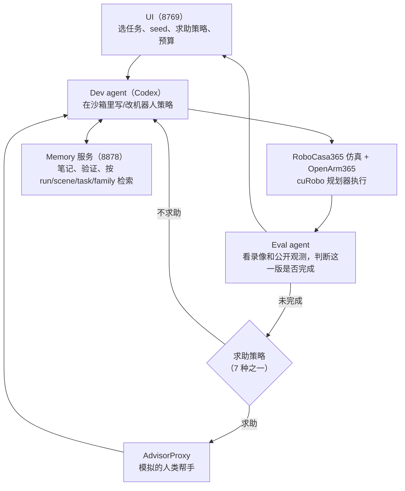

# TidyBot AttentionBench 项目指南

研究问题是：**机器人什么时候值得请求帮助，以及怎样把有效帮助变成可复用经验，在成功率与注意力成本之间取得更好的平衡。**

**当前状态（2026-10-31）：** 系统以 RoboCasa365 厨房任务 + OpenArm365 双臂移动机器人为主线，在开发档（dev tier，非正式）上运行。agent 模式已有真实运行做到原生成功；七种求助方法的完整效果比较、held-out 和正式实验**尚未执行**，目前没有任何论文级效果结论。

## 从哪里看

- **代码**：本分支 [`attentionbench/baseline-20261015`](https://github.com/TidyBot-Services/Tidybot-Universe/tree/attentionbench/baseline-20261015)。仓库默认分支（master）**不包含**本研究版本。
- **进度**：[模块进度](attentionbench_progress.md)（按时间倒序）与仓库根目录的 [STATUS.md](../STATUS.md)。
- **方法规格**：[七策略规格](attentionbench_seven_policy_experiment_spec.md)、[Memory 生命周期](attentionbench_memory_lifecycle.md)、[求助机制](attentionbench_request_mechanism.md)、[seed 可复现性](attentionbench_seed_reproducibility.md)。
- **Service 边界**：[Service 仓库边界](service_repository_boundaries.md)。

## 系统怎样工作（agent 模式）

- **仿真**：RoboCasa365（官方 robosuite `5ce6643` + robocasa `456174f`），模拟器负责物理和原生成功判断。
- **规划器**：NVIDIA cuRobo 官方 `78fd485`，经部署锁固定；开发档用 dev-local 快照，结果自动标为 non-formal。
- **模型**：Dev、Eval、AdvisorProxy 默认都走 Codex CLI（`gpt-6.1-sol`）。AdvisorProxy 是模拟的人，不是真人实验。
- **Memory**：帮助经过来源证据、配对验证后才能成为可复用笔记；分 run ⊂ scene ⊂ task ⊂ family 四层检索。

## 项目要求与目前进度

1. **任务与场景：已具备。** RoboCasa365 中选定 14 个任务 / 4 个家族；主开发任务 `pick_place_counter_to_sink`，seed 101–103 有可复现的场景契约（scene contract v2）。
2. **执行与预算规则：已接通。** 时间、版本数、求助次数、模型额度都有上限；运行可暂停/继续，可从任一版本 fork。
3. **agent 模式：已接通，有真实成功样本。** Dev 在 bwrap 沙箱里读写文件、调用只读探针；10-30 一次真实运行原生成功（0 次求助）。
4. **七种求助方法：已接入，比较尚未做。** 从不求助、先看演示、失败求助、重试后求助、随机求助、看 Trace 求提示、结合 Trace 与 Memory。
5. **Memory：链路已接通，效果待实验。** 自动验证、跨 seed、跨任务家族的检索都已实现；"长期减少求助"尚无实验结论。
6. **可视化与控制：已接通。** UI 有运行列表、录像回放、Eval/Advisor 记录、Memory 页面。
7. **回答"求助是否值得"：未完成。** 没有完整七方法、held-out 或消融结果。

## 仓库与版本

每项 Service 一个独立仓库。下表是研究分支，不是默认分支。

| 仓库 | 内容 | 研究分支 |
| --- | --- | --- |
| [Tidybot-Universe](https://github.com/TidyBot-Services/Tidybot-Universe/tree/attentionbench/baseline-20261015) | Harness、agent 模式、UI、规划器客户端、协议与测试 | `attentionbench/baseline-20261015` |
| [attention_memory_service](https://github.com/TidyBot-Services/attention_memory_service/tree/attentionbench/baseline-20261015) | Memory 服务：笔记、验证、授权、生命周期 | `attentionbench/baseline-20261015` |
| [robosuite_sim](https://github.com/TidyBot-Services/robosuite_sim/tree/feature/attentionbench-week2-depth-diagnostics) | 旧 Robosuite 路线的服务包；当前仅作为导入依赖 | `feature/attentionbench-week2-depth-diagnostics` |
| [maniskill_sim](https://github.com/TidyBot-Services/maniskill_sim/tree/feature/attentionbench-week2-sync-20260927) | 旧 RoboCasa/ManiSkill 路线（历史） | `feature/attentionbench-week2-sync-20260927` |
| `robocasa365_sim` | RoboCasa365 仿真服务包 | **尚未上 GitHub**（进行中） |

10-01 之前的旧路线（Robosuite `cube_lift`、ManiSkill RoboCasa `counter_to_sink`、`agent_server`、`maniskill-robocasa-tasks`）的版本记录见 [`attentionbench_github_delivery.json`](attentionbench_github_delivery.json)，那是 10-01 的快照，不代表当前版本。

## Run it yourself

**目前还不能在作者以外的机器上完整运行。** 正在做的事（方案见作者工作区 `PLAN-collaborator-reproducible-20261031`）：

1. 代码里的本机绝对路径改为由 `ATTENTIONBENCH_WORKSPACE` 和 `paths.json` 配置；
2. `robocasa365_sim`、任务配置、OpenArm 网格进 GitHub；
3. 一键安装 `bootstrap.sh`、自检 `doctor.sh`、启动 `start.sh`；
4. 规划器部署在协作者机器上本机构建、本机登记，只用于开发档。

完成后需要：Linux、NVIDIA GPU、约 50G 磁盘、能使用 `gpt-6.1-sol` 的 Codex CLI 账号。

现在能做的：克隆代码阅读；按 `benchmarks/attention_harness/setup_env.sh` 安装 UI 依赖并跑不依赖仿真的测试（部分测试仍会因缺少本机文件而失败）。

## 结果边界

- 所有结果都是**开发档、非正式**：dev-local 规划器、模拟的 AdvisorProxy、单一作者机器。
- 原生成功只说明链路能走通到成功，不说明某种求助方法更好。
- 真人、LIBERO、真实机器人属于后续独立扩展。
